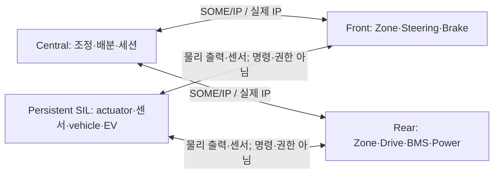

# StrataDrive

**StrataDrive — Compute-Aware Autonomous Driving System with Zonal E/E Architecture**

## Current Status

**M6 Host quiet SIL/Python MIL 범위 종료** — [종료 검토](docs/m6_exit_review.md).
Central·Front·Rear 3개 프로세스의 SOME/IP Host FIFO 경로에 실제8-role 세션·보호·재가입,
actual 기반 차량/EV 에너지와 유한 물리 응답을 연결했다. M4 전체 종료, SDK sanitizer 전체
기능 완료, Jetson·전체 시스템 검증을 뜻하지 않는다.

**M7 정상 기능 통합 검증 진행, 전체 NOT CLOSED** — [통합 종료 검토](docs/m7_exit_review.md).
native Actual→CARLA→관측 solver work→단일 EV 경로에서 가속·회생·마찰 제동·휠 정지·재출발을 검증했다.
영상/고장/lifecycle 실행 결과와 실패는 [통합 근거](docs/test-plan/evidence/m7_carla_integrated/README.md)에 모았다.
[종료 교착 수정](docs/test-plan/evidence/m7_carla_recovery/README.md)과
[요청 순서를 보완한 보호 Actual 검증](docs/test-plan/evidence/m7_carla_recovery/causal-followup/README.md)을 추가했다.
[독립 wall 감시→local 보호 선택→다음 tick 차단](docs/test-plan/evidence/m7_carla_wall_guard/README.md)을 추가 검증했다.
연속 실시간2ms/4ms 실행과 wall fault 이후 실제 보호 제동 수용은 남아 있다.
CARLA 입력 대기 중에도 원래8-role service·보호 CAN Actual을 계속하는 terminal wall 경로를 검증했다.
보호 hold의 자연 완전 정지와 client-loss 종료 교착도 [일괄 재현·수정](docs/test-plan/evidence/m7_carla_recovery/batch-closeout/README.md)했다.
[solver 증거 전달 경로](docs/test-plan/evidence/m7_carla_wall_guard/pipeline/README.md)를 최적화하고 물리·에너지 동등성을 확인했다.
정상 wall 실행과 CARLA에 다시 적용할 clock agreement는 남아 있다.
새 wall-domain INIT·수신/owner 분리·입력 단절 중 보호 Actual 지속을
[native runtime component](docs/test-plan/evidence/m7_carla_wall_guard/wall-owner/README.md)로 검증했다.
이 모드의 실제 CARLA clock/work 연결과 보호 제동 적용은 아직 남아 있다.
현재 계약은 [Plant Adapter ICD](docs/icd/carla_plant_adapter.md), 과거 단계별 결과는 상태 문서를 따른다.

[현재 상태·OPEN·다음 작업](docs/project_status.md) · [단계/TBD](docs/roadmap.md) · [학습 안내](docs/learning/README.md)

## Project Overview

StrataDrive는 CARLA 기반 closed-loop software-in-the-loop (SIL) 환경에서
Central Vehicle Compute → Zone Controller → Leaf ECU 차량 software architecture를
학습하고 검증하기 위한 프로젝트다. 차량 제어, 분산 통신, vECU, timing, diagnostics,
Physical AI를 서로 다른 compute budget에 맞춘 배포와 함께 다룰 계획이다.

학습 방향은 **제한된 ODD에서 운전자 개입에 의존하지 않는 자동 주행 SIL**이다.
정상 주행과 선택한 고장 사례의 검출·보호 동작을 검증하며, 운전자 인계를 위험 감소의
근거로 가정하지 않는다. 이 방향 선택이 Level 4 달성이나 안전 정지 검증을 뜻하지는 않는다.
구체적인 가정과 첫 조향 사례는 [기능 안전 학습 초안](docs/safety/concept_study.md)에 정리한다.

현업의 기술과 개발 산출물을 단계적으로 학습한다. AUTOSAR Classic / Methodology의
설계·설정·생성·통합, ISO 26262의 기능 안전 활동, Automotive SPICE의 추적성과 변경
관리를 참고하며 AI 단계에서는 ISO 21448 / SOTIF 관점을 연결한다. 구체적인 범위와
첫 학습 순서는 [개발·학습 계획](docs/engineering_plan.md)에 정리한다.
Leaf vECU의 ECU 소프트웨어는 [Classic 개발 체계](docs/adr/ADR-0022-leaf-classic-development-methodology.md)로
Steering부터 설계하고 SIL 물리 모델의 책임을 구분한다. 실제 OS/RTE/BSW stack의 채택은 pilot에서 검토한다.

[MBD 개발 계획](docs/engineering_plan.md#model-based-design-path)도 포함한다. M6에서 종방향 제어 모델/MIL,
M8에서 C++ 구현과 동등성·차량 SIL을 검증할 계획이며 모델 도구·자동 코드 생성은 별도 결정이다.

## Motivation

Simulator 주행 데모나 inference benchmark를 넘어, 각 compute tier에서 차량의
전체 feature 구성이 명시된 요구사항을 만족하는지 살펴본다. 빠른 코드 생성보다
architecture를 이해하고 각 구현을 직접 설명할 수 있는 것을 우선한다.

## Key Engineering Questions

- Vehicle command, Central allocation, Zone 전달, actuator response를 어떻게 분리할 것인가?
- Stale message, ECU 통신 상실, actuator fault는 closed-loop 동작에 어떤 영향을 주는가?
- 평균 AI latency 외에 어떤 timing tail과 deadline miss를 살펴봐야 하는가?
- Learned Planner는 제한이 정의된 Classical Controller 경로를 어떻게 보조할 수 있는가?
- 각 보드의 resource budget 안에서 어떤 feature가 동일한 요구사항을 만족하는가?

## System Architecture

현재 Host functional SIL의 실제 실행 경계는 다음과 같다.



실제8참여자 INIT/Release ACK/RunLease/arm, 원천 source/expiry·CAN/P05와 독립 보호를 유지한다.
C++ vehicle demand는 시나리오 fixture이며 Python 종방향 MIL은 별도 모델이다.
구체 배치/CPU·스레드·Host/Target 차이는 [배포 문서](docs/architecture/deployment_architecture.md),
소프트웨어 책임은 [software architecture](docs/architecture/software_architecture.md)에 있다.

Host PC + Jetson 한 대(Thor **또는** Orin)에 여러 vECU를 두는 Target은 계획이다.
M7 CARLA에서는 Plant Adapter만 ego actuation의 단일 writer이며 실제 actuator feedback만 사용한다.
raw command fallback/중복 dynamics는 금지한다. [전체 설계](docs/architecture/system_architecture.md)를 따른다.

## Reference Baseline v0.1

| 항목 | M0 정의 |
| --- | --- |
| ODD | 맑은 낮, 포장도로, 단일 ego, 신호등 없는 직선/완만한 곡선, 0–40 km/h; 복잡한 교차로/traffic interaction 제외 |
| 정상 scenario | S01 직선 30 km/h, S02 곡선 30 km/h, S03 직선→곡선→직선 및 30→20 km/h request |
| 주행 acceptance | steady speed max absolute error <=1 km/h; lateral absolute P95 <=0.3 m; heading absolute P95 <=3 deg; positive validated target 대비 overspeed <=10% |
| 통신 | critical command/actual loss는 마지막 valid RX부터 <=100 ms에 검출; invalid/stale command는 valid age 갱신 금지 |
| Logical rates | CARLA world/state 100 Hz, RGB/GT·Planner 20 Hz, Controller 50 Hz, Zone·Steering/Brake/Drive vECU 100 Hz |
| State | INIT → NORMAL → DEGRADED → FAIL_SAFE; critical loss는 FAIL_SAFE 직행, recovery는 explicit INIT 재검증 |

수치와 평가 window는 [scenario baseline](docs/test-plan/scenario_baseline.md), 시간 정의는
[timing contract](docs/requirements/timing_requirements.md)에 있다. M3/M6/M7/M8 측정·tuning으로
변경할 때 requirement revision/rationale과 profile/test를 함께 갱신한다.

## Compute Tier Strategy

먼저 동일한 scenario, 요구사항, model/input 설정, 측정 protocol을 사용하는
**Reference Config**를 두 보드에 각각 독립 실행한다. 이후 **AGX Thor: Premium Compute
Profile**과 **Orin NX: Mainstream Compute Profile**을 탐색한다. AI latency,
camera-to-trajectory latency, FPS, CPU/GPU utilization, RAM, power, temperature,
control jitter, deadline miss를 비교할 계획이며 현재 주장하는 성능 수치는 없다.

최적화 후보는 FP16 → INT8, Medium → Small model, 1080p → 720p, 30 → 20 FPS,
optional segmentation 비활성화, temporal hidden size 축소, feature gating이다.
Quantization과 feature 제거 후에는 정확도와 차량 동작을 다시 검증해야 한다.
상세 설정은 TBD이며 [profile 설명](profiles/README.md)에 정리한다.

## Scope / Non-Scope

기술 학습과 계약 검증을 위한 Host functional SIL/MIL 프로젝트다.
현재 완료 범위는 위 상태/종료 검토를 따르며 CARLA·상위 주행 제어·AI·Target은 후속이다.
Linux vECU/SIL 모델은 MCU·물리 차량의 근사이며 production/도로 운행 준비,
HIL·functional safety 인증·ISO26262 준수나 CARLA와 상용 검증 도구의 동등성을 주장하지 않는다.

[AUTOSAR 개발 경로](docs/engineering_plan.md#autosar-adoption-path)와
[Item Definition/HARA 학습 초안](docs/safety/concept_study.md)은 별도 범위다.
실제 Classic RTE/BSW stack·ASIL/safety concept·학습자 개인 수용은 미확정이며
component 시험 PASS를 전체 stack/안전 인증으로 확대하지 않는다.

## Tech Stack and Planned Target

| 영역 | 적용한 Host 선택 / 후속 범위 |
| --- | --- |
| Host simulation | x86 Ubuntu, CARLA 0.9.16 계열 초기 후보; 정확한 호환 버전 TBD-07 (M7) |
| Core software | Host core C++17·SOME/IP adapter C++20 / GCC11.4 / CMake; Target·CI는 TBD-11/09 |
| Orchestration / analysis | Python 표준 라이브러리·unittest, 고정 SIL runner/독립 MIL; 도구/실행 버전은 evidence |
| Communication | Host: SOME/IP(vSomeIP3.7.6), owner-wire v1·CAN/P05; DDS는 CLOSED 대안/과거 근거 보존. Target 채택·clock은 후속 |
| Isolation | Host: Linux netns/veth의 실제 IP 경계. Target 격리·권한은 별도 검증 |
| Target | Jetson AGX Thor 또는 Jetson Orin NX 한 대; 보드별 platform stack TBD-09 (M5) |
| Physical AI | Pretrained perception, TensorRT export/inference; 이후 GRU 또는 작은 Temporal Transformer |
| Quality | 첫 field codec에 GoogleTest 1.11.0, clang-tidy, cppcheck, ASan/UBSan 실행; 차량 regression은 Planned |
| E2E protection | Actuator와 EV/BMS frame에 R25-11 Profile 5 Protect/Check·receiver 구현; E2E State Machine·차량 통합은 후속 |
| AUTOSAR pilot | Steering vECU의 Classic OS/RTE/BSW toolchain 타당성 검토; release/구현체/Target 지원 미선정, NOT RUN |

## Quick Start

아래는 core/CAN demo 진입점이다. 실제3-vECU 실행/SDK 빌드는
[Rear adapter 재현](docs/test-plan/evidence/m5_someip_rear_adapter/README.md),
M6 quiet 모델·물리 응답은 [최종 재현](docs/test-plan/evidence/m6_physical_response/README.md#실행계측-경계와-재현)을 따른다.
별도 SDK/Host userns·실제 RT 권한 조건을 core build 성공으로 대체하지 않는다.


Steering/Brake/Drive/BMS 예제와 시험을 build하고 실행한다. 현재 Host에 설치된 도구를 사용하며 자동 설치하지 않는다.

```sh
cmake -S . -B build/m1-angle -DCMAKE_BUILD_TYPE=Debug
cmake --build build/m1-angle --parallel 2
ctest --test-dir build/m1-angle --output-on-failure
./build/m1-angle/actuator_demo ev-power normal
./build/m1-angle/actuator_demo steering-model jam
./build/m1-angle/actuator_demo --help
```

예제는 수동 시계로 전원 준비→구동·회생→종료와 조향 jam 검출을 재현한다.
예상 결과는 [EV 회로 안내](docs/learning/m2_ev_power_circuit.md)와
[조향 고장 검출 안내](docs/learning/m2_steering_fault_monitor.md)에 있다.
Codec·수신부 등 나머지 예제는 `--help`와 [학습 안내](docs/learning/README.md)에서 확인한다.
실제 wall-time 실행과 CSV 결과는 [M3 조향 안내](docs/learning/m3_steering_timing.md)와
[다중 주기·CAN 감시 안내](docs/learning/m3_multirate_runtime.md)에 있다.
[고정 부하·CPU 배치 안내](docs/learning/m3_cpu_placement.md)는 같은 CPU/다른 CPU 부하의 결과와 실패 run을 비교한다.
[Drive Actual 안내](docs/learning/m3_drive_feedback.md)는 토크 취득 시각을 보존한 실제 CAN 송수신과 replay 검출을 설명한다.
`-DBUILD_TESTING=OFF`로 configure하면 라이브러리와 예제만 build하며
단위 시험과 통합 시험의 TX/RX 실행 파일은 제외한다.

M1의 첫 개발 환경 확인은 Linux terminal에서 다음과 같이 실행한다.

```sh
unshare --user --map-root-user --net python3 tools/vcan_smoke.py
```

예상 출력과 확인 범위는 [M1 실행 안내](docs/learning/m1_vcan_start.md)에 기록한다.

Steering/Brake/Drive Command/Actual과 EV 6개 frame을 독립 송신·수신 process로 연결하고 오류/중단/flood를 검사한다.
위 C++ build 후 다음 명령을 실행한다. 자세한 흐름과 결과는
[Steering SocketCAN 안내](docs/learning/m1_steering_socketcan.md)와
[BMS SocketCAN 안내](docs/learning/m1_bms_codec.md#ev-socketcan-연결과-wall-time-시험)에 있다.

```sh
unshare --user --map-root-user --net python3 tests/integration/can/check_socketcan.py
# EV 경로 49개(기존 EV 36 + queue 12 + restart 1)만 재현할 때
unshare --user --map-root-user --net python3 tests/integration/can/check_socketcan.py --family ev
```

## Development Principles

1. 코드보다 요구사항과 interface를 먼저 정의하고, 미결정 값은 TBD로 남긴다.
2. 모든 closed-loop 시험에서 Central Vehicle Compute → Zone Controller → vECU → Plant 경계를 유지한다.
3. AI 출력은 trajectory/target speed/risk로 제한하고, safety 검사와 Classical Controller,
   Classical Planner fallback을 거친다.
4. Clock 기준을 명시하고 execution, jitter, tail, deadline, fault response를 측정한다.
5. Requirement → Component → Interface → Test → Result의 추적성을 유지한다.
6. 작은 변경을 검토하고 직접 실행한 뒤, 내용을 설명할 수 있을 때 수용한다.

상세 내용은 [개발·학습 계획](docs/engineering_plan.md), [학습 원칙](docs/learning/README.md),
[품질 정책](docs/quality_policy.md),
[검증 전략](docs/test-plan/verification_strategy.md)을 참조한다.

## Milestone Roadmap

[로드맵](docs/roadmap.md)이 단계별 범위와 TBD의 기준이다. M6 Host quiet SIL/MIL은 종료했고,
M7의 현재 검증 범위·실패·종료 gate는 [통합 종료 검토](docs/m7_exit_review.md)에 모았다.
과거 M7-1a–1s evidence는 당시 결과를 보존하며 최신 수용으로 덮어쓰지 않는다.
M8에서 종방향 모델의 C++ 구현·동등성과
차량 closed-loop를 검증한다. M9 diagnostics, M10–M11 AI, M12 compute 비교, M13 전체 V&V는 후속이다.
Local fault 보호는 이미 각 component/runtime에 존재하며 M9까지 미루지 않는다.

## Repository Structure

```text
StrataDrive/
├── README.md, .gitignore, .gitattributes, CMakeLists.txt
├── docs/
│   ├── requirements/      # System, timing, safety baseline
│   ├── architecture/      # System, software, 배포, fault 계약
│   ├── icd/               # SOME/IP/owner-wire/CAN·모델 계약; DDS 이력
│   ├── adr/               # 설계 결정 기록
│   ├── test-plan/         # 검증 전략, scenario baseline, 추적성
│   ├── learning/          # 학습자 중심 절차
│   ├── safety/            # Item Definition / HARA 학습 초안; 평가·승인 전
│   ├── engineering_plan.md # 표준 참고 범위와 단계별 적용·학습 계획
│   ├── project_status.md  # 현재 구현 범위·시험 결과·다음 작업
│   ├── m0_baseline.md     # Exit checklist와 문서 검토 증거
│   ├── m6_exit_review.md # Host quiet SIL/MIL 종료·TBD 분할·M7 선행 조건
│   ├── m2_acceptance_review.md # M2 수용 검토와 미완료 항목
│   ├── roadmap.md
│   └── quality_policy.md
├── interfaces/
│   ├── common/            # E2E Profile 5, 공통 payload 직렬화·수신 상태
│   ├── central/           # VehicleRequest, 배분 명령과 Front/Rear sideband 계약
│   ├── steering/          # 조향 angle/frame codec, receiver, local sensor port
│   ├── brake/             # 압력/frame codec, receiver, sensor/actuation port
│   ├── drive/             # 구동·회생 torque/frame codec, feedback receiver
│   ├── bms/               # EV 물리값·6개 frame codec, 항목별 수신부
│   ├── socketcan/         # Linux CAN socket·adapter, Zone deadline 송신 port
│   ├── dbc/               # Actuator 6개 + EV/BMS 6개 frame 초안
│   └── dds/               # 배치용 placeholder
├── central/               # 조정·배분·세션·피드백; ADAS/control은 후속
├── zone/                  # Front/Rear 명령 수용·CAN gateway·local safety component
├── vecu/                  # Steering/Brake/Drive/BMS/Power 판단·보호; 물리 실행과 분리
├── simulation/            # 실제 actuator·vehicle/EV·SIL runtime; CARLA 후속
├── physical_ai/           # Perception, learned planner, export, inference
├── profiles/              # Reference / Thor Premium / Orin Mainstream 설계 data
├── tests/
│   ├── unit/              # 모듈별 C++ test; 기능 확장은 기존 파일의 case로 추가
│   ├── integration/someip/ # 3-vECU 실행·IP/세션·갱신·보호 판정
│   ├── integration/can/  # SocketCAN TX/RX fixture와 Python 검사기
│   ├── integration/runtime/ # 주기·deadline·CAN 상실 검사와 CSV 리포터
│   └── sil/, fault/, performance/ # 후속 시험 배치
├── benchmark/             # Timing, compute, 검토된 결과
├── deploy/                # Docker, systemd, scripts — 배치용 placeholder
├── models/README.md       # 대용량 artifact 정책과 작은 sample 예외
└── tools/                 # actuator_demo 진입점, demo/ 도메인별 예제, DBC/vCAN 도구
```

[시스템 요구사항](docs/requirements/system_requirements.md)과
[M0 baseline summary](docs/m0_baseline.md)를 먼저 읽고,
[후속 단계의 TBD](docs/roadmap.md#open-m0-decisions)에서 owner/결정 milestone을 확인하면 된다.
