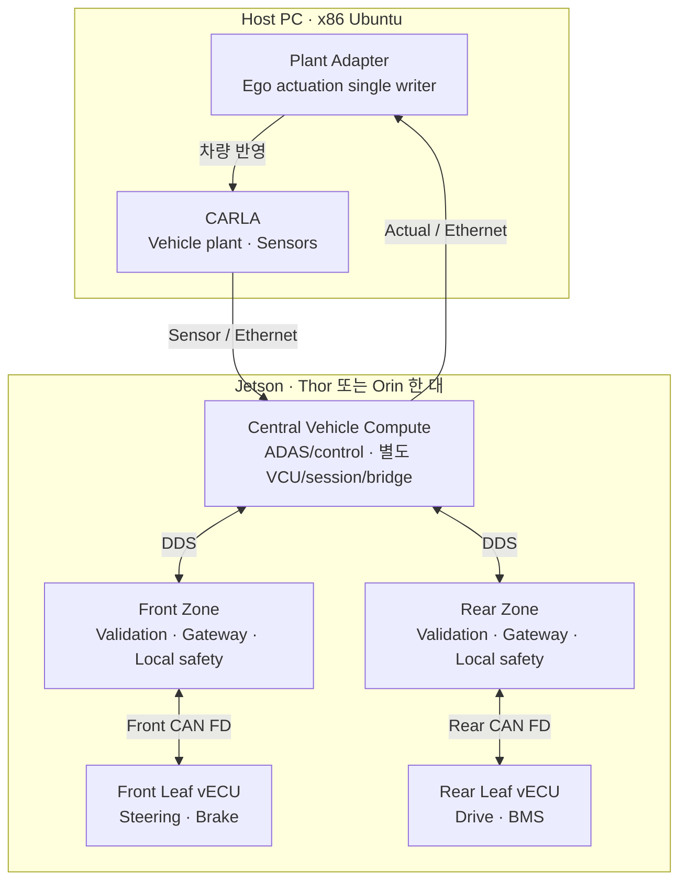

# StrataDrive

**StrataDrive — Compute-Aware Autonomous Driving System with Zonal E/E Architecture**

## Current Status

**M2 진행 중** — Host SIL에서 actuator·EV 모델과 조향 고장 검출을 구현·검증하고 있다.
다음 작업은 **Brake stuck/slow-response detector**이며, M2 수용 검토와 직접 재현도 진행한다.
Central/Zone DDS·차량 closed-loop 통합은 후속 단계다.

[상세 진행 현황·시험 결과](docs/project_status.md) · [전체 로드맵](docs/roadmap.md) · [학습 안내](docs/learning/README.md)

## Project Overview

StrataDrive는 CARLA 기반 closed-loop software-in-the-loop (SIL) 환경에서
Central Vehicle Compute → Zone Controller → Leaf ECU 차량 software architecture를
학습하고 검증하기 위한 프로젝트다. 차량 제어, 분산 통신, vECU, timing, diagnostics,
Physical AI를 서로 다른 compute budget에 맞춘 배포와 함께 다룰 계획이다.

학습 방향은 **제한된 ODD에서 운전자 개입에 의존하지 않는 자동 주행 SIL**이다.
정상 주행과 선택한 고장 사례의 검출·보호 동작을 검증하며, 운전자 인계를 위험 감소의
근거로 가정하지 않는다. 이 방향 선택이 Level 4 달성이나 안전 정지 검증을 뜻하지는 않는다.
구체적인 가정과 첫 조향 사례는 [기능 안전 학습 초안](docs/safety/concept_study.md)에 정리한다.

현업의 기술과 개발 산출물을 단계적으로 학습한다. AUTOSAR Classic / Methodology의
설계·설정·생성·통합, ISO 26262의 기능 안전 활동, Automotive SPICE의 추적성과 변경
관리를 참고하며 AI 단계에서는 ISO 21448 / SOTIF 관점을 연결한다. 구체적인 범위와
첫 학습 순서는 [개발·학습 계획](docs/engineering_plan.md)에 정리한다.
Leaf vECU의 ECU 소프트웨어는 [Classic 개발 체계](docs/adr/ADR-0022-leaf-classic-development-methodology.md)로
Steering부터 설계하고 SIL 물리 모델의 책임을 구분한다. 실제 OS/RTE/BSW stack의 채택은 pilot에서 검토한다.

## Motivation

Simulator 주행 데모나 inference benchmark를 넘어, 각 compute tier에서 차량의
전체 feature 구성이 명시된 요구사항을 만족하는지 살펴본다. 빠른 코드 생성보다
architecture를 이해하고 각 구현을 직접 설명할 수 있는 것을 우선한다.

## Key Engineering Questions

- Vehicle command, Central allocation, Zone 전달, actuator response를 어떻게 분리할 것인가?
- Stale message, ECU 통신 상실, actuator fault는 closed-loop 동작에 어떤 영향을 주는가?
- 평균 AI latency 외에 어떤 timing tail과 deadline miss를 살펴봐야 하는가?
- Learned Planner는 제한이 정의된 Classical Controller 경로를 어떻게 보조할 수 있는가?
- 각 보드의 resource budget 안에서 어떤 feature가 동일한 요구사항을 만족하는가?

## System Architecture

아래 그림은 **Planned topology**이며 아직 구현된 배포 구성이 아니다.
Host와 Jetson의 배치, 주요 책임, 통신 경계를 묶어 표시했다.
양방향 선은 센서·command·status·actual이 오가는 통신 연결이다.



[Zone 분할 설계](docs/architecture/zonal_partition.md)는 후륜 구동 Reference packaging을
가정한다. Front의 Brake 값은 차량 전체 마찰제동 aggregate이며 전륜만 뜻하지 않는다.
Central의 차량 전체 배분기는 하나다. 두 Zone은 scoped demand를 검증·전달하고 차량 전체
요구를 다시 배분하지 않는다. BMS 상태·한계도 Rear→Central 경로로 보고한다.

| 경로 | 연결 / 역할 |
| --- | --- |
| 시나리오·고장 주입 | Host orchestrator → 시나리오/Zone/Leaf fault; Host가 tick 소유 |
| 상태 피드백 | 각 Leaf → 담당 Zone → Central 집계/bridge → Host |
| 기록·평가 | 원천 actual/health/fault와 Plant Adapter 결과 → Host logging / PASS·FAIL |

Thor와 Orin은 **서로 독립적인 대체 Target**이다. Central/Front/Rear를 같은 Linux Target의
논리 Ethernet node로 분리할 계획이며 별도 보드는 필요하지 않다. Host–Target은 실제 Ethernet,
Target 내부는 DDS와 Zone별 SocketCAN/vCAN을 사용한다. 이는 물리적 fault isolation이나
CAN FD의 전기적 동작·arbitration·bus timing을 검증하는 구성은 아니다.

**Vehicle-level command != actuator command != actual actuator feedback**이다.
Central Controller는 차량 수준 요구를 생성하고 별도 Central allocation이 Steering/Drive/Brake
demand를 배분한다. Front/Rear gateway가 담당 Leaf로 전달한다.
vECU는 task/delay/saturation/dynamics/fault를 거친 actual을 생성한다. Bridge는 원천
identity/validity/time과 상위 요구의 유효 기간을 보존하며 중계로 freshness를 연장하지 않는다.

필수 loop는 CARLA Sensor → Central Controller → Central allocation → 담당 Zone/CAN → Leaf response
→ 담당 Zone → Central feedback bridge → Host Plant Adapter → CARLA motion이다.
**Plant Adapter만 ego actuation single writer**이며 Host orchestrator가 tick을 소유한다.
Actual이 invalid/stale/missing이면 다음 apply/tick을 보류한다. 이는 simulation containment이며
물리적 안전 정지의 검증은 아니다. Raw command fallback이나 direct CARLA actuation은 금지한다.

상세 계약은 [system architecture](docs/architecture/system_architecture.md),
[software 책임](docs/architecture/software_architecture.md),
[배포 설계](docs/architecture/deployment_architecture.md)에 있다.

## Reference Baseline v0.1

| 항목 | M0 정의 |
| --- | --- |
| ODD | 맑은 낮, 포장도로, 단일 ego, 신호등 없는 직선/완만한 곡선, 0–40 km/h; 복잡한 교차로/traffic interaction 제외 |
| 정상 scenario | S01 직선 30 km/h, S02 곡선 30 km/h, S03 직선→곡선→직선 및 30→20 km/h request |
| 주행 acceptance | steady speed max absolute error <=1 km/h; lateral absolute P95 <=0.3 m; heading absolute P95 <=3 deg; positive validated target 대비 overspeed <=10% |
| 통신 | critical command/actual loss는 마지막 valid RX부터 <=100 ms에 검출; invalid/stale command는 valid age 갱신 금지 |
| Logical rates | simulation/sensor·Planner 20 Hz, Controller 50 Hz, Zone·Steering/Brake/Drive vECU 100 Hz |
| State | INIT → NORMAL → DEGRADED → FAIL_SAFE; critical loss는 FAIL_SAFE 직행, recovery는 explicit INIT 재검증 |

수치와 평가 window는 [scenario baseline](docs/test-plan/scenario_baseline.md), 시간 정의는
[timing contract](docs/requirements/timing_requirements.md)에 있다. M3/M6/M7/M8 측정·tuning으로
변경할 때 requirement revision/rationale과 profile/test를 함께 갱신한다.

## Compute Tier Strategy

먼저 동일한 scenario, 요구사항, model/input 설정, 측정 protocol을 사용하는
**Reference Config**를 두 보드에 각각 독립 실행한다. 이후 **AGX Thor: Premium Compute
Profile**과 **Orin NX: Mainstream Compute Profile**을 탐색한다. AI latency,
camera-to-trajectory latency, FPS, CPU/GPU utilization, RAM, power, temperature,
control jitter, deadline miss를 비교할 계획이며 현재 주장하는 성능 수치는 없다.

최적화 후보는 FP16 → INT8, Medium → Small model, 1080p → 720p, 30 → 20 FPS,
optional segmentation 비활성화, temporal hidden size 축소, feature gating이다.
Quantization과 feature 제거 후에는 정확도와 차량 동작을 다시 검증해야 한다.
상세 설정은 TBD이며 [profile 설명](profiles/README.md)에 정리한다.

## Scope / Non-Scope

M0에서는 요구사항, architecture, semantic ICD baseline, ADR, 검증 계획, 학습 절차를 다룬다.
이후 milestone에서는 AI보다 classical driving을 먼저 구현하고, actuator model,
fault, 공정한 compute 비교를 다룰 계획이다.

M0에서는 CARLA 설치, model 다운로드, production software 구현, 차량 시험을
수행하지 않는다. QNX, AUTOSAR, hardware-in-the-loop (HIL)의 적용이나 functional safety
인증, ISO 26262 준수를 주장하지 않는다. Linux vECU model은 MCU/RTOS 학습을 위한
근사 모델이다. CARLA가 CarMaker, CANoe, dSPACE와 동등하다고 주장하지 않으며,
이 프로젝트가 실제 도로 운행 준비를 입증하는 것은 아니다.

후속 학습에는 Steering vECU의 실제 AUTOSAR OS/RTE/BSW 적용 가능성 검토와
[Item Definition / HARA 초안 검토](docs/safety/concept_study.md)를 포함한다.
AUTOSAR stack/toolchain은 미선정이며 ASIL과 safety concept은 미확정이다.
기존 M0 baseline과 milestone은 유지하고 기술 채택은 근거를 검토한 뒤 결정한다.

## Planned Tech Stack

| 영역 | 계획된 선택 / 미결정 사항 |
| --- | --- |
| Host simulation | x86 Ubuntu, CARLA 0.9.16 계열 초기 후보; 정확한 호환 버전 TBD-07 (M7) |
| Core software | 첫 Host field codec은 C++17 / GCC 11.4.0 / CMake 4.3.2; Target·CI 선택은 TBD-11/09 |
| Orchestration / analysis | Python, pytest; 버전 TBD-11 (M1) |
| Communication | Virtual Ethernet 기반 DDS 기본 계획; Zenoh 후보 비교, 구현체/direct API vs ROS 2 TBD-05 (M4 비교·M5 결정); SocketCAN/vCAN |
| Isolation | Docker network 또는 Linux network namespace + veth; 선택 TBD-05 (M4/M5) |
| Target | Jetson AGX Thor 또는 Jetson Orin NX 한 대; 보드별 platform stack TBD-09 (M5) |
| Physical AI | Pretrained perception, TensorRT export/inference; 이후 GRU 또는 작은 Temporal Transformer |
| Quality | 첫 field codec에 GoogleTest 1.11.0, clang-tidy, cppcheck, ASan/UBSan 실행; 차량 regression은 Planned |
| E2E protection | Actuator와 EV/BMS frame에 R25-11 Profile 5 Protect/Check·receiver 구현; E2E State Machine·차량 통합은 후속 |
| AUTOSAR pilot | Steering vECU의 Classic OS/RTE/BSW toolchain 타당성 검토; release/구현체/Target 지원 미선정, NOT RUN |

## Quick Start

Steering/Brake/Drive/BMS 예제와 시험을 build하고 실행한다. 현재 Host에 설치된 도구를 사용하며 자동 설치하지 않는다.

```sh
cmake -S . -B build/m1-angle -DCMAKE_BUILD_TYPE=Debug
cmake --build build/m1-angle --parallel 2
ctest --test-dir build/m1-angle --output-on-failure
./build/m1-angle/actuator_demo ev-power normal
./build/m1-angle/actuator_demo steering-model jam
./build/m1-angle/actuator_demo --help
```

예제는 수동 시계로 전원 준비→구동·회생→종료와 조향 jam 검출을 재현한다.
예상 결과는 [EV 회로 안내](docs/learning/m2_ev_power_circuit.md)와
[조향 고장 검출 안내](docs/learning/m2_steering_fault_monitor.md)에 있다.
Codec·수신부 등 나머지 예제는 `--help`와 [학습 안내](docs/learning/README.md)에서 확인한다.
`-DBUILD_TESTING=OFF`로 configure하면 라이브러리와 예제만 build하며
단위 시험과 통합 시험의 TX/RX 실행 파일은 제외한다.

M1의 첫 개발 환경 확인은 Linux terminal에서 다음과 같이 실행한다.

```sh
unshare --user --map-root-user --net python3 tools/vcan_smoke.py
```

예상 출력과 확인 범위는 [M1 실행 안내](docs/learning/m1_vcan_start.md)에 기록한다.

Steering/Brake/Drive Command/Actual과 EV 6개 frame을 독립 송신·수신 process로 연결하고 오류/중단/flood를 검사한다.
위 C++ build 후 다음 명령을 실행한다. 자세한 흐름과 결과는
[Steering SocketCAN 안내](docs/learning/m1_steering_socketcan.md)와
[BMS SocketCAN 안내](docs/learning/m1_bms_codec.md#ev-socketcan-연결과-wall-time-시험)에 있다.

```sh
unshare --user --map-root-user --net python3 tests/integration/can/check_socketcan.py
# EV 경로 49개(기존 EV 36 + queue 12 + restart 1)만 재현할 때
unshare --user --map-root-user --net python3 tests/integration/can/check_socketcan.py --family ev
```

## Development Principles

1. 코드보다 요구사항과 interface를 먼저 정의하고, 미결정 값은 TBD로 남긴다.
2. 모든 closed-loop 시험에서 Central Vehicle Compute → Zone Controller → vECU → Plant 경계를 유지한다.
3. AI 출력은 trajectory/target speed/risk로 제한하고, safety 검사와 Classical Controller,
   Classical Planner fallback을 거친다.
4. Clock 기준을 명시하고 execution, jitter, tail, deadline, fault response를 측정한다.
5. Requirement → Component → Interface → Test → Result의 추적성을 유지한다.
6. 작은 변경을 검토하고 직접 실행한 뒤, 내용을 설명할 수 있을 때 수용한다.

상세 내용은 [개발·학습 계획](docs/engineering_plan.md), [학습 원칙](docs/learning/README.md),
[품질 정책](docs/quality_policy.md),
[검증 전략](docs/test-plan/verification_strategy.md)을 참조한다.

## Milestone Roadmap

| Milestone | 계획 범위 |
| --- | --- |
| M0 | Architecture / Requirement / ICD Baseline — BASELINED |
| M1 | DBC + vCAN — TECHNICAL CHECKS PASS / REVIEW PENDING |
| M2 | IN PROGRESS: component·Steering response monitor 시험; Brake response detector·학습자 review 남음 |
| M3 | Real-Time Timing & Scheduling Measurement |
| M4 | Central coordinator + 대등한 Front/Rear Zone |
| M5 | Central Compute + DDS |
| M6 | Simple Vehicle Plant |
| M7 | CARLA Integration |
| M8 | Classical Autonomous Driving |
| M9 | Fault / Diagnostics / DTC |
| M10 | Physical AI Perception |
| M11 | Learned Temporal Planner |
| M12 | Thor vs Orin Compute-Tier Optimization |
| M13 | Final SIL / V&V / Regression |

Acceptance 증거의 상세 후보는 [로드맵](docs/roadmap.md)에 정리한다.
Fault 계약은 M0부터 정의하며, local fault 동작은 관련 component와 함께 설계할 계획이다.
M9에서는 전체 시스템의 diagnostics와 DTC를 통합한다.

## Repository Structure

```text
StrataDrive/
├── README.md, .gitignore, .gitattributes, CMakeLists.txt
├── docs/
│   ├── requirements/      # System, timing, safety baseline
│   ├── architecture/      # System, software, 배포, fault 계약
│   ├── icd/               # DDS/CAN 계약; actuator wire와 EV/BMS 설계
│   ├── adr/               # 설계 결정 기록
│   ├── test-plan/         # 검증 전략, scenario baseline, 추적성
│   ├── learning/          # 학습자 중심 절차
│   ├── safety/            # Item Definition / HARA 학습 초안; 평가·승인 전
│   ├── engineering_plan.md # 표준 참고 범위와 단계별 적용·학습 계획
│   ├── project_status.md  # 현재 구현 범위·시험 결과·다음 작업
│   ├── m0_baseline.md     # Exit checklist와 문서 검토 증거
│   ├── m2_acceptance_review.md # M2 수용 검토와 미완료 항목
│   ├── roadmap.md
│   └── quality_policy.md
├── interfaces/
│   ├── common/            # E2E Profile 5, 공통 payload 직렬화·수신 상태
│   ├── steering/          # 조향 angle/frame codec, receiver, local sensor port
│   ├── brake/             # 압력/frame codec, application receiver
│   ├── drive/             # 구동·회생 torque/frame codec, feedback receiver
│   ├── bms/               # EV 물리값·6개 frame codec, 항목별 수신부
│   ├── socketcan/         # Linux CAN socket, actuator·EV 변환 adapter
│   ├── dbc/               # Actuator 6개 + EV/BMS 6개 frame 초안
│   └── dds/               # 배치용 placeholder
├── central/               # ADAS/control; session Epoch store; vehicle management/allocation/bridge 예정
├── zone/                  # Front/Rear gateway/validation/local safety 예정
├── vecu/                  # Steering/Brake/Drive/BMS의 판단·보호와 SIL adapter
├── simulation/            # Steering/Drive/Battery/Power 모델; vehicle/CARLA 통합 예정
├── physical_ai/           # Perception, learned planner, export, inference
├── profiles/              # Reference / Thor Premium / Orin Mainstream 설계 data
├── tests/
│   ├── unit/              # 모듈별 C++ test; 기능 확장은 기존 파일의 case로 추가
│   ├── integration/can/  # SocketCAN TX/RX fixture와 Python 검사기
│   └── sil/, fault/, performance/ # 후속 시험 배치
├── benchmark/             # Timing, compute, 검토된 결과
├── deploy/                # Docker, systemd, scripts — 배치용 placeholder
├── models/README.md       # 대용량 artifact 정책과 작은 sample 예외
└── tools/                 # actuator_demo 하나, DBC 검사, vCAN 환경 확인
```

[시스템 요구사항](docs/requirements/system_requirements.md)과
[M0 baseline summary](docs/m0_baseline.md)를 먼저 읽고,
[후속 단계의 TBD](docs/roadmap.md#open-m0-decisions)에서 owner/결정 milestone을 확인하면 된다.
