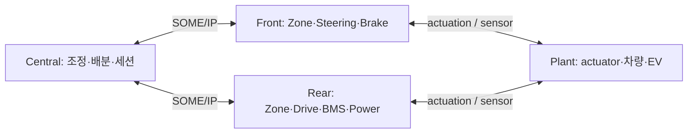

# StrataDrive

Central → Front/Rear Zone → Leaf ECU 구조의 차량 소프트웨어를 만들고 검증하는 SIL 프로젝트다.
Host에서 통신·세션·actuator/EV 모델을 연결했고, CARLA 통합을 진행하고 있다.

**현재: M6 Host quiet SIL/Python MIL 완료, M7 CARLA 통합 진행 중.**
고정 시나리오의 가속·회생·제동은 검증했지만 정상 실시간 주행은 아직 수용하지 못했다.
최신 판정과 다음 작업은 [프로젝트 상태](docs/project-status.md) 한곳에서 관리한다.

## 시작하기

| 하고 싶은 일 | 문서 |
| --- | --- |
| 전체 문서에서 길 찾기 | [문서 안내](docs/README.md) |
| 빌드하고 예제 실행하기 | 아래 명령과 [학습 안내](docs/learning/README.md) |
| CARLA 실행·화면·결과 확인하기 | [CARLA 실행 안내](docs/carla-guide.md) |
| 구조와 코드 책임 이해하기 | [아키텍처](docs/architecture/README.md) |
| 앞으로 할 일과 미결정 값 확인하기 | [로드맵·TBD](docs/roadmap.md) |

저장소 루트의 Linux 터미널에서 실행한다. C++17, CMake, GoogleTest와 compiler가 필요하다.
별도 SDK·CARLA 설치는 이 core 빌드에 포함되지 않는다.

```sh
cmake -S . -B build/m1-angle -DCMAKE_BUILD_TYPE=Debug
cmake --build build/m1-angle --parallel 2
ctest --test-dir build/m1-angle --output-on-failure
./build/m1-angle/actuator_demo ev-power normal
./build/m1-angle/actuator_demo steering-model jam
./build/m1-angle/actuator_demo --help
```

## 실행 구조



Central은 차량 전체 요구를 배분하고 Zone은 자신의 명령과 상태를 검증·전달한다.
Leaf는 판단·보호를, 외부 plant는 물리 응답을 맡는다. CARLA에서는 검증된 Actual만
단일 adapter를 통해 차량에 적용하고, 관측한 solver work를 단일 EV 모델에 정산한다.

Reference ODD는 맑은 낮·포장도로·단일 ego·직선/완만한 곡선·0–40km/h다.
실제 C++ 주행 제어기, AI, Jetson 배포와 전체 system 시험은 후속 범위다.
Thor와 Orin NX는 각각 독립적으로 비교할 배포 대안이다.

## 파일 배치

| 경로 | 내용 |
| --- | --- |
| `central/`, `zone/`, `vecu/` | 차량 조정·배분, Zone gateway, Leaf 판단·보호 |
| `interfaces/` | CAN/P05, 세션, 메시지·단위·유효성 계약 |
| `simulation/` | actuator·차량·전원·배터리 모델과 SIL runtime |
| `tests/`, `tools/` | 검증 runner, CARLA 확장, 예제와 분석 도구 |
| `models/`, `profiles/` | 독립 종방향 MIL 모델, Reference/보드별 설정 |
| `physical_ai/`, `deploy/`, `benchmark/` | AI·배포·compute 비교의 후속 작업 위치 |
| `docs/` | 현재 안내·계약, 검증 근거와 과거 기록 |

요구사항·수치 기준은 [시스템 요구사항](docs/requirements/system-requirements.md),
개발·검증·문서 관리 원칙은 [개발 정책](docs/development-guide.md)을 따른다.
