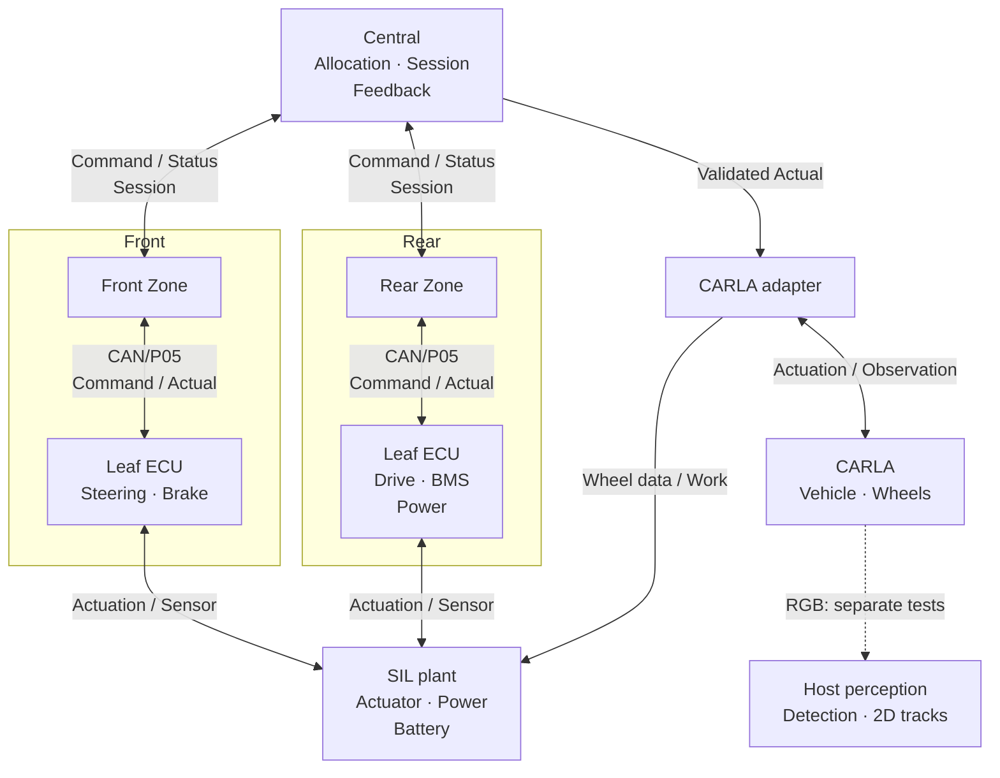

# StrataDrive

**Central–Zone–Leaf Vehicle Software Architecture & Software-in-the-Loop Validation**

C++ · Python · SOME/IP · SocketCAN/vCAN · CARLA · SIL

StrataDrive는 Central → Front/Rear Zone → Leaf ECU 구조의 차량 소프트웨어를 Host 환경에서
구현하고 검증하는 프로젝트다. 통신·세션, 액추에이터·EV 모델과 CARLA를 연결해 차량 제어,
상태 감시와 고장 대응을 시험한다.

ECU의 판단과 외부 물리 모델을 분리하고, 명령이 실제 모델 응답으로 이어지는 과정과
통신 손실·오래된 입력·실행 지연에 대한 반응을 확인하는 데 초점을 둔다.
요구사항부터 인터페이스, 시험, 실행 증거까지 연결해 검증 조건과 한계를 기록한다.

**현재는 Host 영상 인지와 주행·보호 기능의 연결을 확장하는 단계다.**
독립 인지 품질, 전체 실시간 성능과 Target 배포 검증은 진행 중이거나 후속 범위다.
최신 실험 결과와 다음 작업은 [프로젝트 상태](docs/project-status.md)에서 관리한다.

## 아키텍처

아래 그림은 공통 ECU 책임과 CARLA 연동의 논리적 데이터 경로다.
SOME/IP 분산 통신 시험과 CARLA 기능 시험의 실행 구성은 그림 아래에 구분했다.



Central은 차량 전체 요구를 배분하고, Zone은 담당 명령과 상태를 검증·전달한다.
Leaf는 제어 목표와 로컬 보호를 판단하고 물리 모델의 응답을 Actual로 보고한다.
Front의 Brake는 차량 전체의 마찰제동을 담당한다.

| 실행 구성 | 연결과 물리 모델 |
| --- | --- |
| SOME/IP Host SIL | Central/Front/Rear를 별도 프로세스로 실행하고 실제 IP로 통신한다. 각 Zone과 담당 Leaf는 같은 프로세스에 있으며, 별도 물리 프로세스가 액추에이터·SimpleVehicle·EV 모델을 실행한다. |
| CARLA 기능 시험 | Native 시험 실행기 안의 ECU owner와 로컬 전달 경로를 사용한다. Zone·Central을 거쳐 검증한 Actual을 단일 adapter로 적용하고, CARLA의 차량 운동과 native 액추에이터·EV 모델을 연결한다. |

CARLA에서 관측한 물리 work는 단일 EV 모델에서 에너지로 정산한다.
점선은 별도 영상 인지 시험 경로이며, 인지 결과를 이용한 전체 주행 연결은 후속 검증 대상이다.

Central–Zone 통신에는 기존 세션·입력 유효성·보호 계약을 유지하면서 Host 기능 시험을 거친
vSomeIP 기반 SOME/IP 경로를 채택했다. [통신 선택 기록](docs/archive/design-decisions.md#adr-0062)과
[아키텍처 상세](docs/architecture/README.md)에서 실행·배포 경계를 확인할 수 있다.

## 핵심 구현

| 영역 | 구현 내용 | 코드 |
| --- | --- | --- |
| 차량 조정·분산 통신 | Central의 요구 배분·전원·주행 권한 관리, SOME/IP 명령·상태 전달, CAN/P05 메시지 검증과 세션 재가입 | [central](central/) · [zone](zone/) · [interfaces](interfaces/) |
| 실행 감시·로컬 보호 | 입력의 원래 취득 시각과 만료 시각 보존, 통신 손실·잘못된 입력 거부, 제어 주기와 독립된 실행 감시 | [vecu](vecu/) · [simulation](simulation/) |
| 물리 모델·차량 제어 | 액추에이터 지연·포화, 전원·배터리·회생 모델, C++ 속도·경로 제어, Python 모델과의 동등성 검사 | [simulation](simulation/) · [models/longitudinal](models/longitudinal/) · [central/control](central/control/) |
| 고장 진단·복구 | 고장 검출·보호·실제 응답의 인과관계 기록, DTC 수명주기, 명시적 해제와 재기동 후 이력 보존 | [central/diagnostics](central/diagnostics/) |
| Host 영상 인지 | 사전학습 모델의 RGB 객체 검출·영상 좌표 tracking, 비동기 수신·만료 검사, 정답 데이터와 분리한 품질 평가 | [physical_ai/perception](physical_ai/perception/) · [central/perception](central/perception/) |

## 검증 범위

기능 구현, 지정 조건의 시험 통과, 전체 시스템 수용을 구분한다.
아래 근거는 각 시험의 설정·시간·고장 조건에 한정된다.

| 영역 | 확인한 범위 | 근거 |
| --- | --- | --- |
| 통신·세션 | Central/Front/Rear 3개 프로세스의 SOME/IP, 세션·권한·Actual 전달과 재가입을 지정 Host FIFO 조건에서 검증 | [통신 시험](docs/test-plan/evidence/m5_someip_rear_adapter/README.md) |
| 모델·제어 | Host SIL·독립 Python 모델, C++ 제어기 동등성과 고정 속도·경로·정지 시험 | [물리 응답](docs/test-plan/evidence/m6_physical_response/README.md) · [제어 검증](docs/test-plan/evidence/m8_closeout/README.md) |
| CARLA 통합 | 시뮬레이션 시간 기준으로 연속 주행·영상 수신·보호·고장 조건과 Actual 적용·EV 정산 검증 | [통합 시험](docs/test-plan/evidence/m7_carla_integrated/simulation-time/README.md) |
| 진단·복구 | 유한 Host 부하·서비스 시험과 시뮬레이션 10ms 조건의 고장→보호→차량 응답·진단 기록 검증 | [진단 검증](docs/test-plan/evidence/m9_followup/README.md) |

**개발·검증 중:** Host 영상 인지의 독립 품질 평가, 지연·처리량·장기 실행,
인지 결과를 사용할 수 없을 때의 보호 동작과 주행 기능 연결.

**후속 범위:** 위치 추정·metric world model·학습 기반 planner, 전체 Reference 조건과
실시간 성능, Jetson 배포 및 전체 시스템 검증. Thor와 Orin NX는 각각 독립적으로 비교할 배포 대안이다.

Reference 운행 조건(ODD)은 맑은 낮·포장도로·단일 ego·직선/완만한 곡선·0–40km/h다.
현재 고정 시험의 통과가 이 조건 전체나 실차·Target에서의 동작을 보장하지는 않는다.
단계별 판정은 [프로젝트 상태](docs/project-status.md), 향후 계획은 [로드맵](docs/roadmap.md)을 따른다.

## 시작하기

기본 빌드에는 Linux, C++17 컴파일러, CMake 3.20 이상과 GoogleTest 1.11.0이 필요하다.
현재 CMake는 설치된 GoogleTest의 정확한 버전을 요구한다. 저장소 루트에서 실행한다.

```sh
cmake -S . -B build/m1-angle -DCMAKE_BUILD_TYPE=Debug
cmake --build build/m1-angle --parallel 2
ctest --test-dir build/m1-angle --output-on-failure
./build/m1-angle/actuator_demo ev-power normal
./build/m1-angle/actuator_demo steering-model jam
./build/m1-angle/actuator_demo --help
```

위 명령은 core 빌드·테스트와 모델 예제를 실행한다. SOME/IP SDK, CARLA 서버와 인지 모델은
별도로 준비한다. CARLA 연동은 프로젝트의 고정 source build와 NoDrive 확장을 사용한다.

- 개념·코드·예제 따라가기: [학습 안내](docs/learning/README.md)
- CARLA 환경과 제어 시험 실행: [CARLA 실행 안내](docs/carla-guide.md)
- 모델 추론·객체 평가·부하 시험: [영상 인지 안내](docs/perception-guide.md)

원본 실행 증거를 재현할 때는 Git LFS를 설치한 뒤 `git lfs pull`로 로그를 받고,
해당 evidence 디렉터리에서 `sha256sum -c SHA256SUMS`로 원본 해시를 확인한다.

## 문서 안내

| 문서 | 내용 |
| --- | --- |
| [문서 목록](docs/README.md) | 목적별 안내와 상세 계약·과거 기록 찾기 |
| [프로젝트 상태](docs/project-status.md) | 최신 구현·검증 판정, 남은 문제와 다음 작업 |
| [아키텍처](docs/architecture/README.md) | Central/Zone/Leaf 책임과 Host·Target 실행 경계 |
| [시스템 요구사항](docs/requirements/system-requirements.md) · [인터페이스](docs/interfaces/README.md) | 요구사항, 메시지·단위·시간·유효성 계약 |
| [검증 안내](docs/test-plan/README.md) · [요구사항 추적성](docs/test-plan/requirements-traceability.md) | 시험 방법, 요구사항별 시험과 실행 증거 |
| [로드맵](docs/roadmap.md) | 후속 개발 단계와 미결정 항목 |
| [개발 정책](docs/development-guide.md) | 변경·검증·학습·문서 관리 원칙 |

<details>
<summary>소스 디렉터리 안내</summary>

| 경로 | 내용 |
| --- | --- |
| `central/`, `zone/`, `vecu/` | 차량 조정·배분, Zone gateway, Leaf 판단·보호 |
| `interfaces/` | CAN/P05, 세션, 메시지·단위·유효성 계약 |
| `simulation/` | actuator·차량·전원·배터리 모델과 SIL runtime |
| `tests/`, `tools/` | 검증 runner, CARLA 확장, 예제와 분석 도구 |
| `models/`, `profiles/` | 독립 종방향 MIL 모델, Reference/보드별 설정 |
| `physical_ai/`, `deploy/`, `benchmark/` | Host 인지·추론·tracking, 후속 배포·compute 비교 |
| `docs/` | 현재 안내·계약, 검증 근거와 과거 기록 |

</details>
