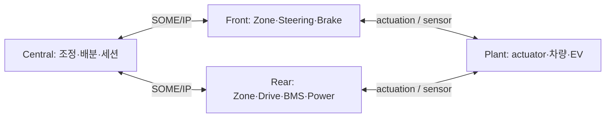

# StrataDrive

Central → Front/Rear Zone → Leaf ECU 구조의 차량 소프트웨어를 만들고 검증하는 SIL 프로젝트다.
Host에서 통신·세션·actuator/EV 모델과 CARLA 제어 폐루프를 연결했다.

**현재: M9 기능 범위를 마감하고 M10 Host 인지·tracking·준비 gate·실제 카메라 shadow를 구현·검증했다.**
인지 정확도·20Hz 처리량·전체 Reference와 실시간·Target 수용은 남아 있다.
최신 판정과 다음 작업은 [프로젝트 상태](docs/project-status.md) 한곳에서 관리한다.

## 시작하기

| 하고 싶은 일 | 문서 |
| --- | --- |
| 전체 문서에서 길 찾기 | [문서 안내](docs/README.md) |
| 빌드하고 예제 실행하기 | 아래 명령과 [학습 안내](docs/learning/README.md) |
| CARLA 실행·화면·결과 확인하기 | [CARLA 실행 안내](docs/carla-guide.md) |
| M10 모델 추론·객체 평가·부하 시험하기 | [영상 인지 안내](docs/perception-guide.md) |
| 구조와 코드 책임 이해하기 | [아키텍처](docs/architecture/README.md) |
| 앞으로 할 일과 미결정 값 확인하기 | [로드맵·TBD](docs/roadmap.md) |

저장소 루트의 Linux 터미널에서 실행한다. C++17, CMake, GoogleTest와 compiler가 필요하다.
별도 SDK·CARLA 설치는 이 core 빌드에 포함되지 않는다.

```sh
cmake -S . -B build/m1-angle -DCMAKE_BUILD_TYPE=Debug
cmake --build build/m1-angle --parallel 2
ctest --test-dir build/m1-angle --output-on-failure
./build/m1-angle/actuator_demo ev-power normal
./build/m1-angle/actuator_demo steering-model jam
./build/m1-angle/actuator_demo --help
```

원본 실행 증거를 재현할 때는 Git LFS를 설치한 뒤 `git lfs pull`로 로그를 받고,
해당 evidence 디렉터리에서 `sha256sum -c SHA256SUMS`로 원본 해시를 확인한다.

## 실행 구조



Central은 차량 전체 요구를 배분하고 Zone은 자신의 명령과 상태를 검증·전달한다.
Leaf는 판단·보호를, 외부 plant는 물리 응답을 맡는다. CARLA에서는 검증된 Actual만
단일 adapter를 통해 차량에 적용하고, 관측한 solver work를 단일 EV 모델에 정산한다.

Reference ODD는 맑은 낮·포장도로·단일 ego·직선/완만한 곡선·0–40km/h다.
C++ 주행 제어기는 고정 fixture에서 검증했다. M10은 사전학습 RGB 객체 검출·영상 좌표 tracking의
Host 경계까지 연결했다. Learned planner, Jetson 배포와 전체 system 시험은 후속 범위다.
Thor와 Orin NX는 각각 독립적으로 비교할 배포 대안이다.

## 파일 배치

| 경로 | 내용 |
| --- | --- |
| `central/`, `zone/`, `vecu/` | 차량 조정·배분, Zone gateway, Leaf 판단·보호 |
| `interfaces/` | CAN/P05, 세션, 메시지·단위·유효성 계약 |
| `simulation/` | actuator·차량·전원·배터리 모델과 SIL runtime |
| `tests/`, `tools/` | 검증 runner, CARLA 확장, 예제와 분석 도구 |
| `models/`, `profiles/` | 독립 종방향 MIL 모델, Reference/보드별 설정 |
| `physical_ai/`, `deploy/`, `benchmark/` | Host 인지·추론·tracking, 후속 배포·compute 비교 |
| `docs/` | 현재 안내·계약, 검증 근거와 과거 기록 |

요구사항·수치 기준은 [시스템 요구사항](docs/requirements/system-requirements.md),
개발·검증·문서 관리 원칙은 [개발 정책](docs/development-guide.md)을 따른다.
