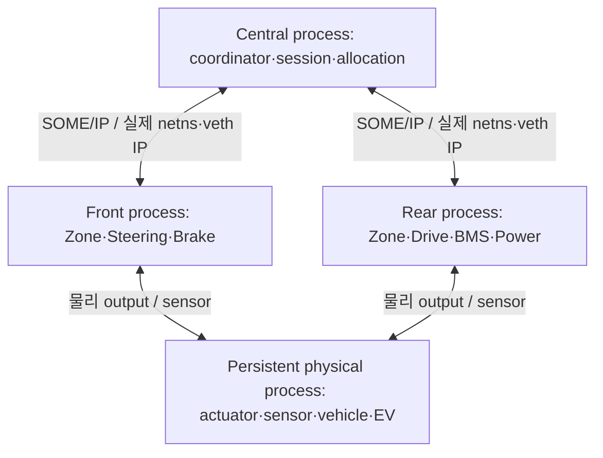

# 아키텍처

현재 구현·수용 판정은 [프로젝트 상태](../project-status.md)를 따른다.
이 문서는 시스템·소프트웨어·Zone 분할·배포·고장 대응의 공통 구조를 묶는다.

## 책임과 소유권

| 경계 | 책임 | 주요 코드 |
| --- | --- | --- |
| Central coordinator | 차량 전체 power lifecycle·permission, 제어 요구 배분, 세션·Epoch·RunLease, feedback 집계 | `central/coordinator/`, `vehicle_management/`, `control_allocation/`, `session/`, `feedback_bridge/` |
| Front Zone | Steering와 차량 전체 aggregate Brake의 명령 검증·CAN gateway·상태 감시·로컬 보호 | `zone/command_validation/`, `gateway/`, `feedback/`, `local_safety/` |
| Rear Zone | Drive/BMS/Power 경로의 검증·전달·상태 감시·로컬 보호 | 같은 Zone 모듈, 역할별 scope |
| Leaf ECU | 명령 수용·gate·제어 목표·로컬 보호 판단과 Actual 보고 | `vecu/steering/`, `brake/`, `drive/`, `bms/`, `power/` |
| SIL plant | actuator delay/rate/saturation·센서, 차량 운동·전원 회로·Battery/EV | `simulation/` |
| CARLA adapter | 검증된 Actual을 NoDrive effort로 적용하는 단일 writer, 관측 solver work 전달 | `tools/carla/m7_nodrive/`, `tests/integration/carla/` |
| 상위 주행·AI · 후속 | state/perception/world model → planner → safety → classical controller | `central/vehicle_state/`, `perception/`, `world_model/`, `planner/`, `safety/`, `control/`, `physical_ai/` |

Front/Rear는 대등한 gateway다. 정상 경로에 Zone 간 relay를 추가하거나 차량 배분기를 복제하지 않는다.
BMS limit은 BMS → Rear → Central 판단 → Rear → Drive로 전달한다.
Drive/BMS의 로컬 보호는 이 왕복이나 Central 승인을 기다리지 않는다.
Front의 Brake는 전륜 전용이 아닌 차량 전체 aggregate 마찰제동이다. 후륜 단일 모터는 학습용 가정이다.

## 현재 Host 실행

실제8참여자의 Prepare/INIT/Release ACK·credit·arm과 CAN/P05·owner-wire 경계를 유지한다.
물리 bus는 actuation/sensor 전용이며 명령·세션·권한을 우회하지 않는다.
M6에서는 physical process만 SimpleVehicle·EV를 적분한다. ECU 재가입은 물리 상태를 reset하지 않는다.
M7에서는 차량 운동을 CARLA만 적분하고 기존 SimpleVehicle motion을 함께 실행하지 않는다.
Actuator 응답과 전기 정산은 별도 owner 경계로 연결하며 실제 구간 work를 한 번만 정산한다.

Host SOME/IP 배치는 [Front](../interfaces/someip-front-adapter.md)·[Rear](../interfaces/someip-rear-adapter.md)를 따른다.
기존 CPU1/2/7 owner·physical3·monitor0·SDK4/5/6 조합의 근거는
[해당 실행](../test-plan/evidence/m5_someip_rear_adapter/README.md)에 한정된다.
CARLA 실험의 functional/wall clock과 단일 tick 규칙은 [CARLA ICD](../interfaces/carla-plant-adapter.md)에 있다.

## 데이터 경로의 불변 조건

1. VehicleRequest → Central allocation → 담당 Zone → Leaf → Actual CAN/P05 → Zone →
   Central feedback bridge → plant의 반환 경로를 지킨다. Command를 Actual로 바꾸지 않는다.
2. 값·단위와 함께 run/epoch·sequence·clock·acquisition·oldest dependency·validity·expiry를 전달한다.
   새 envelope·CAN counter·heartbeat는 내부의 오래된 원천을 fresh로 만들지 않는다.
3. INIT/ACK·READY·arm·정상 permission·물리 완료는 각각 다른 상태다.
   보호 선택 ACK도 torque0·압력 도달·차체 정지의 증거가 아니다.
4. Plant의 motion·actuator 응답·EV 에너지는 각각 한 owner만 적분한다.
   CARLA 적용 실패와 불완전 work는 unavailable/latch·다음 tick 차단으로 처리한다.
5. AI 출력은 Safety Supervisor·Classical Controller를 거친다. GT는 학습/평가 전용이다.

전체 semantic ID와 payload는 [Interface 목록](../interfaces/README.md),
실제 encoding/세션은 [owner-wire v1](../interfaces/owner-wire-v1.md)과 [CAN ICD](../interfaces/can.md)를 따른다.
`IF-DDS-*`는 기존 semantic ID이며 현재 Host transport는 SOME/IP다.

## ECU와 물리 모델의 실행 경계

ECU는 plant 객체를 소유하거나 물리를 진행하지 않는다. Typed actuation/sensor port를 통해
출력 요구와 관측값을 교환한다. `prepare(now)`/`complete(sensor, now)`는 같은 owner가
같은 논리 job 시각에서 직렬 실행한다. SIL 연결 코드가 실제 plant/센서 진행을 소유한다.

제어 주기와 독립 monitor 실행을 분리한다. 늦은 output은 실제 적용 직전에도 deadline/latch를
다시 검사하고 물리 delay는 실제 적용 시각에서 시작한다. Cached snapshot의 원래 시각은 유지한다.
Latest snapshot은 bounded SPSC 소유권 교환이며 FIFO 전달과 구분한다.
Host thread·Trampoline POSIX 파일럿은 MCU/RTOS·전체 AUTOSAR stack의 동등 구현이 아니다.

## 고장과 복구

| 관측 | 검출 주체·반응 |
| --- | --- |
| Command loss·CRC/counter·stale/잘못된 Epoch | 수신 Zone/Leaf가 독립 거부·age 감시·로컬 보호. Reject로 valid RX age를 갱신하지 않음 |
| Leaf Actual loss·Zone/coordinator loss | 각 원천과 각 link 방향을 독립 감시. 다른 heartbeat로 누락을 메우지 않음 |
| Steering/Brake 응답 이상 | Leaf response monitor가 목표 이력과 fresh sensor를 비교. 통신 timeout과 물리 응답 이상은 별도 |
| BMS limit/status·power/sensor 오류 | BMS/Drive gate와 Central permission 검증. valid0·unknown, power 요청·actual을 구분 |
| Task overrun·owner 정지 | 독립 completion monitor가 missed slot·deadline을 기록하고 보호 선택 |
| AI timeout/invalid · 후속 | 검증된 classical fallback 또는 FAIL_SAFE. Diagnostics 기록을 기다리지 않음 |

상태는 INIT → NORMAL → DEGRADED → FAIL_SAFE다. Critical loss는 FAIL_SAFE로 직행하고,
복구는 원인 해소·명시적 INIT·입력/health/power 재검증을 거친다. FAIL_SAFE가 실제 안전 정지를 보장하지는 않는다.
고장별 구체 동작·수치 기준은 [안전 요구](../requirements/safety-requirements.md)와
[시간 요구](../requirements/timing-requirements.md)에서 관리한다.

Fault event는 source·severity·영향 requirement/interface·run/epoch·clock·last-valid RX·
injection/detection/action/actual response 시각을 구분한다. M9에서 DTC lifecycle을 연결한다.

## Target과 compute 비교 계획

Host PC는 CARLA·sensor/plant·scenario·fault orchestration·평가를 맡는다.
Target은 Jetson AGX Thor **또는** Orin NX 한 대에 전체 Central/Front/Rear/Leaf를 배포하는 계획이다.
두 보드는 별도 실험이며 동일 binary·TensorRT engine·JetPack 호환을 가정하지 않는다.
Target protocol·격리·clock sync·실제 CAN/NIC·RT 권한은 아직 검증하지 않았다.
DDS의 과거 제어 gate CLOSED를 Host SOME/IP 성공으로 해제하지 않는다.

보드별 Reference Config를 먼저 고정해 독립 실행하고, 이후 Premium/Mainstream 변경을 비교한다.
Board/RAM·stack·power/clocks·cooling·warmup·duration/repetitions·부하·clock uncertainty를 기록한다.
AI latency·camera-to-trajectory·FPS·CPU/GPU·RAM·power/temperature·jitter/deadline을 함께 측정하고
최적화 후 정확도와 차량 동작을 재검증한다. 설정은 [profiles](../../profiles/README.md),
결정 시점은 [TBD 목록](../roadmap.md#open-m0-decisions)을 따른다.

vCAN은 application frame 계약용이다. 물리 CAN FD의 전기·arbitration·bus 부하·transceiver나
같은 Host 자원의 물리 고장 독립성·failover를 검증한 것으로 해석하지 않는다.

## 추적성용 Component ID

다음 Target 배치는 설계 위치다. 현재 Host process 배치와 구분하며 기존 requirement의 ID를 유지한다.

| Component ID | 배치 / 책임 | 경계 |
| --- | --- | --- |
| ARCH-HOST | x86 Ubuntu workstation: CARLA Vehicle Plant / Road / Traffic / Pedestrian, Camera / IMU / GNSS | 차량 환경과 센서의 원천; autonomy 결정은 Target 책임 |
| ARCH-ORCH | Host: ScenarioRunner / OpenSCENARIO, Fault/Test Orchestrator, logging, PASS/FAIL 평가 | 시나리오/seed/run ID, fault 시점, 결과 및 환경 기록 |
| ARCH-CENTRAL | Target: vehicle state, perception, world model, planner, deterministic control, health | Vehicle-level command 생성; CARLA actuation API 의존 금지 |
| ARCH-CENTRAL-VM | Target Central: 별도 vehicle management | fresh power/health로 전원 요청·주행 허가 결정; 단일 VCU owner |
| ARCH-CENTRAL-ALLOC | Target Central: 별도 control allocation | VehicleCommand + 원천 actual/capability/permission → scoped actuator demand; 단일 배분 |
| ARCH-CENTRAL-SESSION | Target Central: trusted session coordinator | 영속 Epoch issuer/INIT/rejoin; CAN frame에서 authority 자동 학습 금지 |
| ARCH-CENTRAL-BRIDGE | Target Central: per-source feedback aggregation/Host bridge | 두 Zone 원천 metadata 보존; actual-only Host 경로 |
| ARCH-SAFETY | Target Central Vehicle Compute: Safety Supervisor | planner trajectory 검증, fallback/state 기반 제한, Classical Controller 출력 제한의 별도 guard |
| ARCH-ZONE | Front/Rear Zone 공통 component family | gateway, command validation, local safety; 기존 requirement ID의 family 책임 유지 |
| ARCH-ZONE-FRONT | Target: Front gateway, local validation/monitor/protection | Central과 독립 command/status/session; Steering/aggregate Brake CAN |
| ARCH-ZONE-REAR | Target: Rear gateway, local validation/monitor/protection | Central과 독립 command/status/session; Drive/BMS CAN; 전체 요구 재배분 금지 |
| ARCH-VECU | Target: Steering / Brake / Drive software ECU | command 수용·task/state·목표/보호 판단·외부 sensor 기반 Actual 보고 |
| ARCH-BMS | Target: 독립 논리 BMS vECU | battery 센서와 power 요청 → charge/discharge limits, power 실제 상태/health; 상위 보고는 Zone 경유 |
| ARCH-EV-PLANT | SIL battery / power plant | 실제 model power → energy/SOC/voltage/current/temperature, power 응답; BMS controller와 분리; M6 Host는 persistent physical owner; M7 CARLA/Target 배치 TBD-07 |
| ARCH-ADAPTER | Host: CARLA Plant Adapter; Target feedback bridge와 연결 | vECU actual feedback만 ego actuation 입력으로 변환; CARLA actuation의 단일 writer |
| ARCH-DIAG | Target Central Vehicle Compute: Diagnostics Manager + Zone Controller/vECU local monitors | fault event 집계, DTC, state transition; local 반응은 Central Vehicle Compute 통신에 의존하지 않음 |
