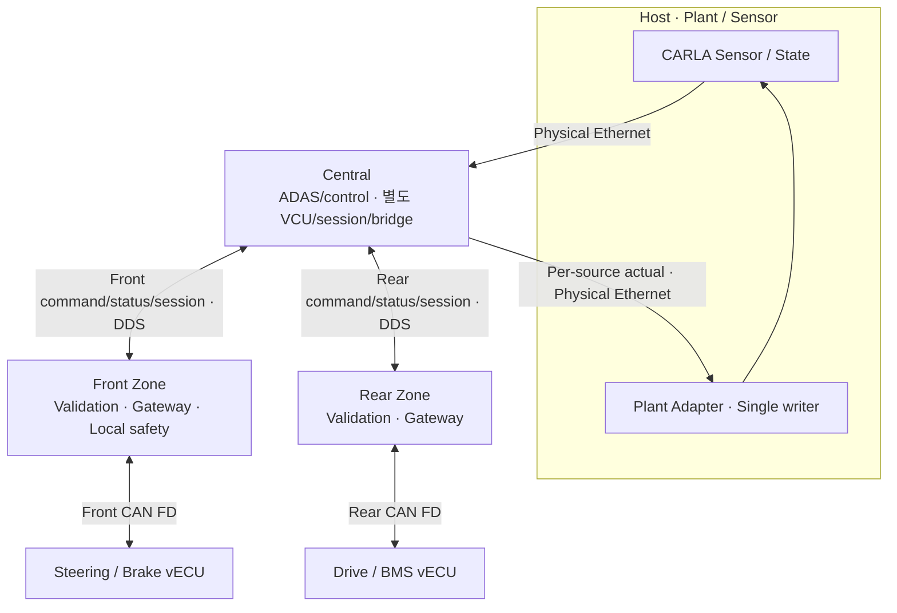

# System architecture

Status: **전체 시스템/Target 설계 계약 DEFINED**. Host 구현·한정 수용과
전체 차량/Target 미검증 범위는 [project_status](../project_status.md)를 따른다.
[ZON-01 v0.5 / ADR-0021](../adr/ADR-0021-central-coordination-and-parallel-zones.md)의
Central 단일 조정/배분/세션과 대등한 Front/Rear를 Host SOME/IP로 연결했다.
M6 Host quiet 모델/MIL은 종료했으며 아래 CARLA/Jetson 배포·상위 autonomy는 후속이다.

## 경계와 책임

| Component ID | 배치 / 책임 | 경계 |
| --- | --- | --- |
| ARCH-HOST | x86 Ubuntu workstation: CARLA Vehicle Plant / Road / Traffic / Pedestrian, Camera / IMU / GNSS | 차량 환경과 센서의 원천; autonomy 결정은 Target 책임 |
| ARCH-ORCH | Host: ScenarioRunner / OpenSCENARIO, Fault/Test Orchestrator, logging, PASS/FAIL 평가 | 시나리오/seed/run ID, fault 시점, 결과 및 환경 기록 |
| ARCH-CENTRAL | Target: vehicle state, perception, world model, planner, deterministic control, health | Vehicle-level command 생성; CARLA actuation API 의존 금지 |
| ARCH-CENTRAL-VM | Target Central: 별도 vehicle management | fresh power/health로 전원 요청·주행 허가 결정; 단일 VCU owner |
| ARCH-CENTRAL-ALLOC | Target Central: 별도 control allocation | VehicleCommand + 원천 actual/capability/permission → scoped actuator demand; 단일 배분 |
| ARCH-CENTRAL-SESSION | Target Central: trusted session coordinator | 영속 Epoch issuer/INIT/rejoin; CAN frame에서 authority 자동 학습 금지 |
| ARCH-CENTRAL-BRIDGE | Target Central: per-source feedback aggregation/Host bridge | 두 Zone 원천 metadata 보존; actual-only Host 경로 |
| ARCH-SAFETY | Target Central Vehicle Compute: Safety Supervisor | planner trajectory 검증, fallback/state 기반 제한, Classical Controller 출력 제한의 별도 guard |
| ARCH-ZONE | Front/Rear Zone 공통 component family | gateway, command validation, local safety; 기존 requirement ID의 family 책임 유지 |
| ARCH-ZONE-FRONT | Target: Front gateway, local validation/monitor/protection | Central과 독립 command/status/session; Steering/aggregate Brake CAN |
| ARCH-ZONE-REAR | Target: Rear gateway, local validation/monitor/protection | Central과 독립 command/status/session; Drive/BMS CAN; 전체 요구 재배분 금지 |
| ARCH-VECU | Target: Steering / Brake / Drive software ECU | command 수신부터 task/state/dynamics를 거쳐 actual actuator feedback 생성 |
| ARCH-BMS | Target: 독립 논리 BMS vECU | battery 센서와 power 요청 → charge/discharge limits, power 실제 상태/health; 상위 보고는 Zone 경유 |
| ARCH-EV-PLANT | SIL battery / power plant | 실제 model power → energy/SOC/voltage/current/temperature, power 응답; BMS controller와 분리; M6 Host는 persistent physical owner; M7 CARLA/Target 배치 TBD-07 |
| ARCH-ADAPTER | Host: CARLA Plant Adapter; Target feedback bridge와 연결 | vECU actual feedback만 ego actuation 입력으로 변환; CARLA actuation의 단일 writer |
| ARCH-DIAG | Target Central Vehicle Compute: Diagnostics Manager + Zone Controller/vECU local monitors | fault event 집계, DTC, state transition; local 반응은 Central Vehicle Compute 통신에 의존하지 않음 |

Host–Target은 **실제 Ethernet**이다. Target은 Jetson AGX Thor **또는** Jetson
Orin NX 한 대다. 동일 Vehicle SW Architecture를 보드별 독립 배포하며 두 보드를
연결해 하나의 차량으로 구성하지 않는다.

다음 그림의 DDS는 원래 Target 설계의 전송 후보 표기다. 현재 Host 실행은
SOME/IP이며, Target protocol/clock/격리는 [배포 문서](deployment_architecture.md)의 후속 검증 범위다.

## Command hierarchy

**Vehicle-level command != actuator command != actual actuator feedback**.

| 계층 | Producer → Consumer | 의미 / 경계 |
| --- | --- | --- |
| Vehicle-level command | Central Classical Controller → Central allocation | target speed, acceleration demand, target curvature, braking demand + timestamp/sequence/freshness; actuator actual 값 아님 |
| Actuator command | Central allocation → 각 Zone → Steering/Brake/Drive vECU | steering angle demand / drive torque demand / brake pressure demand |
| Actual actuator feedback | vECU response → 담당 Zone → Central feedback bridge → Host Plant Adapter | actual steering angle / actual drive torque / actual brake pressure + 각 원천 time/validity |

물리 의미/단위는 [interface overview](../icd/interface_overview.md)에 정의한다.
Wire layout은 M1/M5, 수치 한계/calibration은 M2/M6/M7에 결정한다.
동일한 값이 우연히 나와도 command와 actual은 서로 다른 책임과 sample이다.

2026-10-13 [RG-01](../icd/regenerative_braking_design.md)로 회생제동 포함 범위를 결정했다.
Drive는 signed 구동/회생 토크와 회생 가용량, Brake는 마찰제동 압력을 맡고 Central allocation이 배분한다.
상세 설계/runtime은 후속 작업이며 M0 v0.1의 검토 결과에 소급 포함하지 않는다.

## Closed-loop invariant

Planner 또는 Classical Controller가 CARLA API로 차량을 직접 움직이면 architecture 위반이다. Zone Controller에서
보낸 command로 CARLA를 직접 구동하거나 vECU command를 actual feedback으로 간주하거나
Plant Adapter에서 actual feedback loss를 raw command로 우회하는
것도 금지한다. vECU task, delay, saturation, fault가 반영된 feedback이 실제
plant 입력을 결정해야 한다. Host fault orchestrator의 명시적 disturbance는
별도 기록하고 정상 control path와 구분한다. Ego autopilot과 다른 actuation
writer는 PLANNED 통합에서 비활성화해야 한다.

vECU feedback은 CAN → 담당 Zone → Central 집계/target bridge → Ethernet → Host Plant Adapter로
전달한다. M0 최초 baseline의 단일 Zone은 역사적으로 유지하며 최종 설계는 ZON-01의 두 Zone이다.
Central bridge process/transport와 각 Zone 독립 DDS 경로는 M4/M5(TBD-05/06/15)에 정한다.
Bridge는 원천 metadata를 보존하고 actuator actual을 재계산하거나 command에서 생성하지 않는다.

## Plant fidelity와 시간

Steering angle(rad), brake pressure(Pa), aggregate drive torque(N·m)를 CARLA plant 입력으로
변환하는 calibration은 M6/M7(TBD-02/03/07)이다. vECU는 actuator response를,
CARLA는 vehicle motion을 담당하며 actuator delay/dynamics의 중복 적용을 mapping review에서
배제한다. Fresh actual feedback 없이는 다음 driving tick을 보류한다. 이는 simulation
containment이며 실제 차량 정지의 검증이 아니다([안전 계약](../requirements/safety_requirements.md)).

RG-01의 음수 Drive Actual과 friction Brake Actual은 공통 wheel 기준으로 변환해 각각
한 번씩 반영한다. Signed torque의 CARLA API mapping과 에너지 모델의 fidelity는
TBD-02/07이다. 회생 한계는 plant actuation 값이 아니다.

M7-1d 개정 Reference world/Vehicle State는100Hz, RGB/GT는20Hz다.
Controller50Hz, Zone/Steering·Brake·Drive vECU100Hz와30ms freshness는 유지한다.
BMS/power task·발행 주기는 TBD-14다. 한 Host
orchestrator만 tick을 소유하고 Plant Adapter만 ego actuation을 쓴다. Orchestrator의
route/scenario 설정 권한은 ego actuation 권한을 포함하지 않는다. Fault injector는
command/feedback 통신이나 vECU model에 fault를 주입하며 별도 ego writer가 될 수 없다.
Reset/spawn은 INIT 상태의 scenario lifecycle로 구분한다.

Synchronous functional replay와 monotonic wall-time 측정을 구분하며 timeout clock,
pause/reset/multirate 의미는 [timing contract](../requirements/timing_requirements.md)를 따른다.
Reference ODD는 [system requirements](../requirements/system_requirements.md),
남은 결정은 [TBD register](../roadmap.md#open-m0-decisions)에 있다.

관련 결정: [ADR-0001](../adr/ADR-0001-simulator-selection.md),
[ADR-0002](../adr/ADR-0002-zonal-architecture.md).

## EV-01과 ZON-01 추가 기능

Central → Zone → Leaf와 담당 Zone을 거치는 feedback 경계를 유지한다.
BMS는 Rear Leaf이고 상태·한계는 제약/관측 정보다. BMS status 자체를 wheel actuation에
더하지 않는다. Rear→Central의 원천 한계/상태로 Central이 배분한 뒤 Rear→Drive로 전달하며
Rear/Drive/BMS도 로컬 검증·보호한다. 전원 lifecycle과 기존 severity는 별개다.
[Zone 분할 계약](zonal_partition.md), [EV 설계](../icd/ev_power_bms_design.md)를 따른다.

최종 Front/Rear topology와 Central 단일 조정 owner는 ACCEPTED다. 단일 Zone에서 component를
먼저 검증한 뒤 M4/M5에 두 Zone을 연결한다. 각 Central–Zone schema/QoS/queue/clock/fault budget/rejoin은
TBD-15다. M0 review/현재 M1 wire 증거는 두 Zone runtime 검증이 아니다.
