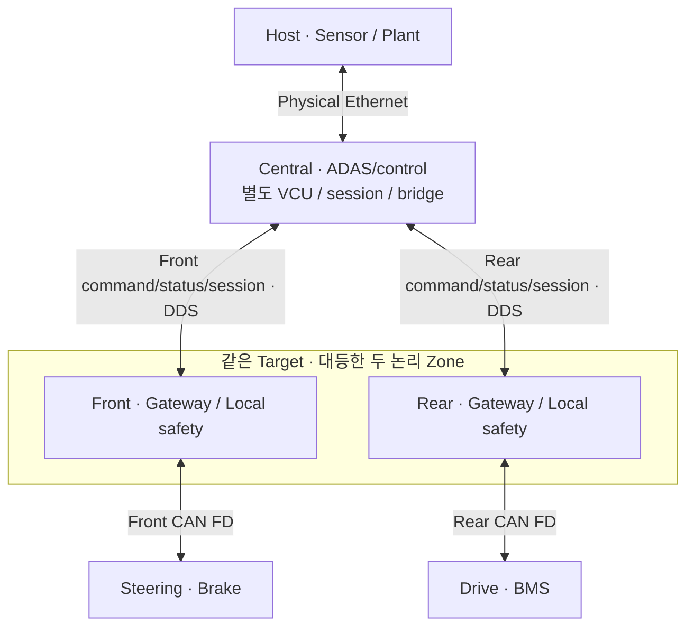

# Central과 Front/Rear Zone 분할 — ZON-01 v0.5

Date: 2026-10-14. Status: **배치 ACCEPTED / protocol 초안 / runtime PLANNED / 시험 NOT RUN**.
[ADR-0021](../adr/ADR-0021-central-coordination-and-parallel-zones.md)이 ADR-0015의 Front 조정 배치를 대체한다.
기존 M0/M1/M2 결과는 새 다중 Zone acceptance의 증거가 아니다.

## Reference 배치

| Node / Component | 책임 | 연결 |
| --- | --- | --- |
| Central ADAS/control | state/perception/planning/safety, vehicle-level 요구 생성 | Host sensor, Central VCU interface |
| Central vehicle_management | 전원 lifecycle·주행 허가의 단일 owner | lifecycle 요청, Rear BMS/power 원천 status, 각 Zone health |
| Central control_allocation | 구동·회생·마찰제동·조향 배분의 단일 owner | Controller 요구/원천 actual·capability → 두 Zone scoped command |
| Central session / feedback_bridge | trusted Epoch/INIT, 원천 feedback 집계·Host bridge | 각 Zone의 독립 command/status/session, Host actual/EV status |
| Front Zone | local validation/monitor/protection, Front CAN gateway | Central DDS, Steering/aggregate Brake CAN |
| Rear Zone | local validation/monitor/protection, Rear CAN gateway | Central DDS, Drive/BMS CAN |
| Host | plant/scenario/tick owner, sensor 원천, actual의 단일 plant writer | Central sensor 경로, Central feedback bridge |

Rear-drive single motor는 학습용 packaging 가정이며 calibration은 TBD-02/07이다.
Front의 Brake는 차량 전체 aggregate 마찰제동 압력이며 전륜 전용 제동이 아니다.
Battery pack은 차체 하부 등가 모델, BMS controller의 논리 접속 위치는 Rear다.
같은 Target 자원을 공유하며 물리적 CPU/전원 고장 독립성이나 failover를 주장하지 않는다.

## Application routing

| Interface | Producer → Consumer | 계약 |
| --- | --- | --- |
| IF-CENTRAL-VEHICLE-REQUEST | Controller → Central allocation | vehicle-level 요구; actuator actual이 아님 |
| IF-CENTRAL-POWER-REQUEST | lifecycle requester → Central vehicle management | non-driving power 요청; 원래 identity/deadline 보존 |
| IF-DDS-FRONT-CMD | Central → Front | 배분된 Steering/Brake 요구; parent/source expiry 보존 |
| IF-DDS-REAR-CMD | Central → Rear | Drive 요구, BMS constraints/permission/power request, 필요한 speed 입력 |
| IF-DDS-FRONT-STATUS | Front → Central | Steering/Brake 원천 actual/health |
| IF-DDS-REAR-STATUS | Rear → Central | Drive actual/capability, BMS/power 원천 status/health |
| IF-DDS-FRONT-SESSION / IF-DDS-REAR-SESSION | Central ↔ 각 Zone | trusted INIT/rejoin/Epoch/monitor enable/correlation |
| IF-CAN-STEERING / IF-CAN-BRAKE | Front ↔ Front Leaf | 기존 command/actual 의미 |
| IF-CAN-DRIVE / IF-CAN-BMS / IF-CAN-DRIVE-CONSTRAINT | Rear ↔ Rear Leaf | scoped demand 검증 후 CAN 전달; source/expiry 연장 금지 |
| IF-HOST-ACTUATOR / IF-HOST-EV-STATUS | Central bridge → Host | 각 원천 time/sequence/validity/causal identity 보존 |

두 Zone은 차량 전체 요구를 다시 배분하지 않는다. 각 Zone envelope와 per-source/dependency
freshness를 별도로 검사한다. Zone publication/새 CAN counter/다른 Zone heartbeat가 상위
유효 기간이나 누락 Leaf sample의 age를 갱신하지 않는다.
BMS limit 경로는 BMS→Rear→Central 판단→Rear→Drive다. Local Drive/BMS 보호는 이 왕복이나
Central 승인을 기다리지 않는다. 정상 application 경로에 Front↔Rear relay를 추가하지 않는다.
물리적인 switch/backbone forwarding은 이 routing table과 별개이며 TBD-05/15다.

## Coordinator와 local protection

Central의 VCU 기능은 ADAS/controller와 별도 validation/fault 책임을 갖는다.
정상 power sequence/permission과 총 요구 배분을 한 번만 결정하며 Central 전체를 하나의
무검증 함수/monolithic task로 합친다는 뜻은 아니다. Process/task/watchdog 배치는 TBD-04/05다.
Zone와 Leaf는 자신의 loss/fault를 독립 검출하고 Central diagnostics 없이 보호한다.

| Fault / variant | 검출 / 최소 계약 |
| --- | --- |
| Central→Front 또는 Central→Rear command 단방향 상실 | 해당 Zone와 Leaf의 독립 timeout/local protection; 다른 link heartbeat로 복구 금지 |
| Front→Central 또는 Rear→Central status 상실 / Zone 정지 | Central의 Zone별·Leaf별 원천 monitor, FAIL_SAFE/normal 배분 중단, Host actual gate |
| Leaf 정지, 담당 Zone heartbeat 지속 | 원천 source age/validity 유지; aggregate heartbeat로 availability 복구 금지 |
| Central VCU/controller 정지 | 두 Zone의 독립 command timeout과 local 보호; coordinator failover는 이번 범위 밖 |
| Delay/replay/wrong Epoch / startup 누락 / 명시적 rejoin | reject/unknown, trusted Epoch/parent/INIT gate, 원래 expiry 보존, 자동 NORMAL 복귀 금지 |

Physical torque/pressure/power response와 budget은 TBD-03/12/15다.
Host tick gate는 simulation containment이며 실제 정지 보장은 아니다.

## 남은 설계와 검증 순서

두 Zone/담당 Leaf/Central 단일 owner는 결정했다. Scoped command/status/session의 IDL/schema/QoS,
bounded queue/clock/skew/source-age/monitor/rejoin과 routing config는 TBD-15/05/14다.
M4에서 Central coordinator를 검증하고 Front/Rear gateway를 연결한다. M5는 독립 DDS 경계와
Host bridge, M6/M7는 모델 기반 plant loop를 시험한다. Zone별 CAN bus/interface identity를
trace에 보존하고 in-process shortcut을 cross-node 통신 검증으로 표시하지 않는다.
현재 [전원·허가 상태 owner](../learning/m4_vehicle_management.md)는 component로 구현·시험했다.
후속 [첫 배분 component](../learning/m4_control_allocation.md)도 구현했다. Scoped parent/expiry는 in-process sideband이며 Zone admission 구현 전이다.
Zone health/비Power actual은 그 연결 시험의 명시적 fixture이며 실제 Zone ingress/runtime 검증은 후속이다.
ZON-S01/ZON-F01/F02, TC-ZON-001–003과 기존 COM/EV/SAFE 시험에 연결하며 전체 Result는 NOT RUN이다.
