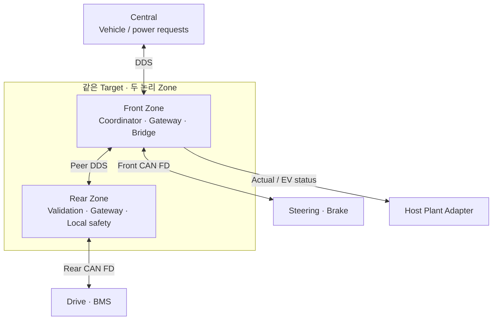

# Front/Rear Zone 분할 — ZON-01

Date: 2026-10-13. Status: **두 Zone·책임 배치 ACCEPTED / protocol 초안 / runtime PLANNED / 시험 NOT RUN**.
[ADR-0015](../adr/ADR-0015-front-rear-zones.md)를 따른다. M0 v0.1 이후의 확장이며 기존
단일 Zone/M1 실행 결과가 다중 Zone acceptance를 충족한 것은 아니다.

## Reference 배치

| Node / Component | 책임 | 연결 |
| --- | --- | --- |
| Central / ARCH-CENTRAL | vehicle-level acceleration/curvature/braking demand, power lifecycle 요청, 상위 safety/diagnostics | Front DDS; Host sensor bridge |
| Front / ARCH-ZONE-FRONT | vehicle management/drive permission, 총 구동·제동 배분의 단일 owner; Front CAN gateway, vehicle-wide feedback/target bridge | Central DDS, Rear peer DDS, Steering/Brake CAN |
| Rear / ARCH-ZONE-REAR | scoped demand/constraint 검증·CAN dispatch, Drive/BMS 원천 status 수집, local protection | Front peer DDS, Drive/BMS CAN |
| Front Leaf | Steering response와 aggregate friction-brake pressure | Front CAN |
| Rear Leaf | signed motor response와 BMS state/charge·discharge limits/power actual | Rear CAN |
| Host | sensor/vehicle motion, scenario/tick owner, 실제 actuator feedback의 단일 plant writer | Central sensor path, Front target bridge |

Rear-drive single motor를 가정하는 학습용 배치이며 물리 calibration은 TBD-02/07이다.
Brake pressure는 차량 전체 aggregate 값을 유지하며 Front controller 배치를 전륜 전용 제동으로 해석하지 않는다.
Battery pack은 차체 하부의 등가 모델, BMS controller의 논리 접속 위치는 Rear로 가정한다.

ARCH-ZONE은 두 Zone의 공통 책임을 나타내는 family ID로 유지하고 구체적 ownership은
ARCH-ZONE-FRONT/REAR로 표시한다. 독립 process/network node를 같은 Target에 구성하고 별도 보드는 요구하지 않는다.
같은 Linux/전원을 공유하므로 physical fault independence를 주장하지 않는다.

## Application routing

| Interface | Producer → Consumer | 내용 / 원칙 |
| --- | --- | --- |
| IF-DDS-VEHICLE-CMD / IF-DDS-POWER-REQUEST | Central → Front | vehicle-level request; parent identity/deadline 보존 |
| IF-DDS-REAR-CMD | Front → Rear | 배분된 Drive demand, 원천 BMS limit/permission, BMS power request, 필요한 speed 입력; Rear는 재배분하지 않음 |
| IF-DDS-REAR-STATUS | Rear → Front | Drive actual/capability, BMS/power status/health; source별 clock/time/sequence/validity/causal identity |
| IF-DDS-REAR-SESSION | Front ↔ Rear | trusted INIT/rejoin, epoch/monitor-enable/correlation; payload에서 epoch 자동 학습 금지 |
| IF-CAN-STEERING / IF-CAN-BRAKE | Front ↔ Front Leaf | 기존 command/actual 의미 |
| IF-CAN-DRIVE / IF-CAN-BMS / IF-CAN-DRIVE-CONSTRAINT | Rear ↔ Rear Leaf | Front demand/constraint 검증 후 CAN 전달; 새 timestamp로 유효 기간 연장 금지 |
| IF-DDS-ZONE-STATUS / IF-HOST-ACTUATOR / IF-HOST-EV-STATUS | Front → Central / Host | vehicle-wide 집계; Rear 경유 source metadata 보존, actual을 command로 합성하지 않음 |

Peer ingress는 raw reception과 valid acceptance를 구분하며 Front/Rear 각각 필요한 range/mode/
epoch/freshness를 검증한다. 후단 CAN encoding의 transport counter가 진행해도 origin sample의
sequence/time/deadline을 진행시킨 것으로 해석하지 않는다. Peer envelope와 per-source/dependency를
모두 감시한다. Fresh peer heartbeat로 invalid BMS limit를 유효하게 만들지 않는다.
BMS→Drive constraint는 Rear→Front 집계 후 coordinator가 판단한 route로 되돌려 전달한다.
Drive/BMS의 로컬 제한·보호는 이 round trip이나 Central 승인을 기다리지 않는다.

## Coordinator와 local protection

Front가 정상 총 요구/회생·마찰 배분과 power sequence/drive permission을 한 번만 결정한다.
Rear는 Leaf별 dispatch와 local protection을 수행한다. Drive/BMS도 자신의 limit/input을
검증한다. Front가 Rear local fault를 덮어 NORMAL로 복귀시키지 않는다.
Front는 단일 coordinator이며 redundancy/runtime failover는 이번 범위 밖이다.

| Fault / variant | 검출 / 최소 계약 |
| --- | --- |
| Front→Rear command loss / Front process 정지 | Rear는 상위 승인 없이 <=100 ms critical loss 검출/local protection; Leaf 자체 timeout 유지 |
| Rear→Front status loss / Rear process 정지 | Front는 Rear와 각 critical 원천 stream을 독립 판정, FAIL_SAFE/정상 배분 중단; Host actual gate 유지 |
| Leaf 정지, Rear heartbeat 지속 | 누락 Leaf의 source age/validity 보존; heartbeat로 availability 복구 금지 |
| Peer delay/cached replay/wrong epoch | reject/unknown, valid age 미갱신; 전달된 과거 값을 new actual로 간주하지 않음 |
| 단방향 partition / clear / restart | 수신 방향별 local protection, epoch/health/INIT gate; 자동 severity 하향/복귀 금지 |

실제 torque/pressure/power 반응과 budget은 TBD-03/12/15에서 정하고 component/plant로 관측한다.
Host tick gate는 simulation containment이며 물리적 정지/안전성의 증거가 아니다.

## 남은 설계와 검증 순서

TBD-15의 두 Zone 채택/mapping/단일 coordinator는 이 문서에서 결정했다. Peer IDL/serialization/QoS,
bounded queue/overflow, clock/최대 skew, source-age/monitor margin, INIT/rejoin, mixed-version
거부와 routing config는 **미결정/미구현**이다. 실행 전에 ICD/profile/test oracle에 구체화한다.
CAN bus/interface 이름은 runtime config에서 분리한다. 같은 frame ID를 다른 bus에서 쓰더라도
bus/producer identity를 trace에 포함한다. In-process shortcut을 cross-zone 검증으로 표시하지 않는다.

M2 component의 기존 fixture를 활용하고 M4에서 단일 coordinator 동작 후 두 Zone gateway/monitor로 분할한다.
M5에서 DDS 격리와 peer protocol, M6/M7에서 feedback-driven plant를 검증한다.
ZON-S01/ZON-F01/02, TC-ZON-001–003을 [scenario](../test-plan/scenario_baseline.md),
[verification](../test-plan/verification_strategy.md), [traceability](../test-plan/traceability.md)에 연결한다.
Runtime Result는 NOT RUN이며 EV/M0/기존 M1 PASS를 다중 Zone 검증으로 확대하지 않는다.
