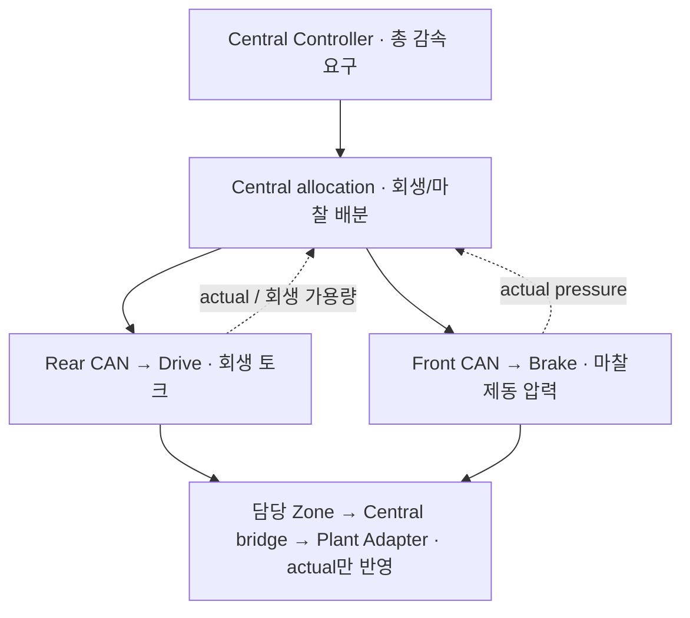

# 회생제동 설계 — RG-01

원래 범위 결정:2026-10-13([ADR-0011](../adr/ADR-0011-regenerative-braking-scope.md)).
현재 **Central 배분→양 Zone/Leaf actual→M6 vehicle/EV 에너지의 Host quiet 경로 구현/검증**.
실행/수용은 [project_status](../project_status.md), 물리/energy 모델은 [vehicle-energy ICD](vehicle_energy.md)를 따른다.
아래 부호/단위·가용성·배분/보호 의미를 유지하며 실제 차량 calibration/전체 TC는 후속이다.

## 역할과 통신 경로

| 역할 | 입력 → 출력 / 책임 |
| --- | --- |
| Central ADAS/control | vehicle state → acceleration/braking demand; 배분은 별도 component |
| Central allocation | vehicle demand + 유효한 actual/capability/permission → signed Drive torque + Brake pressure |
| Front/Rear Zone | scoped demand 검증 → 담당 CAN; 원천 actual/health 보존, local protection |
| Drive vECU | signed torque demand → motor dynamics 후 actual torque + 회생 가용량 |
| Brake vECU | pressure demand → 압력 dynamics 후 actual friction-brake pressure |
| Plant Adapter | actual Drive torque + actual Brake pressure → 각각 한 번씩 plant에 적용 |

전진 0–40 km/h ODD를 유지한다. 첫 확장은 wheel-equivalent 단일 모터/aggregate
마찰제동 모델이다. 바퀴별 ABS/ESC와 후진은 후속 범위다. BMS 논리 ECU와 단순 battery/
power 모델은 EV-01에 포함하며 상세 셀 화학/열화/밸런싱은 제외한다.

## 물리량과 유효성

아래 semantic field는 [Drive wire 초안](drive_frame_draft.md)의 C++/DBC 필드에 대응한다.
물리 응답과 한계 산출 모델은 M2에 구현한다.

| 필드 | 의미 |
| --- | --- |
| DriveCommand.torque_nm | aggregate driven-wheel motor torque demand; 전진 구동 양수, 전진 회생 음수, 0은 모터 토크 요구 없음 |
| DriveActual.torque_nm | dynamics/saturation/local protection 후 실제 모델 토크; command echo 아님 |
| DriveActual.wheel_speed_rad_s | 토크와 같은 equivalent wheel 기준의 모델 속도; rad/s, 전진 nonnegative; 원천 유효성/시각 보존 |
| DriveActual.regen_torque_limit_nm | 현재 허용 가능한 회생 토크의 nonnegative 크기; wheel 기준 N·m |
| DriveActual.regen_capability_valid | 한계 산출에 필요한 입력과 source freshness가 유효한지; torque actual validity와 별도 |
| DriveActual.regen_limit_reason | 정상/모터·속도 한계/충전 수용 한계/입력 불명 등의 원인 후보; enum encoding TBD-01 |
| BrakeCommand/Actual.pressure_pa | nonnegative aggregate **마찰제동 압력**; 유효한 0은 release이며 unavailable과 구분 |

회생 한계가 유효한 0이면 현재 회생을 사용할 수 없다는 정상적인 정보다.
한계가 unknown/invalid/stale이면 Central allocation은 새로운 음수 Drive demand를 만들지 않는다.
Drive는 로컬 최신 한계를 적용해 수신 demand를 다시 제한하며 capability 변화가 토크
응답에 어떻게 반영되는지는 M2에 정의한다. 유효 torque actual과 무효 capability는 구분한다.
Critical Drive Actual 자체가 invalid/stale/missing이면 기존 FAIL_SAFE/Plant gate를 적용한다.

Capability의 실제 산출 시각과 가장 오래된 dependency source time을 별도로 담는다.
Cached 충전 한계에 새 timestamp를 붙여 유효하게 만들지 않는다. M1 Host receiver는
각 source/input age <=30 ms와 시간관계/불변 cached 값을 검사한다. Target clock/통합 skew와
물리 budget은 TBD-02/04다. ZoneStatus/Host bridge도 이 유효성과 원천 정보를 보존해야 한다.

## Central 배분 원칙

1. Central의 acceleration demand와 정상/보호 braking demand를 arbitration해 총 제동
   요구를 얻는다. 우선순위는 TBD-06이며 두 요구를 독립적으로 더해 중복 제동하지 않는다.
2. Drive torque와 friction pressure를 **동일한 wheel-equivalent torque 기준**으로 변환한다.
   Wheel geometry와 압력→마찰 토크 계수는 TBD-02다. Pa와 N·m를 직접 빼지 않는다.
3. 유효 회생 한계 안에서 회생을 우선 배분하고 잔여 요구를 Brake pressure로 변환한다.
   정상 제동 배분에서 양수 추진 demand를 동시에 유지하지 않는다. 전환 arbitration은 TBD-06다.
4. 회생 demand가 그대로 실현됐다고 가정하지 않는다. Actual torque/pressure, 응답 지연과
   변화율을 반영해 마찰제동을 보정한다. 전환 시 감속 부족·과다 허용 범위는 TBD-03/06이다.
5. 저속 정지/정지 유지에서는 마찰제동을 사용한다. 속도 전환 구간, hold pressure와
   hysteresis는 TBD-03/06이며 임의의 속도 threshold를 현재 코드에 넣지 않는다.

2026-10-19 [ADR-0045](../adr/ADR-0045-first-central-control-allocation.md)로 위 원칙의 첫 component fixture를 명시했다.
정상 제동 중재는 max(negative acceleration torque, normalized service braking torque), 초기 회생 우선·
관측 잔여 회생을 뺀 마찰 보정과 제동 구간 내 회생 목표 비증가, 2/3 rad/s 저속 hysteresis·명시적 hold를 시험했다.
Threshold/geometry/pressure coefficient·response budget은 별도 fixture이며 최종 차량 TBD를 닫지 않는다.
보호 경로·차량 전환/정지 검증과 실제 BMS derating의 허가 envelope는 후속이다.

정상 steady-state 관계는 공통 기준에서 `B_request = B_regen + B_friction`이며 각 항은
제동 토크의 양수 크기다. 동적 전환에서는 request와 actual의 차이를 별도 기록한다.
Brake 최대 압력/토크와 응답 속도에도 한계가 있다. 회생이 사라진 순간 마찰제동이 항상
즉시 전부 보충한다고 가정하지 않는다. 실현 불가능한 요구는 deficit와 원인을 기록하고
검증된 envelope를 벗어나면 local protection을 선택한다(TBD-03/06).

## 보호 동작

| 조건 | 설계된 대응 |
| --- | --- |
| 유효 회생 한계 감소/0 | 회생 demand 제한, 가용한 마찰제동으로 재배분; 반응/deficit 판정은 검증된 budget 적용 |
| Capability invalid/stale, torque actual은 valid | 새 회생 demand 0, 제한 원인 기록, 마찰제동 경로 재검증; 기능 축소 허용 envelope TBD-06 |
| Drive command timeout / F03 | 이전 양수·음수 demand 무효화, local FAIL_SAFE, zero motor torque target 선택; actual의 0 접근 응답은 TBD-03 |
| Drive/Brake actual stream 상실 | 기존 critical loss 정책 유지; raw command를 actual로 대체하지 않고 다음 plant apply/tick gate |
| 마찰제동까지 부족/불가 | 요구 미충족 기록과 local protection; 정지 성공으로 표시하지 않음 |

100 ms는 critical loss **검출 상한**이다. 토크 전환이나 정지 시간 요구가 아니다.
FAIL_SAFE는 latched이며 capability 회복만으로 NORMAL로 돌아가지 않는다.
초기 motor torque target은 0이며 회생을 정지 유지 수단으로 가정하지 않는다.

## 충전 수용 및 에너지 모델

M2 component fixture는 속도별 motor regen envelope, 충전 수용 power 한계와 효율을
설정 가능한 입력으로 사용한다. EV-01 통합 모델에서는 BMS가 battery 상태로부터 충전/방전
한계를 산출하고 Zone을 거쳐 Drive에 전달한다. 현재 BMS 구현 완료나 특정 차량의 SOC/온도 수치를 주장하지 않는다.
충전 수용 0과 한계의 급변/입력 stale을 재현할 수 있어야 한다(TBD-03).
M2 component 시험에서는 속도/충전 입력을 명시적 fixture로 주입한다. 통합에서는 vehicle
state→Zone→Drive의 속도 입력 경로와 원천 freshness를 M1/M5에 정한다(TBD-01/05).
유효 속도 입력 없이 회생 가용량을 유효하게 발행하지 않는다.

회수 에너지는 command가 아니라 **actual 음수 토크와 유효 wheel speed**의 기계적 power,
변환 효율 및 충전 수용 한계로 계산한다. Wheel-equivalent model의 기계적 회생 power는
전진 중 `max(0, -T_actual * omega_wheel)`이다. Power는 W, 적분 시간은 simulation seconds,
회수 에너지는 J로 기록한다. 효율/한계/초기 조건/적분 오차는 TBD-02/03이다.
회수 에너지는 nonnegative이고 실제 기계적 회생 에너지와 충전 수용 에너지 한계를 넘지 않아야 한다.
변환 효율은 0–1 범위로 검증하고 충전 수용 power는 nonnegative로 검증한다.
마찰제동 에너지를 회수량에 넣지 않으며 invalid sample은 측정 불가로 표시한다.

M6 Simple Plant에서 두 actual의 합과 에너지 일관성을 먼저 검증한다.
M7 CARLA mapping은 선택한 API/모델이 signed drive 효과를 표현하는 방식을 검토한다.
음수 torque를 임의의 negative throttle로 전달하거나 Brake contribution과 중복 반영하지 않는다.
CARLA motion 검증과 단순 충전 모델의 에너지 추정 결과는 구분한다(TBD-07).

## Wire 작업과 실행 순서

현재 Steering/Brake wire는 유지한다. Drive는 signed 0.1 N·m, Command 32/Actual 64 bytes,
독립 Data ID 0x1201/0x1202와 source/input timestamp를 [ADR-0013](../adr/ADR-0013-drive-feedback-wire.md)에
정의·구현했다. Six-frame 수는 유지하고 Actual payload를 확장해 원천 정보가 맞도록 했다.
Capability는 actual torque의 대체 값이 아니다. [Host wire/receiver/vCAN 실행](../learning/m1_drive_codec.md)은
완료했다. 후속 [local Epoch/queue](../learning/m1_session_queue.md)의 영속 발급과 overflow도 검사했다.
Wire baseline 채택, 실제 Central coordinator/Zone DDS protocol 및 물리 응답은 남아 있다.

Brake receiver → Drive wire/receiver → M2 dynamics/충전 모델 → M4 Central blending
→ M6 Simple Plant → M7 CARLA 순서다. 새 테스트 실행 파일을 단계마다 만들기보다
기존 unit/integration fixture에 관련 case를 추가한다.

검증 계획은 [TC-REG-001–005](../test-plan/verification_strategy.md), 요구 연결은
[traceability](../test-plan/traceability.md)에 기록한다. M1 capability 유효성은 부분 증거이며
모델·배분·에너지·차량 통합과 전체 TC-REG-001–005 결과는 **NOT RUN**이다.

설계 참고: [Bosch regenerative braking systems](https://www.bosch-mobility.com/en/solutions/driving-safety/regenerative-braking-systems/)는
모터 발전에 의한 에너지 회수와 부족한 제동 토크의 마찰제동 보충을 설명한다.
이 문서의 ECU 책임, field와 배분 정책은 StrataDrive의 설계 선택이다.
