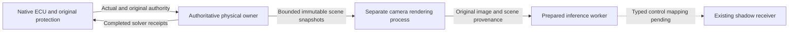

# Physics and camera rendering separation

One physical owner supplies authoritative state; a separate world renders camera
images from bounded completed snapshots. The selected Host configuration passes
three finite30s diagnostic cases. Complete visual-scene admission,300s operation
and native perception-control acceptance remain OPEN.

Current settings, timing/thermal limits and test counts are maintained in
[project status](../project-status.md#최신-m10-판단) and the
[Host profiling report](../test-plan/evidence/m10_host_profile_v5/README.md).
Earlier normal/failed experiments and the DXC lifecycle fix are indexed in
[Host execution history](../archive/implementation-history.md#m10-host-실행-이력).
The contractual ownership and timestamp rules below apply to every configuration.

## Chosen ownership boundary

Keep one authoritative physical world and the existing native ECU/Actual/solver
settlement owner. Camera rendering runs in a separate process/world that
consumes immutable completed physical snapshots. A render stall must not require
the authoritative owner to wait for rendering, camera readback, inference or IPC.

The physical owner remains the only source of solver work, sensor feedback and
energy settlement. The rendering world never supplies vehicle physics, ECU input
freshness, command authority or a replacement world clock. Re-entering world physics
from `FFrameEndSync`'s event-wait loop is outside this design: the game-thread and
scene ownership rules still apply. Removing the fence, extending input deadlines,
or moving only Python inference does not establish this boundary.

## Scene provenance and admission contract

- Export only completed snapshots with session/epoch, authoritative frame and
  logical time, original physical acquisition wall bracket, map/configuration
  identity and a complete set of relevant actor poses/dynamic scene state. Missing
  actors, incompatible geometry/weather, gaps or discontinuities must be explicit.
  An ego-only moving camera is insufficient for dynamic scene fidelity.
- Use a finite nonblocking producer channel, one immutable in-use snapshot and at
  most one pending latest snapshot. Replacement/drop is recorded. The renderer
  acknowledges no control credit. Rendering overload must not grow owner queues.
- The rendered image must retain both its actual renderer frame/time and the exact
  authoritative snapshot used for the scene. Scene acquisition age, render timing
  and callback receipt are different facts. A late callback cannot refresh scene
  age, and a renderer frame must not be relabelled as an authoritative CARLA frame.
- Define and test the new typed provenance-to-receiver mapping before enabling
  acceptance. The current same-world frame contract cannot silently ingest a second
  world's images. Preserve exclusive source/receipt100ms checks and actual-state
  wall-age<100ms; add a scene-age rejection where the old contract cannot express
  render queue delay. No cross-clock subtraction or timestamp extrapolation.
- Rendering pause, process exit, queue overflow, clock/session mismatch and
  out-of-order output must produce unavailable shadow data. Existing vehicle
  watchdogs, freshness, NoDrive, recovery and INIT authority remain unchanged.

## Ordered implementation checks

1. The explicit5ms physical owner and trusted5ms/10ms observer are implemented.
   Native ECU periods,2/4ms deadlines and HV30ms remain unchanged.
2. `physical_ai/perception/scene_mailbox_v1.py` implements one in-flight and one
   pending latest snapshot, trusted inventory/configuration, original acquisition
   age, disconnect/expiry rejection and acknowledgements with no control credit.
   Three actor-root transforms and the camera calibration are joined to original
   receipts in the live paired path. Same-frame bone/wheel/material state and full
   visual assets remain incomplete; the
   [typed provenance boundary](perception-render-provenance-v1.md) keeps images
   unavailable for control until that contract is complete.
3. Finite normal concurrency and actual renderer stop/death have separate retained
   tests. The selected30s configuration uses a20Hz scene-query cap, a20Hz renderer
   progression cap and a100ms model camera period (target10Hz). These are distinct
   rates and do not change physical5ms or relabel source timestamps. Live raw BGRA
   is written to NVMe; lossless archive compression runs after control finishes.
4. Next declare a300s trial with temperature and storage preflight. Preserve every
   actual frame and failed verdict. Measure physical service, scene→callback,
   inference and thermal behavior separately;20Hz camera throughput is not a gate.
   The target is1× wall behavior without silently slowing simulation.
5. Complete visual state and the typed native mapping before enabling perception
   control. Revalidate Required-mode unavailable/recovery and original100ms
   checks. A diagnostic concurrency pass does not open admission.

This is Host SIL work. Independent model quality, metric world modeling and each
Jetson Thor/Orin NX deployment remain separate. The transport boundary permits
later board-specific adapters; remote clock synchronization and board optimization
have not been validated.
