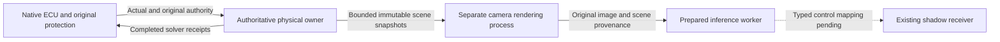

# Physics and camera rendering separation

One physical owner supplies authoritative state; a separate world renders camera
images from bounded completed snapshots. The selected Host configuration passes
three finite30s diagnostic cases, but its subsequent300s case failed the original
HV dependency freshness bound. Complete visual-scene admission, stable300s
operation and native perception-control acceptance remain OPEN.

Current settings, timing/thermal limits and test counts are maintained in
[project status](../project-status.md#최신-m10-판단) and the
[structured-state candidate and watchdog failure](../test-plan/evidence/m10_structured_state_v1/README.md).
Earlier normal/failed experiments and the DXC lifecycle fix are indexed in
[Host execution history](../archive/implementation-history.md#m10-host-실행-이력).
The contractual ownership and timestamp rules below apply to every configuration.

## Optional state-path diagnostics

`--profile-state-path` requires the existing bounded30/300s endurance mode.
The owner preallocates fixed-size monotonic/thread-CPU records for admission,
staging, pre/post physics, original acquisition, solver-work formatting and
publication. Native records each existing service call and the exact consumed
frame/acquisition source. No shared-memory ABI, control deadline or source clock
changes. Records are serialized after physical execution; `state_path` is a
sibling of the immutable original receipt, so cached scene queries remain equal.

The diagnostic join checks HV against the original work end, acquisition,
oldest actuator and coil source. HV input time is not necessarily a physical
acquisition timestamp. The unchanged physical/joint audits remain authoritative.
The read-only50ms host sampler reports sequential frequency/thermal brackets,
unavailable counters and its own CPU cost. Wall minus thread CPU includes
waiting, preemption, parallel physics work and measurement skew; it is not a
kernel scheduling trace. Diagnostic integrity alone does not establish stability.

`--structured-state` is a separate opt-in bounded-endurance candidate. Physics
and solver-work objects bypass internal serialization/parsing; canonical bounded
internal admission requests enter the same authentication/admission logic.
External RPC parser/size checks remain unchanged, and oversized or noncanonical
internal envelopes use the original text path. Before native START, the client
requires actual UE bit-exact number/state and envelope checks. Original numeric
computation, source fields, cached receipts and protection remain unchanged.
Finite object values use the direct path; NaN/Infinity use the original writer/
parser so the optimization does not bypass its rejection. Nested nonfinite
fixtures and finite pointer identity are checked before START as well.
The first live attempt stopped during INIT with a native monitor scheduling
fault; its moving comparison is unavailable and the candidate is not promoted.

## Chosen ownership boundary

Keep one authoritative physical world and the existing native ECU/Actual/solver
settlement owner. Camera rendering runs in a separate process/world that
consumes immutable completed physical snapshots. A render stall must not require
the authoritative owner to wait for rendering, camera readback, inference or IPC.

The physical owner remains the only source of solver work, sensor feedback and
energy settlement. The rendering world never supplies vehicle physics, ECU input
freshness, command authority or a replacement world clock. Re-entering world physics
from `FFrameEndSync`'s event-wait loop is outside this design: the game-thread and
scene ownership rules still apply. Removing the fence, extending input deadlines,
or moving only Python inference does not establish this boundary.

## Scene provenance and admission contract

- Export only completed snapshots with session/epoch, authoritative frame and
  logical time, original physical acquisition wall bracket, map/configuration
  identity and a complete set of relevant actor poses/dynamic scene state. Missing
  actors, incompatible geometry/weather, gaps or discontinuities must be explicit.
  An ego-only moving camera is insufficient for dynamic scene fidelity.
- Use a finite nonblocking producer channel, one immutable in-use snapshot and at
  most one pending latest snapshot. Replacement/drop is recorded. The renderer
  acknowledges no control credit. Rendering overload must not grow owner queues.
- The rendered image must retain both its actual renderer frame/time and the exact
  authoritative snapshot used for the scene. Scene acquisition age, render timing
  and callback receipt are different facts. A late callback cannot refresh scene
  age, and a renderer frame must not be relabelled as an authoritative CARLA frame.
- Define and test the new typed provenance-to-receiver mapping before enabling
  acceptance. The current same-world frame contract cannot silently ingest a second
  world's images. Preserve exclusive source/receipt100ms checks and actual-state
  wall-age<100ms; add a scene-age rejection where the old contract cannot express
  render queue delay. No cross-clock subtraction or timestamp extrapolation.
- Rendering pause, process exit, queue overflow, clock/session mismatch and
  out-of-order output must produce unavailable shadow data. Existing vehicle
  watchdogs, freshness, NoDrive, recovery and INIT authority remain unchanged.

## Ordered implementation checks

1. The explicit5ms physical owner and trusted5ms/10ms observer are implemented.
   Native ECU periods,2/4ms deadlines and HV30ms remain unchanged.
2. `physical_ai/perception/scene_mailbox_v1.py` implements one in-flight and one
   pending latest snapshot, trusted inventory/configuration, original acquisition
   age, disconnect/expiry rejection and acknowledgements with no control credit.
   Three actor-root transforms and the camera calibration are joined to original
   receipts in the live paired path. Same-frame bone/wheel/material state and full
   visual assets remain incomplete; the
   [typed provenance boundary](perception-render-provenance-v1.md) keeps images
   unavailable for control until that contract is complete.
3. Finite normal concurrency and actual renderer stop/death have separate retained
   tests. The selected30s configuration uses a20Hz scene-query cap, a20Hz renderer
   progression cap and a100ms model camera period (target10Hz). These are distinct
   rates and do not change physical5ms or relabel source timestamps. Live raw BGRA
   is written to NVMe; lossless archive compression runs after control finishes.
4. Preserve every actual frame and failed verdict. Recovery V3 fixes the earlier
   standalone auditor import failure without changing runtime or deadlines. Both
   30s cases and all eight frozen supplemental audits pass. The300s case fails
   at60.242013606s with held HV dependency age30.883485ms. Its first main GC takes
   17.925938ms; four normal post-GC frames still inherit the pre-GC dependency.
   First incremental purge finishes in408 calls over2.017s, maximum156.412us.
   Original60000 admissions,36009 ingress records and first-fault replay match.
   At the exact next pump6.955483ms after GC, both the original300us and a
   counterfactual0 extra preview reject the published proof for wheel freshness.
   These read-only queries do not establish a different physical trajectory.
   All1,500,000 eligible native slots complete without missing/late entries in
   this case; intermittent gaps and cooling margin remain open. Maximum observed
   CPU temperature is89°C with no observed throttle-counter increase. Camera
   rate is9.233Hz; pre-fault results have80.227ms median and85.999ms p95, with
   one100ms exceedance. Protected-hold video is not normal-driving acceptance.
   The prospective owner4/image2 comparison transfers one whole physical core
   with its SMT sibling. The unchanged module, model,300us preview, final
   Admission class, pre-physics guard,5ms interval, HV30ms and held-expiry order
   remain fixed. Measure both GC recovery and possible image-side contention;
   preparation success does not establish70% physical acceptance.
   See the [current decision and evidence](../project-status.md#최신-m10-판단)
   and [execution history](../archive/implementation-history.md#m10-host-실행-이력).
   20Hz camera throughput is not a gate; the target remains1× wall behavior
   without silently slowing simulation.
5. Complete visual state and the typed native mapping before enabling perception
   control. Revalidate Required-mode unavailable/recovery and original100ms
   checks. A diagnostic concurrency pass does not open admission.

This is Host SIL work. Independent model quality, metric world modeling and each
Jetson Thor/Orin NX deployment remain separate. The transport boundary permits
later board-specific adapters; remote clock synchronization and board optimization
have not been validated.
