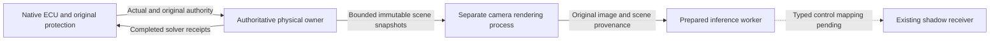

# Physics and camera rendering separation: next prototype boundary

Status: **selected Host configuration passes three finite30s concurrent trials;
physical progress through actual renderer stop/death verified; complete-scene,
300s and perception-control acceptance OPEN**. The
[fence comparison](../test-plan/evidence/m10_fence_compare_v1/README.md) locates
42.21ms of one45.95ms physical-service gap inside a render-thread completion event.
The camera-free run also failed later, with0 normal physical intervals. Separating
rendering is therefore a candidate for one dependency, not a demonstrated cure for
all vehicle availability failures.

The latest [Host profiling comparison](../test-plan/evidence/m10_host_profile_v5/README.md)
retains five failed experiments and selects shared four-core rendering/inference,
CFS owner scheduling, blocking CUDA host wait and raw NVMe recording. Renderer
wall cap20Hz with camera100ms model cadence keeps the camera target10Hz and
reduces delivery delay. F/G/H each complete6000 original5ms intervals with no
protection or missed execution slots. Median scene→result is76.89–77.48ms, but
20/840 outputs exceed100ms and the maximum is328.89ms. No timestamp or acceptance
bound changes; incomplete visual state still keeps all results unavailable.
Peak CPU95–97°C and one run's thermal counter increase remain, as does the
unperformed300s trial. Raw archives are compressed only after live work ends.

The [paired implementation](../test-plan/evidence/m10_paired_v3/README.md) now
captures three same-frame SDK actor roots and joins them to the original native
receipt, checks the body-to-actor transform, and applies an explicit camera
calibration on the separate renderer. Its D-FINE output remains diagnostic only,
with no publication to the native receiver. V3 completed400 physical intervals
with238 normal and0 protected while rendering65 images and performing32 inferences.
Its misplaced walker was corrected in [V4](../test-plan/evidence/m10_paired_v4/README.md),
but that run failed the unchanged30ms HV dependency bound at30.334ms. A finite pass
does not establish repeated-run stability. Earlier cold-cache preparation failures
are retained. [V5](../test-plan/evidence/m10_paired_v5/README.md) then capped receipt
queries at20Hz with all physical/native/freshness guards unchanged:400 intervals,
234 normal,0 protected,37 overlapping inferences and scene→result maximum92.517ms.
This workload comparison does not establish the cause of V4 or a latency guarantee.
Full visual-scene admission remains unavailable.

[V7](../test-plan/evidence/m10_paired_v7/README.md) also verifies51 physical starts
while the renderer is actually stopped and49 after its actual death is observed.
All400 intervals settle without protection. Its earlier injection and pidfd-based
dead-server cleanup follow retained V6 failure; all100ms/HV30 guards remain.
Repeated-run stability and V4's root cause remain open.

[Endurance V3](../test-plan/evidence/m10_endurance_v3/README.md) then failed all
three declared30s normal cases. Case01 completed6000 intervals with20 normal and
5818 protected; HV30ms expired and the lossless recording queue later overflowed.
Cases02/03 ended at106/87 intervals before normal arming, with missing front
Actual packets. Case02 also required forced renderer shutdown after30s. The
conditional300s run was not started. Diagnostic horizon/storage extensions keep
all original deadlines and default capacities; the original module is restored.
No long-run concurrency, leak, full-scene or perception-control acceptance follows.

## Chosen ownership boundary

Keep one authoritative physical world and the existing native ECU/Actual/solver
settlement owner. Prototype camera rendering in a separate process/world that
consumes immutable completed physical snapshots. A render stall must not require
the authoritative owner to wait for rendering, camera readback, inference or IPC.
The first owner-only experiment must explicitly declare its rendering mode; the
camera-absent comparison used renderer ON and does not validate a no-render owner.

The subsequent [owner5ms V2 case](../test-plan/evidence/m10_owner_split_v2/README.md)
used no-render/NullRHI/inline rendering and completed400 intervals with234 normal,
zero protective intervals in2.002217 wall seconds. HV30 and original ECU rates and
deadlines remain. V1's first5ms snapshot was rejected by the old10ms-only observer;
the explicit-period correction and failed original trial are retained separately.

The physical owner remains the only source of solver work, sensor feedback and
energy settlement. The rendering world never supplies vehicle physics, ECU input
freshness, command authority or a replacement world clock. Re-entering world physics
from `FFrameEndSync`'s event-wait loop is outside this design: the game-thread and
scene ownership rules still apply. Removing the fence, extending input deadlines,
or moving only Python inference does not establish this boundary.

## Contract that must precede implementation

- Export only completed snapshots with session/epoch, authoritative frame and
  logical time, original physical acquisition wall bracket, map/configuration
  identity and a complete set of relevant actor poses/dynamic scene state. Missing
  actors, incompatible geometry/weather, gaps or discontinuities must be explicit.
  An ego-only moving camera is insufficient for dynamic scene fidelity.
- Use a finite nonblocking producer channel, one immutable in-use snapshot and at
  most one pending latest snapshot. Replacement/drop is recorded. The renderer
  acknowledges no control credit. Rendering overload must not grow owner queues.
- The rendered image must retain both its actual renderer frame/time and the exact
  authoritative snapshot used for the scene. Scene acquisition age, render timing
  and callback receipt are different facts. A late callback cannot refresh scene
  age, and a renderer frame must not be relabelled as an authoritative CARLA frame.
- Define and test the new typed provenance-to-receiver mapping before enabling
  acceptance. The current same-world frame contract cannot silently ingest a second
  world's images. Preserve exclusive source/receipt100ms checks and actual-state
  wall-age<100ms; add a scene-age rejection where the old contract cannot express
  render queue delay. No cross-clock subtraction or timestamp extrapolation.
- Rendering pause, process exit, queue overflow, clock/session mismatch and
  out-of-order output must produce unavailable shadow data. Existing vehicle
  watchdogs, freshness, NoDrive, recovery and INIT authority remain unchanged.

## Ordered implementation checks

1. Completed diagnosis: original10ms command coverage was shorter than the physical
   interval plus4ms preview; the preserved1537-row/80-receipt replay is exact. The
   already-supported explicit5ms owner profile avoids changing those deadlines.
2. Finite owner verification completed:400 receipts,234 normal intervals, no
   protection or owner deadline miss, with the corrected explicit5ms state observer.
   The original10ms camera baseline is retained; this short case is not long-term
   physical or rendering acceptance.
3. Snapshot transport is implemented in `physical_ai/perception/scene_mailbox_v1.py`:
   one in-flight plus one pending latest; fixed trusted inventory/configuration,
   original acquisition age, disconnect/expiry rejection and private acknowledgements
   with no control credit. Tests include a stalled consumer process and exact400
   original-receipt kinematic replay. Three actor-root acquisition/application and
   actual diagnostic concurrency are implemented; full dynamic-scene state remains
   incomplete. The
   [typed renderer provenance boundary](perception-render-provenance-v1.md) and
   [standalone2K replay](../test-plan/evidence/m10_render_replay_v2/README.md) now
   preserve12 original-to-renderer frame associations across3 retained poses.
   All19 actual images are retained; the whole trial failed server shutdown.
   Kinematic images remain unavailable because complete scene export is missing.
   The [subsequent quiescent renderer](../test-plan/evidence/m10_render_shutdown_v2/README.md)
   holds its actual final frame during3.587s of storage and exits in1.617s. A prior
   unchanged-cleanup diagnostic also exited cleanly; the earlier hang is not fixed
   by evidence. Conditional bounded post-SIGINT thread diagnosis remains available.
   Actual actor/camera transforms now rejoin in the paired run; full visual assets
   and bone/wheel animation remain unavailable. V5 normal and V7 actual live
   stall/crash cases now pass their finite diagnostic audits with native perception
   acceptance0. V4/V6 failures remain; a stalled IPC fixture is not that live test.
4. Freeze each fresh bounded2K paired experiment with full raw retention. Measure
   physical service, scene-to-callback and inference separately. Require no20Hz
   target; evaluate1× wall behavior without silently slowing simulation. Host
   resource contention between processes remains a measurement question.
5. Next verify repeated/longer physical stability under the declared20Hz workload;
   V4's failed original HV audit prevents a general stability claim. Then complete
   same-frame visual state and the typed native mapping before allowing any image
   into control. Revalidate Required-mode unavailable/recovery and original100ms
   checks with that complete contract; no diagnostic pass opens admission.

This is Host SIL work. Required live perception authority, independent model
quality, metric world modeling and Jetson Thor/Orin NX deployment remain separate.
The transport boundary should permit later board-specific adapters, but no remote
clock synchronization or board optimization is claimed here.

[Remediation V4–V8](../test-plan/evidence/m10_remediation_v1/README.md) preserves
all control/freshness guards. A10Hz wall-paced2K renderer retained300 raw frames
and293 calls without loss over the30s trial, but only667 physical intervals were
normal. Thermal100C/0.8GHz observations and original protection keep normal
endurance OPEN. Source receipt export remains capped20Hz. A renderer cap is not
a physical-world tick change, source-time rewrite or accepted perception output.

The [DXC lifetime fix](../test-plan/evidence/m10_dxc_lifetime_v1/README.md) keeps
the shutdown mutex alive through the final llvm_shutdown. Standalone negative
controls and two empty CARLA lifecycle checks verify the narrow fix. These checks
create no sensor or native session and do not establish normal control endurance.
