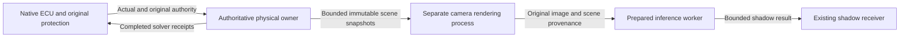

# Physics and camera rendering separation: next prototype boundary

Status: **finite owner-only case verified; snapshot IPC component implemented;
live rendering separation not yet implemented or accepted**. The
[fence comparison](../test-plan/evidence/m10_fence_compare_v1/README.md) locates
42.21ms of one45.95ms physical-service gap inside a render-thread completion event.
The camera-free run also failed later, with0 normal physical intervals. Separating
rendering is therefore a candidate for one dependency, not a demonstrated cure for
all vehicle availability failures.

## Chosen ownership boundary

Keep one authoritative physical world and the existing native ECU/Actual/solver
settlement owner. Prototype camera rendering in a separate process/world that
consumes immutable completed physical snapshots. A render stall must not require
the authoritative owner to wait for rendering, camera readback, inference or IPC.
The first owner-only experiment must explicitly declare its rendering mode; the
camera-absent comparison used renderer ON and does not validate a no-render owner.

The subsequent [owner5ms V2 case](../test-plan/evidence/m10_owner_split_v2/README.md)
used no-render/NullRHI/inline rendering and completed400 intervals with234 normal,
zero protective intervals in2.002217 wall seconds. HV30 and original ECU rates and
deadlines remain. V1's first5ms snapshot was rejected by the old10ms-only observer;
the explicit-period correction and failed original trial are retained separately.

The physical owner remains the only source of solver work, sensor feedback and
energy settlement. The rendering world never supplies vehicle physics, ECU input
freshness, command authority or a replacement world clock. Re-entering world physics
from `FFrameEndSync`'s event-wait loop is outside this design: the game-thread and
scene ownership rules still apply. Removing the fence, extending input deadlines,
or moving only Python inference does not establish this boundary.

## Contract that must precede implementation

- Export only completed snapshots with session/epoch, authoritative frame and
  logical time, original physical acquisition wall bracket, map/configuration
  identity and a complete set of relevant actor poses/dynamic scene state. Missing
  actors, incompatible geometry/weather, gaps or discontinuities must be explicit.
  An ego-only moving camera is insufficient for dynamic scene fidelity.
- Use a finite nonblocking producer channel, one immutable in-use snapshot and at
  most one pending latest snapshot. Replacement/drop is recorded. The renderer
  acknowledges no control credit. Rendering overload must not grow owner queues.
- The rendered image must retain both its actual renderer frame/time and the exact
  authoritative snapshot used for the scene. Scene acquisition age, render timing
  and callback receipt are different facts. A late callback cannot refresh scene
  age, and a renderer frame must not be relabelled as an authoritative CARLA frame.
- Define and test the new typed provenance-to-receiver mapping before enabling
  acceptance. The current same-world frame contract cannot silently ingest a second
  world's images. Preserve exclusive source/receipt100ms checks and actual-state
  wall-age<100ms; add a scene-age rejection where the old contract cannot express
  render queue delay. No cross-clock subtraction or timestamp extrapolation.
- Rendering pause, process exit, queue overflow, clock/session mismatch and
  out-of-order output must produce unavailable shadow data. Existing vehicle
  watchdogs, freshness, NoDrive, recovery and INIT authority remain unchanged.

## Ordered implementation checks

1. Completed diagnosis: original10ms command coverage was shorter than the physical
   interval plus4ms preview; the preserved1537-row/80-receipt replay is exact. The
   already-supported explicit5ms owner profile avoids changing those deadlines.
2. Finite owner verification completed:400 receipts,234 normal intervals, no
   protection or owner deadline miss, with the corrected explicit5ms state observer.
   The original10ms camera baseline is retained; this short case is not long-term
   physical or rendering acceptance.
3. Snapshot transport is implemented in `physical_ai/perception/scene_mailbox_v1.py`:
   one in-flight plus one pending latest; fixed trusted inventory/configuration,
   original acquisition age, disconnect/expiry rejection and private acknowledgements
   with no control credit. Tests include a stalled consumer process and exact400
   original-receipt kinematic replay. Full dynamic-scene acquisition/application,
   actual renderer integration and rendered-image provenance remain to implement.
   Then inject a live render stall/exit and show continued original physical receipts
   while shadow data becomes unavailable. A stalled IPC fixture is not that live test.
4. Freeze a fresh bounded2K paired experiment with full raw retention. Measure
   physical service, scene-to-callback and inference separately. Require no20Hz
   target; evaluate1× wall behavior without silently slowing simulation. Host
   resource contention between processes remains a measurement question.

This is Host SIL work. Required live perception authority, independent model
quality, metric world modeling and Jetson Thor/Orin NX deployment remain separate.
The transport boundary should permit later board-specific adapters, but no remote
clock synchronization or board optimization is claimed here.
