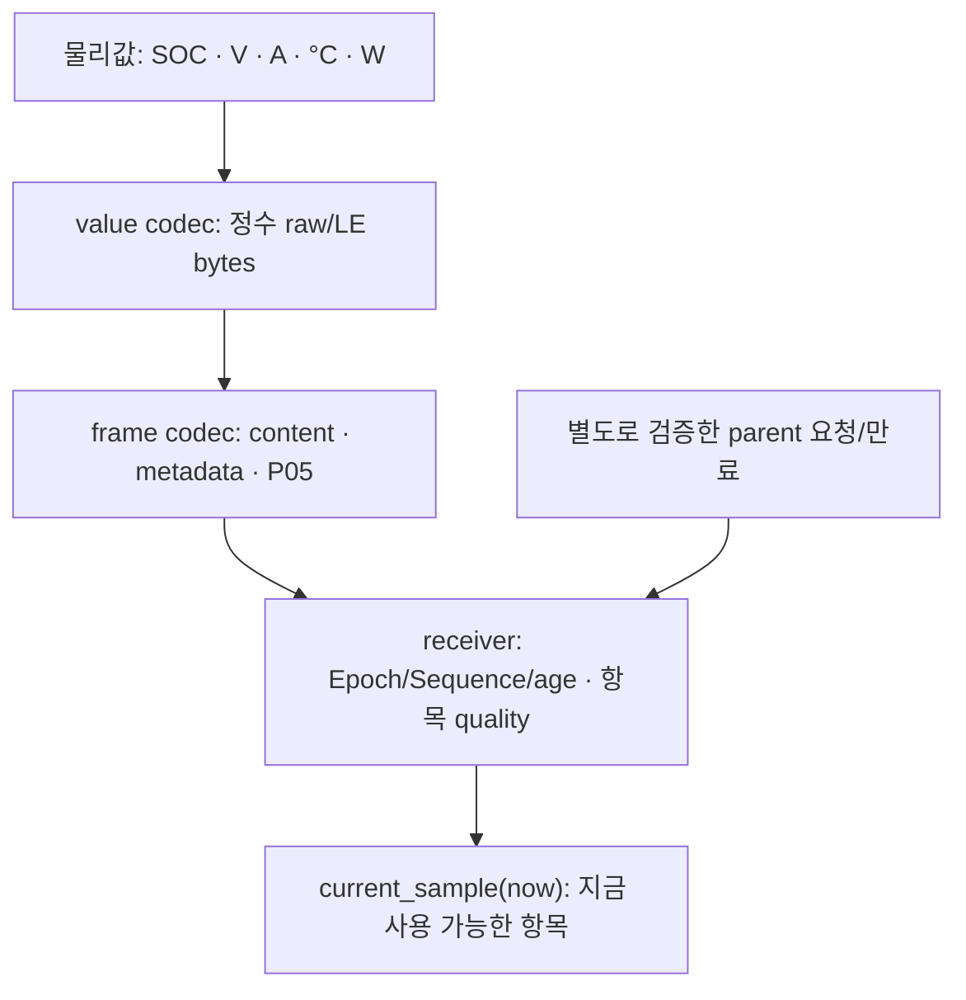

# M1 BMS 물리값·frame codec과 항목별 수신부

Date: 2026-10-14. Status: **Host 구현·unit/local vCAN 검사 / 학습자 review·직접 재현 PENDING**.
[BMS wire](../icd/bms_frame_draft.md), [ADR-0017](../adr/ADR-0017-bms-codec-receiver.md)을 구현했다.
EV 독립 process/vCAN도 연결·시험했다. BMS 한계 산출/전원 모델과 차량 주행 gate는 후속 작업이다.

## 현재 흐름과 파일



| 파일 | 책임 |
| --- | --- |
| [bms_value_codec](../../interfaces/bms/bms_value_codec.hpp) | finite/range, rounding, signed/unsigned raw와 sentinel |
| [bms_frame_codec](../../interfaces/bms/bms_frame_codec.hpp) | 6개 frame의 typed content, 48/64-byte layout, canonical/P05 검사와 원천 limit 전달 |
| [bms_receiver](../../interfaces/bms/bms_receiver.hpp) | trusted INIT, source/dependency/parent/expiry, 독립 항목의 usable view와 timeout |
| [actuator_socketcan](../../interfaces/socketcan/actuator_socketcan.hpp) | Linux native frame 변환; 잘못된 ID/flags/length도 검사 전에 보존 |
| [bms_test](../../tests/unit/bms_test.cpp) | BMS domain 단위 시험 28개 |

6개 frame은 PowerRequest, PowerStatus, PowerLimits, BatteryState, DriveBatteryLimits,
DrivePermission이다. Limits는 W이며 motor wheel torque N·m로 바꾸는 모델은 아직 없다.
`forward_bms_limits`는 BMS 원천 sequence/epoch/source/input/causal/content를 보존하고
전달 frame 종류만 바꾼다. 새 CRC/Data ID/transport counter는 전달 stream의 TX state가 담당한다.
이는 Front/Rear routing runtime을 구현했다는 뜻은 아니다.

## 수신 성공과 사용 가능의 차이

`receive`의 Accepted는 envelope/application cursor 수용이다. `quality`가 해당 항목의
Usable/Unavailable/Stale/Invalid를 별도로 알려준다. `last_accepted()`는 원시 진단 기록이다.
제어 소비자는 `current_sample(now_ns)`로 시각을 다시 검사한 view를 사용해야 한다.
Unknown이나 stale 항목이 이전 정상 값으로 되돌아가지 않는다.

| Frame | 독립 검사 group |
| --- | --- |
| BatteryState | SOC / 같은 acquisition의 voltage·current / temperature |
| PowerLimits·DriveBatteryLimits | charge limit / discharge limit |
| PowerStatus | lifecycle / contactors·조건 mask·HV bus의 필수 physical 입력 |
| PowerRequest·DrivePermission | action 또는 permission과 그 만료/원천 관계 |

충전 limit가 valid 0이면 회생 충전 허용량이 0이라는 **알려진 값**이다.
Unknown은 한계를 판단할 입력이 없다는 뜻이다. 방전 limit만 계속 정상이어도 충전 항목의
last-usable RX가 갱신되지 않는다. Cached 관측 acquisition이나 power physical-input batch의
재전송도 해당 healthy RX를 갱신하지 않는다. Source time과 oldest dependency time을
별도로 검사해 새 계산 시각으로 오래된 모델 입력을 숨기지 않는다.

Critical source 50 ms, dependency 70 ms, RX timeout 80 ms는 시작값이다.
관측은 group age 150 ms, envelope timeout 300 ms로 구분한다. Group 하나의 관측 상실로
다른 관측 group을 정상화하거나 critical stream 전체 상실로 간주하지 않는다.
Critical group timeout/clock rollback은 latched이며 늦은 정상 frame으로 해제되지 않는다.
`start_session`은 외부가 승인한 새 nonzero Epoch와 monitor-enable 시각을 요구한다.
Local vCAN fixture에서 80..100 ms loss 검출을 확인했다. 실제 Zone task의 monitor 10 ms와
dispatch/jitter margin 10 ms 충족은 후속 통합·부하 시험 대상이다.

NormalPath power request와 AllowNormal permission에는 수신 CAN과 별도로 검증한 Central
요청의 `BmsParentContext`를 제공한다. Epoch/causal/source/deadline과 parent age를 비교한다.
새 CAN counter나 같은 parent의 재계산으로 원래 만료를 연장하지 않는다. 독립 context의
생성·전달 coordinator는 아직 없으며 단위 시험은 trusted fixture를 제공한다.
Enable은 INIT에서 power checks를 요청할 수 있다. 실제 HV_READY와 normal torque 허가는
다르며 Drive는 torque/limits/permission/session과 자신의 실제 HV 입력을 함께 검증해야 한다.
`bms_power_is_ready`와 `bms_permission_allows_normal`은 해당 판단 보조이며 통합 actuation gate가 아니다.

Drive의 `max_capability_input_age_ns`를 추가했다. 생략하면 기존 feedback age(기본 30 ms)를
사용한다. EV 연결에서 input age 70 ms를 명시할 수 있지만 torque actual, wheel/capability
source age는 30 ms로 유지한다. 이 opt-in 경계도 기존 Drive 단위 시험에 추가했다.

## 직접 실행

```sh
cmake -S . -B build/m1-angle -DCMAKE_BUILD_TYPE=Debug
cmake --build build/m1-angle --parallel 2
ctest --test-dir build/m1-angle --output-on-failure
build/m1-angle/actuator_demo bms-value soc 0.75
build/m1-angle/actuator_demo bms-value current -12.3
build/m1-angle/actuator_demo bms-frame limits nominal
build/m1-angle/actuator_demo bms-frame limits zero
build/m1-angle/actuator_demo bms-frame limits partial
build/m1-angle/actuator_demo bms-receiver
build/m1-dbc-venv/bin/python tools/check_actuator_dbc.py --demo build/m1-angle/actuator_demo
```

Sanitizer와 actuator/EV transport는 같은 build/runner를 사용한다. 아래 63개는 BMS 연결 당시의
검사 범위다. 후속 [session/queue](m1_session_queue.md)까지 포함한 기본 실행은 89개,
`--family ev`는 49개, `--family actuator`는 40개다.

```sh
cmake -S . -B build/m1-angle-sanitized -DCMAKE_BUILD_TYPE=Debug -DSTRATADRIVE_SANITIZERS=ON
cmake --build build/m1-angle-sanitized --parallel 2
ctest --test-dir build/m1-angle-sanitized --output-on-failure
unshare --user --map-root-user --net python3 tests/integration/can/check_socketcan.py --build-dir build/m1-angle
unshare --user --map-root-user --net python3 tests/integration/can/check_socketcan.py --build-dir build/m1-angle-sanitized
```

SOC 0.75는 raw 7500/LE `4C 1D`로 복원된다. `bms-frame`은 request/power-status/limits/
battery/drive-limits/permission의 nominal/zero/invalid fixture를 출력한다. Partial은 limits/
drive-limits/battery/power-status에서 지원한다. 실제 model sample이나 socket 송신은 아니다.

`bms-receiver`는 +0 ms charge 120 kW/discharge 200 kW에서 시작해 +20 ms charge valid 0,
+40/60/80 ms charge unknown/discharge fresh를 수신한다. +100 ms에 charge 마지막 valid RX
+20 ms부터 80 ms timeout을 latch한다. 별도 permission은 parent expiry +20 ms에서 사용이
금지된다. 예제 physical range/값은 공학 fixture이며 특정 실차의 calibration이 아니다.

## 실행 증거와 한계

GCC 11.4.0/C++17, CMake 4.3.2, GoogleTest 1.11.0, Cantools 40.7.1을 사용했다.
2026-10-14 normal·ASan/UBSan 각각 unit **129/129 PASS**다. BMS 28개는 5종 물리량의
모든 uint16 raw, 6개 독립 golden, 336개 payload byte의 모든 single-bit 변조, 잘못된
Data ID/flag/length/reserved/시간, exact uint64, 독립 counter와 원천 전달을 검사한다.
Partial 센서/limit, physical range, model identity rollback/cached input, parent 누락/변경/
만료, INIT Enable, actual readiness와 permission 구분, new Epoch/timeout/clock rollback을 시험했다.
DBC 도구는 전체 12개 frame과 C++ payload **36개**(actuator 14 + EV 22)를 교차 검증한다.
EV canonical 거부 vector 51개와 valid-zero/unknown/partial positive fixture도 검사한다.

Static analysis와 local vCAN 결과는 [품질 정책](../quality_policy.md)에 기록한다.
Actual coordinator/DDS, local HV 검증·torque 적용, power sequence/고장 물리 출력과 전체
TC-EV는 NOT RUN이다. Local fixture 결과를 차량/Target timing 보장으로 확대하지 않는다.

## EV SocketCAN 연결과 wall-time 시험

기존 `tests/integration/can/socketcan_tx.cpp`, `socketcan_rx.cpp`, `socketcan_support.hpp`,
`check_socketcan.py`를 확장했다. 별도 실행 프로그램/runner를 추가하지 않았다.
임시 vCAN에서 각 frame의 독립 TX/RX를 실행하며 trace는 build의 `socketcan-results/`에 남긴다.

Harness가 shared CLOCK_MONOTONIC의 monitor-enable, Epoch, 승인된 parent identity/deadline
목록을 stdin으로 각각 제공한다. Receiver는 CAN의 causal key로 그 목록을 조회하며
CAN 값으로 권한이나 만료를 생성하지 않는다. 이는 테스트용 trusted bootstrap이고 실제
Central/Front/Rear coordinator·DDS protocol의 구현은 아니다.

EV 36개 case는 6종류 각각 normal/faults/silent/flood 24개와 추가 12개다.
2026-10-14 normal·ASan/UBSan 각각 전체 **63/63 PASS**다.

- Normal은 10/20/100 ms의 frame별 논리 publication을 실행한다. SOC·V/A/온도와
  power readiness, INIT Enable, 48/64-byte 길이와 원천 source/sequence를 대조한다.
- Faults는 duplicate, extension CRC corruption, length/classic/extended/BRS,
  wrong Epoch, stale source, fresh counter의 cached sequence, CRC를 다시 붙인 reserved 오류,
  unknown과 timeout 후 late frame을 검사한다. Flood 중 RX dispatch budget은 cycle당 8개다.
- Partial limits는 valid charge 0 → unknown에서도 discharge가 진행하는 동안 charge의
  마지막 usable RX부터 독립 timeout을 확인한다. Cached limits/power input은 새 envelope로
  dependency age나 physical-input healthy RX가 갱신되지 않는지 검사한다.
- Observation은 cached SOC/끊긴 온도와 fresh voltage·current를 분리한다. 관측 envelope의
  300 ms timeout을 critical 80 ms와 구분하며 전자를 FAIL_SAFE 물리 반응으로 판정하지 않는다.
- Request/permission은 35 ms expiry, parent 누락/불일치/rollback/만료 연장 거부와 explicit
  non-driving Shutdown/Inhibit를 검사한다. Timeout 이후 승인된 새 Epoch의 INIT/rejoin을 시험한다.
- Forward는 **TX(BmsPowerLimits) → relay → RX(DriveBatteryLimits)**의 3 process 시험이다.
  원천 source/input time·model causal sequence와 양쪽 limit를 보존한다. Source counter 0..4와
  downstream counter 5..9를 독립적으로 검사한다(첫 값 5는 P05 startup window 안의 fixture).

Critical loss 검출은 마지막 usable RX부터 80..100 ms, 관측은 300..320 ms로 판정한다.
Expiry use gate는 RX timeout을 기다리지 않고 닫는다. 각 역할의 stdio 준비/시작 handshake를
기다리고 성공·실패 trace를 보존한다. Kernel overflow는 후속 session/queue에서 주입했다.
vCAN의 전기적 동작·arbitration, 실제 Zone round-trip 및 BMS 물리 한계 산출은 시험 범위 밖이다.

영속 local Epoch/queue의 M1 기술 검사를 완료했고 wire/학습자 review와 함께 M2 응답 모델로 진행한다.
M2에서는 로컬 battery 모델의 셀 전압·온도 극값 입력, 실제 power response와 BMS limit
산출을 구현한다. 구체적인 [모델 범위](../icd/ev_power_bms_design.md#로컬-셀-극값-입력)는 별도다.
