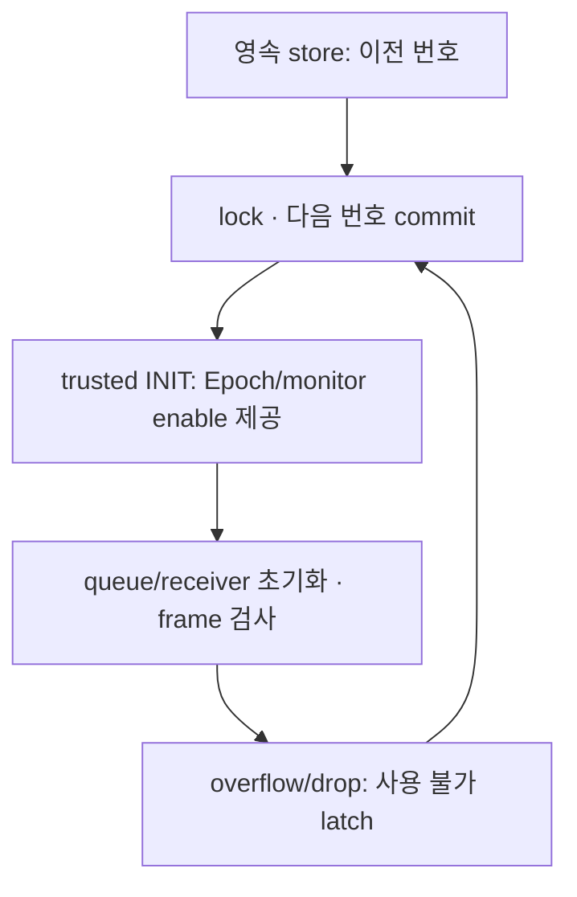

# M1 마무리: 세션 번호와 수신 큐

Date: 2026-10-14. Status: **local technical 검사 / 학습자 이해·wire 채택 review PENDING**.
[ADR-0018](../adr/ADR-0018-local-session-and-rx-continuity.md)을 구현한다.
M1 통신의 남은 startup/queue 부분을 다루며 M2 actuator/battery/power 모델은 후속이다.

## Epoch를 누가 발급하나

Epoch는 현재 실행 세션의 번호다. Application Sequence와 P05 Counter는 그 세션 안에서
진행한다. 수신 CAN에서 Epoch를 배우지 않고 trusted 시작 경로가 모든 participant에 제공한다.
최종 구조에서는 Front의 session coordinator가 소유한다. 지금은 M1 test harness가
[EpochStore](../../zone/session/epoch_store.hpp)를 기존 `actuator_demo epoch` 명령으로 호출한다.
발급 process가 종료되고 새로 실행돼도 같은 저장소의 다음 번호를 발급한다.



`initialize`는 **존재하지 않는 새 directory에 한 번만** 수행한다. Record는 16 bytes이며
magic/version 8 bytes, uint32 Epoch LE와 complement 각 4 bytes다. 초기 record 0은 아직
발급 없음이고 frame Epoch 0은 여전히 금지다. `issue`는 이전 번호+1을 확정한 뒤 반환한다.
Record·lock 상실/손상, busy lock, I/O 오류나 uint32 소진은 새 grant를 만들지 않는다.
기존 저장소를 1로 재설정하지 않고, 발급 후 사용 전에 종료된 번호는 건너뛴다.

Startup file I/O는 control/monitor cycle 밖에서 수행한다. Stable lock을 유지하며 pending
file fsync → rename → directory fsync로 commit한다. 이전 pending은 미발급 데이터로
간주하지만 committed record가 손상됐으면 이를 pending으로 복원하지 않는다.
이 시험은 process restart·동시 발급과 error path를 확인하며 실제 power-cut 시험은 아니다.
운영 저장소를 삭제하거나 과거 backup으로 되돌리지 않는다는 소유·보존 계약이 필요하다.
Storage 상실 시에는 세션을 중지하고 관리된 재provision을 별도 검토한다.

```sh
# 최초 새 저장소에서 한 번만 실행. 이미 존재하면 거부한다.
build/m1-angle/actuator_demo epoch init build/epoch-example
build/m1-angle/actuator_demo epoch next build/epoch-example
build/m1-angle/actuator_demo epoch next build/epoch-example
```

두 `next`의 예상 값은 1, 2다. 이후 새 process의 `next`는 3이다.
수신부 `start_session`은 더 큰 Epoch와 비감소 clock을 요구한다. 이것은 통신 session
초기화이며 실제 HV readiness/정상 주행 허가를 자동으로 생성하는 기능이 아니다.
Vehicle management, peer/parent context의 실제 DDS protocol은 여전히 M4/M5 범위다.

## 큐가 넘치면 왜 기존 값을 버리나

[BoundedRxQueue](../../interfaces/common/bounded_rx_queue.hpp)는 단일 owner의 고정 용량 FIFO다.
M1 fixture는 32 entries를 사용하고 cycle마다 최대 8개를 ingest/dispatch한 뒤 monitor를
확인한다. 조용한 시간에는 1 ms sleep한다. 수신 처리로 monitor가 무한히 밀리지 않게 한다.
Capacity와 budget은 프로젝트 시작값이며 M2/M3 부하·task 시험에서 다시 검토한다.

Application queue full 또는 누적 kernel drop count 변화가 관측되면 backlog를 비우고
queue를 latch한다. Domain receiver에도 `mark_continuity_lost`를 전달한다.
`current_sample(now)`는 값이 없고, 뒤의 정상 packet도 이를 해제하지 못한다.
`last_accepted()`는 원인 분석용 history로 남는다. Clock/timeout fault는 continuity event로
정상화하지 않는다. 새 trusted Epoch/INIT만 다시 시작할 수 있다.

Kernel drop 이후에는 새 socket으로 RX backlog/drop counter를 정리해야 한다. 새 Epoch로
queue만 reset한 뒤 오염된 socket의 cumulative drop을 받으면 다시 latch한다.
Drop ancillary report는 후속 수신 packet에서 관측되므로 하드웨어 loss 발생 시각과 report
시각을 같은 것으로 기록하지 않는다. Timeout/source age monitor는 ingress/dispatch 중단 중에도 실행한다.
관측 BatteryState의 continuity error는 관측 unavailable이며 그 자체로 차량 FAIL_SAFE를 주장하지 않는다.

재시작에서 이전 Epoch의 P05 counter가 200이고 새 producer가 0부터 시작하는 경우도
검사한다. 이전 Epoch를 거부하면서 현재 transport check state까지 오염시키지 않아야 한다.
수신부는 CRC/canonical로 확인한 다른 Epoch의 P05 상태 변경을 되돌린다.
이는 P05의 인증 기능을 추가한 것이 아니며 trusted bootstrap은 별도 경계다.

## 실행과 판정

```sh
cmake -S . -B build/m1-angle -DCMAKE_BUILD_TYPE=Debug
cmake --build build/m1-angle --parallel 2
ctest --test-dir build/m1-angle --output-on-failure
unshare --user --map-root-user --net python3 tests/integration/can/check_socketcan.py
```

Runner는 격리된 새 test bus마다 private store를 explicit initialize하고 매 case마다
독립 C++ issuer process에서 다음 Epoch를 발급한다. Rejoin의 다음 번호도 미리 reserve한다.
`socketcan-results/epoch-run-*/store`와 TX/RX 로그에 원천/수신 시각·Epoch를 보존한다.
운영 bus의 저장소를 매번 새로 만드는 예제가 아니다. Family 선택은 `--family actuator`
또는 `--family ev`이며 respective 40/49개 case, 기본 all은 89개다.

| 기술 검사 | 판정 범위 |
| --- | --- |
| Unit 143개 | 기존 129 + session/queue 14; 동시 발급, 손상·상실·lock·소진/I/O, FIFO/latch, 12개 receiver의 restart |
| vCAN 89개 | 기존 actuator 27/EV 36 + 12 streams×두 overflow 24 + actuator/permission restart 2 |
| Application overflow | dispatch를 중단해 실제 bounded FIFO가 가득 참; drop count 0, gate 폐쇄/latch |
| Kernel overflow | 요청 SO_RCVBUF 1024 + ingress 중단 + 2048-frame burst; 실제 SO_RXQ_OVFL >0, gate 폐쇄/latch |
| Restart | 저장소가 발급한 새 Epoch, old counter 200 거부, 새 counter 0 수용과 timeout latch |
| DBC | wire 변경 없음; 12개 frame/36개 C++ payload와 독립 CRC 교차 검증 |

Sanitizer는 기존 `build/m1-angle-sanitized`로 build/ctest하고 runner에 `--build-dir`를 준다.
Normal/ASan·UBSan의 결과와 observed timing은 [품질 기록](../quality_policy.md)에 둔다.
Socket buffer의 실제 크기는 Linux가 조정할 수 있으며 성공 판정은 요청값이 아닌 drop report다.
Cycle·손실 검출·물리 response의 서로 다른 clock/budget을 혼동하지 않는다.

## M1 technical exit와 다음 순서

| 항목 | 상태 |
| --- | --- |
| 12개 DBC/물리값/frame/P05와 domain 수신 검증 | 구현·Host 검사 |
| 독립 TX/RX/relay, partial/cached/expiry/timeout | local vCAN 검사 |
| 영속 로컬 Epoch 발급과 trusted INIT fixture 연결 | 구현·restart/concurrency 검사 |
| Bounded queue, 실제 application/kernel overflow와 latched unavailable | 구현·fault 검사 |
| 문서/ICD/profile/요구→시험 부분 증거 정합성 | 자동 검사; 전체 system TC는 NOT RUN |
| 학습자의 설명·직접 재현과 wire baseline 채택 | PENDING; 자동 시험으로 대신하지 않음 |

다음 구현은 M2의 실제 조향 응답부터 작은 component model로 시작한다. 이어서 Brake/Drive,
배터리·셀 극값 입력/BMS 한계 산출, power 프리차지·컨택터 응답/보호와 local gate로 확장한다.
Calibration·fault threshold와 physical response budget은 TBD-02/03/12/13이다.
