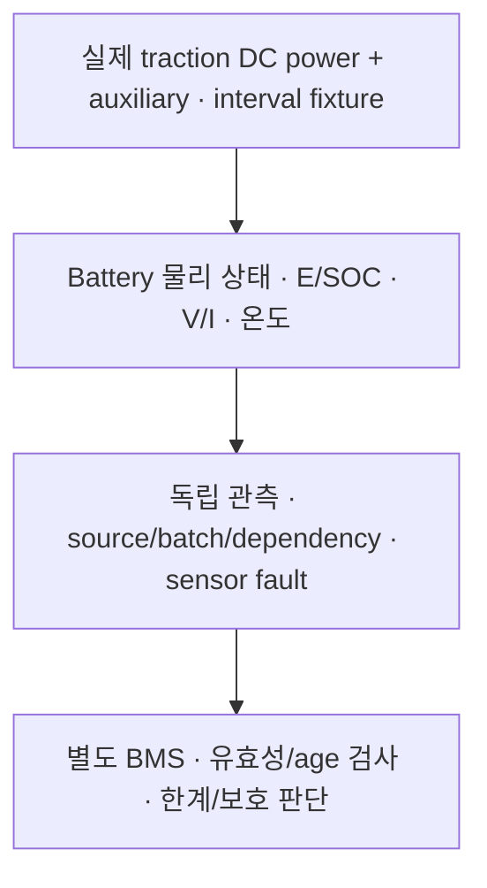

# M2 첫 Battery 모델: 전력에서 에너지·SOC·센서까지

Date: 2026-10-15. Status: **Host functional SIL component 구현·시험 / 직접 재현·이해 review PENDING**.
[ADR-0024](../adr/ADR-0024-first-battery-energy-and-sensors.md)의 독립 물리 모델이다.
이후 [BMS 제어기·충방전 한계·보호](m2_bms_controller.md)를 별도 component로 연결했다.
[Power lifecycle·컨택터/RC 모델](m2_power_lifecycle.md)도 별도 component로 구현했다.
이어 [Drive local gate](m2_drive_gate.md)를 별도 component로 구현했다.
[첫 Drive energy loop](m2_drive_energy.md)는 이상적 HV에서 actual torque/speed·손실·auxiliary와 이 모델을 연결했다.
[실제 PowerModel 연결](m2_ev_power_circuit.md)도 구간 전하/발열·capacitor/경로 손실을 포함해 별도 component로 시험했다.
이때 BatteryModel의 `step_integrated`는 end sensor와 구간 current integral을 구분한다. 차량 motion/회생 배분 통합은 후속이다.

## 먼저 구분할 것

Battery model은 **실제 전력이 들어왔을 때 상태가 어떻게 변하는지** 계산한다.
BMS는 그 관측값을 읽고 **얼마나 충전·방전을 허용할지** 결정하는 별도 제어기다.
모델 내부 진단값으로 센서 invalid/stale을 우회해서는 안 된다.



코드는 [BatteryModel API](../../simulation/battery/battery_model.hpp),
[구현](../../simulation/battery/battery_model.cpp), [시험](../../tests/unit/battery_model_test.cpp)에 있다.
이 문서의 실행 입력은 독립 fixture다. 후속 DriveEnergyModel은 실제 torque·wheel speed에 motor/inverter
손실을 적용한 DC 입력을 만든다. Command나 허용 limit를 actual로 대체하지 않는다.

## 전력 W와 에너지 J

전력은 단위 시간의 에너지 변화량이다. 일정한 20 kW 부하를 10 s 유지하면 200 kJ를 소비한다.
`1 kWh = 3,600,000 J`이며 fixture 50 kWh는 180 MJ다.

입력의 `traction_dc_w`는 battery 쪽 traction branch의 실제 DC 전력이다.
양수는 소비, 음수는 DC 반환이다. `auxiliary_w`는 별도로 더하는 nonnegative 부하다.
반환 100 W보다 보조 부하 200 W가 크면 전체는 100 W 소비여서 SOC가 내려간다.
음수 traction 값만 보고 모두 battery 충전량이라고 집계하면 안 된다.

```text
Pterminal = Ptraction_dc + Paux
Vterminal = Voc − I × R
Pterminal = Vterminal × I
chemical_power = Voc × I = Pterminal + I²R
E_next = E_previous − chemical_power × dt
```

방전은 `I>0`, 충전은 `I<0`다. 저항 손실 `I²R`은 두 경우 모두 nonnegative다.
따라서 방전 때 저장 에너지는 terminal 공급분보다 더 줄고,
충전 때는 반환 DC에서 보조 부하와 battery 저항 손실을 뺀 만큼만 저장된다.
Motor/inverter 손실은 upstream DC 변환의 책임이라 여기서 중복 차감하지 않는다.
`received_dc_j`는 branch의 DC 유입 장부이며 차량 회생 에너지의 검증 결과는 아니다.

## SOC와 온도는 어떤 근사인가

SOC는 일반적으로 전하량의 비율이다([Coulomb counting](https://www.mathworks.com/help/simscape-battery/ref/socestimatorcoulombcountingvariablecapacity.html)).
이번 모델은 Voc가 일정하므로 `E=Voc×Q`이고 `SOC=E/capacity_j`를 사용할 수 있다.
이는 알려진 초기값에서 시작하는 simulation truth다. 실제 BMS의 noisy current 기반
SOC 추정기나 가변 OCV curve를 구현한 것으로 해석하지 않는다.

전압은 단순 저항 강하를, 온도는 아래 등가 열용량·주변 냉각을 따른다.

```text
Cthermal × dT/dt = I²R − G × (T − Tambient)
```

일정한 power interval에서는 전류와 손실이 일정해서 thermal 해석해로 갱신한다.
열은 battery 저항 손실이 어디로 갔는지를 나타내며 SOC에서 다시 빼는 별도 손실이 아니다.
실제 equivalent-circuit 모델은 SOC/온도별 OCV·저항·RC 등을 사용한다
([공식 모델 설명](https://www.mathworks.com/help/simscape-battery/ref/batteryequivalentcircuit.html)).
현재는 그 parameter table·전기화학·셀별 열전달·열화·balancing을 구현하지 않았다.

## Fixture와 보존 검사

| 항목 | 시험 설정 |
| --- | --- |
| Capacity / 초기 SOC | 180 MJ = 50 kWh / 0.5 |
| Constant OCV / resistance | 400 V / 0.05 Ω |
| Thermal capacity / cooling | 200,000 J/K / 20 W/K |
| Ambient / 초기 온도 | 25 °C / 25 °C |
| Series cells / 극값 half-spread | 100 / 0.01 V·1 °C |
| 각 power 항·terminal 합의 절댓값 상한 | 100,000 W |
| 예제 step / 허용 최대 step / dependency age | 20 ms / 40 ms / 50 ms |

모두 시험 수치다. 실제 차량 calibration, profile loader나 Target timing 보장이 아니다.
Constant OCV 근사라 SOC 0에서도 수식상 OCV는 400 V다. 소비 가능 여부는 energy 경계와
후속 BMS/Drive gate로 판단하며, voltage 하나로 준비·가용성을 선언하지 않는다.
또한 pack voltage와 컨택터 뒤 Drive 자체 HV bus는 다른 관측이다. Power 모델 없이 HV_READY를 선언하지 않는다.

30개 unit에는 아래 energy balance와 100,000번 교대 power 입력의 drift 검사가 있다.

```text
initial_E − current_E = drawn_dc − received_dc + auxiliary + ohmic_loss
```

허용 residual은 `max(1e-6 J, capacity_j×1e-12)`이며 이 fixture는 0.00018 J다.
Full에서 추가 충전하거나 empty에서 방전하면 step을 거부하고 초과 에너지를 보고한다.
전력/에너지를 clip해서 장부를 맞추지 않는다. Last committed state는 진단용으로 남고
현재 관측은 unavailable이다. 한계보다 먼저 actual response를 제한하는 것은 후속 제어기의 책임이다.

## 시간과 관측 유효성

`BatteryInterval`은 begin/end 구간 전체에서 power가 일정하다는 명시적 실제 모델 입력이다.
직전 end와 다음 begin이 같아야 한다. 새 end 시각의 순간 power를 과거 구간에 소급하지 않는다.
Power의 source/dependency는 begin 이하여야 하고 end에서도 dependency age를 만족해야 한다.
캐시한 동일 입력은 age 안에서만 재사용할 수 있으며 새 source로 오래된 dependency를 덮을 수 없다.
Missing/invalid power를 0으로 바꾸거나 gap을 backfill하지 않는다.

SOC·electrical pair·pack 온도·cell 전압 pair·cell 온도 pair는 각각 별도 optional 관측이다.
각 측정은 acquisition Epoch/batch/source와 oldest dependency를 갖는다.

| Capture 동작 | 결과 |
| --- | --- |
| Acquire | 이번 물리 상태를 새 acquisition으로 읽음 |
| Hold | 기존 값과 batch/source/dependency를 모두 보존 |
| Invalidate | 해당 group unavailable; 다른 group과 물리 상태는 유지 |
| Cell pair override | 극값 관측의 명시적 주입; 잘못된 pair는 unavailable |

Optional 값이 있다는 것은 acquisition이 존재한다는 뜻이다. **Freshness는 BMS가 각 group별로 검사**해야 한다.
전체 batch가 새로워도 held cell 값이 fresh해지는 것은 아니다. 초기 SOC/온도는 알려져 있지만
처음 실제 power interval 전의 electrical pair·cell voltage는 unknown이다. 정상 0 A와 구분한다.

Power/time/identity/model 위반은 latch하고 모든 current 관측을 unavailable로 만든다.
복구용 `initialize`는 새 Epoch·알려진 SOC/온도를 요구하는 **명시적 scenario reset**이다.
단순 ECU restart가 물리 battery를 초기 SOC로 되돌리는 기능으로 사용하면 안 된다.

## 실행과 읽을 로그

```sh
cmake -S . -B build/m1-angle
cmake --build build/m1-angle -j 4
ctest --test-dir build/m1-angle --output-on-failure
build/m1-angle/actuator_demo battery-model
```

Demo는 가상 시계 20 ms로 30 s를 실행한다. 앞 10 s는 traction +20 kW,
다음 10 s는 -10 kW, 마지막 10 s는 traction 0 W이며 auxiliary 200 W는 계속 소비한다.
출력은 1 s마다 기록한다. 10 s의 SOC는 약 0.4988706이다.
13/14 s에서 전체 batch는 650/700인데 held cell voltage batch는 600이다.
15 s의 cell 최대 온도 80 °C는 관측 주입이며 pack의 실제 등가 온도가 80 °C가 된 것이 아니다.
23 s에서는 cell temperature가 unavailable이어도 pack 온도·SOC는 계속 관측된다.

Battery 구현 시점의 정상·sanitizer 전체 unit은 222개이며 Battery 30개를 포함한다.
이번 단계는 로컬 model/관측 시험이라 CAN frame·송수신 fixture는 추가하지 않았다.
기존 Drive 단계의 vCAN 97개와 차량 TC의 NOT RUN 상태를 유지한다.
Sanitizer는 `build/m1-angle-sanitized`와 `-DSTRATADRIVE_SANITIZERS=ON`을 사용한다.
실행 근거는 [품질 기록](../quality_policy.md)에 남긴다.

이 observation을 소비하는 [BMS 판단 단계](m2_bms_controller.md)로 이어진다. Pack 평균만으로
cell 극값을 덮지 않고 valid zero/unknown/stale을 구분해 한계·보호 상태를 계산한다.
