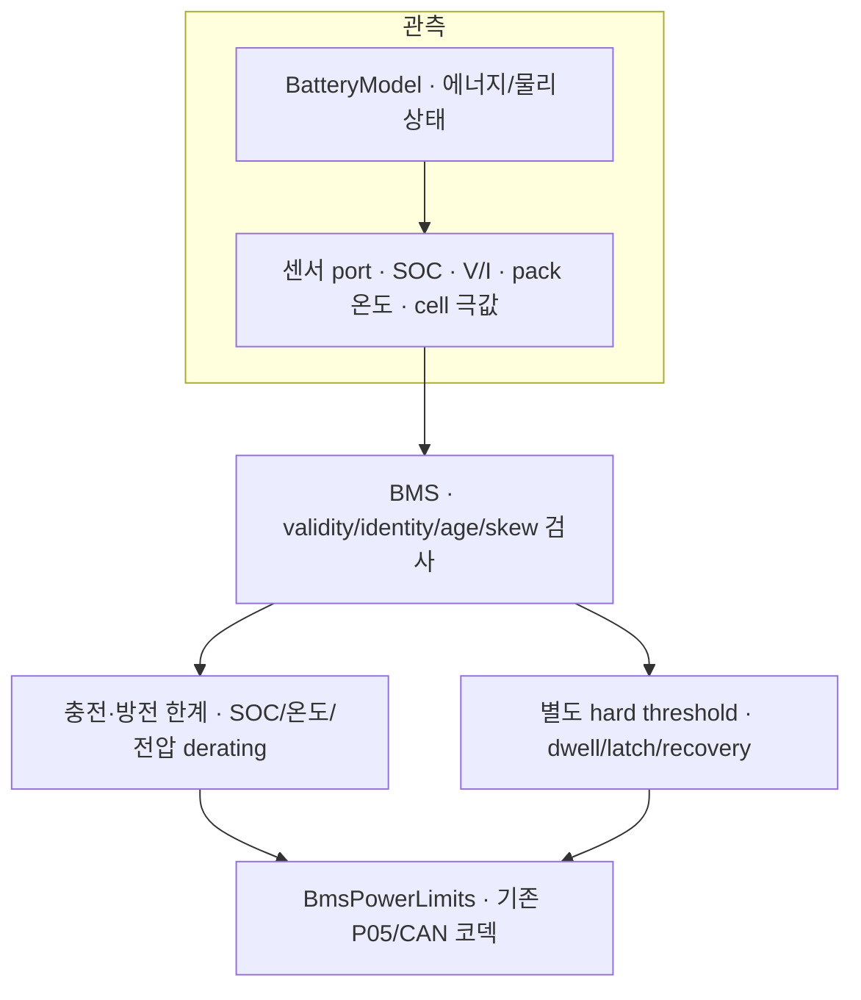

# M2 첫 BMS: 센서를 읽고 충전·방전 한계를 판단하기

Date: 2026-10-15. Status: **Host functional SIL component 구현·시험 / 직접 재현·이해 review PENDING**.
[ADR-0025](../adr/ADR-0025-first-bms-limits-and-protection.md)의 구현이다.

## 물리 모델과 BMS의 차이

[BatteryModel](m2_battery_model.md)은 실제 전력에 따라 에너지·SOC·전압·전류·온도를 계산한다.
**BMS는 그 상태를 관측해서 허용 한계와 보호 요청을 정한다.** BMS가 limit를 0 W로 내보냈다고
실제 전류나 torque가 즉시 0이 된 것은 아니다. 후속 Drive gate/Power actuator와 actual feedback이
필요하다. Pack 전압을 읽었다고 컨택터 뒤 Drive HV bus가 준비된 것도 아니다.



코드는 [센서 port](../../interfaces/bms/battery_sensor_snapshot.hpp),
[BMS API](../../vecu/bms/bms_controller.hpp), [판단 구현](../../vecu/bms/bms_controller.cpp),
[시험](../../tests/unit/bms_controller_test.cpp)에 있다. ECU 코드가 simulation header를 import하지 않는다.

## 처음 익힐 개념

| 개념 | 의미와 이번 코드에서의 사용 |
| --- | --- |
| Cell / pack | Cell들을 묶은 것이 pack이다. 평균이 정상이어도 cell 하나가 위험할 수 있어 극값을 따로 본다. |
| SOC | 남은 전하의 비율이다. 0.5는 50%. 현재 port는 모델에서 알려진 값을 받으며 실차 SOC estimator가 아니다. |
| 충전 / 방전 | 충전에는 회생으로 들어오는 전력도 포함된다. 충전 한계와 구동에 쓰는 방전 한계를 따로 둔다. |
| A / W | 전류는 A, 전력은 W. `P=V×I`이므로 400 V에서 80 A는 32 kW다. |
| Derating | 온도·SOC·전압의 여유가 줄면 허용 출력을 미리 낮추는 것이다. 고장 latch와 구분한다. |
| Protection | 위험 threshold에서 inhibit를 요청하고, 확인 시간이 채워지면 fault를 유지한다. |
| Dwell | 조건이 일정 시간 지속됐는지 확인한다. 오래된 측정 하나를 여러 번 읽은 시간은 세지 않는다. |
| Hysteresis | 고장 진입과 복구 기준을 다르게 둔다. 60 °C trip 뒤 59.9 °C만으로 회복시키지 않는다. |

전압·온도에 따라 충방전 전류를 제한하는 기본 구조는
[MathWorks 공식 설명](https://www.mathworks.com/help/simscape-battery/ug/protect-battery-charge-discharge-for-electric-vehicle.html)을 참고한다.
실제 BMS에는 계측과 contactor/차단 장치의 제어도 필요하다
([Bosch BMS/BDU](https://www.bosch-mobility.com/en/solutions/powertrain/fuel-cell-electric/battery-management-system/)).
이번에는 그중 **관측 검사·허용 한계·software 보호 판단**을 구현했다.

## 한계를 계산하는 방법

각 방향에서 SOC, 온도, cell voltage를 0..1 factor로 바꾸고 가장 작은 factor를 고른다.
여러 독립 한계가 각각 정한 상한을 지켜야 해서 곱하지 않고 최솟값을 사용한다.

```text
I_candidate = I_base × min(SOC_factor, temperature_factor, cell_voltage_factor)
P_candidate = min(P_cap, measured_pack_voltage × I_candidate)
P_wire = floor(P_candidate / 10 W) × 10 W
```

400 V·80 A의 충전 base에서 온도 factor가 0.5라면 40 A·16 kW를 허용한다.
SOC factor가 0.8이어도 더 작은 0.5가 지배하므로 12.8 kW로 곱해서 줄이지 않는다.
현재 전압으로 환산하는 단순 supervisory envelope다. 향후 전압 sag/온도/내부저항을 예측하는
정밀 SOP(State of Power)나 제조사 pulse/continuous limit table을 구현한 것은 아니다.

충전은 **최대 cell voltage**, 방전은 **최소 cell voltage**를 본다.
온도는 pack 값과 cell pair를 합친 최저/최고를 사용한다. Pack 25 °C라도 cell 하나가
42.5 °C면 충전 온도 factor가 0.5로 내려간다. 저온에서는 충전을 먼저 막고 방전은 허용할 수도 있다.

아래는 모두 **학습용 SIL fixture 수치**다. 실제 chemistry·cell 사양서와 시험으로 정할 차량
calibration은 TBD-13으로 남아 있다. 이 값을 실제 배터리에 그대로 적용하지 않는다.

| Directional 한계 | 충전 | 방전 |
| --- | --- | --- |
| Base current / power cap | 80 A / 30 kW | 200 A / 80 kW |
| SOC | ≤0.80 full, 0.95에서 0 | 0.05에서 0, ≥0.10 full |
| Cell voltage | max ≤4.10 V full, 4.20 V에서 0 | min 3.00 V에서 0, ≥3.30 V full |
| 온도 | 0..10 °C ramp up, 10..40 full, 40..45 ramp down | −20..0 °C ramp up, 0..45 full, 45..55 ramp down |

Threshold 사이를 선형 보간하고 바깥에서는 factor를 0 또는 1로 제한한다.
충전 허용이 0이어도 방전이 자동으로 0이 되지는 않는다. SOC가 가득 찼을 때의 회생 금지가 예다.
Wire는 10 W 단위이므로 **내림**해 계산 상한을 초과하지 않게 한다. 정상 power cap은 Nominal,
가장 제한적인 factor는 SocLimited/TemperatureLimited/ElectricalLimited로 보고한다.

## 위험 보호와 재시작

| Hard trip (경계 포함) | Release 검사 범위 |
| --- | --- |
| Cell ≤2.80 V 또는 ≥4.25 V | 2.95..4.15 V |
| Pack ≤280 V 또는 ≥425 V | 295..415 V |
| 온도 ≤−30 °C 또는 ≥60 °C | −15..50 °C |
| 실제 전류 ≤−100 A 또는 ≥250 A | −80..200 A |

실제 전류는 **방전 양수, 충전 음수**다. 위 전류 protection은 고정 absolute band다.
낮아진 dynamic limit에 actual current가 얼마나 늦게 따라오는지 보는 tracking fault detector는 후속이다.

Hard trip 후보가 생기면 이번 tick부터 양방향 valid zero와 `inhibit_requested=true`를 만든다.
같은 항목이 fresh acquisitions에서 40 ms 지속되면 LATCHED다. 후보가 40 ms 전에 사라지면
다시 정상 제한 계산이 가능하다. Cell OV 20 ms와 온도 이상 20 ms를 합쳐 40 ms로 세지 않는다.
단락 같은 고장에 필요한 독립 hardware protector의 반응을 이 software dwell로 대체하지 않는다.

초기에는 INITIAL_CHECKS에서 release band 안의 fresh sample이 100 ms 지속돼야 ACTIVE가 된다.
ACTIVE는 **이 BMS 계산기가 동작 가능하다**는 뜻이며 차량 NORMAL/HV_READY/Drive 허가가 아니다.
한번 latch하면 정상 센서가 돌아와 `recovery_ready=true`여도 자동 해제하지 않는다.
새 trusted application Epoch로 INIT하고 100 ms를 다시 확인한다. Fault가 없는 full SOC처럼
방향별 출력 제한만 있는 상태도 ACTIVE일 수 있다.

Application Epoch는 ECU 통신 세션, model Epoch는 물리 시나리오다. 예제의 app Epoch는 1→2→3으로
바뀌지만 model Epoch는 7을 유지한다. **BMS 재시작은 SOC/에너지 초기화가 아니다.**
Trusted mapping은 local startup 인자로만 제공하며 수신 CAN으로 자동 학습하지 않는다.

## 0과 unknown, 새 envelope와 새 측정

| 출력/상태 | 의미 |
| --- | --- |
| valid 0 W / SocLimited 등 | 해당 방향의 허용 전력이 없다고 계산할 수 있음 |
| valid 0 W / Disabled | INIT 또는 보호 상태라 사용을 막음 |
| unknown / InputsInvalid | 센서를 믿고 한계를 계산할 수 없음; 0 W로 정상화해서 보고하지 않음 |
| inhibit request | 후속 local gate/Power에 대한 요청; contactor가 실제 열렸다는 피드백이 아님 |

다섯 group 모두 finite/range·identity·source age ≤50 ms·dependency age ≤70 ms를 만족해야 한다.
최신/최오래된 acquisition 간 skew는 ≤20 ms다. Pack voltage가 N×cell min/max의 범위
(fixture tolerance 2 V) 안에 있는지도 본다. 이는 실제 cell voltage 합이나 open-wire 진단은 아니다.
같은 acquisition의 값/time/dependency를 바꾸면 identity 오류다. 모두 unknown이면 InputTimeNs는 0이다.

새 BMS message의 source time은 판단 시각, CausalSequence는 입력 model batch,
InputTimeNs는 사용한 다섯 group의 **가장 오래된 dependency**다. Cached 측정/새 envelope로
freshness나 dwell을 갱신하지 않는다. 한계가 unknown인 frame은 receiver의 usable-RX clock도 갱신하지 못한다.
입력 상실은 ACTIVE에서 latch하고, 센서가 복원돼도 새 세션 전까지 Disabled다.
Tick gap >40 ms는 unknown latch, clock rollback은 publication 중단이며 과거 계산을 backfill하지 않는다.

## 실행과 확인

```sh
cmake -S . -B build/m1-angle
cmake --build build/m1-angle -j 4
ctest --test-dir build/m1-angle --output-on-failure
build/m1-angle/actuator_demo bms-control
```

기존 CLI를 확장했다. 2초 가상 시계를 사용하고 실제 socket/HV 장치를 작동하지 않는다.
매 tick 실제 plant의 센서 port→BMS→기존 P05 codec→receiver를 통과한다.

| 예제 시각 | 읽을 결과 |
| --- | --- |
| 100 / 200 ms | INITIAL_CHECKS valid zero → ACTIVE; 약 30 kW 충전/79.96 kW 방전 |
| 500 ms | Cell max 42.5 °C 주입 → 충전 약 15.99 kW로 derating |
| 620 / 660 ms | 60 °C 후보로 inhibit/zero → 40 ms 후 overtemperature latch |
| 800..1000 ms | 센서는 정상·recovery-ready여도 LATCHED 유지 |
| 1100 / 1200 ms | 새 app Epoch 2의 초기 검사 → ACTIVE; model Epoch/SOC는 연속 |
| 1320 / 1360 ms | Cell temperature 상실 → unknown; 복원 후 valid zero/Disabled |
| 1600 / 1700 ms | 새 app Epoch 3의 초기 검사 → ACTIVE |
| 1720 ms | Cell max 4.20 V → 충전만 0, 방전은 유지 |

첫 BMS 구현 시점의 테스트는 새 BMS 33개를 포함해 normal·ASan/UBSan 각각 전체 255개 unit이었다.
정적 분석·production build 결과는 [품질 기록](../quality_policy.md)에 기록한다.
Transport 변경이나 새 vCAN case는 없으며 기존 97개 증거와 차량 TC의 NOT RUN을 구분한다.

[Power lifecycle 모델](m2_power_lifecycle.md)로 이어진다. 이후 local typed safety gate를 추가해
OFF→CHECKS→PRECHARGE→HV_READY→SHUTDOWN과 실제 contactor/HV bus feedback에 연결했다.
같은 decision identity/source/dependency를 보존하고 unknown을 허용으로 바꾸지 않는다.
[Drive local gate·capability](m2_drive_gate.md)는 명시적 relay/독립 Central fixture를 통해
원천 BMS 한계·permission·실제 HV/속도를 검사하는 component로 구현·시험했다.
[첫 Drive energy loop](m2_drive_energy.md)도 실제 torque/speed→DC→Battery 관측을 이 BMS에 되돌리는
이상적 HV component로 연결했다. [실제 회로 연결](m2_ev_power_circuit.md)도 별도 loop에서 구간 current/에너지와 power lifecycle을 시험했다.
차량 통합, thermal 제어·SOC 추정·balancing·SOH와 fault 진단 확장은 후속이다.
