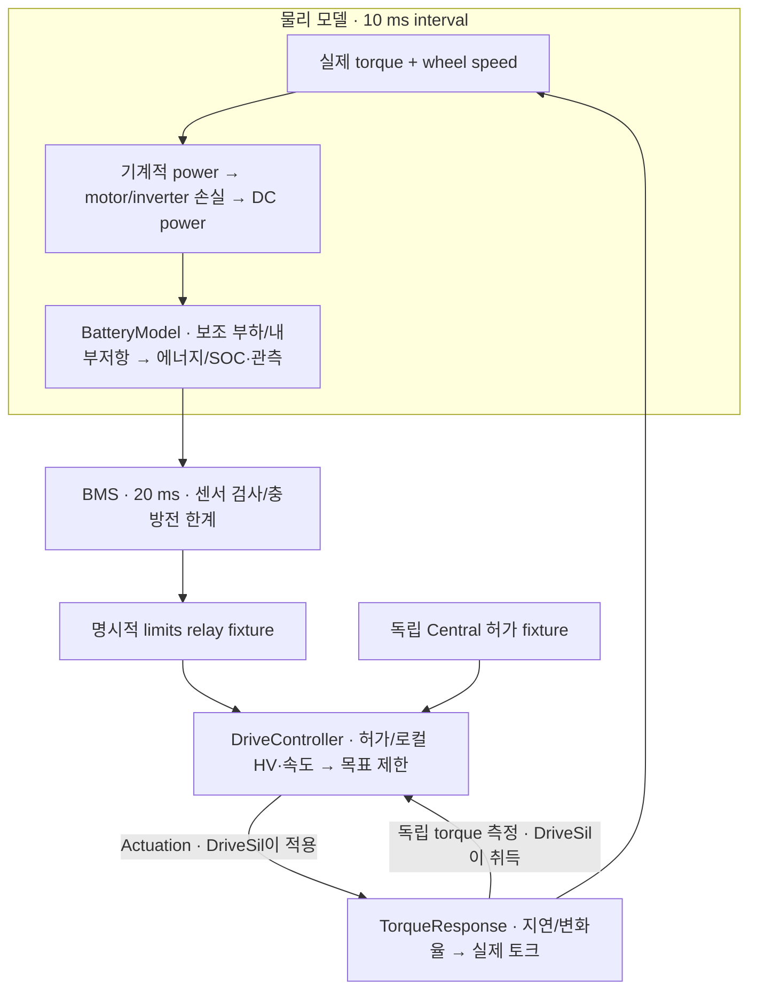

# M2: 실제 회생 토크가 배터리 충전으로 이어지는 경로

Date: 2026-10-15. Status: **Host functional SIL component 구현·시험 / 직접 재현·이해 review PENDING**.
[ADR-0028](../adr/ADR-0028-first-drive-battery-energy-coupling.md)의 첫 energy coupling이다.

## 이번에 연결한 것

기존 [Drive gate](m2_drive_gate.md)는 토크 사용 여부와 한계를 판단했다.
이번에는 **실제 토크와 실제 속도에서 전력을 계산해 배터리의 저장 에너지·SOC를 바꾼다.**



코드는 [DriveEnergyModel API](../../simulation/drive/drive_energy_model.hpp),
[구현](../../simulation/drive/drive_energy_model.cpp), [시험](../../tests/unit/drive_energy_model_test.cpp)에 있다.
BatteryModel이 저장 에너지를 한 번만 소유한다. BMS/DriveController는 SOC를 직접 수정하지 않는다.
ECU session 재시작으로 배터리를 충전된 초기 상태로 되돌리지 않는다.
현재 [DriveSil](../../simulation/drive/drive_sil.cpp)이 ECU의 `prepare/complete`와 TorqueResponse를 연결하며
DriveController에는 물리 모델 객체나 actual getter가 없다. 전체 fixture 순서는
[drive_demo.cpp](../../tools/demo/drive_demo.cpp)의 `drive-energy` 경로에서 읽는다.

## 토크가 음수이면 무조건 충전일까?

같은 aggregate wheel 기준 torque Nm와 speed rad/s를 곱하면 mechanical power W다.
예를 들어 −200 Nm × 20 rad/s = −4000 W이며 4 kW의 기계적 제동 에너지가 모터로 들어온다.
이 전체가 배터리에 저장되지는 않는다.

Fixture의 85% 회생 conversion이면 600 W를 잃는다. Copper loss `0.01×200²=400 W`,
inverter idle 50 W도 있으므로 반환 DC는 2950 W다. Auxiliary 150 W를 쓰면 battery terminal에
2800 W가 들어간다. Battery 내부저항에서도 약 2.45 W가 열로 바뀌어 약 2797.55 W가 저장된다.

반대로 구동 +200 Nm/20 rad/s에서는 mechanical 4000 W에 conversion·copper·idle을 더해
약 4797.83 W DC를 쓰고, auxiliary까지 terminal draw는 약 4947.83 W다.
여기에 BatteryModel의 저항 손실이 추가된다. Motor 손실은 battery 발열로 다시 더하지 않는다.

작은 회생 −5 Nm/20 rad/s는 DC 34.75 W를 반환하지만 auxiliary가 150 W라서 **배터리는 방전**한다.
전기적으로 반환하고 있는지와 순수하게 저장 에너지가 증가하는지를 구분해야 한다.

손실 모델의 system-level 접근은 [Motor & Drive 공식 설명](https://www.mathworks.com/help/simscape-electrical/ref/motordrivesystemlevel.html)을
참고했다. 0.92/0.85와 k=0.01·idle 50 W는 실제 모터 map이 없는 현재의 시험 값이다.
이 eta는 추가 손실까지 합친 총 효율이 아니다. [설계 결정](../adr/ADR-0028-first-drive-battery-energy-coupling.md)에 가정을 기록한다.

## 한계 0, 목표 0, 실제 전력 0은 서로 다르다

BMS가 충전 한계를 0으로 바꾸면 Drive gate는 새 회생 목표를 0으로 제한한다.
실제 torque가 −200 Nm에서 2000 Nm/s로 줄면 0에 도달하기까지 시간이 필요하다.
그 사이 실제 회생 power도 계속 배터리 입력에 포함한다. Command나 capability가 0이라는 이유로
이 전력을 지워 버리지 않는다. `charge-zero` 예제의 5010..5150 ms 로그에서 볼 수 있다.

이번 BMS의 SOC 95% soft zero와 실제 full 사이에는 50 kWh 기준 9 MJ 여유가 있다.
제한된 fixture 가정의 최대 반응 에너지는 약 27.9 kJ다. 상세 계산은 ADR에 있다.
이 숫자로 모든 충전/고장 안전성을 주장하지 않는다. 허용 충전 전력의 과도 초과, 실제 셀/온도 여유,
auxiliary 종료와 circuit 보호를 별도로 검토해야 한다. Full에서 잘못된 실제 충전을 강제로 주면
CapacityViolation으로 보고하고 SOC를 100%로 잘라 장부를 감추지 않는다.

## 시간 구간과 에너지 장부

각 10 ms 구간은 **시작 때 알고 있는 실제 torque/speed/auxiliary를 끝까지 유지하는 근사(ZOH)**다.
끝에서 얻은 더 큰 actual을 지난 구간 전체에 적용하지 않는다. TorqueResponse의 연속 ramp를
정확 적분한 모델은 아니며, step을 줄이면 알려진 ramp의 mechanical work에 가까워지는지 시험했다.

1. Begin actual을 읽어 현재 구간의 DC power와 Battery를 갱신한다.
2. End의 battery 관측을 BMS가 자기 20 ms 주기에서 읽는다.
3. Limits·별도 허가·local HV/speed를 Drive가 검사해 다음 응답을 만든다.
4. 그 actual이 다음 구간의 입력이 된다.

입력별 source/dependency를 보존한다. Local input age는 end 기준 30 ms, acquisition skew는 10 ms다.
Missing torque/speed/auxiliary를 0으로 바꾸거나 끊긴 구간을 나중에 채우지 않는다.
전체 장부는 `저장 에너지 감소 = signed mechanical work + motor 손실 + auxiliary + battery 저항 손실`이다.
`balance_j`는 이 식의 수치 잔차다. 50 kWh fixture 허용 잔차 0.00036 J는 실차 정확도를 뜻하지 않는다.

## 실행과 확인

```sh
cmake -S . -B build/m1-angle
cmake --build build/m1-angle -j 4
ctest --test-dir build/m1-angle --output-on-failure
build/m1-angle/actuator_demo drive-energy normal
build/m1-angle/actuator_demo drive-energy charge-zero
build/m1-angle/actuator_demo drive-energy near-full
build/m1-angle/actuator_demo drive-energy auxiliary
```

| 예제 | 확인할 결과 |
| --- | --- |
| normal | 처음 약 10 s 구동으로 SOC 하강 → 약 10 s 회생으로 SOC 상승 → 나머지 idle 부하; 최종 SOC는 초기보다 낮음 |
| charge-zero | 2 s 이후 회생, 5 s에 cell hotspot 45 °C 센서 주입 → 충전 한계/목표 0 → 남은 actual 반환도 적분 |
| near-full | 처음 SOC 1에서 시작; BMS valid charge-zero로 회생 차단, 보조/idle 소비로 SOC는 조금 내려감 |
| auxiliary | 작은 음수 torque와 DC 반환이 있어도 보조 부하가 더 커서 SOC 하강 |

`interval_torque_nm`은 적분에 쓴 begin actual, `end_actual_nm`은 이후 control tick의 actual이다.
`dc_w`는 traction branch, `battery_w`는 aux까지 합친 terminal power다. `return_dc_j`는 DC 유입
누적량이고 순수한 저장량이 아니다. `motor_loss_j`와 `battery_heat_j`도 다른 장부다.

첫 ideal-path 단계 시점은 새 28개를 포함해 normal·ASan/UBSan 전체 unit 362개였다. Analytic flow/손실·standstill·unknown/
age/cache/시간·capacity와 20,000 alternating interval 장부, 연결 loop·잔여 회생·step refinement를 시험했다.
네 demo를 normal·sanitizer·BUILD_TESTING=OFF에서 실행했다. 상세는 [품질 기록](../quality_policy.md)에 있다.
새 CAN wire/transport case는 없으며 이전 vCAN 이력과 차량 TC NOT RUN을 유지한다.

## 현재 가정과 다음 작업

**HV가 준비된 이상적인 전선**을 통해 battery terminal과 Drive가 연결됐다고 둔다.
Local HV는 실제 battery terminal voltage이고 inverter-ready는 fixture다. 기존 [PowerModel](m2_power_lifecycle.md)의
동적 RC bus/컨택터를 동시에 실행하지 않는다. 그 capacitor 에너지를 누락한 채 통합을 완료했다고 주장하지 않는다.

또한 속도는 외부에서 유지한 20 rad/s다. 이는 dynamometer 같은 외부 기계 경계로, 차량 감속/
관성/타이어/마찰제동은 계산하지 않는다. 고정 속도에서 오래 회생할 에너지는 외부 경계가 공급한다.
실제 Central coordinator·Zone runtime도 아직 없으며 grant/relay는 명시적 fixture다.

[후속 EvPowerModel](m2_ev_power_circuit.md)은 별도 `ev-power` loop에서 RC/DC-link·접점과 Battery를 연결했다.
구간 current/heat·capacitor/path 손실·종료 중 지속 부하를 검사했다. 이 문서의 `drive-energy`는 계속
ideal-path fixture다. M2 수용 검토는 PENDING이며 [M3 실행·계측](m3_multirate_runtime.md)은 진행 중이다. Vehicle motion/배분·마찰 보충,
정밀 map·실차 calibration·Target timing과 full TC는 후속이다.
