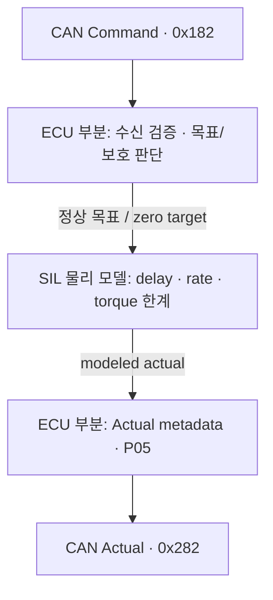

# M2 첫 구현: Drive torque 응답과 제어기의 차이

Date: 2026-10-15. Status: **Host functional SIL component 구현·검사 / 직접 재현·이해 review PENDING**.
[ADR-0023](../adr/ADR-0023-first-drive-torque-response.md)의 독립 torque 응답 fixture다.
완전한 Drive ECU의 BMS/permission/local HV gate나 차량 회생제동 완료를 뜻하지 않는다.

## 지금 어느 제어를 만드는가

| 계층 | 입력 → 출력 / 프로젝트 단계 |
| --- | --- |
| Central 차량 제어기 | 목표·실제 차량 속도 → 가감속 요구; PID 등 classical 제어는 M8 |
| Central allocation | 요구와 actual/capability/permission → Drive torque와 Brake 압력 배분; M4 |
| Leaf ECU 기능 | 유효 명령과 로컬 상태 → 정상/보호 목표 선택; 이번 Drive는 명령·timeout 처리 부분만 구현 |
| SIL actuator 응답 | 목표 torque → 지연·변화율·한계를 거친 실제 모델 torque; 이번 물리 모델 |
| 상세 motor 제어 | torque 요구·motor feedback → 전류/전압/PWM; PI/FOC 등은 별도 확장, 현 범위 미채택 |

PID는 오차의 비례·적분·미분 항으로 제어 출력을 정한다([공식 설명](https://www.mathworks.com/help/simulink/slref/pidcontroller.html)).
Motor FOC는 d-q 축의 전류 제어 등을 다룬다([공식 설계 설명](https://www.mathworks.com/help/mcb/ug/design-field-oriented-control-algorithm.html)).
이번 `clamp(target - actual, ±rate × dt)`는 정해진 응답을 재현하는 수식이다.
오차를 이용해 계산하더라도 이를 PID 구현이나 실제 motor의 폐루프 제어 성능으로 해석하지 않는다.
Classic은 기능·실행·서비스 구조를 정리하며 특정 제어 알고리즘을 자동으로 제공하는 체계가 아니다.

## 코드와 책임

- [DriveActuator](../../vecu/drive/drive_actuator.hpp) / [구현](../../vecu/drive/drive_actuator.cpp):
  receiver/session, source expiry/timeout/continuity/deadline, 목표 선택과 Actual/P05.
- [TorqueResponse](../../simulation/drive/torque_response.hpp) / [구현](../../simulation/drive/torque_response.cpp):
  CAN과 독립인 물리 응답. Delay FIFO, torque 상태, 정상·zero-target rate를 소유.
- [DriveActuatorSil](../../simulation/drive/drive_actuator_sil.cpp): ECU의 `prepare/complete`와 물리 진행·torque 취득을 연결.
- [시험](../../tests/unit/drive_actuator_test.cpp): 두 경계의 입력과 관측값을 독립 검증.
- 기존 [TX](../../tests/integration/can/socketcan_tx.cpp), [RX/model](../../tests/integration/can/socketcan_rx.cpp),
  [runner](../../tests/integration/can/check_socketcan.py): Command TX → model → 독립 Actual RX.



ECU 기능은 SWC/Port/Runnable 설계 대상이고 물리 모델은 SIL 환경의 책임이다.
후속 [실행 경계 정리](m2_execution_boundaries.md)에서 DriveActuator의 물리 소유/호출을 제거했다.
[DriveActuatorSil](../../simulation/drive/drive_actuator_sil.cpp)의 `tick`이 같은 thread에서 둘을 순서대로 연결한다. 이것이 실제 RTE 연결이나
독립 OS Task의 실행을 뜻하지 않는다. [ADR-0022](../adr/ADR-0022-leaf-classic-development-methodology.md)를 따른다.

## 시험 설정과 정상 응답

| 항목 | fixture 값 |
| --- | --- |
| Command 허용 범위 / physical 한계 | -300..500 Nm / -200..300 Nm |
| 초기 actual / normal rate | 0 Nm / 1000 Nm/s |
| Normal delay / 보호 zero rate | 50 ms / 2000 Nm/s |
| 최소 control 간격 / 허용 gap | 10 ms / 30 ms |
| Source age / valid-RX timeout | 30 ms / 80 ms |

모두 시험용이며 YAML loader나 OEM calibration은 없다. Equivalent driven-wheel torque이고,
motor shaft torque와 섞어 쓰지 않는다. 양수는 전진 구동, 음수는 전진 제동 방향이다.
음수 torque 시험만으로 실제 배터리 충전이나 energy 회수를 검증하지 않는다.

첫 목표를 10 ms tick에서 포착하면 due는 60 ms다. 같은 목표를 계속 받아도 due는 밀리지 않는다.
목표가 500 Nm라면 physical target은 300 Nm로 제한되고 70 ms에 10 Nm, 360 ms에 300 Nm가 된다.
허용 밖 500.1 Nm는 수신 거부한다. 목표 변경마다 delay를 유지하고 due가 tick 사이에 있으면
그 경계를 기준으로 interval을 나누어 적분한다. 반복 Command가 끊기면 source expiry가 먼저 적용된다.

Wheel speed·효율·BMS power limits가 아직 없으므로 `wheel_speed`와 `regen_capability`는 unavailable이다.
`regen_limit_reason=InputsInvalid`를 유지한다. 유효한 torque actual과 회생 가용량의 유효성은 별개다.
Fixture의 NORMAL은 명령 stream 상태이며 차량 READY·정상 주행 허가를 대신하지 않는다.
후속 [DriveController](m2_drive_gate.md)는 BMS/permission/HV 검사를 별도 component로 구현했다.
실제 Central/Zone runtime과 에너지 통합은 남아 있다.

## 0을 요구하는 것과 실제 0의 차이

Normal 0 command는 delay 50 ms와 normal rate를 거친다. 반면 명령 상실은 pending 목표를
취소하고 delay를 우회해 zero target을 선택한다. Actual을 즉시 0으로 덮지는 않는다.

예제에서 마지막 수용 Command의 source는 1000 ms다. 1030 ms까지 source age는 허용되고,
1040 ms tick에서 stale을 감지한다. 그 순간 actual은 -200 Nm이며 다음과 같이 변한다.

```text
시각(ms)    actual(Nm)    상태
1040        -200          FAIL_SAFE / LocalProtection
1050        -180          FAIL_SAFE / LocalProtection
1060        -160          FAIL_SAFE / LocalProtection
1140           0          FAIL_SAFE / LocalProtection
```

이는 정상 tick에서의 시험 수치다. 늦은 fresh command로 fault가 해제되지 않으며
새 trusted Epoch로만 복구한다. 재시작해도 물리 torque는 순간적으로 0으로 초기화하지 않는다.
기존 SIL helper는 missed interval을 hold하고 다음 regular tick에서 zero ramp를 실행한다.
Clock 역행은 ECU publication 중단이며, 외부 실행자가 독립 진행한 물리는 되돌리지 않는다.
회생 torque 제거는 전체 제동력 감소를 뜻할 수 있으므로 실제 차량 보호는 마찰제동 배분과
함께 검증해야 한다. 이 component 시험은 차량 정지 성공을 주장하지 않는다.

## 실행과 검사

```sh
cmake -S . -B build/m1-angle
cmake --build build/m1-angle -j 4
ctest --test-dir build/m1-angle --output-on-failure
build/m1-angle/actuator_demo drive-model
unshare --user --map-root-user --net python3 tests/integration/can/check_socketcan.py --family model --model drive
```

Demo는 trusted Epoch 1/가상 시계, vCAN은 영속 issuer/Epoch와 Linux monotonic wall clock을 사용한다.
`model-normal`은 +saturation → -saturation → valid 0 → 통신 상실,
`model-loss`와 `model-regen-loss`는 각각 양·음 torque 중 상실 → zero ramp → late 반대 명령 거부다.
Actual source/sequence/causal/state/value와 speed/capability unavailable을 독립 RX에서 확인한다.
Drive 단계에서 20개 unit을 추가해 전체 192개였다. [Battery 후속](m2_battery_model.md) 시점은 222개였다.
Drive vCAN은 3개, 전체 model은 8개,
기존 M1 89개를 포함한 all은 97개다. 실행 결과와 도구 검사는 [품질 기록](../quality_policy.md)에 남긴다.
Sanitizer는 `build/m1-angle-sanitized`와 `-DSTRATADRIVE_SANITIZERS=ON`을 사용한다.

다음 학습은 목표·actual·capability의 차이와 zero target/응답 시간을 설명하는 것이다.
[Battery 물리·관측](m2_battery_model.md), BMS/Power와 [Drive local gate·capability](m2_drive_gate.md)까지
후속 component로 구현·시험했다. DriveController는 필수 입력으로 목표/보호 출력을 선택한다.
[DriveSil](../../simulation/drive/drive_sil.cpp)이 이 출력을 같은 TorqueResponse 모델에 적용하고 관측을 ECU에 전달한다.
이 문서의 DriveActuator는 계속 isolated fixture다. [실제 DC/Battery 연결](m2_drive_energy.md)은
별도 이상적 HV component로 구현했다. [실제 RC/접점 연결](m2_ev_power_circuit.md)도 시험했고 차량 motion/에너지 통합은 후속이다.
