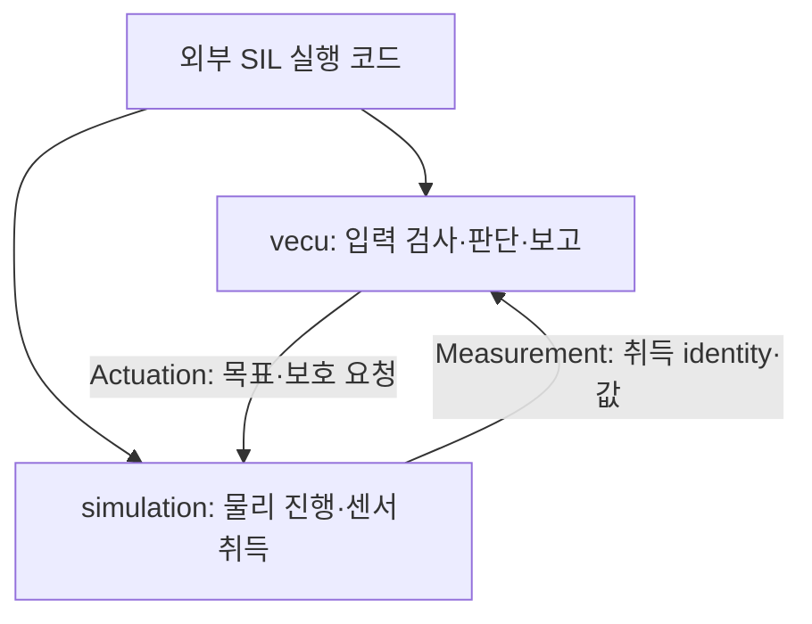

# M2 구조 정리: ECU와 물리 모델은 누가 실행할까?

Date: 2026-10-16. Status: **Host 구조 분리·component 검사 / M3 실제 task·계측은 후속**.
[ADR-0032](../adr/ADR-0032-ecu-and-sil-execution-boundaries.md)의 구현이다.

## 책임과 파일

| 계층 | 책임 / 코드 |
| --- | --- |
| Port | `interfaces/`의 sensor/actuation 구조체, frame/receiver 계약 |
| ECU | [SteeringActuator](../../vecu/steering/steering_actuator.hpp), [BrakeActuator](../../vecu/brake/brake_actuator.hpp), [DriveActuator](../../vecu/drive/drive_actuator.hpp), [DriveController](../../vecu/drive/drive_controller.hpp): 입력 검증·목표/한계·보호 판단·보고 |
| Plant | `simulation/`의 SteeringResponse·BrakePressureResponse·TorqueResponse·Battery/Power: 물리 상태와 응답 |
| SIL 연결 | [SteeringSil](../../simulation/steering/steering_sil.cpp), [BrakeSil](../../simulation/brake/brake_sil.cpp), [DriveSil](../../simulation/drive/drive_sil.cpp), [isolated Drive](../../simulation/drive/drive_actuator_sil.cpp): ECU/plant 호출과 센서 취득·고장 주입 |
| 실행 예제 | [명령 진입점](../../tools/actuator_demo.cpp)과 `tools/demo/`의 도메인별 구현; 실행 파일은 여전히 하나 |

BMS/PowerController는 이미 외부 sensor port를 받는다. 이번에 남아 있던 actuator/Drive composition도 같은 방향으로 분리했다.
`vecu` library에는 물리 모델 객체와 simulation header가 없다. SIL library가 ECU와 plant를 연결한다.



그림의 외부 호출은 현재 동기식이다. 별도 thread나 OS task를 만들었다는 뜻은 아니다.

## prepare와 complete

기존 SIL `tick(now)` API는 `simulation::*Sil` 클래스에 있다. 내부에서는 다음 순서로 연결한다.

1. **ECU `prepare(now)`**: clock/period·명령·한계·gap을 검사한다. Drive는 bounded 목표/envelope도 선택한다.
2. **SIL 물리 처리**: 보호 요청과 기존 목표, gap 정책에 따라 물리를 진행하고 센서를 취득한다.
3. **ECU `complete(sensor, now)`**: 측정을 검사하고 Actual을 만든다. Steering/Brake는 이 측정으로 정상/보호 목표를 갱신한다.
4. **SIL 출력 적용**: 새로 선택한 목표/보호 요청을 모델에 적용한다. 새 목표의 지연과 유한 응답은 유지한다.

초기화는 `ActuatorSession{application_epoch, model_epoch, enable_ns}`라는 trusted local 입력을 받는다.
CAN frame에서 session을 자동 학습하지 않고 앱 세션과 물리 모델 identity를 구분한다.

두 ECU phase는 같은 논리 job 시각을 사용한다. 한 owner가 직렬로 호출하며 phase 사이에 나중 시각의
RX/센서 갱신을 섞지 않는다. 완료를 건너뛰고 다음 prepare로 가면 ControlDeadline을 기록한다.
같은 job을 두 번 complete하거나 시각이 다른 complete를 호출해도 추가 Actual을 만들지 않는다.

M3에서 ECU 실행 비용을 측정할 때는 두 ECU 구간과 외부 physics 구간을 구분해야 한다.
실제 job 배치·release/deadline·handoff·독립 watchdog과 그 측정 protocol은 아직 구현하지 않았다.

## ECU 호출이 멈추면 물리도 멈출까?

외부 실행자는 마지막 출력을 적용한 plant를 ECU와 독립적으로 진행시킬 수 있다.
예를 들어 10 ms에 조향 목표 0.2 rad를 발행한 뒤 ECU를 호출하지 않아도,
plant를 100 ms까지 진행하면 기존 delay/rate에 따라 각도가 약0.04 rad가 된다.
ECU 복귀 시 gap을 검출하고 hold를 요청해도 이미 발생한 각도를 0으로 되돌리지 않는다.

[조향](../../tests/unit/steering_actuator_test.cpp), [브레이크](../../tests/unit/brake_actuator_test.cpp),
[Drive](../../tests/unit/drive_actuator_test.cpp)의 새 case가 이 경계를 확인한다.
기존 SIL helper의 `tick`만 사용하는 시험은 이전과 같이 관측하지 못한 gap interval을 hold한다.
어떤 clock/owner가 물리를 진행했는지 명시해야 두 결과를 올바르게 해석할 수 있다.

이 시험은 **별도 실행이 가능함**을 보인다. 멈춘 ECU를 독립 task가 정해진 deadline 안에
검출하고 물리 보호까지 성공시킨 결과는 M3와 후속 차량 통합에서 검증한다.

## 측정값을 만들어 넣지 않기

ECU에는 physical getter가 없다. Typed sensor를 넣지 않으면 command나 initial calibration으로 Actual을 채우지 않는다.
고장 주입과 truth getter는 simulation/시험 쪽에만 있다. Epoch 재시작은 ECU pending/latch를 초기화하며
물리 상태와 acquisition sequence 보존은 SIL 쪽 책임이다.

Steering/Brake는 늦게 도착한 새 acquisition의 원래 source time을 Actual에 보존한다.
Drive의 새 torque port는 epoch·sequence·source time·Nm를 갖는다. 현재 Drive report는 **같은 job end 시각의
새 acquisition만** torque로 발행한다. Cached/지연 취득은 unavailable이며 30 ms 초과 age·missing·identity/time/range 위반은
TorqueFeedbackUnavailable이다. 부호와 기존 fault enum 값, wheel speed/capability 계약은 유지한다.

## 예제와 검사

```sh
cmake --build build/m1-angle -j 4
ctest --test-dir build/m1-angle --output-on-failure
build/m1-angle/actuator_demo steering-model jam
build/m1-angle/actuator_demo brake-model stuck-rise
build/m1-angle/actuator_demo ev-power normal
```

명령·출력은 기존과 같다. 진입점은 93줄이며 도메인별 구현은 각각 180–425줄이다.
새 기능마다 executable을 만들지 않고, 관련 도메인 파일과 기존 시험의 case를 확장한다.

[ECU 경계 시험](../../tests/unit/ecu_boundary_test.cpp)은 core library만 link하는 18개 case다.
Simulation include 경로와 plant library가 없어도 목표 선택·port validation·Actual/phase guard를 검증한다.
외부 물리 진행 case 3개와 기존 470개를 합해 전체 491개다. 상세 build/static/vCAN 증거는 [품질 기록](../quality_policy.md)에 둔다.
M2 직접 재현·설명은 PENDING이며 system TC 전체는 NOT RUN이다.
