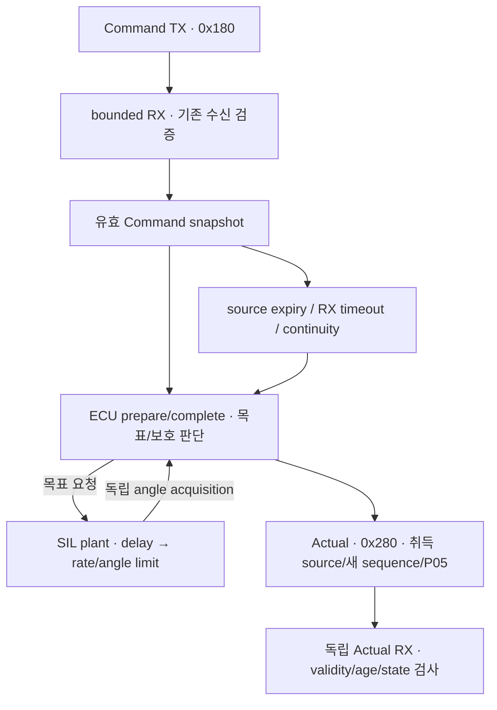

# M2 첫 구현: 조향 명령에서 Actual까지

Date: 2026-10-14. Status: **Host functional SIL 부분 구현·검사 / 직접 재현·이해 review PENDING**.
[ADR-0019](../adr/ADR-0019-first-steering-response-model.md)의 첫 component 모델이다.
M1 wire/receiver를 유지하고 M2 전체의 완료를 뜻하지 않는다.
2026-10-16 [response monitor 후속](m2_steering_fault_monitor.md)에서 물리 응답·sensor 경계를 분리하고
jam/slow-response fixture와 local residual/dwell 판단을 연결했다. 아래 정상 응답 계약과 기존 상실 정책은 유지한다.

후속 [ECU/SIL 실행 경계 정리](m2_execution_boundaries.md) 뒤 ECU의 `prepare/complete`와
`simulation/`의 SIL `tick`을 구분해서 읽는다. 물리 진행·고장 주입은 SIL 쪽 책임이다.

## 코드와 흐름

- [SteeringActuator](../../vecu/steering/steering_actuator.hpp): 수신·판단·local fault와 prepare/complete.
- [SteeringSil](../../simulation/steering/steering_sil.cpp): 물리·센서·ECU 호출을 연결하는 예제용 tick.
- [ECU 구현](../../vecu/steering/steering_actuator.cpp): 수신·sensor/monitor·보호 요청과 Actual/P05 생성.
- [물리 응답](../../simulation/steering/steering_response.cpp): delayed demand와 rate/angle limit; 후속 sensor/fault 경계.
- [단위 시험](../../tests/unit/steering_actuator_test.cpp): 외부 clock으로 응답과 경계를 정확히 비교.
- 기존 [TX](../../tests/integration/can/socketcan_tx.cpp), [RX/model](../../tests/integration/can/socketcan_rx.cpp),
  [runner](../../tests/integration/can/check_socketcan.py): 세 독립 process의 실제 vCAN 연결.



`receive(frame, now)`는 기존 CRC/P05, Epoch, sequence, source age, mode, command 범위를 검사한다.
`SteeringSil::tick(now)`이 ECU의 `prepare/complete`와 외부 물리 진행·센서 취득을 연결한다.
ECU는 유효 snapshot과 센서로 목표/hold 요청을 선택하며 모델을 직접 호출하지 않는다.
현재 수신과 control은 같은 소유 thread에서 실행하므로 mutex는 필요하지 않다.
Runtime thread 분리 시 synchronization을 다시 설계한다.
외부에서 Epoch/clock을 제공하며 CAN으로 session을 자동 학습하지 않는다.

## 응답 계산

Fixture: command 범위 ±0.5 rad / model 한계 ±0.3 rad / 초기 0 rad / rate 1 rad/s /
delay 50 ms / control 최소 간격 10 ms / 허용 tick gap 30 ms.
Source age 30 ms, RX timeout 80 ms. 모두 시험 설정이며 profile loader나 실차 calibration은 아니다.
단위는 equivalent front road-wheel angle의 rad다. [의미 계약](../icd/interface_overview.md)을 따른다.

SIL plant가 ECU의 새 목표를 받으면 `due = issued_time + delay`로 보관한다. 같은 목표를 계속 받아도
due를 뒤로 밀지 않는다. 변경한 목표는 별도 due를 갖는다. Due 사이 구간마다 다음을 적용한다.

```text
target = clamp(accepted_command, model_min, model_max)
max_change = max_rate_rad_s × elapsed_seconds
actual += clamp(delayed_target − actual, −max_change, +max_change)
```

첫 목표를 10 ms tick에서 포착하면 due는 60 ms다. 60 ms에는 아직 이동량이 0이고,
70 ms에는 0.01 rad 움직인다. 목표 0.2 rad는 260 ms에 도달한다. 반복 Command는 계속 필요하다.
한 번 수신하고 기다리면 source age를 넘겨 보호 상태에 들어가므로 모델이 끝까지 움직이지 않는다.
Wire 해상도로 Actual을 양자화하지만 모델 내부 상태는 double로 유지한다.

허용 범위 밖 0.6 rad는 수신 거부한다. 허용된 0.4 rad는 model target이 0.3 rad로 제한된다.
이 차이는 command 계약과 물리 한계의 구분이며 다음 allocation/calibration 검토에 연결한다.
Actual.CausalSequence는 마지막 수용 Command 번호다. Delay 중에도 더 최근 Command 번호일 수 있다.

## 상실과 재시작

Source expiry 또는 RX timeout을 감지하면 ECU는 hold를 요청하고 FAIL_SAFE를 latch한다.
SIL plant는 pending target을 버리고 현재 modeled angle을 유지한다.
Continuity loss와 control gap 초과도 같은 hold/latch 정책을 사용한다. 이후 명령은 사용하지 않는다.
`FAIL_SAFE / LocalProtection` Actual은 angle이 유효하더라도 정상 주행 가능을 의미하지 않는다.
Startup에서 수용 명령이 없는 timeout은 unavailable Actual을 낸다.
Clock 역행은 publication을 중단한다. 새 trusted Epoch로만 복구하고 실제 각도를 0으로 리셋하지 않는다.

기존 SIL helper는 tick 끝에서 sample이 stale이면 그 interval 전체를 이동하지 않는 sampled 모델이다.
새 수신 전에도 이전 source expiry를 확인한다. Missed tick을 catch-up 실행하지 않는다.
외부 실행자가 plant를 독립 진행한 경우에는 ECU 복귀 시 이미 발생한 이동을 되돌리지 않는다.
[실행 경계 안내](m2_execution_boundaries.md#ecu-호출이-멈추면-물리도-멈출까)를 함께 읽는다.
이 hold 정책은 첫 SIL 선택이며 실차 안전 fallback/물리 actuator 사양을 보장하지 않는다.

## 실행

```sh
cmake -S . -B build/m1-angle
cmake --build build/m1-angle -j 4
ctest --test-dir build/m1-angle --output-on-failure
build/m1-angle/actuator_demo steering-model
unshare --user --map-root-user --net python3 tests/integration/can/check_socketcan.py --family model --model steering
```

기존 build directory는 M1부터 재사용한다. Demo는 fixed Epoch/가상 시각의 결정론적 실행이고,
vCAN runner는 영속 issuer의 Epoch와 Linux monotonic wall clock을 사용한다.
조향만 선택하면 2개다. [Brake 후속 모델](m2_brake_model.md)까지 model family는 5개였으며
[Drive 후속](m2_drive_model.md)까지 현재 8개다. 기존 actuator family 40개와 EV family 49개를 포함한 현재 기본 all은 97개다.
실행 로그는 각 build의 `socketcan-results/steering-model-*.log`에 보존한다.
Sanitizer는 `build/m1-angle-sanitized`와 `-DSTRATADRIVE_SANITIZERS=ON`을 사용한다.

검사 범위:

- Unit 13개 추가: 지연·동일 목표 refresh·방향 전환·rate·saturation·초기값·DEGRADED,
  손상/expiry·continuity/restart·deadline/clock과 경계 시각. 조향 추가 당시 unit은 기존 143 + 13 = 156개이며 Brake/Drive/Battery 후속 단계 시점은 222개였다.
- Model normal: 0.4 rad 명령 → delay/rate → 0.3 rad 포화, 그 후 송신 상실과 hold.
- Model loss: 움직이는 중 Command 중단 → source expiry → hold, 뒤늦은 반대 방향 명령 거부.
- 두 경로 모두 독립 Actual RX의 CRC/metadata/source/sequence, 전송값과 모델값 일치 확인.

실행 결과는 [quality policy](../quality_policy.md)에 기록한다. Full vehicle TC는 NOT RUN이다.

## 다음 작업

정상 추종 오차와 jam 판정을 구분해 설명하고 위 로그를 직접 재현한다.
후속 [Brake 압력](m2_brake_model.md)과 [Drive signed torque 응답](m2_drive_model.md)도 구현·시험했다.
[Battery 물리·관측](m2_battery_model.md), BMS/Power·Drive gate와 [이상적 HV의 DC/SOC 연결](m2_drive_energy.md)도 구현·시험했다.
[실제 RC/접점 에너지 연결](m2_ev_power_circuit.md)과 [M2 수용 검토](../m2_acceptance_review.md)도 수행했다.
[Steering sensor/response monitor](m2_steering_fault_monitor.md)를 후속으로 구현·시험했다. [Brake response monitor](m2_brake_fault_monitor.md)도 후속 구현·시험했다. 다음은 M2 직접 재현·수용과 M3 task/trace 설계다.
Steering의 inertia/friction·정밀 sensor/원인 진단, 실제 task watchdog와 Target timing,
차량 FAIL_SAFE/회생 배분은 미검증이다.
