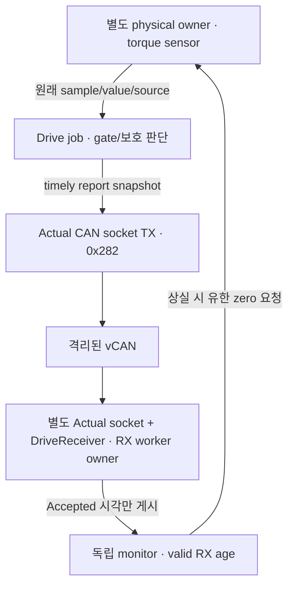

# M3: 비동기 실제 토크를 CAN으로 보내고 확인하기

Date: 2026-10-18. Status: **Host Drive Actual 송수신·취득 시각 보존 / 차량 bridge·Target 후속**.
[다중 주기 실행](m3_multirate_runtime.md)의 unavailable 토크 보고를 연결한다.
결정은 [ADR-0036](../adr/ADR-0036-asynchronous-drive-actual-feedback.md)에 있다.

## 측정과 생성은 서로 다른 시각이다

| 사건 | 예시 시각 | 의미 |
| --- | --- | --- |
| 토크 취득 | 100 ms | 실제 센서가 25 N·m를 관측 |
| ECU job/report | 102 ms | 보존한 sample 검사·보호 판단과 보고 생성 |
| CAN TX / RX | 103 / 104 ms | 실제 socket 송신 / 독립 receiver 수신 |

CAN Actual의 `SourceTimeNs`는 **100 ms**다. 104 ms에 수신했으므로 토크의 source age는 4 ms다.
메시지를 방금 생성/송신했다고 측정도 방금 한 것으로 바꾸지 않는다.
같은 센서를 다음 job에 다시 읽으면 새 측정이 아니므로 torque unavailable 진단을 만든다.
진단의 생성 시각은 별도 의미이며 valid torque age를 갱신하지 않는다.

기존 64-byte frame에 이미 토크 SourceTimeNs·wheel speed source·capability source/oldest input이 있다.
CAN ID·schema 2·CRC layout·DBC signal 위치는 유지한다. Sender가 실제 취득 시각을 쓰도록 하고 수신 정책을 정리했다.

## 보조 값이 토크보다 나중일 수 있다

예시에서 speed는 101 ms, capability는 102 ms에 산출할 수 있다.
각 시각이 토크 100 ms보다 늦어도 각자의 session/현재 시각·age·cursor 검사를 통과하면 usable이다.
수신한 현재 시각보다 미래이거나 원천 시각이 후퇴/동일 시각에 값이 변하면 보조 값을 무효화한다.
Torque는 여전히 자기 source의 30 ms age·엄격한 증가를 따른다. 보조 값이 새로워도 오래된 torque는 사용할 수 없다.
Capability oldest input 70 ms는 이 EV fixture의 명시적 opt-in이며 generic default는 30 ms다.

## 실행 경계



Actual receiver는 DriveController 내부 객체와 별개다. 원래 TX payload 64 bytes와 RX payload가 일치하고,
그 값/취득 시각이 producing job의 sensor에서 왔는지 확인한다. CAN을 읽어서 trusted session을 만들지 않는다.
독립 receiver의 current_sample은 이후 age 만료도 반영한다. Raw last-accepted 진단 값을 제어 값으로 우회하지 않는다.
Application Epoch 1/model Epoch 7과 Central request/relay는 여전히 유한 fixture다.

다섯 입력과 Actual을 포함한 6개 stream이 RX budget 8을 공유한다. RX는 2 ms×1210 jobs로 ECU 마지막 job 뒤 20 ms까지 비우고,
monitor/plant는 기존 40 ms tail을 유지한다. 새로운 thread를 추가하지 않는다.
이 Actual 수신부는 관측/검증 경로다. 실제 CARLA apply와 Central/Zone feedback bridge는 M4–M7에 연결한다.

## 실행과 고장 주입

```sh
cmake --build build/m1-angle --parallel 4
ctest --test-dir build/m1-angle --output-on-failure
python3 tests/unit/timing_report_test.py
unshare --user --map-root-user --net python3 tests/integration/runtime/check_timing.py --family multirate --repetitions 2
```

정상/full·정상/minimal, 다섯 worker stall, CRC 손상에 `feedback-replay`를 더해 9조건·2회면 18 runs다.
Replay는 1.1 s부터 하나의 정상 Actual을 같은 payload/P05 counter/Sequence/source로 반복한다.
Raw CRC는 맞지만 새 torque가 아니므로 Accepted가 늘지 않고 마지막 valid RX 뒤 80..100 ms 안에 상실을 검출해야 한다.
다른 5개 입력은 정상 수용되고 실제 torque는 유한한 zero 응답을 따른다. Replayed wire 값을 물리 모델에 적용하지 않는다.
Source age 30 ms로 current_sample이 먼저 unavailable이 되는 것과 RX timeout 80 ms는 구분한다.

| 기록 | 확인할 것 |
| --- | --- |
| `drive-jobs.csv` | Sensor source/input torque와 report source·job phase, 실제 ECU 비용 |
| `actual-tx.csv` | Generation·socket begin/end, producing/candidate job, replay 여부·원래 bytes |
| `actual-rx.csv` | Raw arrival/Accepted, 실제 receiver decision·usable torque/source·보조 quality와 bytes |
| `run.json`의 `actual_feedback` | 송신/수신/수용 수·expired report와 receiver health |
| `streams`의 `drive_actual` | 다른 입력과 구분한 last-valid/검출 시각·latched health |
| `summary.json`의 `actual_feedback` | Accepted sample의 source→RX, generation→TX, TX→RX 통계 |

`generation_ns`는 ECU에 전달한 논리 job/report 시각(`phase_ns`)이다. 실제 직렬화 완료 시각을 뜻하지 않는다.
Job start/end·ECU 비용과 socket begin/end는 따로 기록한다.
Trace schema 3과 CAN schema 2는 다른 번호다. 이전 schema 2 timing 기록도 기존 의미로 분석한다.
상세 trace는 원래 payload bytes를 보존하고 minimal은 같은 송수신 경로의 count를 기록한다.
원천 ns는 정수이며 floating-point timestamp로 바꾸지 않는다. Torque wire 양자화 오차는 최대 0.05 N·m다.
Source→RX는 local 소프트웨어 경계의 latency이며 실제 CAN arbitration·차량 전체 E2E나 settling time이 아니다.

## 이번 관측

정상 run은 매번 **240 TX = 240 raw RX = 240 Accepted**였다. Normal build의 상세 trace 2회·480개 sample에서
취득 source→소프트웨어 RX는 Mean 4.485 ms / P95 6.045 ms / P99 6.053 ms / Max 6.060 ms였다.
모든 수용 bytes·torque/source를 TX 및 producing job에 연결했고 보조 시각도 독립 검사했다.
Replay run은 240개를 계속 송수신했지만 Accepted는 110개에서 멈췄다. Normal의 검출은 마지막 valid RX 뒤 **81.988–82.062 ms**였다.
이후 current_sample은 과거 토크로 fallback하지 않았고 실제 물리는 유한 zero 응답을 따랐다.

전체 multirate/Actual 45회와 조향 회귀 8회, 일반·sanitizer 각각 C++ 521개·기존 vCAN 97조건, Python 21개와 DBC/CRC를 검사했다.
새 6-stream 부하 smoke는 배치/부하 적용 12/12 PASS, ECU 계약 6 PASS / 6 FAIL이었다. Scheduling 문제는 다음 검토 범위다.

## 읽을 코드와 다음 범위

[TorqueFeedback](../../vecu/drive/torque_feedback.hpp) → [DriveController](../../vecu/drive/drive_controller.cpp) →
[DriveReceiver](../../interfaces/drive/drive_receiver.cpp) → [runtime 연결](../../simulation/runtime/multirate_runtime.cpp) 순서로 읽는다.
DBC/독립 CRC·unit/vCAN·timing 결과와 실패 기록은 [품질 기록](../quality_policy.md)에 남긴다.
이전 CPU 배치 결과는 Actual을 보내기 전 workload의 이력이며 새 RX 비용과 구분한다.
RX/monitor/plant 배치·실행 budget/우선순위와 M3 수용 검토가 다음이다. Target·전체 system TC는 NOT RUN이다.
