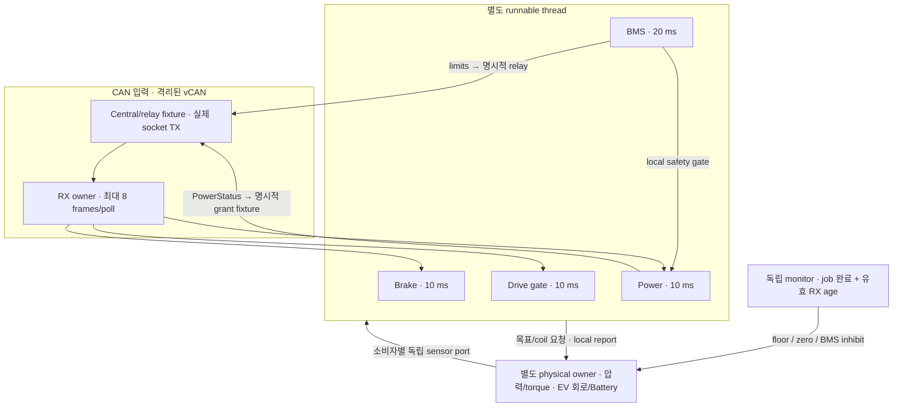

# M3: 여러 ECU의 주기와 CAN 수신 정지를 함께 보기

Date: 2026-10-16. Status: **Host multirate/vCAN component 구현·검사 / owner별 배치·우선순위·Target/E2E 후속**.
2026-10-18 [Drive Actual 연결](m3_drive_feedback.md)로 비동기 torque 송수신과 여섯 번째 valid-RX 감시·RX drain tail을 추가했다.
같은 날 후속 [owner별 CPU 배치 비교](m3_cpu_placement.md#owner별로-cpu를-나누기)를 추가했다.
[첫 Steering 실행](m3_steering_timing.md)의 schedule·completion monitor와 latest snapshot을 확장했다.
결정과 보호 범위는 [ADR-0034](../adr/ADR-0034-multirate-runtime-and-can-loss-monitoring.md)에 기록한다.

## 주기를 다르게 두는 이유

주기는 기능이 새 입력을 검사하고 출력을 갱신하는 간격이다. 이번에는 Brake·Drive·Power를
10 ms, BMS를 20 ms로 실행한다. BMS 출력은 새 20 ms sample이 올 때까지 원래 시각으로 유지된다.
Power/Drive가 그 값을 여러 번 읽어도 새 측정이 되지는 않는다.

| Runnable | Period | Relative deadline | First offset / 예정 jobs |
| --- | --- | --- | --- |
| Brake | 10 ms | 5 ms | 10 ms / 240 |
| Drive gate | 10 ms | 5 ms | 10 ms / 240 |
| BMS | 20 ms | 8 ms | 5 ms / 120 |
| Power | 10 ms | 5 ms | 8 ms / 240 |
| SocketCAN RX | 2 ms | 3 ms | 2 ms / 1210 (20 ms drain tail 포함) |

Deadline은 각 job의 release에 더한다. RX처럼 period보다 긴 deadline도 명시적으로 표현한다.
2.4 s ECU workload 뒤 RX는 20 ms 더 수신하고 monitor/plant는 40 ms까지 진행한다. 최소 ECU 호출 guard 1 ms와 runnable period는 다른 설정이다.
이 값은 [reference.yaml](../../profiles/reference.yaml)의 `m3_multirate_runtime_fixture`에 기록한 Host 실험 설정이며 YAML loader는 없다.

## 실행 경계



Physical owner가 실제 torque/speed→DC·접점/RC 회로→Battery SOC와 독립 센서를 진행한다.
Drive는 원천 BMS limits·별도 permission·로컬 HV/속도를 모두 검사한다. BMS fresh release dwell,
Power의 실제 precharge/READY를 통과한 뒤 구동한다. 속도는 외부 20 rad/s fixture이며 차량 운동은 없다.

Latest snapshot은 소비자마다 별도 인스턴스다. 같은 SPSC port를 Power와 Drive가 함께 읽지 않는다.
CAN metadata/센서를 재시각화하지 않으며 중간 snapshot 대체와 kernel/trace 유실을 구분한다.
권한의 parent context는 CAN 밖에서 발급한 최근 4개 frame 이력과 exact envelope/payload를 맞춰 사용한다.
수신 frame으로 권한을 자동 생성하지 않는다. 실제 Central/Zone runtime과 DDS는 후속이다.

## 작업이 멈추는 것과 메시지가 유효하지 않은 것

1. **Job 감시:** 예정 release + deadline에 completion이 없는지 별도 thread가 확인한다.
   실행하지 못한 job도 분모에 남기며 늦은 완료로 miss를 지우지 않는다.
2. **유효 RX 감시:** 각 receiver가 실제 `Accepted`를 반환한 시각만 원자로 게시한다.
   별도 monitor가 80 ms threshold와 실제 검출 <=100 ms를 확인한다.

CRC가 틀린 packet이 계속 오면 RX thread는 실행 중이고 raw 수신량도 늘어난다.
그렇더라도 유효 command의 age는 늘어나므로 timeout을 검출해야 한다.
반대로 RX thread를 멈추면 job deadline과 6개 stream(5개 입력+Drive Actual)의 last-valid age를 각각 확인할 수 있다.
후자는 기존 application receiver의 수용 완료 시각 기준이며 hardware CAN timestamp나 전체 network latency가 아니다.

Accepted timestamp와 외부 보호/출력 snapshot을 **먼저 읽고 그 뒤 기준 시각을 읽는다.**
시각을 먼저 읽은 뒤 새 상태를 취득하면 실제로는 나중인 검출/결정을 과거 구간에 적용할 수 있다.
이번 동시 실행 검사에서 그 순서를 고쳤고 `detection <= action < stalled job return`을 검사한다.
이미 진행한 물리를 되돌리지 않는다.

## 보호는 장치별로 다르다

- Brake/RX job 정지 또는 Brake stream 상실: 압력을 낮추지 않는 1 MPa floor 요청.
- Drive/BMS/Power/RX job 정지 또는 Drive/Power critical stream 상실: 유한 rate의 torque zero 요청.
- BMS job 정지: Power에 정상 gate를 전달하지 않고 unknown/inhibit로 취급.
- Power job 정지: Drive zero를 요청하면서 마지막 coil 요청을 유지.
  복귀하면 실제 current dwell→contactor open→방전 종료는 기존 PowerController가 판단.

Torque를 즉시 0으로 덮거나 contactor를 일괄 즉시 열지 않는다. Trace에서 남는 torque와 전류 감소를 확인한다.
Power 정지 동안 접점이 유지되는지도 검사한다. 이는 bounded 120 ms stall에 대한 첫 SIL 정책이며,
영구 power-controller 고장이나 차량 정지/독립 전기 차단 성공의 증거가 아니다.
정상 입력이 다시 와도 latch를 자동 해제하지 않는다.

## Drive torque의 취득 시각과 Actual CAN

첫 실행에서는 같은 job end acquisition만 보고해 비동기 torque가 unavailable이었다.
후속 [ADR-0036](../adr/ADR-0036-asynchronous-drive-actual-feedback.md)은 기존 SourceTimeNs에 실제 취득 시각을 보존하고,
speed/capability는 독립 시각으로 수신 검사한다. Cached torque는 새 sample로 보고하지 않는다.
Physical truth와 job의 sensor input, Actual socket TX bytes와 별도 DriveReceiver의 Accepted를 연결한다.
Wire schema 2/64 bytes는 유지하며 trace schema는 3이다. Actual을 CARLA에 반영하는 vehicle bridge는 후속이다.

## 실행과 결과 읽기

기존 executable과 timing runner를 사용한다. `--family steering`이 기본이며 새 family는 격리된 netns에서 실행한다.
Runner는 자신이 만든 vCAN만 정리하고 결과 directory를 덮어쓰지 않는다.

```sh
cmake -S . -B build/m1-angle -DCMAKE_BUILD_TYPE=Debug
cmake --build build/m1-angle -j 4
ctest --test-dir build/m1-angle --output-on-failure
python3 tests/unit/timing_report_test.py
unshare --user --map-root-user --net python3 tests/integration/runtime/check_timing.py --family multirate --repetitions 2
```

정상/full·정상/minimal, Brake/Drive/BMS/Power/RX 각각의 stall, 지속 CRC 손상과 Actual replay로 9조건이다.
2회 반복이면 18 runs다. Warm-up 제외는 0이며 각 task의 분모/Mean/P95/P99/Max와 miss를 따로 보고한다.
서로 다른 주기의 sample을 한 평균으로 섞지 않는다.

| 파일 | 확인할 내용 |
| --- | --- |
| `*-jobs.csv` | Brake/Drive/BMS/Power/RX별 release/start/end·miss·누락, ECU 비용·센서 source·수용 stream mask·local report |
| `can-rx.csv` | 6개 stream의 software raw RX, 원래 source, CRC와 kernel drop |
| `actual-tx.csv` / `actual-rx.csv` | Drive Actual의 원래 bytes·취득/생성/TX/RX/Accepted·usable 값과 replay |
| `monitor.csv` | task/stream fault mask와 독립 보호 latch |
| `physical.csv` | 실제 압력·torque·bus/current·SOC/energy 잔차, 보호와 실제 접점 |
| `run.json` | task별 period/deadline/offset·thread policy, last-valid/검출·보호 적용과 snapshot 계수 |
| `summary.json` / `environment.json` | task별 timing/검출 판정·계측 비교 / commit·binary/source/profile hash·OS/compiler·부하/clock 조건 |

코드는 [runtime 구성](../../simulation/runtime/multirate_runtime.cpp), [공통 Linux 실행 도구](../../simulation/runtime/runtime_support.hpp),
[유효 RX 감시](../../vecu/common/receive_watch.hpp), [trusted fixture](../../simulation/runtime/multirate_fixture.hpp) 순서로 읽는다.
[검사·리포터](../../tests/integration/runtime/check_timing.py)는 두 family를 처리한다.
상세 실행 수치와 검사 범위는 [품질 기록](../quality_policy.md)에 남긴다.

후속 [고정 부하·CPU 배치 비교](m3_cpu_placement.md)에서 같은/다른 CPU의 부하와 실패 run을 비교했다.
Drive Actual은 후속 연결했고 실행 budget·배치/우선순위와 M3 수용 검토가 다음이다.
Target/차량 전체 E2E, 실제 Central/Zone, AUTOSAR OS/BSW, 무한 hang/OS 고장 격리는 검증하지 않았다.
전체 32개 요구/29개 system TC는 NOT RUN이며 M1/M2 학습자 수용 기록은 별도다.
