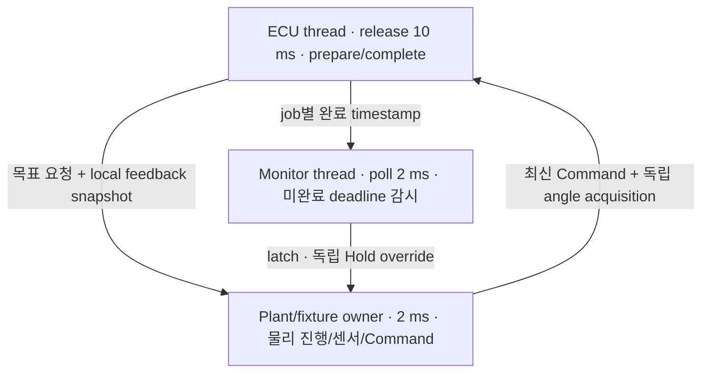

# M3 첫 실행: 10 ms 주기와 독립 deadline 감시

Date: 2026-10-16. Status: **Steering Host component 구현·계측 / 고정 부하·Target 검증 후속**.
다른 ECU와 실제 RX 감시는 후속 [다중 주기 안내](m3_multirate_runtime.md)에 있다.
[ADR-0033](../adr/ADR-0033-first-wall-time-execution-and-monitor.md)의 첫 실행이다.
M2의 ECU/SIL 분리를 실제 thread 실행에 연결한다. 기존 deterministic 모델·vCAN 검사는 유지한다.

## 주기, 실행 시간, deadline

10 ms 주기는 예정된 시작 시각 사이의 간격이다. 실행 시간은 실제 start→end의 elapsed wall time이다.
Deadline은 완료 시한이며 주기와 따로 정한다. 이번 fixture는 release + **5 ms**를 deadline으로 선택했다.
실차나 Target의 deadline을 채택한 값은 아니다.

예를 들어 release가 210 ms, start가 210.1 ms, end가 225.1 ms면 시작 지연은 0.1 ms,
실행 시간은 15 ms, 완료 시한은 215 ms다. 다음 220 ms job까지 실행하지 못했다면 그 job도 분모에 남긴다.
늦은 일을 빠르게 몰아서 실행하거나 다음 release를 현재 시각으로 바꾸지 않는다.

## 세 owner의 책임



ECU가 120 ms 멈춰도 monitor는 완료 timestamp의 부재를 확인하고 plant에 Hold를 요청한다.
Plant는 그 요청을 관측한 실제 시각부터 적용한다. 이미 움직인 각도를 과거로 되돌리지 않는다.
보호 이후에도 새 angle acquisition은 계속된다. Hold override는 이 실험의 containment이며 차량 안전 조향 정책의 확정이 아니다.

Command는 plant/fixture owner가 10 ms마다 생성한다. CAN codec/P05와 receiver는 거치지만
이 실행은 local port 실험이며 SocketCAN·Zone·DDS를 통과하지 않는다.
Application/model Epoch 1은 명시적인 fixture이며 영속 session coordinator를 대신하지 않는다.

| 코드 | 읽을 내용 |
| --- | --- |
| [periodic_task.hpp](../../vecu/common/periodic_task.hpp) / [구현](../../vecu/common/periodic_task.cpp) | absolute release 선택, job별 completion과 독립 deadline latch |
| [latest_snapshot.hpp](../../vecu/common/latest_snapshot.hpp) | 단일 생산자·단일 소비자가 세 slot의 소유권을 atomic exchange로 교환 |
| [steering_runtime.cpp](../../simulation/runtime/steering_runtime.cpp) | ECU·monitor thread와 plant owner, 출력 admission·실제 적용, 사전 할당 trace |
| [SteeringActuator](../../vecu/steering/steering_actuator.cpp) | 기존 ECU 판단; 물리 모델을 호출하지 않음 |
| [검사·리포터](../../tests/integration/runtime/check_timing.py) | 모든 예정 job의 분모, CSV 검증·통계·환경/해시 보존 |
| [경계 시험](../../tests/unit/periodic_task_test.cpp) / [리포터 시험](../../tests/unit/timing_report_test.py) | deadline 경계·누락·동시 snapshot의 무결성, tail/분모 계산 |

Latest snapshot은 FIFO가 아니다. ECU보다 센서 취득이 빠르므로 중간 snapshot의 대체는 정상적으로 발생한다.
캐시를 다시 읽어도 source time·acquisition sequence를 바꾸지 않는다. 대체 횟수와 trace 유실은 별도 지표다.
이 port는 **한 생산자·한 소비자**만 지원한다. 소비자를 늘릴 때 같은 인스턴스를 공유하지 않는다.

## 시각과 출력 경계

모든 owner는 같은 process의 `CLOCK_MONOTONIC`을 사용한다. Absolute sleep으로 예정 release를 유지한다.
ECU의 두 phase는 입력 snapshot을 읽은 뒤 고정한 `job_time_ns`를 함께 사용한다.
계산이 끝나면 실제 wall clock으로 deadline/latch를 다시 검사해 늦은 feedback을 억제한다.
보호 latch 뒤에도 제시간에 완료한 job은 FAIL_SAFE/LocalProtection 진단 feedback을 보고한다.
기존 Steering sensor-gap latch가 걸리면 각도는 unavailable이며 trusted INIT 전까지 정상화하지 않는다.
유효 각도에는 원래 취득 source를, unavailable 진단에는 job 생성 시각을 사용한다.
정상 구동을 막는 것과 진단 보고를 끊는 것을 구분한다.
Plant도 새 output을 적용하기 전에 deadline을 검사하고, 목표의 물리 delay는 **실제 적용 시각**부터 계산한다.
`output_issued_ns`와 `output_applied_ns`를 구분하므로 handoff 지연을 숨기지 않는다.

Core의 최소 호출 간격 guard는 이 fixture에서 **1 ms**, task release는 **10 ms**다.
Actual start jitter 때문에 정상적인 두 호출 간격이 10 ms보다 조금 짧을 수 있기 때문이다.
M2의 deterministic 10 ms guard와 delay/rate/angle calibration은 바꾸지 않았다.
설정 기록은 [reference.yaml](../../profiles/reference.yaml)의 `m3_steering_runtime_fixture`이며 YAML loader는 없다.

## 실행과 결과 파일

Repository root에서 실행한다. 기본 3회 반복은 총 12 runs다. 같은 output directory는 덮어쓰지 않는다.

```sh
cmake -S . -B build/m1-angle -DCMAKE_BUILD_TYPE=Debug
cmake --build build/m1-angle -j 4
ctest --test-dir build/m1-angle --output-on-failure
python3 tests/unit/timing_report_test.py
python3 tests/integration/runtime/check_timing.py --build-dir build/m1-angle
```

한 번만 실행하고 CSV를 직접 읽을 수도 있다. 아래 directory는 새 경로여야 한다.

```sh
build/m1-angle/actuator_demo steering-runtime stall build/m1-angle/my-m3-stall
python3 tests/integration/runtime/check_timing.py --analyze build/m1-angle/my-m3-stall
```

| 파일 | 의미 |
| --- | --- |
| `jobs.csv` | 예정 120개 전부: release/deadline/start/end·미실행·감시 검출, ECU phase, Command/source/causal/sensor identity, local feedback 발행 |
| `plant.csv` | physics/capture 비용, 새 sensor source/sequence·각도, 마지막 적용 ECU job·issued/applied time, 독립 Hold |
| `monitor.csv` | ECU와 별개인 poll 시각과 latch |
| `run.json` | clock/resolution·clock-read probe, thread policy/priority·관측 CPU, handoff/trace 계수와 fixture 설정 |
| `environment.json` | runner가 남긴 UTC·commit/dirty 상태·source/profile/binary hash, OS/compiler/build·affinity/governor와 환경 한계 |
| `summary.json` / `artifact-sha256.json` | run별 판정·통계·계측 비교 / 결과 artifact의 해시 |

주기 실행 중에는 file I/O를 하지 않는다. 고정 크기 port와 미리 확보한 trace 공간을 사용하고
join 후 CSV를 쓴다. Trace 공간이 부족하면 drop을 계수해 검사를 실패시킨다.
물리 thread가 읽은 local feedback snapshot은 CAN 송신 완료나 독립 Actual RX를 뜻하지 않는다.

## 정상·실행 초과·정지에서 확인할 것

| 조건 | 주입 / 판정 |
| --- | --- |
| normal/full | 120 jobs 전부 완료·miss 0·ECU fault 0·fresh feedback·0.3 rad 도달 |
| normal/minimal | 같은 workload에서 phase/plant/monitor 상세 event만 줄임; 기본 job start/end·deadline 감시는 유지 |
| overrun/full | job 20에 15 ms busy work; monitor/plant는 복귀 전에 검출/Hold, late feedback 억제·skipped job 포함 |
| stall/full | job 20에 120 ms sleep; 같은 독립 감시·보호·분모 검사 |

처음부터 끝까지 120개가 eligible이며 warm-up 제외는 0이다. Skipped job에는 가짜 0 ms execution을 넣지 않는다.
Miss rate의 분모에는 남기고 실행 시간 통계의 sample 수를 따로 보고한다.
Nearest-rank Mean/P95/P99/Max는 **개별 관측값**으로 계산한다. Run별 percentile을 평균하지 않는다.
한 번의 큰 지연이 P99에 드러나지 않을 수 있으므로 Max와 miss/drop도 함께 읽는다.

ECU `prepare+complete`, job 전체, physics/capture, release→finish, 유효 sensor→local feedback,
output issue→apply를 각각 보고한다. Sensor→local feedback은 차량 전체 E2E가 아니다.
상세/최소 계측의 평균 차이는 별도 run의 scheduler/cache 잡음도 포함한다. 음수가 나와도
상세 계측이 실행을 빠르게 한다고 해석하지 않으며, 계측 비용을 deadline에서 빼지 않는다.
Clock resolution이나 clock-read probe도 cross-node 동기화 오차나 WCET bound를 뜻하지 않는다.

## 이번 결과와 M3의 남은 범위

첫 실행 시점 Normal·ASan/UBSan 각각 C++ unit **505개**, Python 리포터 **5개**를 검사했다.
각 build에서 12 runs, BUILD_TESTING=OFF build에서 4 runs를 수행했다. 상세 실행 수치·로그는 [품질 기록](../quality_policy.md)에 둔다.
TSan은 이 Host에서 `unexpected memory mapping`으로 시작하지 못해 검사 미실행이다.
현재 thread는 SCHED_OTHER이며 RT priority/affinity를 설정하지 않았다. Sanitizer 수치는 대표 성능으로 사용하지 않는다.

후속 [다중 주기 실행](m3_multirate_runtime.md)으로 Brake/Drive/BMS·Power의 주기와 실제 통신/RX 정지 감시를 확장했다. 다음은
고정 부하·overload와 실행 배치·trace overhead를 검토하는 것이다. Target, process/OS 고장 격리,
무한 hang 강제 종료, 차량 전체 deadline·cross-node/E2E는 아직 검증하지 않았다.
기존 32개 요구/29개 system TC는 NOT RUN이다. M2 학습자 수용 기록은 별도로 남긴다.
