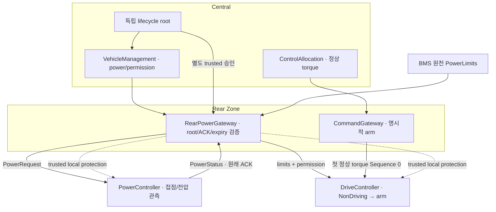

# M4 Rear power: 전원 준비부터 첫 구동 명령까지

Date: 2026-10-19. Status: **Host component + 분리 vCAN 시험 / 전체 M4 runtime 후속**.
[ADR-0048](../adr/ADR-0048-rear-power-routing-and-nondriving-startup.md)의 구현이다.

이번 단계는 Central이 만든 전원 요청·구동 허가를 Rear를 통해 실제 Power/Drive 수신부에 연결한다.
**전원을 켜라는 요청, 실제 고전압 준비, 구동 허가는 서로 다른 사실**이다.



## 시동 순서에서 배울 점

1. Trusted INIT으로 같은 application Epoch를 공급한다. Drive는 `NonDriving`으로 시작한다.
2. Fresh Inhibit·BMS limits와 로컬 speed/HV를 계속 보낸다. 이때 normal torque frame은 보내지 않는다.
3. Central Enable은 별도 승인된 lifecycle root에 묶어 Rear가 전달한다. PowerController가 checks/precharge를 수행한다.
4. 실제 접점·RC bus가 준비된 PowerStatus와 **실제로 전달한 Enable의 ACK**를 확인한다.
5. Trusted coordinator가 Rear와 Drive/정상 명령 gateway를 명시적으로 arm한다.
6. Rear가 검증한 AllowNormal과 limits를 먼저 전달하고, allocator의 첫 normal torque를 전달한다.

NonDriving은 timeout을 전체적으로 끄는 모드가 아니다. Torque receiver 시작만 늦춘다.
나머지 필수 입력은 처음 80 ms 내에 도착해야 하며, 이후 source/의존 시각·expiry 상실은 latch한다.
Arm에서 physics나 BMS cursor를 초기화하지 않고, normal command 대기 80 ms만 시작한다.
미리 보낸 torque packet은 arm/sequence 진행을 만들 수 없고 먼저 온 AllowNormal은 fault다.

BMS limit 0은 정상적인 제한일 수 있다. SOC가 높거나 온도 조건 때문에 충전 허용이 0이면
회생 torque를 제한하고 마찰제동 경로를 쓴다. 정차 중 Drive의 regen capability 0도 알려진 제약이다.
이번에는 [검토한 두 DEGRADED envelope](../adr/ADR-0048-rear-power-routing-and-nondriving-startup.md#검토한-degraded-envelope)만
허용했다. 고장·unknown·stale과 다른 sender의 미검토 DEGRADED는 계속 차단한다.

## 코드의 책임

| 파일 | 볼 내용 |
| --- | --- |
| [power_commands.hpp](../../interfaces/central/power_commands.hpp) | lifecycle root/VM output 공통 계약; vehicle demand root와 구분 |
| [rear_power_gateway.hpp](../../zone/gateway/rear_power_gateway.hpp) | 네 독립 입력·FIFO8·ACK history·expiry·보호 latch |
| [rear_power_control.hpp](../../simulation/runtime/rear_power_control.hpp) | trusted TX의 exact context 기록16·Leaf arm/로컬 보호 연결 |
| [zone_gateway_port.hpp](../../interfaces/socketcan/zone_gateway_port.hpp) | SocketCAN 최종 write guard와 context staging |
| [drive_controller.cpp](../../vecu/drive/drive_controller.cpp) | NonDriving 감시·명시적 arm; 기본 Immediate 동작 유지 |
| [normal_drive_readiness.cpp](../../central/vehicle_management/normal_drive_readiness.cpp) | 제한된 Drive/BMS DEGRADED 허가 정책 |
| [component 시험](../../tests/unit/rear_power_gateway_test.cpp) | root/ACK/queue/clock·실제 시동 연결 |
| [vCAN 시험](../../tests/integration/can/zone_gateway_test.cpp) | 실제 CAN→발급 context 대조→기존 Leaf 수신 |

같은 payload를 수신했다고 parent를 새로 만들지 않는다. Same-host binding은 trusted 송신 단계에
발급한 frame과 정확히 일치하고 아직 살아 있는 기록만 반환한다. Linux의 optional FDF 표시 차이만
정규화하며 BRS/ESI·payload·ID·length는 그대로 대조한다. 원격 신뢰/lease 프로토콜은 후속이다.

## 연결 시험의 범위

**1.6 s 논리 시간 / 10 ms step**에서 실제 VehicleManagement·PowerController·접점/RC PowerModel,
mandatory DriveController·TorqueResponse, 독립 DriveActual receiver·ControlAllocation·정상 CommandGateway와
RearPowerGateway/control binding을 연결했다. 배분은 20 ms다.

프리차지가 80 ms를 넘는 동안 motor actual 0·normal torque frame 0개, actual Ready 뒤 arm/허가,
첫 normal Sequence 0과 이후 실제 양수 torque 응답을 확인했다. 시동 후 즉시 actual 0으로 치환하지 않는다.
Source/parent/expiry와 원래 Actual 취득 시각도 기존 receiver를 통해 유지한다.
마지막에 Rear 연속성 상실을 주입해 실제 Drive Zero·Power inhibit 선택 ACK를 확인한다.
직후 실제 torque 잔류와 닫힌 접점은 그대로이며, 다음 Power tick은 기존 WaitCurrent dwell을 수행한다.

Front Steering/Brake actual·양 Zone health는 fixture다. BMS limits·local BmsSafetyGate·pack400 V/load0 A와
외부 speed0 rad/s도 명시적 fixture다. 실제 BmsController의 셀/pack 판단·Battery SOC/energy·차량 운동을
전부 연결한 시험은 아니다. 전 차량 graceful shutdown도 이번 연결 시험에 포함하지 않는다.

전체 normal·ASan/UBSan **각 C++ 726/726 PASS**다. 기존 697개에 startup7·readiness3·Rear19개를 더했다.
분리 vCAN은 **각 4/4 PASS**로 Rear PowerRequest(0x183), DriveBatteryLimits(0x193),
DrivePermission(0x194)의 실제 전송·기존 receiver·독립 context 대조를 추가했다.
기존 transport 97개 회귀는 별도로 각 97/97 PASS다. System requirement32/TC29는 NOT RUN을 유지한다.

```sh
cmake -S . -B build/m4-readiness -DCMAKE_BUILD_TYPE=Debug
cmake --build build/m4-readiness -j 4
ctest --test-dir build/m4-readiness --output-on-failure
unshare --user --map-root-user --net bash -c '
  ip link add vcan_front type vcan && ip link add vcan_rear type vcan &&
  ip link set vcan_front mtu 72 up && ip link set vcan_rear mtu 72 up &&
  exec build/m4-readiness/zone_gateway_vcan_test'
```

Sanitizer는 `build/m1-angle-sanitized`에 `-DSTRATADRIVE_SANITIZERS=ON`을 설정해 같은 target을 실행한다.
기존 transport는 격리 netns에서 `python3 tests/integration/can/check_socketcan.py --build-dir <build-dir>`로 검사한다.
정적 분석·production build·개발 실패와 원본 로그는 [품질 기록](../quality_policy.md)에 둔다.

## 다음 통합

Front도 초기 정상 command를 강요하지 않는 대기/arm 경로가 필요하다. 전체 coordinator에서 독립
ingress/status·loss/rejoin과 정상 정지→전원 종료를 연결한다. 현재 active Drive의 Inhibit는 기존 fail-safe
정책을 유지하므로, 전 차량 graceful shutdown 구현 완료로 표시하지 않는다.

기존 32-byte normal CAN의 remote Leaf composite lease와 보호 전달 계약, DDS·전체 workload timing·Target도
남아 있다. 이번 논리 시간·same-host vCAN 결과는 hard RT, 차량 정지 성공, M4 전체 완료의 증거가 아니다.
