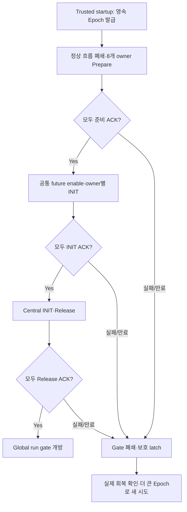

# M4 세션 준비·INIT·재가입: 일부 ECU만 살아나면 왜 안 되는가

Date: 2026-10-19. Status: **Host session component / 정상 비동기 runtime 후속**.
설계와 수치는 [ADR-0054](../adr/ADR-0054-trusted-session-owner-loops.md)에 둔다.

지금까지는 시험 caller가 각 controller/gateway/RX의 `start_session()`을 직접 호출했다.
이번에는 Central이 준비 메시지를 보내고, 각 owner가 자기 INIT 결과를 ACK하는 절차를 추가했다.
평소 조향·제동 명령과 별도의 trusted 제어 경로이며 CAN에 새 INIT frame을 추가한 것은 아니다.

## 흐름



Global gate가 열린 뒤에도 실제 정상 구동은 곧바로 허가되지 않는다.
기존 BMS initial checks/dwell, 실제 전원 READY, 독립 feedback, 명시적 Front/Rear arm이 계속 필요하다.
위 gate는 세션 참여자들이 같은 시작점을 공유했다는 조건이다.

## 알아둘 내용

**준비 ACK와 INIT ACK는 다르다.** 준비는 기존 정상 입력/대기 work를 닫고 물리적으로 reset 가능한지 확인하는 과정이다.
INIT는 각 controller/RX가 공통 application Epoch·enable로 상태를 실제 전환한 결과다.
모든 준비가 끝난 뒤 future enable을 정하므로, 방전을 기다린 시간이 새 세션의 시작 시각이 되지 않는다.

**ACK가 없는 참여자는 성공으로 추정하지 않는다.** Steering은 INIT됐는데 Brake는 실패할 수 있다.
이미 바뀐 Steering을 옛 Epoch로 되돌리는 대신 global gate를 닫고 모두 보호한다.
다음 시도는 더 큰 영속 Epoch를 발급한다. 실패한 grant도 이미 썼으므로 재사용하지 않는다.

**Application 재시작과 물리 reset은 별개다.** 물리 model Epoch7을 유지하면서 application Epoch1→2→3으로 바꿀 수 있다.
재가입으로 SOC를 충전하거나 잔류 토크/압력·bus 전압을0으로 만드는 코드는 없다.
준비 때 안전했던 상태가 INIT 시점에 바뀔 수도 있어, 현재 센서를 다시 검사한다.
Held sensor에 현재 시간을 붙여서 이 검사를 통과시키면 안 된다.

**큐는 전달 수단이고 권한은 protocol이 판단한다.** 이 mailbox는 phase를 잃으면 안 되므로 FIFO를 사용한다.
Latest snapshot으로 덮어쓰지 않는다. Capacity8을 넘으면 데이터 연속성을 신뢰할 수 없어 두 끝에서 보호한다.
각 owner만 자기 port/actor를 수정하고, 다른 owner에게는 typed control/ACK를 전달한다.
정상 command/status에도 이 소유권 경계를 적용하는 작업은 다음 단계다.

## 코드 읽는 순서

| 파일 | 역할 |
| --- | --- |
| [session_control.hpp](../../interfaces/session/session_control.hpp) | 8개 role·phase·proposal/plan·원래 시각 |
| [session_coordinator.cpp](../../central/session/session_coordinator.cpp) | 전체 ACK 집계·Central commit·global gate·실패 latch |
| [session_participant.cpp](../../interfaces/session/session_participant.cpp) | 자기 owner 준비/INIT·immutable ACK·독립 deadline |
| [session_mailbox.hpp](../../interfaces/session/session_mailbox.hpp) | 고정 용량 SPSC·overflow continuity latch |
| [session_loop.hpp](../../simulation/runtime/session_loop.hpp) | bounded owner/Central session runnable |
| [vehicle_session_init.cpp](../../simulation/runtime/vehicle_session_init.cpp) | 현재 센서 재검사·실제 actor/RX의 NonDriving INIT |
| [session_coordinator_test.cpp](../../tests/unit/session_coordinator_test.cpp) | phase/clock/실패/queue·독립 owner thread 시험 |
| [실제 actor 연결](../../tests/unit/rear_power_gateway_test.cpp) | 전체 INIT·부분 실패·더 큰 Epoch 재가입·물리 보존 |
| [영속 발급 연결](../../tests/unit/session_test.cpp) | 중단한 grant 소모·다음 durable grant와 ACK 요구 |

새 demo나 기능별 임시 test 실행 파일은 추가하지 않았다. 새 protocol 단위 파일 하나와 기존 통합/영속 test 파일을 사용한다.

## 실행과 한계

```sh
cmake --build build/m4-readiness -j 4
ctest --test-dir build/m4-readiness --output-on-failure -R 'ManagerTest|SessionLoops|SessionParticipant|SessionMailbox|SessionReset|SessionBootstrapIntegration|DurableAbandoned'
```

실제 actor 시험은 현재 clock으로 물리 센서를 취득하는 직렬 SIL이다. 정상 command producer가 없는 startup fixture이며
angle/pressure/torque·RC 물리를 재초기화하지 않는다. BMS controller도 INIT하지만 이 시험에서 배터리 부하/회생을 구동하지 않는다.
독립 owner thread 시험은 mock local port와 논리 clock/barrier를 사용한다. 기존 동기 normal/protection adapter를
여러 thread가 공유한 결과나 network partition·OS 실시간 보장으로 해석하면 안 된다.

전체 결과·도구·로그는 [품질 기록](../quality_policy.md)에 정리한다.
다음은 정상 요청·결과·feedback·보호도 owner 사이에 비동기로 전달하고, 기존 runtime의 fixture 요청을 실제 Central 경로로 바꾸는 일이다.
그 workload에서 독립 정지/partition·timing을 검사한 뒤 DDS/Host feedback bridge와 remote wire 계약을 진행한다.
