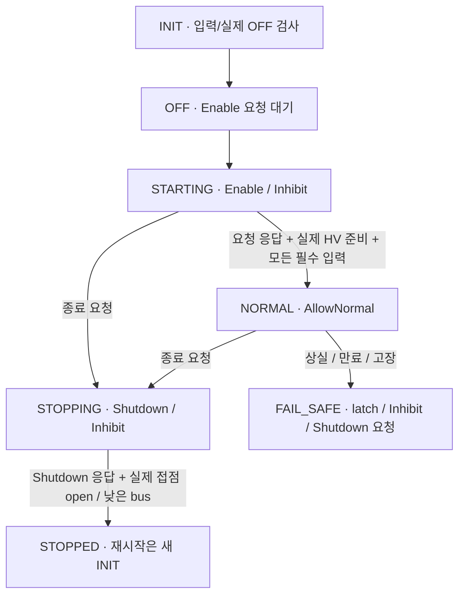

# M4 Central 전원 요청과 주행 허가 상태 관리

Date: 2026-10-19. Status: **Host component + Power circuit 연결 시험 / 전체 coordinator 통합 전**.
[ADR-0044](../adr/ADR-0044-central-vehicle-management-lifecycle.md)의 구현이다.
후속 [첫 control allocation](m4_control_allocation.md)이 이 owner의 허가를 필수 gate로 사용한다.

앞선 [준비 판정](m4_normal_drive_readiness.md)은 입력 snapshot이 조건을 만족하는지만 검사한다.
이번 **VehicleManagement는 그 전의 상태와 고장을 기억하며 전원 요청·주행 허가를 발행**한다.
코드는 [API](../../central/vehicle_management/vehicle_management.hpp),
[구현](../../central/vehicle_management/vehicle_management.cpp),
[모듈 시험](../../tests/unit/vehicle_management_test.cpp)에 있다.

## 시작·주행·종료 흐름



INIT/STARTING/STOPPING에서도 고장을 latch할 수 있다. 그림은 주 흐름만 표시한다.
NORMAL은 주행 권한이 있다는 뜻이며 차량이 실제 움직였다는 관측이 아니다.

중요한 차이는 **Enable과 AllowNormal**이다. Enable은 BMS leaf에게 전원 검사를 시작하라는 요청이다.
실제 접점이 닫히고 precharge가 끝나기까지는 Inhibit를 보낸다. 기존 PowerController가
실제 sensor·로컬 BMS gate로 동작하고, Central은 그 결과를 보고 별도 허가를 만든다.
초기 BMS의 known zero limit/INIT와 실제 OFF/Precharge 상태는 input health로 인정하지만
정상 주행 준비 조건을 만족한 것으로 보지는 않는다. Unknown은 알려진 0과 계속 구분한다.

STOPPING에서는 허가를 철회하고 Shutdown을 요청한다. 접점 open과 bus 하강을 **관측**하고
그 status가 보낸 Shutdown의 응답인지 확인한 뒤 STOPPED가 된다. 다음 Enable에는 새 trusted INIT가
필요하다. 기존 Drive local gate도 활성화 뒤 Inhibit/상실을 latch하므로 end-to-end session 재설정이 필요하다.
정상 종료/고장별 전체 차량 반응은 이후 allocation·Zone 통합에서 다시 시험한다.

## 왜 보낸 요청의 응답인지 확인할까

서로 다른 identity 두 개가 있다.

| Identity | 목적 |
| --- | --- |
| 상위 lifecycle 요청의 Sequence/Source | 누가 언제 어떤 전원 동작을 요청했는가; PowerRequest/DrivePermission의 CausalSequence |
| Central이 발행한 PowerRequest의 Sequence/Source | BMS leaf가 어떤 출력 요청을 수용했는가; PowerStatus의 CausalSequence/AcceptedRequestSourceTime |

예를 들어 상위 요청 4번으로 Central이 PowerRequest 12번을 보냈다면 PowerStatus는 12번과 그
정확한 source time을 응답한다. PowerStatus가 HV_READY여도 다른 요청의 응답이면 허가하지 않는다.
주기마다 PowerRequest를 새로 보내므로 최근 16개 history 안에서 대조하며 각 child/parent 만료도 검사한다.
새로운 root가 수용됐더라도 이전 root에 묶인 응답의 유효 기간을 늘려 주지는 않는다.

## 허가를 반복해서 보내도 원래 만료는 그대로

상위 요청이 70 ms에 만료되면 새 CAN counter/Sequence로 전송해도 70 ms 이후 권한을 만들 수 없다.
별도의 원래 요청 source age 50 ms와 각 Actual/BMS dependency age도 검사한다.
따라서 명목 출력 lifetime은 60 ms지만, 실제 허가는 더 짧을 수 있다.

허가의 expiry는 원래 요청·확인한 Enable 응답의 유효 기간·각 필수 입력의 age 경계 중 가장 빠른 값이다.
이미 허가를 지탱하던 입력이 만료된 뒤 새 feedback이 도착하면 이전 만료를 먼저 latch한다.
같은 root identity의 action/time/expiry 수정은 거부하며, 동일 요청의 반복 수신도 갱신으로 치지 않는다.
이전 root/clock/counter의 연속성을 잃으면 새 INIT에서 검사를 다시 시작한다.

고장 후 fresh 입력만으로 복구하지 않는다. `start_session(new_epoch, enable)`은 더 큰 application Epoch와
비감소 clock을 요구한다. 물리 bus를 0 V로 reset하는 API가 아니며 Leaf/receiver의 INIT도 별도로 수행해야 한다.
실제 접점이 닫힌 채로 새 INIT가 시작되면 다시 StartupEnergized를 검출한다.

Fault 또는 만료된 종료 root 뒤의 Shutdown은 LocalProtection 요청이다. 접점을 즉시 강제로 여는 출력은 아니다.
기존 로컬 전원 제어기가 전류 dwell→접점 open→잔류 전압 방전 순서를 관리한다.
전류를 모르거나 접점이 용착된 경우 Central의 요청만으로 종료 성공을 선언하지 않는다.
유효한 실제 OFF 관측은 다른 Zone 상실이나 sender fault와 구분해 계속 보고할 수 있다.
이 경우에도 차량의 FAIL_SAFE latch는 유지하며 unknown/stale bus로 OFF를 추정하지 않는다.
Clock rollback/표현 범위 소진에는 새 wire output을 만들지 않으며 로컬 상실 보호가 계속 필요하다.

## 어떻게 확인했나

이 단계에서 새 시험 31개를 더해 당시 C++ 전체 normal·ASan/UBSan 각각 **570/570 PASS**였다.
초기 대기·known INIT/zero, parent 변경/재전송/만료, source age와 child expiry, 잘못된 ACK,
7개 필수 source 각각의 상실/latch, 전원 준비·종료 timeout, 실제 OFF/재초기화와 clock/gap을 확인한다.

그중 회로 연결 시험은 10 ms씩 **2.2 s 논리 시간**을 진행한다.

1. 별도 PowerModel의 RC bus·실제 접점 sensor를 기존 PowerController에 입력한다.
2. PowerStatus를 CAN encode→기존 BmsReceiver→Central로 전달한다.
3. Central의 PowerRequest를 CAN encode→기존 PowerController receiver로 전달한다.
4. DrivePermission도 CAN encode→독립 BmsReceiver로 검사한다.
5. Precharge 중 허가 없음, 실제 READY 후 허가, 종료 요청 뒤 actual OFF 확인을 검사한다.

Pack 400 V·load 0 A와 로컬 BMS safety gate, Front/Rear health·비Power actual/limits는 명시적 fixture다.
실제 PowerController·RC/접점 모델의 피드백은 fixture 값으로 대신하지 않는다.
SocketCAN/vCAN·스레드·wall-time·차량 이동/Battery energy 통합 시험은 아니다.
새 CLI를 늘리지 않았으며 기존 `ev-power` demo와 multirate runtime의 request/grant fixture는 아직 유지한다.

```sh
cmake -S . -B build/m4-readiness -DCMAKE_BUILD_TYPE=Debug
cmake --build build/m4-readiness -j 4
ctest --test-dir build/m4-readiness -R '^VehicleManagement' --output-on-failure
```

후속 [control_allocation의 요구/출력 계약과 회생·마찰 배분](m4_control_allocation.md)을 구현·시험했다. VehicleManagement의 허가는
정상 배분의 필수 gate로 사용하고 BMS 한계·Drive actual/capability와 Brake actual을 반영한다.
후속 [Rear 전원/허가/limits·초기 구동 연결](m4_rear_power_startup.md)은 실제 Power/Drive와
독립 root·Enable ACK·trusted arm을 연결하고, 제한된 Drive/BMS DEGRADED envelope도 검토했다.
정상 종료·독립 ingress/local loss/rejoin과 전체 EV loop는 다음 통합이다.
DDS transport는 M5이며 이번 결과가 M3 전체 수용이나 차량 시스템 TC 통과를 뜻하지 않는다.

후속 [Front startup](m4_front_startup.md)은 두 Leaf/gateway의 대기/arm과 실제 양 Zone 시동 연결을 검증했다.
