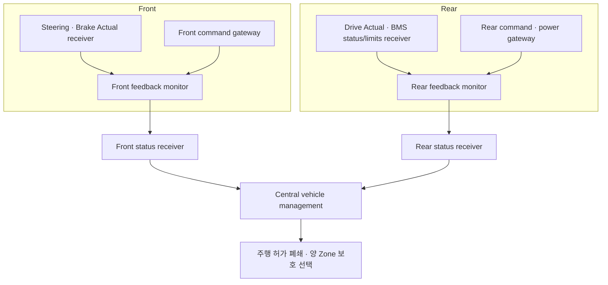

# M4 Zone 상태 감시: 실제 입력에서 Central까지

Date: 2026-10-19. Status: **Host component·회귀 검사 / 전체 coordinator·분산 runtime 후속**.
설계 계약은 [ADR-0051](../adr/ADR-0051-zone-feedback-health-and-status-ingress.md)에 있다.

이전에는 실제 Leaf/물리 모델/CAN receiver를 연결해도 Zone health만 매 cycle 정상으로 채웠다.
이제 **담당 Leaf 입력과 gateway가 살아 있는지 Zone이 판단하고, Central은 두 Zone의 보고를 각각 감시**한다.

## 공부할 구분

**상태 보고 시각과 센서 취득 시각은 다르다.** Steering Actual의 source가10 ms에서 멈췄는데
Zone이20·30·40 ms에 보고하더라도 Actual source는10 ms다. 30 ms age 경계까지 사용할 수 있고,
그 다음에는 입력 상실을 latch한다. 살아 있는 gateway나 다른 Leaf가 이를 대신할 수 없다.

**통신 건강과 주행 준비도 다르다.** 첫 입력은 Waiting, 입력이 준비된 NonDriving은 Ready,
arm 후 감시는 Active다. 정상 종료 인계 후 Terminal은 센서/lease가 정상이어도 `ready_for_normal=false`다.
Central의 시동·종료 input health에는 사용할 수 있지만 정상 주행 준비 판정에는 사용할 수 없다.
그 뒤 실제 HV OFF를 확인하는 정상 종료 흐름도 계속 통과한다.

**재접속과 복구를 구분한다.** Status가 끊겼거나 FailSafe를 보고한 뒤 같은 Epoch에서 새 메시지만
받아 NORMAL로 돌아가지 않는다. 더 큰 trusted Epoch로 gateway/monitor/receiver를 명시적으로 초기화하고,
Leaf와 Central도 해당 세션의 준비를 별도로 완료해야 한다. 물리 압력·잔류 torque·접점은 INIT 성공과 별개다.

## 코드의 위치

| 파일 | 책임 |
| --- | --- |
| [zone_feedback_monitor.hpp](../../zone/feedback/zone_feedback_monitor.hpp) | 실제 gateway + 담당 receiver current sample → Zone status·로컬 보호 |
| [zone_status.hpp](../../interfaces/zone/zone_status.hpp) | 공통 scope/phase·status 계약과 Central의 독립 수신 감시 |
| [feedback_health.cpp](../../interfaces/zone/feedback_health.cpp) | Zone/Central이 공유하는 기존 INIT·제한 DEGRADED·age/quality 정책 |
| [normal_drive_readiness.cpp](../../central/vehicle_management/normal_drive_readiness.cpp) | 두 Zone별 health와 각 원천을 별도로 판정; Terminal의 종료 health와 주행 준비 구분 |
| [zone_feedback_monitor_test.cpp](../../tests/unit/zone_feedback_monitor_test.cpp) | 시작/상실/원천 시각·scope·continuity·clock·새 INIT 경계 |
| [연결 시험](../../tests/unit/rear_power_gateway_test.cpp) | 기존 실제 시동/정상 종료의 health fixture 교체·두 Zone loss/partition 보호 |

새 CLI/demo는 추가하지 않았다. 단위 시험은 새 독립 모듈 파일에, 연결 case는 기존 연결 시험에 모았다.

## 검증

Normal·ASan/UBSan **각 C++795/795 PASS**다. 이전773개에 monitor/status15개·Central Terminal1개·
기존 실제 모델 연결의 loss/partition6개를 추가했다. Gateway 호출 중 clock이 진행해도 정상 관찰을 허용하고,
그 사이 오래된 입력이 age를 넘으면 보호하는 경계도 검사했다. Production `BUILD_TESTING=OFF` 빌드도 통과했다.
정적 분석·vCAN·문서 검사는 [품질 기록](../quality_policy.md)에 도구/범위/로그와 함께 둔다.

연결 시험은 Actual 하나의 전송을1010 ms부터 누락하거나 Front/Rear status 한쪽 전달만 중단한다.
원래1000 ms source의 budget이 지난1040 ms 경계에서 Central/로컬 감시의 보호 상태를 먼저 관찰한다.
다른 Zone heartbeat가 계속 와도 주행 허가는 폐쇄된다. 명시적 continuity 상실은1000 ms에 즉시 관찰한다.
수신 재개만으로 fault가 지워지지 않으며, Terminal에서 정상 명령/허가로 복귀하지 않는 것도 검사한다.

NormalStop/시동 시험은 실제 controller·angle/pressure/torque/RC·접점 모델과 독립 CAN codec/receiver를 사용한다.
BMS limits/safety gate·pack/load·외부 speed script는 fixture다. 이 시험의 typed status 전달은 실제 DDS나
wall-time 분산 실행이 아니며 지연 보장·완전한 rejoin 성공을 주장하지 않는다.

다음은 이 component들을 **한 Central coordinator와 Front/Rear runtime 실행 경계**로 묶는 일이다.
고장 시 처리 순서·전체 세션 INIT/rejoin·원래 Actual/EV feedback bridge를 연결한 뒤
remote Leaf lease/보호와 새 workload timing을 검증한다. DDS transport는 M5다.
