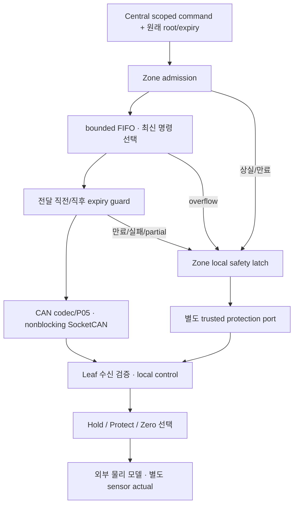

# M4 Zone gateway: CAN 전송과 로컬 보호 연결

Date: 2026-10-19. Status: **Host component + 실제 분리 vCAN 시험 / 전체 EV runtime 후속**.
[ADR-0047](../adr/ADR-0047-zone-can-egress-and-local-protection.md)의 구현이다.
[명령 수용](m4_zone_command_admission.md) 뒤에 다음 경계를 붙였다.



보호 port의 실제 연결은 현재 **same-host SIL adapter**다. Remote Leaf용 보호 신호나
CAN에 원래 expiry를 추가한 wire 규격을 새로 만든 것은 아니다.

## 코드에서 볼 경계

| 파일 | 역할 |
| --- | --- |
| [command_gateway](../../zone/gateway/command_gateway.hpp) | 수용/대기열·최신 명령 선택·frame 생성·각 write 전후 검증 |
| [local_safety](../../zone/local_safety/local_safety.hpp) | 원인 latch·독립 보호 handoff·Pending 재시도 |
| [SocketCAN port](../../interfaces/socketcan/zone_gateway_port.hpp) | 전용 Endpoint의 final enqueue guard로 전달 |
| [Leaf 연결](../../simulation/runtime/zone_leaf_protection.hpp) | Front 두 Leaf 또는 Rear DriveController의 기존 로컬 보호 출력 선택 |
| [component 시험](../../tests/unit/command_gateway_test.cpp) | 지연/실패·queue/clock·실제 Leaf/분리 물리 모델 |
| [vCAN 시험](../../tests/integration/can/zone_gateway_test.cpp) | 두 독립 interface에서 기존 CAN 수신부까지 실제 송수신 |

수용했다고 곧바로 사용 가능한 것은 아니다. 명령이 대기하다가 만료될 수 있으므로 write 직전까지 검사한다.
대기열에 더 최신 명령이 있으면 과거 목표를 차례로 실행하지 않고 이전 항목을 건너뛴다.
8개를 넘으면 연속성 상실로 처리하고 backlog를 폐기한다. 정상 dispatch는 한 번에 최신 묶음 하나다.
Duplicate는 queue를 채우거나 source/expiry를 갱신하지 않는다.

Front의 조향/브레이크는 수용할 때 같은 계산의 묶음이지만 CAN write는 별개다.
첫 frame만 나간 뒤 두 번째가 실패하면 첫 frame을 취소했다고 가정하지 않는다.
남은 정상 전송을 중단하고 두 Leaf 모두에 보호를 요청하며 `partial_front`로 기록한다.

## 보호 요청과 실제 반응의 차이

이번 Front 모델 시험은 20 ms의 정상 command를 받아 지연 목표를 보관한 뒤, 원래 expiry인
50 ms에 Zone이 Leaf 보호를 호출한다. Steering은 예정된 움직임을 취소하고 Hold를 선택한다.
Brake는 지연된 release를 취소하고 1 MPa floor를 요청한다. 초기 1.2 MPa라면 이를 내리지 않는다.
Floor는 시험용 기존 설정이며 실차 감속/제동력 보장이 아니다.

초기 압력 0에서는 요청 직후 actual도 0이고, 별도 pressure model이 가압한 뒤 sensor로 도달을 확인한다.
Stuck 주입에서는 handoff ACK가 true여도 actual 0·floor observed false가 유지된다.
Rear는 실제 DriveController의 BMS limits/허가·HV/speed gate를 통과한 ±motor demand를 사용하고,
Zone lease 만료에 Zero를 선택한다. Actual의 남은 양수/음수 토크는 관측값 그대로 보고하고 ramp로 감소한다.
BMS/허가/HV/speed는 이 시험의 명시적 fixture이며 Battery/power/차량 전체 loop는 아니다.

BMS의 `Accepted`와 field quality `Usable`도 구분한다. Packet을 수용했더라도 원천 identity는 같은데
입력 시각만 바뀌는 등 의존 관계가 잘못되면 해당 값은 제어에 쓸 수 없다.
Drive gate 시험은 limits의 원래 input identity/time도 함께 진행시키고 field quality를 확인한다.

보호 handoff가 수용되지 않으면 Pending으로 남고 poll당 한 번 재시도한다.
ACK는 Leaf가 로컬 출력을 선택했다는 뜻이다. 물리적으로 목표에 도달했거나 차량이 멈췄다는 뜻은 아니다.
원인이 사라져도 latch를 자동 해제하지 않으며 Gateway의 새 INIT만으로 Leaf를 복구하지 않는다.

## 재현과 검증 범위

새 component 시험 32개, 전체 normal·ASan/UBSan 각각 **C++ 697/697 PASS**다.
별도 native vCAN 3개도 각각 PASS다. Front Steering/Brake와 Rear Drive의 원래 metadata/CRC/수용,
만료 시 kernel write 없음, 두 interface 독립성과 local protection 호출을 확인했다.
vCAN 시험의 보호 수신자는 ACK fixture이고, 실제 Leaf/물리 보호 연결은 component 시험에서 검증했다.
공통 SocketCAN 송신 경로를 수정했으므로 기존 97개 vCAN 회귀도 normal/sanitizer 각각 재통과했다.

```sh
cmake -S . -B build/m4-readiness -DCMAKE_BUILD_TYPE=Debug
cmake --build build/m4-readiness -j 4
ctest --test-dir build/m4-readiness -R 'CommandGateway|ZoneLeafProtection' --output-on-failure
unshare --user --map-root-user --net bash -c '
  ip link add vcan_front type vcan && ip link add vcan_rear type vcan &&
  ip link set vcan_front mtu 72 up && ip link set vcan_rear mtu 72 up &&
  exec build/m4-readiness/zone_gateway_vcan_test'
```

Sanitizer는 `build/m1-angle-sanitized`에서 같은 새 target을 실행한다.
통합 target은 caller가 만든 격리 vCAN이 필요하므로 일반 CTest unit 목록에 등록하지 않는다.
기존 transport 회귀와 정적 분석·개발 실패 이력은 [품질 기록](../quality_policy.md)에 둔다.

이번에 보장하는 경계는 **userspace에서 SocketCAN에 넣기 직전까지**다.
기존 32-byte CAN에는 원래 composite expiry가 없고 kernel TX queue나 실제 bus 전달을 취소할 수 없다.
Leaf 수신 시 원래 expiry를 확인하는 규격과 remote 보호 전달 방식은 다음 계약 결정이다.
[Rear power/permission/limits·초기 NonDriving/arm](m4_rear_power_startup.md)은 후속 단계에서 연결했다.
전체 ingress/status 감시·full runtime/timing·DDS와 Target/system TC는 남아 있다.
위 697개/vCAN3개는 gateway 최초 단계 이력이다. M4 전체 완료나 M3 타이밍 예외 해소로 표시하지 않는다.

후속 [Front startup](m4_front_startup.md)은 두 Leaf/gateway의 대기/arm과 실제 양 Zone 시동 연결을 검증했다.

후속 [정상 종료](m4_normal_stop.md)는 actual 정지 확인·terminal handoff/lease 뒤 HV 종료를 연결했다.
