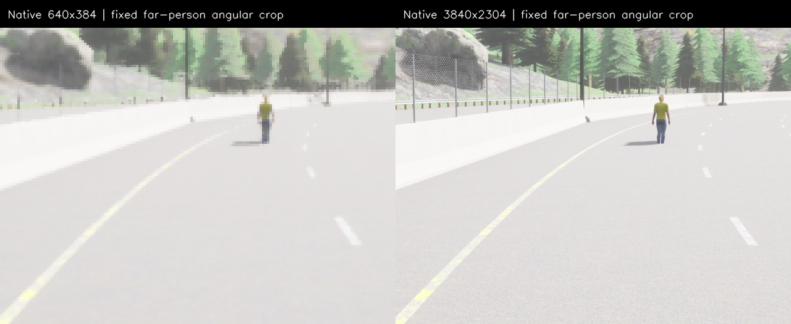

# M10 CARLA 원본 해상도:4K 폭 촬영·개발 비교

2026-11-10. **CARLA 카메라 원본3840×2304를 실제 촬영하고 새 개발 이미지로 검증했다.**
종전640 영상을 확대해 만든 원본이 아니다. 모델은 기존 D-FINE-M960 FP32·동일 confidence를
유지한다. 이번 범위의 가장 큰 source를 다음 새 품질 평가용으로 고정하며, 기본 S/runtime640
경로·M10 OPEN은 유지한다. [사전 기준](../../perception-camera-resolution-v1-protocol.md)을 따른다.

## 원본 크기와 모델 입력

| 항목 | 이번 고정값 |
| --- | --- |
| 실제 CARLA RGB/instance 센서 | **3840×2304**, horizontalFOV90·기존5:3 유지 |
| 모델 입력 | **960×960** PIL RGB bilinear /255 |
| ONNX `orig_target_sizes` | 실제 원본 `[3840,2304]` |
| 가중치·graph | 기존 D-FINE-M960 ONNX SHA `b865ac0f2597afd6fcb9e887ed7738e98e7690ecb4d5cebf42724a3e6b384884` |
| class0/1/2/3/5/7 confidence | `[.60,.40,.60,.50,.50,.60]` |
| 실행 | FP32/BASIC·TF32off·2GiB arena·CPU fallback 금지 |

원본 pixel은 기존의36배다. 이4K 폭은 이번 사전에 정한 상한이며 CARLA의 최대 지원 크기나
3840×2160 UHD 표준이라고 주장하지 않는다. 모델 입력1280의 이전 수치 실패와 여기서의
카메라 원본 크기는 서로 다른 설정이다. 신규 학습·export·crop/ensemble·보드 최적화는 없다.

## 파일럿 선택과 새 개발 결과

모델/GT를 보지 않고 새로 정한 도로가 아니라 **이미 소비한 V9 DEVELOPMENT road45/site38**의
같은 계획 배치를 사용한다. 먼저 far person/bicycle/car3개 case를 source별로 촬영하고 실제
sensor attributes·원본 hash·paired timestamp·pose/도로·모든 actor/Rider·health를 검사했다.

| 원본 source | 모델 없는 준비 | native full300 numeric | 판단 |
| --- | --- | ---: | --- |
| 640×384 | PASS | 3/3 | 통과 |
| 1280×768 | PASS | 2/3 | 수치 FAIL 보존 |
| 1920×1152 | PASS | 3/3 | 통과 |
| 2560×1536 | PASS | 3/3 | 통과 |
| 3840×2304 | PASS | 3/3 | 고정 선택 |

Full300 exact class·canonical box.1pixel/score1e-4·완성 vector를 native PyTorch/ORT CPU/CUDA에서
검사했다.15건 중14건이 PASS다.1280×768의1건은 미달이며 삭제하거나 허용 오차를 바꾸지 않았다.
1280 source 촬영 자체가 실패한 것은 아니다. 모든 raw numeric 배열과 실패를 재생했다.

**가장 큰 기술 통과 source3840×2304를 먼저 봉인한 뒤**640 및4K의 각81장을 별도 서버에서
취득했다. 선택에 본 비교의 정확도 점수를 사용하지 않았다. 두 source의 모델·confidence,
blueprint/월드 pose·3weather·FOV/aspect·Epic/postprocess·물리/staging·settle40/capture10/tick5는
같다. 별도 서버의 실제 renderer/animation/temporal 상태까지 pixel-identical하다고 보지는 않는다.

| 새로 촬영한 개발81장 | TP/FP/FN | Precision | Recall | 절대 기준 |
| --- | --- | ---: | ---: | --- |
| 640×384 | 121/2/8 | 98.37% | 93.80% | PASS |
| 3840×2304 | 129/0/0 | 100.00% | 100.00% | PASS |

양쪽129개 visible GT(계획 actor102+Rider27)이며 포함/제외 분모를 숨기지 않았다.4K는6개 class
각각 recall100%, near person3/3, Rider27/27이다.640은 person37/42·Rider22/27이다.
이 유한 정지 합성 개발 장면에서는 원본 해상도를 높인 결과가 개선됐다. 이미 설계에 쓰던
배치/자산이므로 **새 보류·실제 ODD 일반화·최종 모델 수용은 아니다.** 과거 V9 보류 FAIL도 그대로다.



같은 angular crop의 실제 native 이미지다.640의160×120 crop은4배 nearest 표시,
4K의960×720 crop은640×480으로 축소 표시했다. 이 그림은 모델 입력이나 예측 그림이 아니다.

## 원본·정답·좌표와 실패 보존

두 센서의 원래 BGRA byte를 zlib(level1)로 **손실 없이** 저장하고 stored/raw SHA·길이를
모두 검사했다. 새 variable-size frame/reader는 원래 runtime frame과 다른 offline 자료형이다.
원본을640으로 먼저 낮추지 않고 native RGB에서 바로960 모델 입력을 만든다.

GT는 각 실제 native instance 영상에서 다시 추출했다. Native half-open tight box와 support를
보존하고 비교 때만 box를 source scale로 나눠 canonical640×384 좌표로 환산한다. 최소 지원은
native25×scale²pixel/side4×scale로 기존 angular 조건을 유지한다. Legacy reader용 support는
`max(1,floor(native_pixels/scale²))`이며 실제 native support도 함께 저장한다.640의81개 정답은
원래 annotation 함수와 전부 일치함을 재검사했다. Strict class/IoU.5·Rider→person·primary ignore
false와 기존 절대 품질 기준을 유지했다. 예측 raw도 native 좌표 그대로 저장 후 다시 해석한다.

| 실제 실행 | 원본 pair | 상태 | Server exit | Wall s |
| --- | ---: | --- | ---: | ---: |
| comparison-1-01 | 81 | PASS | 130 | 83.76 |
| comparison-6-01 | 81 | PASS | 130 | 239.03 |
| pilot-1-01 | 3 | PASS | 130 | 32.57 |
| pilot-2-01 | 3 | PASS | 130 | 27.95 |
| pilot-3-01 | 3 | PASS | 130 | 28.35 |
| pilot-4-01 | 3 | FAIL | -9 | 58.90 |
| pilot-4-02 | 3 | PASS | 130 | 29.45 |
| pilot-6-01 | 3 | PASS | 130 | 33.87 |

2560 pilot01은 수집을 끝냈지만 UE가30초 안에 종료되지 않아 forced-9로 FAIL이다.
[사전에 선언한 복구 한도](../../perception-camera-resolution-v1-recovery.md)에 따라 source/plan/
180·900·30s를 유지한02를 한 번만 실행했다. 실행 전 복구 기록과 원래 실패3쌍을 보존했고,
원래 실패는 accepted GT나 모델 probe로 사용하지 않았다. 시작/종료 안정성 해결을 주장하지 않는다.

전체180개 RGB/instance pair를 보존했다. 실패를 포함해 이전5449개와 모든 새 RGB를 합친
**향후 제외5629개**를 고정했다. 이번 source 실험의 모든 영상은 새 보류로 재사용하지 않는다.
원래491 source freeze는 그대로 보존하고 최초 서버 실행 전 runner/supervisor를 추가한
**493개 최종 source freeze**를 새로 고정했다. 모든 원래 source bytes는 유지됐다.

## 처리 비용과 실제20Hz 범위

| source | Health/resize P95 ms | ORT inference P95 ms | 순차 pipeline P95 ms | Cold 포함 Max ms | <100ms |
| --- | ---: | ---: | ---: | ---: | ---: |
| 640×384 | 10.485 | 20.123 | 30.202 | 338.984 | 80/81 |
| 3840×2304 | 73.123 | 20.172 | 93.639 | 168.932 | 80/81 |

각 stage percentile의 합은 전체 percentile과 다를 수 있다. 위 pipeline은 이미 메모리에
있는 native RGB의 health/resize/추론/postprocess이며 압축 파일 읽기·해제/RGB 변환/hash·raw
저장은 제외한다. Cold/init/late 호출은 제외하지 않았다. 전체 wall/source age 수용이 아니다.

4K의 순차 P95는50ms보다 커서 **현재 경로의20Hz는 수용하지 않았다.** 모델 입력은960 그대로고
주요 증가분은 native RGB health/resize다. 고해상도 원본 확보·품질 결과와 실시간 가능성을
구분한다. 후속은 native 고해상도 ingress/전처리와 GPU 공유를 포함한 전체 wall 검증이다.

4K의81쌍 원본 BGRA는5,733,089,280byte, 손실 없는 저장은1,445,783,571byte다.640 저장은
38,871,333byte다. 저장 파일의 offline decode/RGB/hash P95는5.28/195.18ms이며 이 zlib 저장
경로를 실제 camera transport 성능으로 해석하지 않는다. World tick P95는15.77/44.74ms이고,
sensor가 매10ms simulation tick마다 취득하는 원래 fixture여서 live20Hz를 대신하지 않는다.

보조5초 샘플에서 UE RSS 최대6,400,092KiB·SDK949,624KiB, 전체 GPU5610MiB를 관측했다.
초기 pilot 이후부터의 sampled peak이며 실제 peak 보장이나 Jetson 최소 메모리 요구량이 아니다.
보조 monitor의 최초 빈 proc cmdline 오류와 수정도 별도 로그로 보존했다.

## 프로파일·감사·재현

[다음 카메라 source 프로파일](../../../../profiles/perception-camera-source-candidates-v1.json)은
`dfine-m-960-car-v1-camera4k-v1`·source3840×2304/FOV90·실제 target sizes·adapter/source/결과 SHA를
묶는다. 다음 새 품질 평가의 원본 후보이며 기존 S/C++640 runtime 계약을 변경하지 않았다.
`runtime_promotion=false`, `live20Hz_acceptance=false`다. Thor/Orin 각각의 전체 stack 배포·실측과
보드 최적화는 후속이며 아직 수행하지 않았다.

Python220개와 Debug/Release/ASan+UBSan perception 각13개, Ruff·문서/CSV/whitespace가 PASS다.
원래 C++ 변경은 없고 Python은 sanitizer 계측이 아니다. 원본180쌍·native numeric15건의
PASS/FAIL·model raw162개·GT/선택/취득 순서를 재생했다. 새 source를 실제 subprocess로 실행해
동일 결과를 확인하며 이 감사에는 새 모델/GPU 추론이 없다.

- `selection.json`, `numeric-*.json`, `all-numeric-replay.json`: 품질 전에 고정한 최대 source와14PASS/1FAIL.
- `capture-attempts.json`, `*-recovery-before-launch.json`, `future-exclusion.json`: 전 시도·원래 종료 실패·사전 복구·미래 제외.
- `comparison-*-score.json`, `summary.json`, `source-cost.json`: 실제 개발 품질/분모·모든 cold/late·처리/저장 비용.
- `candidate-profile.json`, `audit.json`, `archive-recheck.json`: source 후보와 원본/새 source 재감사.
- `sources.json`/`sources.tar.gz`, `paths.json`, `experiment-*.tar.gz`, `SHA256SUMS`: 원본 RGB/instance·raw출력·모델/체크포인트·source와 모든 실패.

압축 묶음은 content-addressed object와 경로 map이며 중복을 줄이고 LFS 파일당 크기를 제한한다.
검사기가 exact bytes로 새 project를 구성해 다음 명령으로 재감사한다.

```sh
build/m10-perception/cuda-venv/bin/python \
  docs/test-plan/evidence/m10_camera_resolution_v1/check-archive.py \
  docs/test-plan/evidence/m10_camera_resolution_v1 build/m10-camera-recheck-new.json
```

다음은 이4K 원본/960 모델을 고정한 모델 없는 새 준비·새 개발·지명 뒤 새 보류와, 실제
고해상도 ingress/전처리를 포함하는 whole-wall20Hz 검증이다. 기존 개발 점수로 이를 대체하지 않는다.
