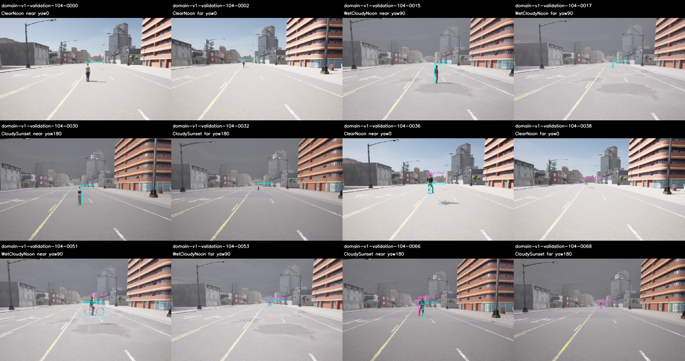
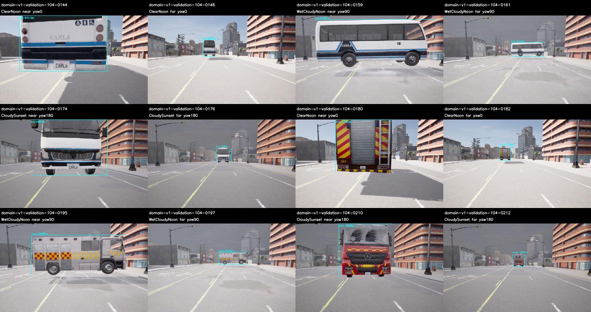

# M10 전용 개발·학습 데이터 v1

2026-11-09. **새 합성 개발 데이터1080장(train813/validation267)의 수집·라벨·분리·내보내기
검증을 완료했다.** 자산 사전 검사176장은 별도다. 모델 학습·새 정확도/quality holdout 평가는
후속 작업이며 기본 S와 기존 M10 품질 FAIL 판정을 유지한다. M10 전체는 OPEN이다.

## 실제 자료와 분리 범위

[수집 사전 기준](../../perception-domain-data-v1-protocol.md)과
[가림 추가 수집 기준](../../perception-domain-extension-v1-protocol.md)을 따른다.
기존 모델 점수로 장면을 고르지 않고, 정답/실제 가시성만으로 자산과 coverage를 준비했다.
과거2717개와 자산 검사176개, **2893개 RGB**를 본 수집에서 제외했다.

| Split | 실제 site·road | 새 영상 | Visible annotation | Rider person | 빈 라벨 영상 |
| --- | --- | ---: | ---: | ---: | ---: |
| Train | 14/31/74 · road52/28/3 | 813 | 1134 | 252 | 9 |
| Validation | 104 · road4 | 267 | 372 | 84 | 3 |

도로·RGB hash·scene family·실제 episode/capture를 분리했고 무작위 frame 분할은 없다.
Validation은 모델 개발 자료다. 다음 미사용127번은 향후 quality holdout 후보로 예약했고 **수집하지
않았다.** 같은 Town에서 얻은 자료이며 다른 도시나 전체 ODD 독립 일반화가 아니다.

22개 blueprint의8m/24m·4방향176장 검사에서 모든 자산의8m semantic/Rider25pixel/side4
지원이 PASS였다.24m에서는 얇은 정면 bicycle과 작은 walker의 지원 부족6개를 관측했다.
Far 실패를 삭제하거나 최소 픽셀 기준을 낮추지 않았다. 본 수집에도 작은 visible 조각을 보존한다.

Person/bicycle/car/motorcycle은 train/validation의 blueprint를 분리했다. 허용목록의 bus1종과
truck2종은 공유하며 이 예외를 자산 독립 일반화로 해석하지 않는다. 실제 자산 목록은 plan과
source snapshot에 있다. 색은 기상축에 따라 바뀌므로 모든 외형 요인의 완전 직교 실험은 아니다.

## 시야·기상·거리와 실제 coverage

원래1020개 계획은 site마다6class×3기상×4방향×3거리216장, 부분 가림18장·동일 pose의
가림 없는 참조18장·배경 제어3장, 총255장이다. ClearNoon/WetCloudyNoon/CloudySunset,
road yaw0/90/180/270°·8/16/24m와 camera yaw±7°/높이15cm/pitch2°, lateral/색을 결정적으로
변경했다. 추가48장은 person lateral .6/.85m×3기상×가림/참조12장/site다.

Train과 validation 각각의6class×기상×방향,6class×기상×거리,6class×기상×부분 가림 coverage가
최소1개25pixel/side4 target 조건을 통과했다. 가림은 실제 참조 대비0초과/.95미만이다.
모든 방향×거리의 개별 셀이 통과했다는 뜻은 아니며 전체 행렬과 미지원 목록을 보존했다.
Site14의 작은 person/WetCloudyNoon 가림 부족도 그대로 남겼다. 학습3도로는 사전 기준대로
합산하고 각 site 판정을 덮어쓰지 않았다.

기존 640×384/FOV90/Epic/postprocess·world10ms·settle40/capture10/선택tick5,
physics-off와 기존 clearance recipe를 유지했다. 실제 pose2cm/0.1°·lane projection2m·clearance
오차15cm도 검사했다. 정지 합성 fixture이며 타이어 접지·동적 주행·실제 센서 ODD 학습 자료를
수용한 것은 아니다. 전체 RGB 건전성을 자동 검사하고, 고정 규칙으로 선택한 패널232장의 라벨을 시각 검수했다.

## 손실 없는 라벨과 학습 입력

Semantic12/13→person,19→bicycle,14→car,18→motorcycle,16→bus,15→truck을 사용한다.
Rider13은 body와 겹쳐도 별도 person으로 남긴다. **모든 nonempty visible fragment를 양성
라벨로 보존**하고25pixel/side4 여부를 `m10_quality_eligible`에 표시한다. 작은 객체를 숨긴 채
배경 음성으로 만들지 않는다. 기존 품질 GT/strict IoU와 점수는 변경하지 않았다.

| Native→COCO category | Train 객체 | 그중 작은 조각 | Validation 객체 | 그중 작은 조각 |
| --- | ---: | ---: | ---: | ---: |
| person 0→1 | 426 | 14 | 138 | 0 |
| bicycle 1→2 | 126 | 13 | 42 | 6 |
| car 2→3 | 204 | 0 | 66 | 0 |
| motorcycle 3→4 | 126 | 0 | 42 | 0 |
| bus 5→6 | 126 | 0 | 42 | 0 |
| truck 7→8 | 126 | 0 | 42 | 0 |

PNG를 다시 읽은 RGB byte가 raw BGRA에서 만든 RGB와 같아야 한다. COCO annotation은
visible xywh·visible pixel area·column-major uncompressed RLE mask·iscrowd=0이며 crowd를
ignore 용도로 만들지 않는다. [COCO 공식 API](https://github.com/cocodataset/cocoapi)의
pycocotools2.0.11로 모든 mask의 area/bbox를 독립 재구성했다. Wheel은 PyPI 배포 SHA와 대조했다.

`DomainDataset`은 category→기존 native class 매핑, annotation/hash·mask/box/area·PNG/RGB와
split을 검증한다. `samples()`는 RGB와 native label을 반환한다. 여섯 category는 기존80-class
모델과 다른 출력 계약을 자동으로 만들지 않는다. 실제 trainer/head·학습/모델 고정·수치 비교와
새 정확도 평가는 이후 별도 구현·봉인이 필요하다.

[작은 보행자 추가 준비 기준](../../perception-domain-support-v1-protocol.md)도 원본과 함께 보존한다.

## 실패·추가 수집 이력

첫 본수집 시작은180초 제한 초과로 FAIL·exit-9·0pair였다. 동일 source/plan/budget으로 다시
시작해 원래 실패와 강제 종료를 보존했다. Validation255장에서는 WetCloudyNoon person의
가시 면적 비율 .96347이 가림 기준을 실패했다. 원래 영상·실패·계획을 유지하고 모델/예측을
읽지 않은 별도 source freeze로48장을 추가했다. 원본/추가를 합친 validation267장이 PASS다.

초기 진행 스크립트는 사전의 split 합산 기준을 도로별로 강하게 적용해 site14에서 중단됐다.
이를 사전 split 단위로 고쳤으며 개별 site FAIL을 PASS로 바꾸거나 gate를 낮추지 않았다.
학습 split의 작은 walker0010/WetCloudyNoon 가림 부족이 남아, train31에서 occluder lateral6단계와
같은 target/camera 참조12장을 별도 사전 기준·source freeze로 추가했다. 기존 영상·split FAIL도
보존했고 final-split-coverage.json의 같은 gate를 통과했다. 모델/예측은 사용하지 않았다.

| 실제 실행 | Raw pair | 수집/종료 | Exit | Wall s |
| --- | ---: | --- | ---: | ---: |
| extension-train-14-01 | 12 | PASS | 130 | 39.57 |
| extension-train-31-01 | 12 | PASS | 130 | 41.28 |
| extension-train-74-01 | 12 | PASS | 130 | 54.46 |
| extension-validation-104-01 | 12 | PASS | 130 | 108.05 |
| preflight-01 | 176 | PASS | 130 | 359.58 |
| support-train-31-01 | 12 | PASS | 130 | 42.58 |
| train-14-01 | 255 | PASS | 130 | 295.77 |
| train-31-01 | 255 | PASS | 130 | 321.03 |
| train-74-01 | 255 | PASS | 130 | 496.68 |
| validation-104-01 | 0 | FAIL | -9 | 210.88 |
| validation-104-02 | 255 | PASS | 130 | 515.79 |

Startup180s·capture900s·shutdown30s와 exit130 기준을 유지했다. 총1256쌍은 사전176개와
개발1080개다. 모델 추론/학습은 실행하지 않았다. 원래 사전 snapshot9개·원본 collection161개·
추가 collection166개와 별도 support169개 source/config와 실제 실행 probe를 보존했다. 사전 검사의 미사용 collection
초안은 보존하고, 실제 본수집 전 이륜차 가림을 측면80°로 고정한 계획도 구분했다.

## 검증과 재현

Python **148개**, Debug/Release/ASan+UBSan perception **13개씩**, Ruff·문서 링크·whitespace가
PASS다. Python 자체는 sanitizer로 계측하지 않았다. 이전 M10 아홉 묶음 SHA256SUMS도 PASS이며
수정하지 않았다. 전체 core/M7·새 wall20Hz·M11/Target/차량 수용은 이번 범위가 아니다.

원본 재감사는1256개 raw→RGB/mask/pose·visible 라벨/지원,1080개 PNG/COCO·split·원래 실패를
재구성한다. 새 경로에 압축을 풀어 동일 결과와 공식 COCO API 검사를 다시 확인한다.

- `experiment-audit.json`, `coco-api-check.json`, `dataset-statistics.json`: 원본/라벨·표준 mask·분리 검증.
- `*-coverage.json`: 개별 원본/합산 site와 사전 split 행렬·기존 FAIL 보존.
- `preflight-acceptance.json`, `*-panels.json`, `*-visual-review.json`, PNG: 자산·가시성·고정 패널 검수.
- `data-bundle.json`, `plans.json`, `*-freeze.json`: 원본/추가 capture freeze·계획·prepared hash 연결. Export의 freeze/plan identity는 이 두 bundle 문서 hash다.
- `export-summary.json`: Train813/validation267의 PNG·COCO annotation manifest. 실제 `export/`는 아래 archive에 있다.
- `experiment.tar.gz`: `build/m10-domain-data-v1/`의 원래 source·raw/RGB·prepared·export·실패/로그·QA dependency/wheel·재현 script. 모델 가중치는 없다.
- `sources.json`/`sources.tar.gz`: baseline `638d38f` 위 최종 관련 코드·설정·문서 snapshot.
- `future-evaluation-exclusion.json`: 과거2717+이번1256, **3973개 RGB**를 다음 quality holdout에서 제외.
- `SHA256SUMS`, `archive-recheck.json`: 묶음 무결성과 새 경로 원본/표준 COCO 재현.

다음은 이 고정 자료에 맞는 trainer·모델 출력/학습 설정을 구현하고 학습 후보를 만든 뒤,
새 개발/quality holdout을 따로 수집해 기존 정확도·시간 gate로 검증하는 일이다.
[실행 안내](../../../perception-guide.md#domain-data-v1), [ADR-0124](../../../archive/design-decisions.md#adr-0124)를 따른다.
