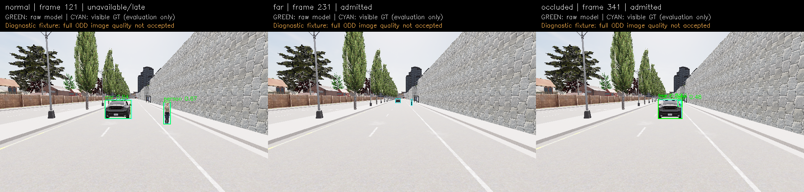
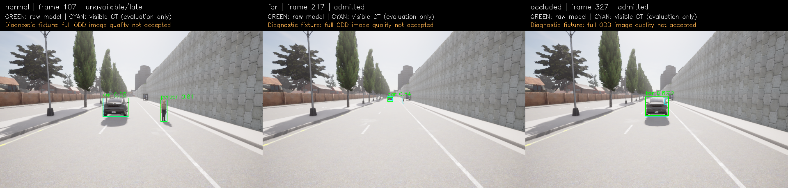

# M10 후속: 명시적 준비·실제 카메라 shadow·RGB 설정

2026-11-06, Host RTX3090. M10 전체 수용은 **OPEN**이다. 이번 범위는 준비 gate, bounded
live ingress, 공유 GPU의 실제 RGB 추론·고장 처리와 독립 감사다. 초기 모델/threshold와
[첫 실행의 raw·실패](../m10_perception/README.md)는 변경하지 않았다.

## 결과

- `require_preparation=True`: 같은 inference owner의 synthetic RGB3회, 전체10s와 뒤2회
  각각100ms exclusive. 준비 전 INIT/submit 차단, probe publication0, 실패/timeout/stop 뒤
  늦은 완료로 READY 복원0. Model 생성·cold probe·준비 전체 비용을 별도로 보존한다.
- BGRA latest1 ingress→실제 snapshot frame/source 확인→RGB→worker latest1. Camera 오류는
  current/pending/in-flight generation을 무효화한다. Receipt100ms는 queue/변환 시간을 포함한다.
  Source가 멈춰도 snapshot은 receipt+100ms에 만료한다.
- CARLA 원본 frame%5 취득, 실제 world10ms·camera50ms와 원본 frame/source를 검증했다.
  모델·GT를 섞지 않고, physics-disabled 차량1대와 횡방향으로 이동시키는 보행자1명을 관측했다.
  Native owner bind·actuator/제어 RPC는 없다. C++ 경계는 실제 소비 결과의 **사후 typed replay**다.
- `--rgb-postprocess enabled`의 최종 live 정상600frame 모두 publication/소비/C++ 경계를 통과했다.
  같은 설정의 slow·exception·blackout·silence4조건도 독립 감사와 서버 종료를 통과했다.

| 최종 RGB live 조건 | Camera callback | Submit | Completed | Published | Overwrite | Late | Error |
| --- | ---: | ---: | ---: | ---: | ---: | ---: | ---: |
| 정상 | 600 | 600 | 600 | 600 | 0 | 0 | 0 |
| 추론 앞150ms 지연 | 120 | 120 | 39 | 0 | 81 | 39 | 0 |
| 후반 backend 예외 | 120 | 120 | 120 | 60 | 0 | 0 | 60 |
| 후반 blackout | 120 | 120 | 120 | 60 | 0 | 0 | 60 |
| 후반 입력 전달 중단 | 120 | 60 | 60 | 60 | 0 | 0 | 0 |

Silence의 나머지60callback은 주입 위치에서 전달하지 않은 것으로 기록된다. 모든 조건 끝에
추가 physics tick 없이500ms 소비를 관측했다. Source가 정지해도 wall-stale 결과는 제공되지 않는다.
유한 trace·종료 시점의 queue/completion 분모를 모두 대조하고 서버 exit130을 확인했다.

## 시간: startup과 sensor를 모두 기록

최종 RGB live 정상 실행에서 model 생성321.7ms, 첫 synthetic cold call255.3ms,
뒤2회10.0/9.0ms다. 준비 전체와 각 call 원본 ns는 `live/rgb-none-600.json`에 있다.
Cold call을 sensor 성공으로 바꾸거나 첫 실행 결과에서 제외하지 않았다.

| 실행 | Sensor N | Receipt/submit→완료 Mean | P95 | P99 | Max | 결과 |
| --- | ---: | ---: | ---: | ---: | ---: | --- |
| 준비 후 CUDA media20Hz | 600 | 19.21ms | 20.77ms | 23.02ms | 26.03ms | 600발행, drop/late0 |
| 준비 후 CPU media20Hz | 33완료/60제출 | 128.63ms | 298.13ms | 365.57ms | 382.69ms | 13발행, overwrite27, late20 |
| 실제 RGB CARLA+CUDA | 600 | 23.34ms | 24.89ms | 40.55ms | 75.33ms | 600발행, drop/late0 |

Media는 같은60frame을10회 반복한30초 workload이며 새 정확도 표본600개가 아니다.
CPU 준비3회는 통과했지만20Hz 처리량은 충족하지 못했다. READY는 처리량 보증이 아니다.

최종 live의 실제 camera wall rate는 **19.34Hz**, callback 간격 Mean51.72/P95 53.07/
P99 87.35/Max159.45ms, simulation/wall ratio0.967이다. 취득 simulation50ms와 전체wall20Hz는
다르다. 모든 완료 결과가 fresh였다는 사실이 연속 가용성이나 hard realtime을 보장하지 않는다.
SDK callback wall과 adapter offer receipt를 구분하며 실제 센서 hardware latency 측정이 아니다.
Host CPU placement는 inherited이며 Jetson/격리 CPU/온도·power 수용 시험이 아니다.

## RGB 설정과 정확도 재측정

초기 RGB `enable_postprocess_effects=False`는 CARLA `SceneCaptureSensor.cpp`에서 lighting 등
show flag도 끈다. 같은 Town03_Opt/ClearNoon/geometry에서 postprocess를 켠 Low/Epic 원본을
각60쌍 새로 수집했다. 확인한 원본과3scene overlay에서는 검은 하늘·경고 HUD가 사라졌다.
엔진 source·asset을 수정하거나 경고 text를 잘라내지는 않았다. Low의 밝기/그림자와 Epic의
시각적 차이도 남긴다. 전체 renderer/ODD 품질은 수용하지 않는다.

동일 YOLOX-S FP32·score0.35·class NMS0.5, visible-instance IoU0.5 기준이다. 각 조건120개의
GT 관측은 **같은 두 actor를 반복 관측**한 것이며 독립 객체120개/COCO mAP가 아니다.

| 수집 설정 | TP | FP | FN | Precision | Recall |
| --- | ---: | ---: | ---: | ---: | ---: |
| 초기 Low, postprocess off | 60 | 20 | 60 | 0.750 | 0.500 |
| 후속 Low, postprocess on | 72 | 57 | 48 | 0.558 | 0.600 |
| 후속 Epic, postprocess on | 73 | 22 | 47 | 0.768 | 0.608 |

Low on의 far TP12/FN28, occluded TP20/FN20이며 FP도 늘었다. Epic on의 far TP13/FN27,
occluded TP20/FN20다. 가림 보행자·원거리와 중복 class/오검출 문제는 남는다. 후속 각 offline
replay는60model-valid 중59admitted/1cold-late이며 raw와 admitted 평가를 모두 남긴다.
`quality_acceptance=NOT_SET`이며 threshold를 이 결과에 맞춰 바꾸지 않았다.

## 실패와 중간 실행

`live-runs.tar.gz`는 초기 `live-*`, frame5 적용 `frame5-*`, 최종 RGB `rgb-*`를 모두 포함한다.

- 초기 live120은 모두 추론했으나 실제14.59Hz였다.
- 초기 기본 sensor_tick의 긴600frame은 모든 추론을 마쳤어도 cadence 검사 **FAIL**이다.
  Frame495→499→505 같은40/60ms 간격이6쌍 관측되었다. Timestamp를 보정하지 않고,
  설치된 sensor patch가 요구하는 `StrataM7SensorFrame5`·`StrataM7NativeProbe` 두 flag와
  `role_name=m7_frame5`를 함께 적용해 실제 취득을 고쳤다. 적용 뒤600frame cadence를 통과했다.
- 초기 blackout120은 client 검사 PASS였지만 서버가30s 내 종료되지 않아 SIGKILL/exit-9,
  전체 **FAIL**이다. Timeout을 늘려 성공으로 바꾸지 않았다. 후속 frame5/RGB 고장 실행은 exit130이다.
- RGB off의 frame5 정상600은17.84Hz,600발행, P95 24.78ms였다. 최종 RGB on19.34Hz와의
  차이를 renderer 설정만의 인과적 성능 개선으로 해석하지 않는다. Host 부하/스케줄이 격리되지 않았다.

## 검사와 보존

Python55개는 준비/receipt/ingress/고장 검사를 포함한다. 독립 live auditor에는21개 변조 사례를
넣어 cold probe 삭제·원천 변경·source/wall expiry·분모 변경·고장 결과 수용을 거절했다.
C++11개+Python suite+boundary replay의13개 CTest를 Debug/Release/ASan+UBSan에서 확인한다.
기본 core 회귀의 정확한 결과와 실행 범위는 `acceptance.json`/`validation.tar.gz`에 기록한다.
`runtime.wall`은 제외하며 M7 opt-in 전체 suite·Target을 새로 실행했다고 주장하지 않는다.

- `acceptance.json`: 선언한 기술 범위, 최신 실행 수치, 남은 gate.
- `live/*.json`, `stream/*.json`, `renderer/*.json`: 최종 원본 보고서와 독립 audit/평가.
- `live-runs.tar.gz`: 모든 live의 실행 probe·server/client log·raw trace·boundary·RGB sample.
- `renderer-inputs.tar.gz`: Low/Epic 원본 BGRA/instance·metadata·파생 RGB-only/GT manifest·추론 결과.
- `validation.tar.gz`, `environment.json`: 테스트·검사·실행 log와 관련 package/hardware inventory.
- `sources.json`/`sources.tar.gz`: 최종 소스·profile·문서 snapshot, baseline4eb743c.
- `source-versions.tar.gz`/`execution-source-coverage.json`: 이전 시도 당시 runtime hash에 맞는
  source byte도 별도로 보존한다. 실제 실행 probe는 각 run에 그대로 복사했다.
- `SHA256SUMS`: artifact 무결성. 첫 M10 묶음도 hash 검사하여 변경되지 않았음을 확인했다.

실행법은 [가이드](../../../perception-guide.md), gate는 [계약](../../../interfaces/perception.md)과
[프로토콜](../../perception-protocol.md)을 따른다. 남은 일은 더 넓은 시나리오/정확도 기준,
small·occlusion·FP 보강, 전체wall20Hz·renderer 장기 안정성이다. Metric fusion/localization,
M11 temporal planner/risk/fallback·native 주행 연결·M12 보드는 별도이며 이번에 완료하지 않았다.
