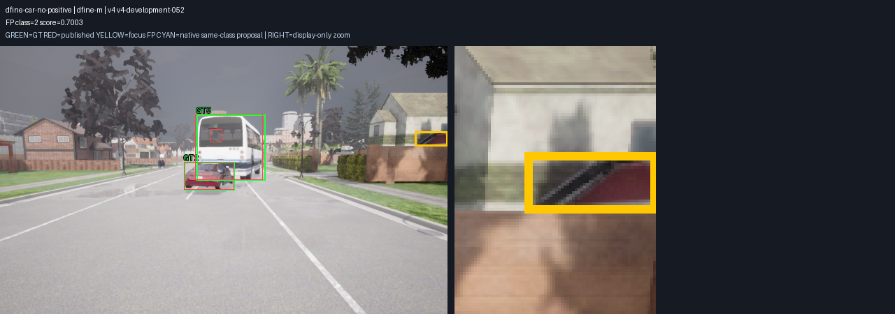
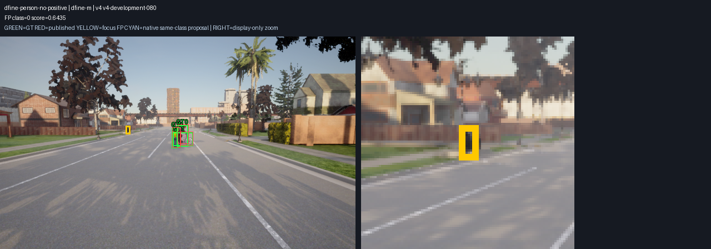
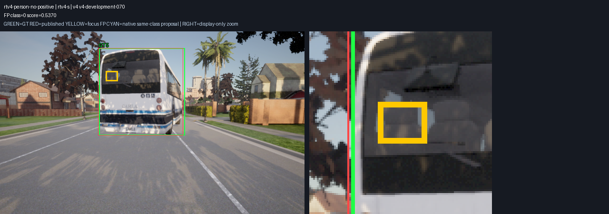
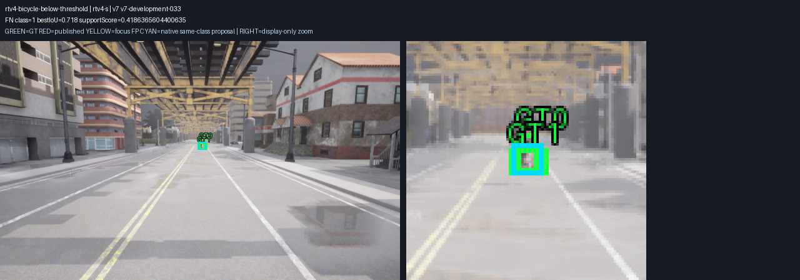
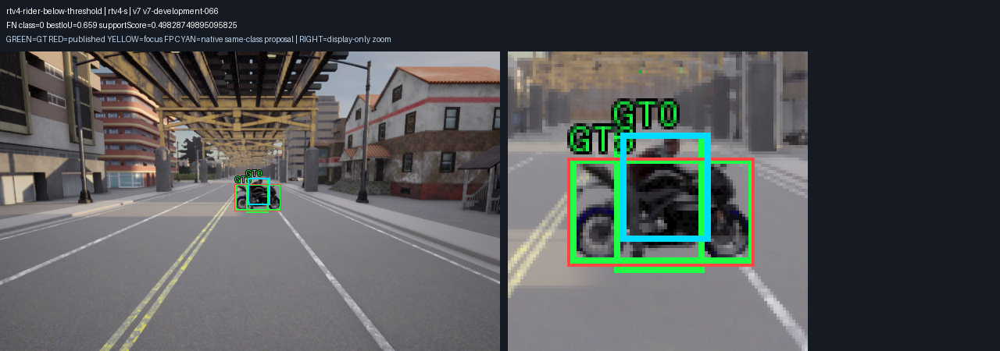
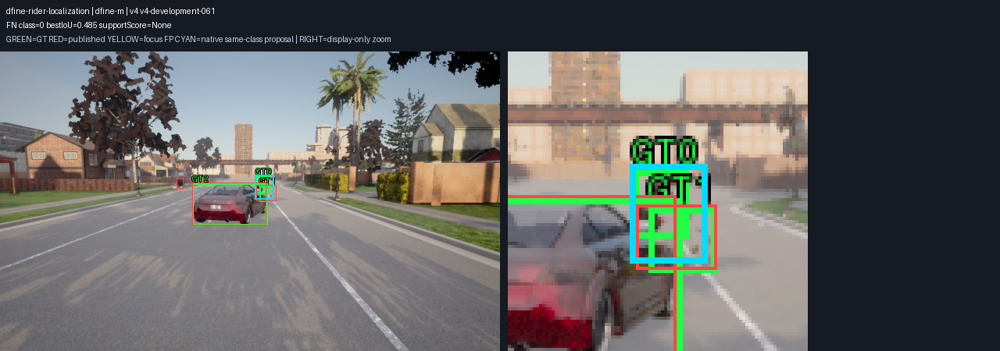

# M10 pretrained detector error diagnostics V1

2026-11-10. 기존 개발405장의 D-FINE-M/RT-DETRv4-S 오류를 분석했다.
**기존 V2 점수·GT·threshold·모델 bytes와 기본 S를 유지**했다. 새 보류/독립 수용이 아니다.
[사전 진단 기준](../../perception-model-diagnostics-v1-protocol.md)과
[원본 mask annex](../../perception-model-diagnostics-v1-mask-annex.md)를 따른다.

## 확인한 내용

| 모델 / 개발 영역 | 원래 FP / FN | FN 중 올바른 class·IoU≥0.5 native 박스가0.50 미만 | FN 중 same-class 위치 겹침만 존재 | FP 중 positive IoU≥0.1 없음 |
| --- | ---: | ---: | ---: | ---: |
| D-FINE-M / calibration324 | 129 / 51 | 49 | 2 | 98 |
| D-FINE-M / 소비한 Town04 개발81 | 16 / 10 | 10 | 0 | 2 |
| RT-DETRv4-S / calibration324 | 27 / 85 | 84 | 1 | 2 |
| RT-DETRv4-S / 소비한 Town04 개발81 | 9 / 16 | 16 | 0 | 0 |

이번 자료에서는 많은 누락에 대해 위치 후보가 존재하며 신뢰도 기준의 영향이 크다.
이는 모델이 모든 객체를 확실히 인식했다는 뜻이 아니다. Native top300에는 낮은 confidence의
여러 class 후보가 들어간다. 분석은0.10 미만 score와80개 원래 class도 보되 실제 검출로
승격하지 않았다. 모든 frame의 native top300 cutoff는0.10 미만이었다.

D-FINE의 calibration FP98건 중95건이 V4에 집중됐다(car55·person40). 같은 고정 배경이
여러 scene에서 반복되므로 이를95개의 독립적인 배경 종류로 해석하지 않는다. 높은 score의
원본 ROI 세 사례를 사전 규칙으로 고정하고 RGB/instance pair·전체 frame GT를 재구성했다.

| 선택 사례 | 예측 class / confidence | ROI 픽셀 | simulator tag 관측 | 예상 target tag 픽셀 |
| --- | --- | ---: | --- | ---: |
| D-FINE V4 scene052 | car / .7003 | 1034 | Buildings978·Walls56 | 0 |
| D-FINE V4 scene080 | person / .6435 | 144 | Static89·Poles24·Fences18·Ground11·Terrain2 | 0 |
| RT-DETRv4 V4 scene070 | person / .5370 | 572 | Bus572 | 0 |

RGB에서는 지붕처럼 보이는 구조, 도로변 정적 물체, 버스 창문 영역을 검출한다. Mask tag와
RGB 관찰은 이 세 사례의 진단이다. 다른 모든 FP의 실제 의미를 확정하거나 GT를 수정하지
않았다. 원본 capture SHA는 `e4cb5fbcc3e075582d0d252223f2872613223e9aa702089a19588b0630739667`이다.
capture의 development/evaluation, scene/frame/source clock, BGRA sensor SHA, 변환 RGB bytes와
봉인 RGB SHA, `visible_boxes_v2`의 전체 positive/excluded GT가 모두 일치했다.

## 겹침과 위치 오류의 구분

| 모델 / 영역 | 같은 class 중복 | 다른 class positive IoU≥.5 | 같은 class IoU .1–.5 | 다른 class만 IoU .1–.5 | positive IoU≥.1 없음 |
| --- | ---: | ---: | ---: | ---: | ---: |
| D-FINE / calibration | 5 | 12 | 13 | 1 | 98 |
| D-FINE / Town04 개발 | 1 | 4 | 9 | 0 | 2 |
| RT-DETRv4 / calibration | 4 | 4 | 17 | 0 | 2 |
| RT-DETRv4 / Town04 개발 | 0 | 3 | 6 | 0 | 0 |

이 표는 상호 배타적인 **geometry bucket**이다. 다른-class overlap이 classifier 혼동의
의미 원인을 입증하지 않는다. Rider/person과 bicycle/motorcycle은 같은 actor ID와 겹치는
GT box를 가질 수 있다. 이를 별도 relationship·Rider flag로 남겼다. D-FINE calibration FP의
17건, RT-DETRv4의9건에 Rider overlap이 있다. 기존 strict FP는 그대로다.

Score0까지 native proposal을 허용하고 FP/용량/greedy 순서를 무시한 **낙관적 일대일 recall
상한**은 calibration D-FINE514/516, RT-DETRv4 515/516, Town04는 둘 다129/129다.
한 proposal을 여러 GT에 재사용하지 않았다. 이 상한은 실제 precision/recall 수용 결과가
아니며 full neural head 전체에 대한 결론도 아니다. 별도 full-head export는 필요하지 않아
실행하지 않았다.

## 검증과 원본

`analysis.json`은810개 native raw·1290개 model/GT 관측의 모든 FP/FN/GT/frame 기록을
보존한다. class/dataset/weather/stratum/Rider/box-size와 score 분포를 집계했다. 작은 box
bin은32²/96² pixel 경계로 고정했다. 모든 frame의 matching/count/GT index를 기존 primary
scorer와 대조하고 기존 V2 micro 점수와 정확히 일치시켰다. `audit.json`은 전체 재계산이다.

Source367개를 분석 전에 고정했다. 새 단위 검사9개는 겹치는 Rider, excluded-overlap FP,
confidence 경계, 낮은 score의 비유한 값, native80-class, 일대일 augmenting-path를 검사한다.
후속 class calibration과 합친 최종 Python201개가 PASS다. C++/live/보드 경로는 변경하지 않았다.

오른쪽 확대는 display-only이며 모델 입력에 쓰지 않았다. 원본 RGB와 native/published/GT
표시를 구분했다. 사례 선정/ROI/입력 SHA는 `visual-cases.json`, mask 관측은 `mask-review.json`,
별도 freeze는 `mask-freeze.json`에 있다. `SHA256SUMS`로 외부 원본을 검사한다.

두 단계의 전체 source·raw810개·개발405개 RGB·세 sensor pair·native 모델·숫자 참조를 담은
공통 [experiment 압축](../m10_class_calibration_v1/experiment.tar.gz)과
[새 source 경로 재현 명령](../m10_class_calibration_v1/README.md)은 후속 evidence에 둔다.
기존 모델을 다시 학습하거나 소비한 보류를 읽지 않았다. 분석 후 별도 사전 규칙으로
[클래스별 confidence 실험](../m10_class_calibration_v1/README.md)을 수행했다.
