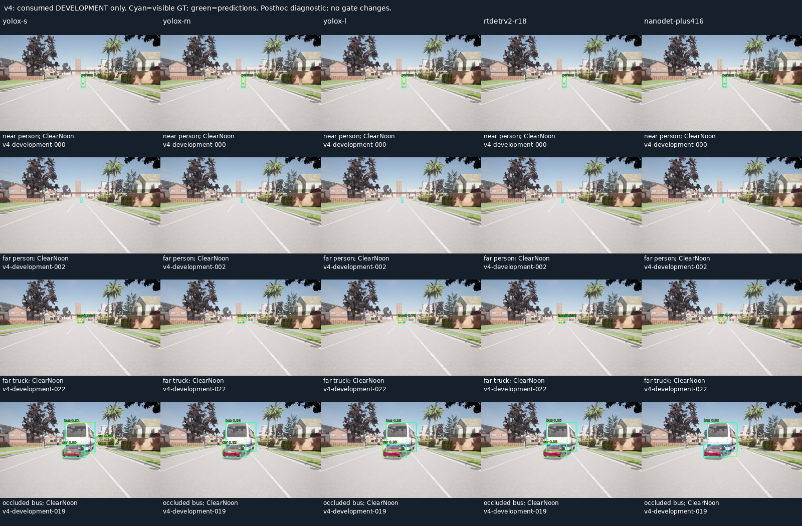
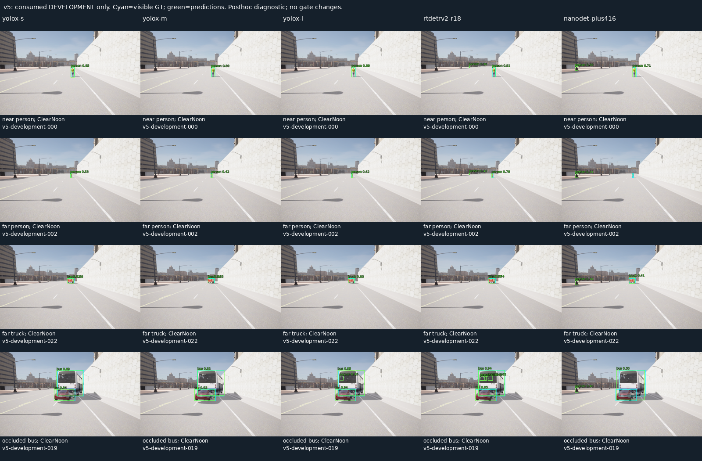
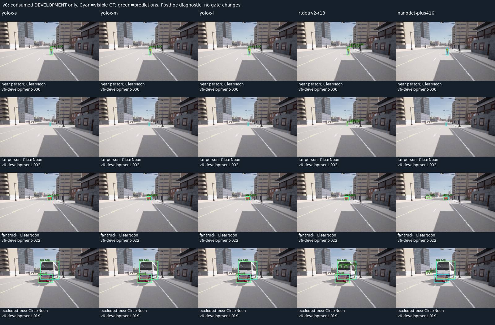
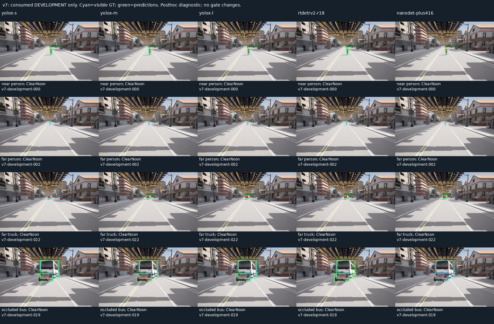

# M10 사전학습5종 개발 비교 V1

2026-11-10. 사용자 지시에 따라 **Jetson 배포 가능성을 고려하고 보드별 최적화는 후속**으로
둔 상태에서5개 사전학습 모델을 같은 개발 영상324장에 실행했다. 추가 학습·새 수집·보류
접근·runtime 교체는 없다. [현재 선정 순서](../../../perception-model-selection.md)와
[사전 기준](../../perception-model-screen-v1-protocol.md)을 따른다.

## 같은 입력의 결과

V4/V5/V6/V7의 development 각81장,516개 visible GT다. 이미 소비한 개발 자료이므로
새 일반화/수용 평가가 아니다. RGB640×384·6class·FP32/batch1·confidence.35와 기존 strict
visible IoU.5 matching을 유지했다. 각 모델의 공식 전처리/입력 크기/후처리를 보존했다.
YOLOX640, RT-DETR640 direct resize, NanoDet416 centered letterbox다. COCO mAP가 아니다.

| Model | TP/FP/FN | P | R | F1 | 개발 절대 gate | P95 ms | Cold 포함 Max ms |
| --- | --- | ---: | ---: | ---: | --- | ---: | ---: |
| yolox-s | 392/37/124 | 91.38% | 75.97% | 82.96% | FAIL | 10.301 | 260.843 |
| yolox-m | 429/29/87 | 93.67% | 83.14% | 88.09% | FAIL | 11.954 | 245.223 |
| yolox-l | 457/28/59 | 94.23% | 88.57% | 91.31% | PASS | 17.339 | 287.157 |
| rtdetrv2-r18 | 480/328/36 | 59.41% | 93.02% | 72.51% | FAIL | 12.098 | 250.566 |
| nanodet-plus416 | 210/194/306 | 51.98% | 40.70% | 45.65% | FAIL | 7.806 | 197.290 |

L은 이 고정 조건에서 가장 높은 F1과 전체 절대 개발 gate PASS를 보였다. S 대비 P 향상은
**2.85%p**로 기존 상대 기준3%p에는 미달한다. [V6 L의 보류 FAIL](../m10_quality_v6/README.md)을
이 결과로 지우지 않는다. 기본 S 유지는 교체 검증 미완료라는 뜻이며 최적 모델 확정이 아니다.
RT-DETR은 R93.02%와 FP328개를 함께 기록했고, NanoDet은 낮은 Host 지연과 R40.70%를
함께 기록했다. 공통 score.35는 계열별 최적 calibration 탐색이 아니므로 보편적인 모델 순위를
주장하지 않는다. Jetson에서의 지연·메모리·전력 순위도 미측정이다.

| Class recall | S | M | L | RT-DETRv2-R18 | NanoDet416 |
| --- | ---: | ---: | ---: | ---: | ---: |
| person | 63.69% | 73.21% | 82.14% | 83.33% | 37.50% |
| bicycle | 40.00% | 63.33% | 75.00% | 88.33% | 0.00% |
| car | 97.73% | 96.21% | 98.48% | 100.00% | 65.15% |
| motorcycle | 58.33% | 81.25% | 83.33% | 100.00% | 18.75% |
| bus | 100.00% | 98.33% | 100.00% | 98.33% | 63.33% |
| truck | 91.67% | 89.58% | 91.67% | 100.00% | 29.17% |

Rider GT108개 중 S/M/L/RT-DETR/NanoDet은 각각62/71/82/90/34개를 검출했다. Near person은
각12/12/12/12/11 TP(분모12)다. 각 도로와 stratum·전체 오류/지연은 원래 score/run JSON에 있다.

## 수치·실행·배포 고려

공식 ONNX 또는 공식 COCO checkpoint를 사용했고 모델 byte/hash·출처·Apache-2.0 license와
tensor contract는 [registry](../../../../profiles/perception-model-screen-v1.json)에 고정했다.
RT-DETR checkpoint는 해시 확인 후 weights_only=True로 읽고 전체 state를 strict load했다.
공식 inference 모듈과 postprocessor를 고정 batch1/opset16으로 내보냈다. 재export한 모델은
**byte 동일**하다. RT-DETR export/참조 환경과 ORT CUDA 환경은 분리했다.

V7 개발 준비의 첫3장만 사용해5model×3probe CPU/CUDA raw·완성 검출15건을 통과했다.
NanoDet은 공식 OpenCV decoder/demo, RT-DETR은 공식 PyTorch/postprocessor 결과와도
대조했다. 첫 수치 검사는 RT-DETR 낮은 top300 후보의 순서를 정수 label까지 동일하게
요구하여 FAIL이었다. 원본 덤프에서 score.05455 후보2개의193/194 위치 교환만 확인했다.
모든300개를 class·box≤.1pixel·score≤1e-4로 한 번씩 대응시키는 set 검사를 추가해
다시 통과했다. 원래 FAIL과 덤프를 보존했으며 threshold/모델/GT는 바꾸지 않았다.

모든5개 후보는324/324 model-valid·error0이고 cold 첫 frame만100ms admission을 넘었다.
모델 생성/첫 추론 비용을 숨기지 않았다. Host ORT CUDA/TF32 off·자동 CPU node fallback
금지·동일 순차 실행이며 stage timing·provider readback·최대 process RSS를 기록했다.
RSS는 CUDA 메모리 전체나 보드 RAM budget 측정이 아니다. Offline timing은 live20Hz 수용이 아니다.

ONNX checker와 graph/domain 검사는 모두 PASS·custom domain0이다. RT-DETR은 GridSample9개,
NanoDet은 overridable initializer158개를 보존한다. 이는 후속 TensorRT 변환 때 확인할 정보이며
Jetson/특정 TensorRT 버전의 지원이나 성공을 보증하지 않는다. 현재 engine 생성·FP16/INT8·
클록/전력 조정·보드별 최적화·실제 Jetson 실행은 하지 않았다.

## 원본 검토·감사·재현

코드/config **192개**와324개 RGB·GT/metadata/seal hash를 추론 전에 고정했다. 실행은 RGB만
모델에 입력하고, 정답은 별도 scorer만 읽는다. 모든324장 raw RGB hash·sealed GT와 strict
점수 재계산을 통과했다. 이번 감사는 기존 정답 mask를 다시 만드는 작업이 아니라, 이전
감사로 봉인된 GT를 그대로 사용한 비교 재현이다. 원래 instance 원본은 이전 evidence에 있다.
새 영상이 없어 다음 RGB 제외 목록4333개는 변하지 않았다.

4개 도로의 near person/far person/far truck/occluded bus 중 첫 ClearNoon 사례16장과
5model 출력을 같은 좌표에 겹쳐80cell을 직접 확인했다. 일부 배경 person FP·far miss를
진단했으며 이 검토로 점수나 후보를 조정하지 않았다. 정지한 같은 Town fixture이며 동적
주행·새 도시/자산 일반화를 수용하지 않는다.






Python **168개**, Debug/Release/ASan+UBSan perception **각13개**, Ruff·문서 링크·whitespace가
PASS다. C++ 변경은 없고 Python 자체는 sanitizer로 계측하지 않았다. 전체 core/M7·실제20Hz·
차량/Target 검증은 재실행하지 않았다. 압축 묶음을 새 경로에 풀어 모델/GPU 없이 모든
RGB·source·strict score를 재검사했다.

- `summary.json`, `*-run.json`, `*-score.json`: 실제324장×5개 예측·원래 분모·점수·지연.
- `freeze.json`, `numeric-01.json`, `numeric-02.json`, `reference-01/`: 사전 고정과 최초 FAIL·수정 검사.
- `deployment-review.json`, `reexport.json`, 환경 txt: graph/호환 고려·export 재현·실제 환경.
- `audit.json`, `archive-recheck.json`, `SHA256SUMS`: RGB/source/score 재현과 압축 무결성.
- `experiment.tar.gz`: frozen source192개·개발 RGB/GT/seal324개·새2종 모델/RT checkpoint·참조/실패/로그.
  기존 S/M/L 모델 byte는 재복제하지 않았다. 공식 URL과 hash는 provenance에 기록했다.

```sh
build/m10-perception/cuda-venv/bin/python \
  docs/test-plan/evidence/m10_model_screen_v1/check-archive.py \
  docs/test-plan/evidence/m10_model_screen_v1 build/m10-screen-recheck-new.json
```

다음은 사전학습 후보/공통 Reference 조건을 정리하고 새로운 독립 평가를 계획하는 단계다.
추가 학습은 필수가 아니며 보드 최적화는 동일 Reference의 실제 보드 비교 뒤에 진행한다.
