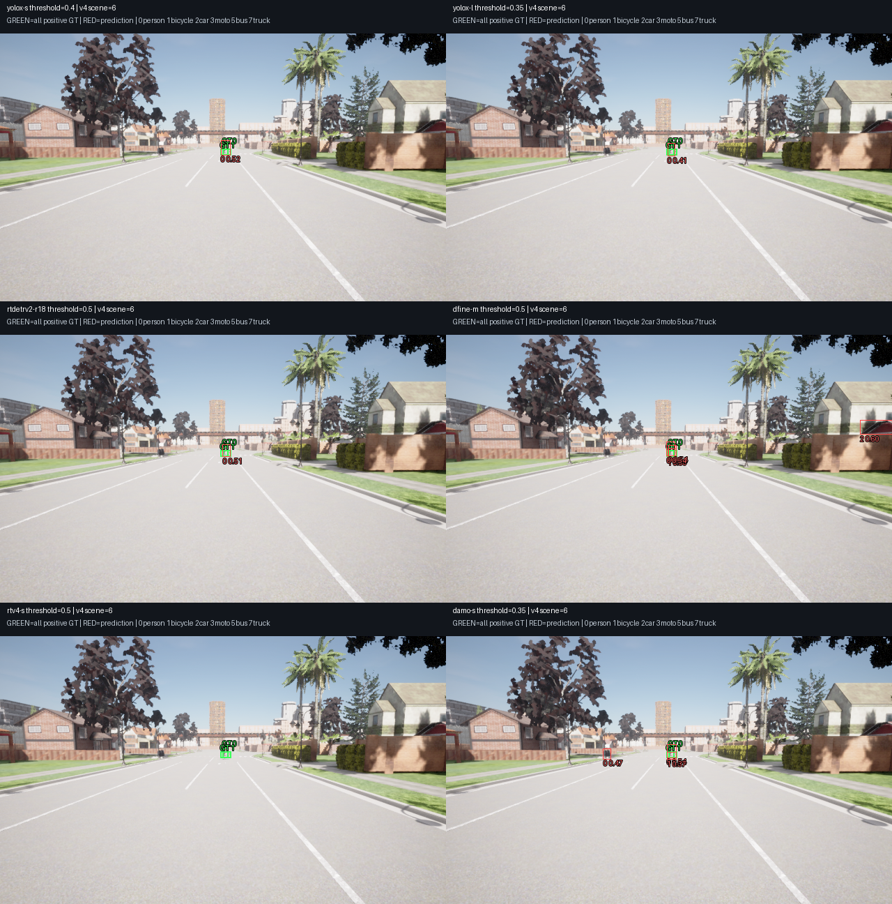
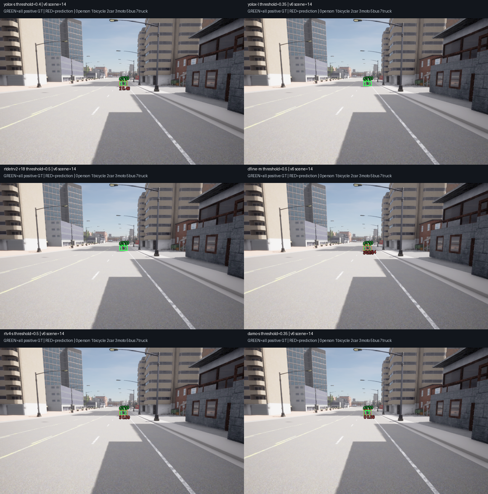
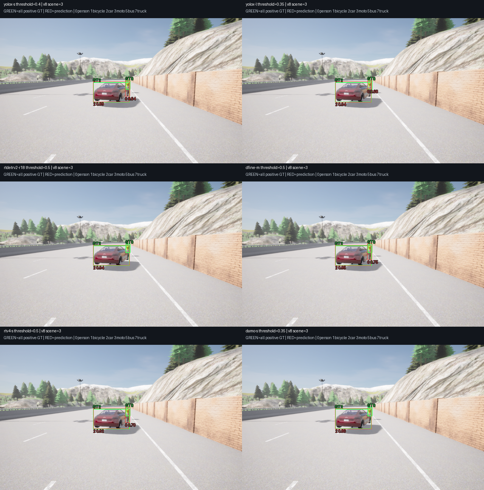

# M10 pretrained model screen V2 — 개발 비교와 confidence calibration

2026-11-10. **최종 Reference 미지명·M10 OPEN·기본 YOLOX-S 유지**. 공개 사전학습6종을 비교했다. 추가 학습·신규 RGB·새 보류·Jetson 실행/최적화는 하지 않았다. [사전 기준](../../perception-model-screen-v2-protocol.md), [모델 선정 안내](../../../perception-model-selection.md)를 따른다.

## 결과와 해석

기존 개발4개 도로324장(516 positive GT)에서 사전8점 confidence grid를 비교했다. 전체 모델의 선택을 봉인한 뒤 Town04 개발81장(129 positive GT)을 확인했다. 총405장·645개 GT는 이미 소비한 개발 자료이며 fresh acceptance가 아니다. 소비한 V1–V8 보류 manifest/RGB/GT/prediction은 입력에 쓰지 않았다. 미래 새 수집 제외 inventory는 기존4990개를 유지한다.

| 모델 | 선택 confidence | Calibration TP/FP/FN | Calibration P / R | Town04 TP/FP/FN | Town04 P / R | 절대 기준 cal / check |
| --- | ---: | ---: | ---: | ---: | ---: | --- |
| yolox-s | 0.40 | 387/29/129 | 93.03% / 75.00% | 91/9/38 | 91.00% / 70.54% | FAIL / FAIL |
| yolox-l | 0.35 | 457/28/59 | 94.23% / 88.57% | 116/8/13 | 93.55% / 89.92% | PASS / PASS |
| rtdetrv2-r18 | 0.50 | 443/84/73 | 84.06% / 85.85% | 111/15/18 | 88.10% / 86.05% | FAIL / FAIL |
| dfine-m | 0.50 | 465/129/51 | 78.28% / 90.12% | 119/16/10 | 88.15% / 92.25% | FAIL / PASS |
| rtv4-s | 0.50 | 431/27/85 | 94.10% / 83.53% | 113/9/16 | 92.62% / 87.60% | FAIL / FAIL |
| damo-s | 0.35 | 420/201/96 | 67.63% / 81.40% | 103/36/26 | 74.10% / 79.84% | FAIL / FAIL |

L은 두 개발 영역의 절대 기준을 통과했지만 기존 V6/V8 보류 FAIL은 그대로다. D-FINE은 Town04 절대 PASS이나 calibration FP129개·P78.28%가 남았다. RT-DETRv4는 높은 precision과 낮은 Host 지연을 보였지만 작은 person/bicycle recall이 부족하다. 이 결과로 보류 실패를 상쇄하거나 runtime을 교체하지 않는다.

Town04에서 기존 S의 공통0.35 대비 상대 기준은 L과 RT-DETRv4만 PASS다. D-FINE은 precision 향상이1.23%p로3%p에 미달한다. RT-DETRv4는 절대 bicycle recall60%가70% 미만이다. 각 모델의 전체/class/stratum/near-person/negative/Rider 분모·실패 기준은 `selection.json`과 `check.json`에 보존했다. 선택 threshold에서 모든 모델의 near-person은 calibration12/12·Town04 3/3이며 negative FP/frame 기준도 통과했다.

### 공통 confidence0.35 결과

| 모델 | Calibration P / R | Town04 개발 P / R |
| --- | ---: | ---: |
| yolox-s | 91.38% / 75.97% | 86.92% / 72.09% |
| yolox-l | 94.23% / 88.57% | 93.55% / 89.92% |
| rtdetrv2-r18 | 59.41% / 93.02% | 61.26% / 90.70% |
| dfine-m | 55.32% / 94.77% | 64.55% / 94.57% |
| rtv4-s | 72.98% / 91.09% | 72.89% / 93.80% |
| damo-s | 67.63% / 81.40% | 74.10% / 79.84% |

모델 간 score 척도가 다르므로 공통 한 점의 결과를 전체 계열 순위로 해석하지 않는다. 선택은 calibration에서 absolute PASS 우선 → six-class macro F1 → minimum class recall → micro F1 → 높은 threshold 동점 순이다. Grid는0.10/0.20/0.30/0.35/0.40/0.50/0.60/0.70이다. Town04 확인 뒤 설정을 재조정하지 않았다.0.35 미만 값은 별도 `ScreenDetection`이며 frozen runtime `Detection`의0.35 하한은 유지했다.

### 선택 confidence의 class recall: calibration / Town04

| 모델 | person | bicycle | car | motorcycle | bus | truck |
| --- | ---: | ---: | ---: | ---: | ---: | ---: |
| yolox-s | 61.90% / 54.76% | 40.00% / 40.00% | 97.73% / 90.91% | 58.33% / 41.67% | 100.00% / 100.00% | 87.50% / 100.00% |
| yolox-l | 82.14% / 85.71% | 75.00% / 80.00% | 98.48% / 93.94% | 83.33% / 83.33% | 100.00% / 100.00% | 91.67% / 100.00% |
| rtdetrv2-r18 | 75.00% / 83.33% | 68.33% / 53.33% | 100.00% / 96.97% | 83.33% / 75.00% | 96.67% / 100.00% | 95.83% / 100.00% |
| dfine-m | 79.17% / 85.71% | 83.33% / 80.00% | 100.00% / 96.97% | 97.92% / 100.00% | 95.00% / 100.00% | 95.83% / 100.00% |
| rtv4-s | 66.07% / 76.19% | 61.67% / 60.00% | 100.00% / 100.00% | 91.67% / 100.00% | 100.00% / 100.00% | 97.92% / 100.00% |
| damo-s | 86.90% / 78.57% | 56.67% / 40.00% | 98.48% / 100.00% | 35.42% / 50.00% | 96.67% / 100.00% | 72.92% / 83.33% |

## 가중치·입력·수치 검증

- 기존 pinned S/L/RT-DETRv2-R18을 기준으로 썼다. 새 공식 source는 D-FINE `956d1709314c2c6a4df6f34de232054578a7449f`, RT-DETRv4 `55fefaaed7efe2a5f72d0a18fd4e05965e35c292`, DAMO-YOLO `319572eef367340267ab6ab8ae253527a71d7c3a`다. 출처·license 원본·source file SHA는 새 registry와 vendor `upstream-files.json`에 있다.
- D-FINE-M은 COCO-only 공식 checkpoint다. RT-DETRv4-S는 공식 README의 공개 Drive 가중치다. hash 검사 뒤 `weights_only=True`, 전체 state strict load, upstream deploy만 수행했다. 학습·teacher inference·backbone 추가 다운로드는 없다. 새3종 모두 재export ONNX bytes가 동일하다.
- DAMO는 공식 ModelScope `damoyolo_tinynasL25_S.pt` SHA `70ccc4b45efd4ebb5e180c77040ca26714aaa9559c2b609b69c1bb6199b4be63`다. 공식 config의 legacy81채널을 strict load하고 첫80 COCO 채널을 쓴다. 최신47.7 공개 variant와 같은 가중치라고 주장하지 않는다.
- 입력은 FP32 batch1/native640이다. DETR은 PIL RGB bilinear direct640 /255, `[width,height]` 원본 크기, top300/noNMS다. YOLOX는 RGB0–255 top-left letterbox114·objectness×argmax·class NMS0.5다. DAMO는 원본 정지 이미지 데모의 PIL RGB·OpenCV linear direct640·mean0/std1·native multi-label class NMS0.7/top500 뒤6class filter다.
- V7 preparation-development의 고정3 probe에서 upstream PyTorch reference와 ORT CPU/CUDA를 대조했다. 최종 `reference-rgb`/`numeric-rgb.json`만 품질 실행에 허용했다.6모델×3=18 probe와8개 confidence 검출 set이 PASS다. DETR full300 one-to-one unordered set은 class exact·box0.1px·score1e-4다. Dense raw atol/rtol0.003/0.003·완성 box0.1px/score1e-4를 썼다. 공통 threshold baseline3종의 calibration 점수는 V1과 정확히 같다.

새 source363개와 모델/입출력/프로파일/데이터 seals를 `freeze.json`으로 고정했다. `selection.json` SHA는 `113f0f802fa4289b863a78fea5ab6093d293b62bb226d6415c2127f98ce51150`이다. 모든 check run은 선택 봉인 뒤 시작했다. Finite/shape/probability/box/capacity 오류는 빈 정상 프레임으로 바꾸지 않는다. 모든 양성·Rider를 기존 strict class/IoU0.5로 채점하고 excluded-overlap 진단으로 FP를 빼지 않았다.

## Host timing과 배포 고려

RTX3090 Host, ORT1.23.2 CUDA, TF32 off·2GiB allocator·CPU node fallback 금지다. 전처리·추론·공통0.35 후처리 timing은 raw-cache 쓰기와 분리했다. 각8점의 별도 후처리 timing도 보존했으며 이를 다른 confidence의 실측 전체 latency로 바꾸지 않는다. 두 실행의 cold call과 초기화는 제외하지 않았다. 모든 모델405/405 valid, 각403/405가100ms 이내였다. 총2430 valid/2418 deadline 이내다.

| 모델 | ONNX MB | Cal P95 ms | Check P95 ms | Cal / check cold ms |
| --- | ---: | ---: | ---: | ---: |
| yolox-s | 35.86 | 11.830 | 10.275 | 231.487 / 262.152 |
| yolox-l | 216.75 | 19.213 | 18.735 | 369.078 / 261.242 |
| rtdetrv2-r18 | 80.46 | 12.799 | 12.757 | 262.931 / 246.865 |
| dfine-m | 77.95 | 16.457 | 16.057 | 305.831 / 293.996 |
| rtv4-s | 41.83 | 11.366 | 11.542 | 290.288 / 285.506 |
| damo-s | 65.24 | 10.579 | 10.613 | 264.363 / 256.890 |

이 timing은 offline Host 관측이며 live20Hz·CARLA 공유 GPU·Jetson 수용이 아니다. 초기화340.127–811.219ms도 run 원본에 있다. Export/reference 환경은 Torch2.5.1+cu124·torchvision0.20.1·ONNX1.17·Pillow12.3.0, Host inference는 Pillow11.3.0이며 실제 전처리 tensor가 byte 동일함을 검사했다.

`deployment-review.json`은6개 graph의 opset/operators/shape를 기록한다. Custom domain·external initializer는0개다. D-FINE GridSample12개·RT-DETRv4 9개는 후속 import 때 확인할 항목이다. TensorRT import/engine 생성·FP16/INT8·보드 tuning은 미실행이다. AGX Thor와 Orin NX는 각각 전체 Central–Zone–Leaf stack을 독립 배포하고 같은 Reference를 먼저 측정한다.

## 초기 실패와 보존

`intake-audit.json`과 experiment 원본에 다음 경위를 보존했다. 모두 품질 실행의 최종 freeze 전에 바로잡았다.

- DAMO 공식 OSS ONNX URL404 → 공식 ModelScope 가중치의 별도 identity 사용.
- RT-DETRv4 ZIP-only 검사 FAIL → PyTorch legacy 저장 형식 확인·weights-only strict load PASS. 최초 `checkpoint-downloads.json`의 FAIL을 지우지 않았다.
- DAMO 최신 legacy=False 설정 strict load FAIL → 공식 ModelScope config와81채널을 확인한 legacy=True 호환 경로. 원래 실패 로그 보존.
- 초기 reference에서 runtime0.35 하한을 calibration에 재사용한 실패, native empty NMS `(0,5)` 처리 실패를 보존했다. 별도 offline type과 좌표 열 처리로 수정했다.
- 초기 DAMO BGR 가정은 정지 이미지 데모의 RGB 경로를 확인하고 폐기했다. 초기 BGR `reference-v3`/`numeric.json`의 PASS는 **품질 실행에 부적격**이다. 비대칭 색상 fixture를 추가하고 RGB reference/numeric을 다시 통과했다. 실제 품질 run은 RGB source freeze만 사용했다.

## 검증·원본 재현

Python183개 PASS, Debug/Release/ASan+UBSan 인식 CTest 각각13개 PASS다. Ruff·문서 링크·CSV·whitespace와 현재/이전 frozen source의 hash를 검사한다. C++ 변경이 없으므로 전체 core/M7/live20Hz/새 CARLA/Jetson 실행을 재검증한 것으로 올리지 않는다.

Raw2430개의 full exported arrays(선택 threshold로 잘라 저장하지 않음)를 모두 해시 검사했다.8점×2430=19440 검출 set·calibration48점·Town04 common/selected12점을 재생했다. `audit.json`과 별도 압축/새 source subprocess의 `archive-recheck.json`이 근거다. 기존 screen V1 source192·V7 source200·V8 source237·training source54의 bytes도 유지했다.

고정 개발 장면의 비교 패널3개를 직접 확인했다. 작은 자전거/Rider·motorcycle·가린 보행자의 모델별 누락/다른 class와 추가 박스를 볼 수 있다. 이는 fixed-frame 진단이며 전체 점수나 의미 원인 판정을 대체하지 않는다. 확인 뒤 설정 변경은 없다.







증거 묶음은 metadata/source/405개 개발 RGB/모델·새 checkpoint의 `experiment.tar.gz`, dense raw의 모델별3개와 DETR raw1개로 나눴다. `archives.json`은5개 압축의 SHA/bytes, `archive-files.json`은 내부 모든 파일 SHA, `SHA256SUMS`는 외부 파일을 검증한다. 큰5개 압축은 Git LFS다. `sources.tar.gz`는 frozen363 source다. Venv/deps 설치본·중복 reexport ONNX는 제외했고 버전/동일 SHA 검사 기록은 보존했다.

LFS 원본을 받은 뒤 저장소 루트에서 다음을 실행한다. 이 명령은 압축의 source를 새 경로로 풀어 새 subprocess에서 raw/score를 재생하고405개 RGB bytes를 검증한다. 신경망 추론·역전파를 재실행하는 명령은 아니다.

```sh
PYTHONPATH=. build/m10-perception/cuda-venv/bin/python \
  docs/test-plan/evidence/m10_model_screen_v2/check-archive.py \
  docs/test-plan/evidence/m10_model_screen_v2 \
  build/m10-screen-v2-archive-recheck.json
```

후속은 개발 영역에서 D-FINE의 오검출과 RT-DETRv4의 작은 보행자·자전거 누락을 분리해 다음 후보/입력 설정을 고정하는 일이다. 최종 설정을 정한 뒤 새 protocol·새 보류로 검증한다. 추가 학습이나 보드 최적화를 필수 다음 작업으로 두지 않는다.
