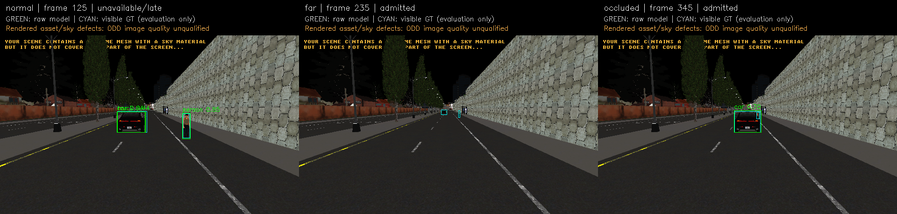

# M10 Host 영상 인지·tracking·CPU/CUDA 검증

2026-11-06, baseline `4eb743c641490417a72c93cd2d0e9d436d61a7ab` 이후의 첫 M10 인지 묶음이다.
**사전학습 모델부터 RGB adapter·bounded worker·관측 history·C++ 수신 경계와 실제 평가까지
기술 검증했다. M10 전체 정확도·20Hz·주행 통합 수용은 OPEN이다.**
[계약](../../../interfaces/perception.md), [프로토콜](../../perception-protocol.md),
[재현 안내](../../../perception-guide.md)를 따른다. M9 제어·보호·진단 조건은 바꾸지 않았다.

## 구현과 검증 범위

- YOLOX-S ONNX의 commit/크기/SHA256·license, RGB8→FP32 전처리·grid decode·class NMS·bounds.
  검증한 model bytes로 세션을 만들어 path 교체에 따른 다른 모델 로딩을 막는다.
- 취득+100ms exclusive expiry와 별도 monotonic wall100ms. NaN/Inf·잘못된 tensor/identity·
  overflow·불완전 목록·flat/blackout/whiteout는 unavailable이며 valid empty와 구분한다.
- 대기1개 latest queue, overwrite·늦은 완료·예외·진행 중 INIT·clock 오류·정지 timeout.
  이전 세션의 완료나 새 invalid 입력 이전의 inference가 가용성을 다시 열지 않는다.
- 이미지 IoU tracking과 실제 관측10frame history. 과거 box를 현재 관측으로 보간하지 않는다.
- 독립 C++ receiver의 model/camera/calibration/epoch/clock·frame/source·expiry·box/count 재검사.
  Python 실제 결과120개(CPU60·CUDA60)의 수락/거절·원천·count를 대조했다.
- RGB-only dataset과 평가 전용 visible-instance GT 분리, 원본 hash·평가 denominator·정답 matching,
  stage timing·source fingerprint·CPU/RSS·provider 옵션 기록.
- 선택형 CUDA FP32/TF32 off·CPU node fallback 금지·2GiB allocator 한도. 같은 RGB의 CPU/CUDA
  raw tensor와 box/class/score가 고정 tolerance 안에서 일치한다.

기본 C++ 빌드에 ML SDK나 모델 다운로드를 추가하지 않았다. Network wire·metric fusion·학습된
trajectory/target/risk·native vehicle command 연결은 구현했다고 표시하지 않는다.

## 실제 CARLA와 인지 한계

최종 전용 새 서버에서 Town03_Opt/ClearNoon 설정·640×384·90°·20Hz의 RGB/instance **60쌍**을
수집했다. Physics-disabled 차량/보행자, 단일 tick owner, 정상 거리·원거리·가림 각20frame이다.
Seed는 UE4 `-FixedSeed`의0, source clock은 실제 episode `8765877589981380779`다.
Pair/frame/time·원본 hash·actor 정리와 서버 exit130을 확인했다. 정지한 두 actor의 반복 frame이며
60개 독립 주행 scenario나120개 독립 object instance가 아니다.

현재 렌더링에는 검은 하늘·엔진 warning overlay가 있고 instance renderer의 일부 재질 경고도
있다. 원본을 보존하며 정상 ODD 영상 품질은 미수용이다. 아래 수치는 이 fixture에만 해당한다.

| 장면 | Frame | GT object 관측 | TP | FP | FN |
| --- | ---: | ---: | ---: | ---: | ---: |
| 정상 거리 | 20 | 40 | 40 | 20 | 0 |
| 원거리 | 20 | 40 | 0 | 0 | 40 |
| 가림 | 20 | 40 | 20 | 0 | 20 |

CPU/CUDA raw model 집계는 같다. 정상 장면은 같은 차량에 car와 truck 중복 class 검출을 냈고,
원거리의 작은 차량/보행자와 가려진 보행자는 놓쳤다. 이번 GT의 small-support 제외는0이다.
전체 raw precision0.75·recall0.5는 **visible-instance@IoU0.5**이며 COCO mAP가 아니다.
자전거/오토바이/버스/truck의 positive coverage는 없다. Score와 threshold를 결과에 맞춰 조정하지 않았다.



Green은 raw model, cyan은 GT다. 첫 CUDA frame은 cold latency로 unavailable이며 그림의
box는 평가용 raw 결과다. 빈 far 출력의 `admitted`는 검사된 모델 출력이라는 뜻이지 빈 도로의
증거가 아니다. [CPU 평가](acceptance/evaluation-cpu.json)·[CUDA 평가](acceptance/evaluation-cuda.json)를 따른다.

## 처리 시간과 overload

동일 최종 dataset·weight·FP32·전후처리로 비교했다. Host scheduler/affinity는 상속했고 전용 CPU나
실시간 설정을 주장하지 않는다. 모든 첫 추론을 분모에 넣었다. 모델 loading/파일 처리 포함 throughput과
각 프레임의 실제 pre/inference/post/total wall latency는 각각 기록한다.

| 최종 offline 실행 | N | Mean ms | P95 ms | P99 ms | Max ms | 100ms 초과/경계 거절 |
| --- | ---: | ---: | ---: | ---: | ---: | ---: |
| CPU4 thread | 60 | 98.289 | 350.324 | 352.129 | 352.366 | 7 |
| RTX3090 CUDA | 60 | 14.117 | 10.377 | 114.209 | 263.210 | 1 |

이전 CPU 측정의74.054ms mean·0miss와98ms/7miss를 한 조건의 보장값으로 합치지 않는다.
Host 변동의 원인을 이번 작업에서 규명한 것으로 표시하지 않는다. CUDA는 cold 첫 호출을 거절했고
이후 처리 시간을 줄였지만 startup 포함 전체 deadline·공유 CARLA GPU 부하·Jetson은 미수용이다.
[CPU 원문](acceptance/cpu/result.json)·[CUDA 원문](acceptance/cuda/result.json)을 따른다.

20Hz60frame의 실제 worker 입력에서 다음 분모를 관측했다. 이는 저장 영상의 새 simulated playback
clock이며 실제 camera→trajectory latency가 아니다. 원래 capture source/frame도 별도로 남긴다.

| 실행 | 제출 | 대기 overwrite | 추론 완료 | 발행 | late | backend error |
| --- | ---: | ---: | ---: | ---: | ---: | ---: |
| CPU 정상 | 60 | 22 | 38 | 16 | 22 | 0 |
| CPU150ms 지연 | 60 | 46 | 14 | 0 | 14 | 0 |
| CPU 예외 | 60 | 3 | 57 | 3 | 3 | 51 |
| CUDA 정상 | 60 | 4 | 56 | 55 | 1 | 0 |
| CUDA150ms 지연 | 60 | 43 | 17 | 0 | 17 | 0 |
| CUDA 예외 | 60 | 4 | 56 | 4 | 1 | 51 |

Late/overwritten/exception을 버린 분모로 FPS를 올리지 않는다. 모든150ms 지연 결과는 발행0이고
원래 expiry를 연장하지 않았다. CUDA normal의 cold miss와4drop도 남는다. 기능 검사 PASS는
명시한 거절·accounting의 통과이며 전체20Hz PASS가 아니다. 원문은 `acceptance/stream-*/stream.json`이다.

## 검사와 실패 기록

- 전체 기본 Debug 회귀(`runtime.wall` 제외) **1459/1459**. M7 opt-in 전체 suite나 Target 실행이 아니다.
- M10 영향 범위 Debug·Release·ASan/UBSan 각각 **13/13 CTest 항목**. 여기에는 C++11개,
  Python **30개**를 실행하는1항목, Python→C++19변조·duplicate/expiry 검사1항목이 포함된다.
- 실제 ONNX Runtime/OpenCV raw tensor3장면×714000값의 동등성, CPU/CUDA raw/box 동등성.
- Actual backend의 blackout/flat-gray/whiteout3조건 거절, independent evaluator12변조 거절.
- clang-tidy production 경계, Ruff 전체 신규 Python, `BUILD_TESTING=OFF` C++ library 빌드 통과.

첫 CTest는 numpy가 없는 Python3.12를 자동 선택해 Python 항목1개가 실패했다. Python executable을
명시하고 configure dependency 검사를 추가했다. 첫 CARLA는 준비180초 timeout이었다. RPC port 준비와
world snapshot 준비를 분리한 뒤 다음 두 실제 서버 수집은 각각60pair·정상 종료를 확인했다.
첫 준비 실패의 근본 원인을 확정하지 않는다. 초기 capture의 잘못된 seed10 표기·고정 clock7은
탐색 원문에 남기고, 최종 수집을 실제 seed0/episode로 다시 실행했다.

GPU 준비에서는 package metadata에 cuDNN이 보여도 실제 `libcudnn.so.9`가 로드되지 않아 두 probe가
실패했다. Project 전용 venv에 실제 CUDA12/cuDNN9 library를 설치한 뒤 실행했다. 공용 환경을
교체하지 않았다. CPU-only ORT에서 CUDA를 요구한 별도 실행도 시도0/발행0으로 거절됐고 CPU로
fallback하지 않았다. `cuda-unavailable/result.json`, `validation.tar.gz`, `exploratory.tar.gz`에 보존한다.

## 보존과 재현

- [acceptance.json](acceptance.json): 최종 실행·고장·검사·미완료 범위를 기계가 읽을 수 있는 요약.
- `capture.tar.gz`: 최종 CARLA raw RGB/instance·capture/server/log·실행 probe와 RGB-only/GT dataset.
- `exploratory.tar.gz`: 준비 실패·초기 수집/추론·수치 개선 전의 결과와 원본. 최신 통과로 덮어쓰지 않음.
- `validation.tar.gz`: configure/build/CTest·Python·정적 검사·설치/환경·초기 실패 원문.
- [sources.json](sources.json)·`sources.tar.gz`: baseline·변경 source/profile/docs의 정확한 hash/snapshot.
- [environment.json](environment.json): compiler/CPU/GPU와 실행 뒤 simulator binary inventory. 이 inventory를
  실행 전 binary 동결로 표시하지 않는다. Capture probe는 실행 전에 복제·hash했다.
- `bin/perception_replay`: 실제 실행한 Release boundary binary. 모델은 source/hash/license로 명시적 fetch.
- [SHA256SUMS](SHA256SUMS): 보관 파일 무결성. Git LFS의 capture/exploratory archive를 먼저 받는다.

```sh
git lfs pull
cd docs/test-plan/evidence/m10_perception
sha256sum -c SHA256SUMS
mkdir -p ../../../../build/m10-replay-data
tar -xzf capture.tar.gz -C ../../../../build/m10-replay-data
```

모델·추론 환경과 실행은 [안내](../../../perception-guide.md)를 따른다. 추출한
`build/m10-replay-data/dataset-final/rgb.json`으로 새 output 디렉터리에서 재실행할 수 있다.
학습자 설명·최종 수용은 별도이며, 다음 gate는 영상 품질/coverage·정확도 기준·cold readiness·
metric world model/localization·M11 planner와 기존 supervisor의 실제 통합이다.
