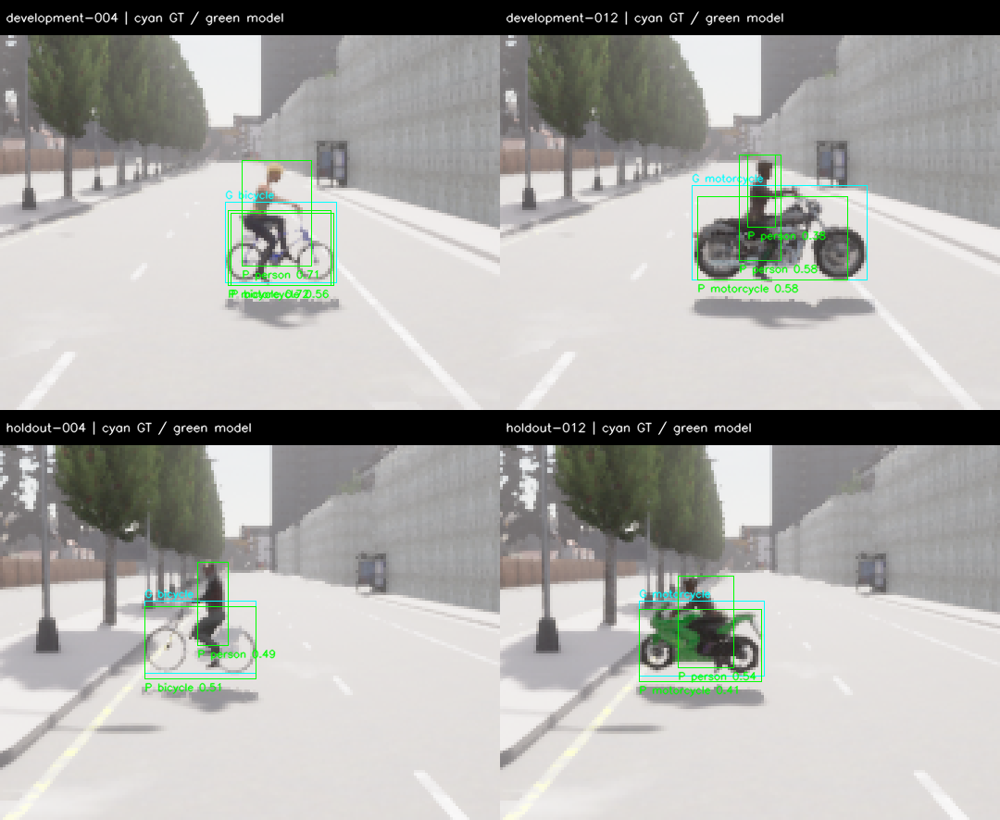
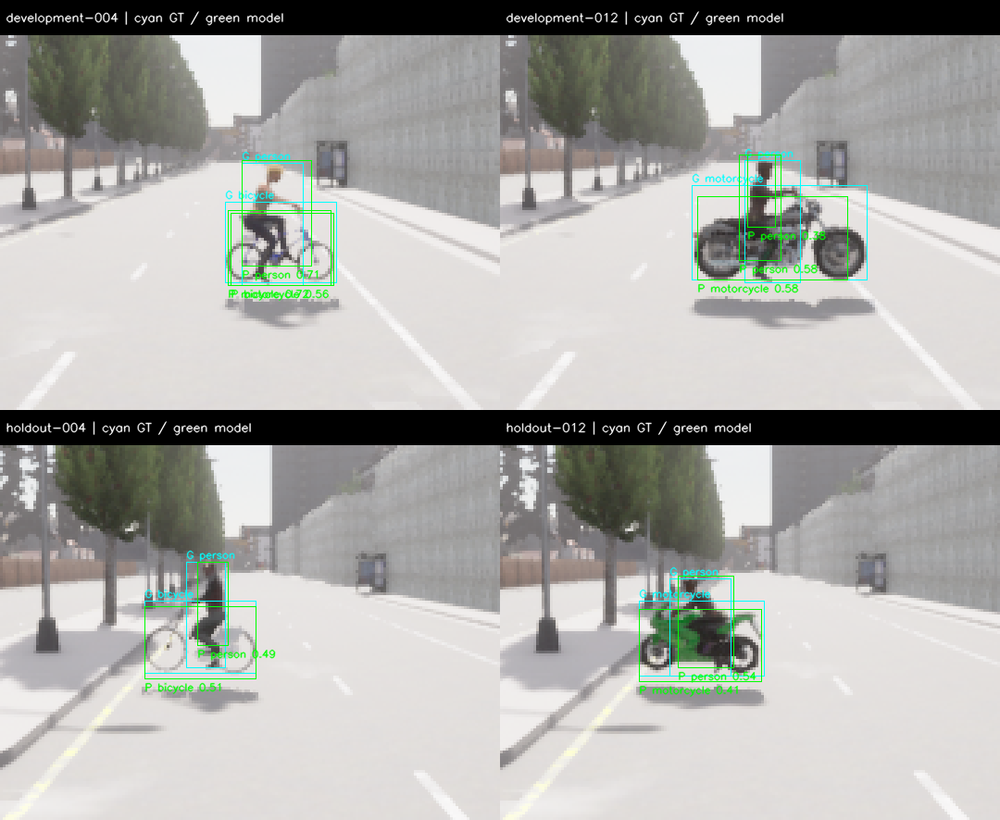

# M10 정확도 확장·후보 비교와 Rider 정답 수정

2026-11-07, Host RTX3090/CUDA. **수집·실행·감사 기능은 PASS, 개선 후보는 미채택, M10 전체는 OPEN**이다.
6종 객체·3기상·개발/보류 각81개 배치를 추가하고 잠정 정확도 gate를 사전에 고정했다.
기본 모델·score0.35·live 경로는 유지했다. V1 정답의 Rider13 누락을 발견하여 별도 v2 생성기를
추가했다. 수정 정답의 사후 재계산을 새로운 보류 평가 PASS로 해석하지 않는다.

## 수집과 분리

Town03_Opt, Epic, postprocess enabled, RGB640×384/FOV90, world10ms다.
각 partition은6class×3기상×near/medium/far/occluded의72배치, negative3·차량 중첩3·VRU 중첩3이다.
40tick settling 뒤10tick 중 사전 지정5번째 RGB/instance 한 쌍을 취득했다. 반복20frame을
독립 표본으로 세지 않았으며 매 tick 취득하는 이 accuracy fixture는 live20Hz 시험이 아니다.

Development와 holdout의 카메라 spawn·거리·방향, 가능한 객체 blueprint를 분리했다.
같은 Town과 bus asset은 공유한다. 정지 배치·3기상은 전체 도로/야간/강우 ODD의 독립 표본이 아니다.
두 fresh 서버의 수집은81/81씩, 종료는 모두130이다. 정리 오류·queue overflow는0이다.
실행 wall은 development212.08s, holdout251.69s며 성능 수용 측정은 아니다.

V1 포함 정답은 development102개, holdout99개다. Holdout의 원거리 자전거3배치
(`holdout-006/033/060`)는 각각22 visible pixel로 사전 최소25pixel에 미달했다.
해당 actor와 제외 이유를 보존했다. 자전거 visible primary9/12, 나머지 class12/12로 사전
coverage 하한을 충족했지만, **원거리 자전거의 유효 정답은0**이므로 그 조건의 recall을 주장하지 않는다.
전체 far target 분모는 development18, holdout15다.

Plan/protocol은 수집 전에 보존했고, 모델·실행/평가 소스20개는 개발셋 추론 전에 freeze했다.
Development 결과만으로 후보 하나를 지명한 뒤 selection hash를 holdout 서버 실행 전에 복사했다.
Holdout에서는 baseline과 지명된 `vehicle-nms-v1`만 실행했다. 중앙 확대 후보를 holdout에서
추가 탐색하거나 기준/정답을 고쳐 원래 지명을 바꾸지 않았다.

## V1 사전 고정 비교 — 정답 누락 한계가 있는 원래 결과

같은 YOLOX-S FP32 가중치·threshold와 visible-instance IoU≥0.5다. COCO mAP가 아니다.
잠정 gate는 micro precision≥.85·recall≥.80, 각 class recall≥.70, near-person recall≥.90,
negative FP/frame≤1/3이다. 후보는 precision3%p 이상 개선과 micro/각 class/far/occluded recall
무회귀 등을 모두 만족해야 한다. 자세한 기준은 [프로토콜](../../perception-quality-protocol.md)을 따른다.

| Partition | 후보 | TP | FP | FN | Precision | Recall | 절대 gate |
| --- | --- | ---: | ---: | ---: | ---: | ---: | --- |
| 개발 | Baseline | 81 | 27 | 21 | .750 | .794 | FAIL |
| 개발 | 차량 계열 NMS | 79 | 24 | 23 | .767 | .775 | FAIL |
| 개발 | 중앙 확대 | 89 | 45 | 13 | .664 | .873 | FAIL |
| 보류 | Baseline | 71 | 25 | 28 | .740 | .717 | FAIL |
| 보류 | 차량 계열 NMS | 68 | 22 | 31 | .756 | .687 | FAIL |

- 차량 계열 NMS는 car/bus/truck 사이 IoU>.75인 낮은 score를 제거한다. 개발셋에서 실제
  truck TP2개를 지워 far target recall이9/18→7/18로 감소했다. 보류셋에서도 bus TP3개를
  추가로 지웠다. 상대 개선 gate FAIL이며 채택하지 않았다.
- 중앙 확대는 `[160,96,320,192]` crop을2배로 추론하고 원래 좌표로 복원한다. 개발셋의 far
  target은9/18→11/18, occluded는12/18→15/18로 증가했지만 FP도27→45로 증가했다.
  상대 gate FAIL이며 holdout 평가 대상이 되지 않았다.
- 근거리 보행자3/3과 negative3장 FP0은 모든 실제 비교에서 충족했다. 매우 작은 분모다.
- 지명은 상대 PASS 우선·F1/recall/precision/ID 순서의 사전 규칙에 따른 **진단용** 선택이다.
  두 후보 모두 실패한 상황에서 지명되었다는 사실이 채택을 뜻하지 않는다.

## 발견한 정답 오류와 별도 v2

원본 RGB에는 탑승자가 보이지만 v1은 CARLA `Pedestrians=12`만 person으로 변환했다.
SDK의 `ObjectLabel.h`와 원본 semantic mask를 대조하니 탑승자는 **Rider=13**이었다.
Development baseline의 person FP11개, holdout의8개는 모두 이륜차가 있는 장면에서 발생했다.
이는 장면 연관 집계이며 각각 모두 정상 검출이었다는 뜻은 아니다. 특히 중복 person box도 있다.

`quality_annotation.py`의 별도 v2는 tags12/13을 person으로 합친다. 같은 instance의 person과
bicycle/motorcycle은 class별로 유지하며 최소25pixel/side4는 그대로다. 합성 mask 검사는
두 태그의 동일 인물 병합·서로 다른 인물 분리·원본16bit ID·이륜차 보존·경계 pixel 수를 확인한다.
162개 원본을 다시 읽어 **person 이외의 포함/제외 정답은 모두 동일**함을 확인했다.
V1 파일과 frozen scorer는 변경하지 않았다.

각 partition에 유효 rider 정답21개가 추가되어 GT는123/120개다. 아래는 기존 예측을 그대로
사용한 **사후 진단**이다. 새 추론·후보 지명·보류 검증이 아니며 acceptance를 판정하지 않는다.

| 기존 영상 | 기존 예측 | TP | FP | FN | Precision | Recall |
| --- | --- | ---: | ---: | ---: | ---: | ---: |
| 개발 | Baseline | 88 | 20 | 35 | .815 | .715 |
| 개발 | 차량 계열 NMS | 86 | 17 | 37 | .835 | .699 |
| 개발 | 중앙 확대 | 105 | 29 | 18 | .784 | .854 |
| 기존 보류 | Baseline | 78 | 18 | 42 | .813 | .650 |
| 기존 보류 | 차량 계열 NMS | 75 | 15 | 45 | .833 | .625 |

오탐 일부가 정상 탑승자 검출로 바뀌지만, 누락했던 rider 정답에 대한 미검출도 새로 드러난다.
따라서 person FP만 감소한 수치를 정확도 개선으로 보고하지 않는다. 가림의 visible/amodal box
차이·아주 작은 객체의 제외/ignore 정책 검수와 새 데이터의 사전 고정 검증이 다음 단계다.
이미 본162배치를 새로운 holdout으로 재사용하지 않는다.

## 시간·검사·감사

각 실제 추론81개를 전부 기록했고 오류0, model-valid81,100ms admitted80이다. 모든 실행의
첫 cold call1개가 늦었으며 이를 warmup 명목으로 제외하지 않았다. Raw와 admitted 점수는
각 score JSON에 별도로 있다. 준비/live20Hz 시험과 이 offline replay를 합치지 않는다.

| 실행 | N | Mean ms | P95 ms | Max/cold ms |
| --- | ---: | ---: | ---: | ---: |
| 개발 baseline | 81 | 12.57 | 10.64 | 232.74 |
| 개발 차량 NMS | 81 | 12.87 | 10.02 | 263.78 |
| 개발 중앙 확대 | 81 | 23.08 | 21.40 | 245.69 |
| 보류 baseline | 81 | 12.94 | 10.43 | 245.01 |
| 보류 차량 NMS | 81 | 12.48 | 9.90 | 236.43 |

최종 Python71개, Debug core1459개(`runtime.wall` 제외), Release/ASan+UBSan의 perception
각13개 CTest를 통과했다. 새 candidate/정답/감사 unit case는16개다. 기존 M7 opt-in 전체 suite·
Target·새 live20Hz 시험을 실행한 것으로 표시하지 않는다. Ruff와 whitespace 검사도 통과했다.

추가 `audit_quality_experiment.py`는 모든 원본에서 RGB/GT/metadata/seal을 재구성하고 점수·
지명을 다시 계산했다. V1 nomination helper가 단독으로 검사하지 않던 **같은 development
metadata** 조건을 여기서 강제한다. 모든 실제 후보의 데이터는 동일하며 partition 간 RGB byte
중복은0이다. Dataset/phase/선택·계수·source·만료·stage timing 변조 검사도 포함한다.
감사 PASS와 정확도 FAIL, annotation 수용 OPEN을 구분한다.

## 보존과 재현

- `acceptance.json`: 이번 기술 범위·정확도/annotation/후속 gate와 검사 결과.
- `scores/`, `candidate-selection.json`, `experiment-freeze.json`, `experiment-audit.json`: 원래
  점수·선택·고정 소스·최종 추가 감사. `annotation-v2-review.json`은 사후 재계산이다.
- `experiment.tar.gz`: 원래 `build/m10-quality/` 경로의 두 서버 log/probe·전체 RGB/instance·
  별도 RGB/GT/metadata/seal·모든 추론/점수·첫/최종 감사·v2 labels·테스트/검사 log·진단 렌더 script.
- Archive의 `frozen-source/`: 추론 전에 고정한20개 소스 byte와 capture wrapper/plan/protocol.
  `source-versions/`는 추가 auditor의 format 변경 전 hash에 맞는 byte다. Capture probe는 각 실행에도 있다.
- `sources.json`/`sources.tar.gz`: 최종 관련 소스·profile·문서 snapshot; baseline4eb743c.
  실제 실행은 freeze/probe hash가 지정한 버전을 기준으로 재현한다.
- `SHA256SUMS`: 묶음 무결성. 이전 두 M10 evidence도 원래 hash로 확인했고 변경하지 않았다.

[실행 안내](../../../perception-guide.md#확장-정확도-비교와-재감사)를 따른다. 다음은 v2 정답/가림
정책 검수와 새 분리셋 재검증, 이후 전체wall20Hz·renderer 안정성이다. Metric fusion/localization·
M11 temporal planner/risk/fallback·native 주행 연결·M12 보드는 별도다.
