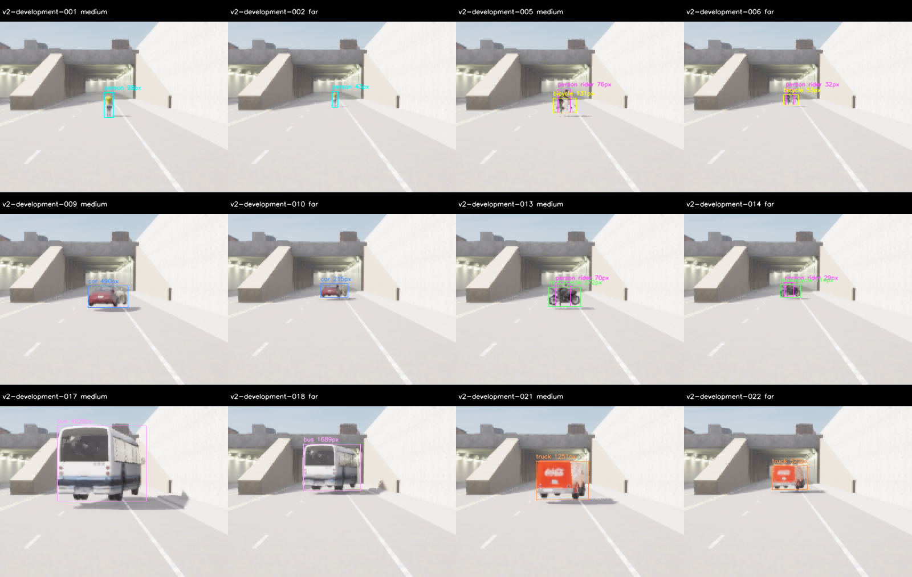
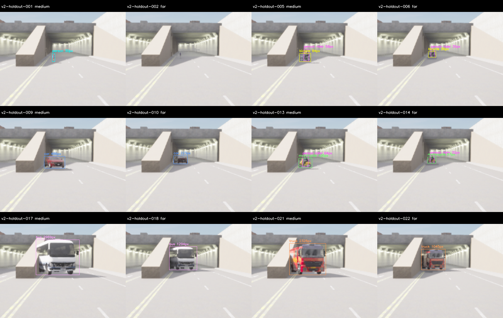
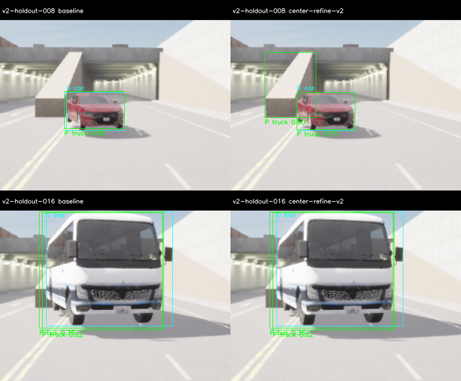

# M10 Rider v2 새 평가·실제 pose·확대 후보

2026-11-07, Host RTX3090/CUDA. **새 수집/추론/원본 감사는 PASS, 정확도와 보류 coverage는 FAIL,
후보는 미채택**이다. [V1의 사후 정답 수정](../m10_quality/README.md)과 별도로 새 개발/보류
각81배치를 사전 고정했다. 재현율 개선과 정밀도 악화를 함께 기록하며 기본 live 모델·threshold는 유지한다.

## 구현과 사전 고정

- `quality_annotation.py`의 Pedestrians12/Rider13→person, 별도 bicycle/motorcycle box를
  실제 새 평가에 적용했다. Visible IoU0.5·최소25pixel/side4와 기존 절대/상대 gate를 유지했다.
- Small-ignore와 visible box를 덮지만 IoU가 모자라는 검출은 별도 진단이다. TP/수용 gate를
  바꾸지 않는다. 같은 class×near/medium/far/occluded마다≥2/3, 유효 rider≥12를 추가 요구했다.
- 이전 v1 영상162개 hash를 제외했다. 새 development/holdout의 byte 중복도0이다.
  모델은 RGB-only 입력을 사용하고 GT/stratum은 별도 evaluator가 읽는다.
- Spawn 직후 SDK cache의0좌표를 기록하던 문제를 수정했다. Physics-disabled 정지 fixture의
  settling/capture 후 실제 pose를 읽고 계획과2cm/0.1° 이내인지 capture와 prepare에서 대조한다.
- 같은 class NMS만 적용하는 `center-refine-v2`, base box를 모두 유지하고 crop의
  person/bicycle/motorcycle만 추가하는 `vru-refine-v2`를 구현했다. 두 후보 모두 기존의 차량
  class 간 억제를 제거한다. Crop은 고정320×192 영역의2배 확대이며 경계2pixel을 제거한다.

[정확한 기준](../../perception-quality-v2-protocol.md)과 `plan.json`/`protocol.json`을 따른다.
Town03_Opt/Epic/postprocess on,640×384/FOV90,world10ms다. Camera spawn2/3,
개발13/25/38m·가림17m, 보류15/27/40m·가림19m를 사용했다. 이전42/48m far·다른 asset/pose의
V1 점수와 합산하거나 동일 분포의 개선율로 비교하지 않는다. Bus asset과 같은 Town은 공유한다.

## 수집 실패와 전체 재수집

첫 `build/m10-quality-v2/development-01`은20pair 뒤 European HGV spawn에서 서버가
SIGSEGV/exit-11로 종료했다. 로그에 `WheeledVehicleMovementComponentNW`와 현재
`M7NoDriveMovement`의 override/import 충돌, `AWheeledVehicleAIController::OnPossess`
stack이 있다. Cleanup 오류도 포함한 전체 FAIL이며20개 표본은 평가에 사용하지 않았다.

**모델 추론 전에** 같은 truck class의 호환 `carlacola` asset으로 계획만 수정했다. 이전 plan/hash와
38개 source/config snapshot을 보존하고 새 fixture revision `v2b`를 다시 freeze했다.
새 서버에서 처음부터81개씩 재수집했으며 engine/source 수정이나 timeout 연장은 하지 않았다.
이는 NW asset 호환성 문제를 해결한 것이 아니다.

| 수집 | Pair | Capture | Server exit | Wall s |
| --- | ---: | --- | ---: | ---: |
| V2 초기 개발 | 20/81 | FAIL | -11 | 126.95 |
| V2b 개발 | 81/81 | PASS | 130 | 151.37 |
| V2b 보류 | 81/81 | PASS | 130 | 116.57 |

최종 두 수집은 cleanup error/queue overflow0이다. 양쪽 각102개, 총204개의 실제 actor pose를
검증했다. 최대 위치 오차는 개발0.00001265m·보류0.00002202m, 최대 yaw 오차는
각0.00003815°/0.00004578°다. Frame pairing과 root pose 검사는 static fixture 범위이며
움직이는 차량의 metric fusion/제어 검증이 아니다.

## 정답 검수와 coverage

추론 전에 RGB/정답만으로 각 partition의 ClearNoon6class×4조건24frame contact sheet를
검수했다. 모든81frame의 source/semantic/instance/최소 지원·계획 actor는 자동 검증한다.
원본 영상은 그대로이며 contact sheet의 중앙 확대는 검사 표시용이다.

개발은 GT129개(rider27), excluded0이며 모든24개 class×조건 cell이3/3이다.
보류는 GT123개(rider27), excluded6이다. `walker.pedestrian.0010`의 far3개는18pixel에
side3, occluded3개는20pixel로 사전 최소 지원에 미달했다. 그 actor의 실제 위치는 계획과 일치한다.

| 보류 primary class | Near | Medium | Far | Occluded |
| --- | ---: | ---: | ---: | ---: |
| person | 3/3 | 3/3 | **0/3** | **0/3** |
| bicycle/car/motorcycle/bus/truck 각각 | 3/3 | 3/3 | 3/3 | 3/3 |

제외 scene은002/003/029/030/056/057이다. 해당 장면을 교체하거나 mask를 확대하지 않았다.
**보류 coverage FAIL**이며 원거리/가림 보행자 정확도를 주장할 수 없다. 아래 수치의
보류 far/occluded primary target 분모는 각각15이고, 전체 물체 정답 분모는123이다.

## 실제 후보 비교

동일 YOLOX-S FP32·score0.35의 strict raw visible-box 평가다. COCO mAP가 아니다.
절대 gate는 precision≥.85·recall≥.80·각 class recall≥.70 등이고, 상대 gate는 precision
3%p 이상 개선과 recall/중요 조건 무회귀를 모두 요구한다. 결과에 맞춰 gate를 바꾸지 않았다.

| Dataset | 후보 | TP | FP | FN | Precision | Recall | F1 |
| --- | --- | ---: | ---: | ---: | ---: | ---: | ---: |
| 개발 | Baseline | 80 | 13 | 49 | .860 | .620 | .721 |
| 개발 | 중앙 확대 | 106 | 19 | 23 | .848 | .822 | .835 |
| 개발 | VRU 확대/base 보존 | 97 | 15 | 32 | .866 | .752 | .805 |
| 보류 | Baseline | 52 | 42 | 71 | .553 | .423 | .479 |
| 보류 | 중앙 확대 | 77 | 76 | 46 | .503 | .626 | .558 |

모든 실행의 절대 gate는 FAIL이다. 개발 후보 둘 다 상대 gate도 실패했다. 사전의
상대 PASS 우선·F1/recall/precision/ID 순서에 따라 중앙 확대 하나를 **진단용**으로 지명하고,
그 selection을 새 보류 서버 시작 전에 복사했다. 보류에는 baseline과 이 후보만 실행했다.
VRU 후보로 바꾸어 보류셋을 다시 탐색하지 않았다.

- 개발 중앙 확대는 far primary3/18→11/18, occluded8/18→15/18, rider11/27→17/27로
  개선했다. Bicycle recall8/15=.533, precision.848 등은 기준 미달이다.
- 보류 중앙 확대는 rider10/27→21/27, near-person1/3→3/3으로 개선했지만 motorcycle은
  두 실행 모두0/12, bicycle7/15와 bus7/15도 충분하지 않았다.
- 보류 far/occluded **primary target** 검출은4/15·9/15로 그대로다. 그 외 rider와 중간거리
  물체의 개선을 원거리·가림 primary target 개선으로 바꾸어 말하지 않는다.
- 모든 negative3장 FP0이다. 매우 좁은 배경 표본이며 안전한 빈 도로 보장이 아니다.

## 오분류와 박스 진단

보류 baseline의 FP42개 중 truck FP가36개다. IoU0.5로 정답 box에 연관시킨 truck FP는
car21개·bus14개다. 중앙 확대에서는 truck FP가66개로 늘었고 car32개·bus15개와 연관되며,
나머지19개는 포함 GT와 IoU0.5로 매칭되지 않는다. 이 연관은 정답 수정이나 전부 background라는
판정이 아니다. 원본 예시에서 승용차를 truck으로 분류하고 crop이 추가 truck box를 만드는 것을 확인했다.

Strict IoU에 못 미치지만 visible GT의80% 이상을 덮는 FN은 baseline/중앙 확대에서
개발2/2개, 보류1/2개다. 이 차이가 전체 미검출을 설명하지 않는다. Small-ignore 진단은
실제5개 실행에서 모두0개 prediction만 해당하므로 raw 점수를 개선시키지 않는다.

남은 병목은 **조건별 가시성 확보, 차량 종류 오분류, 이륜차/작은 물체 미검출**이다.
다음 plan은 별도 준비셋에서 asset 호환성/가시성을 확인하고, 새로운 모델/후보와 새 보류셋을
사전 고정해야 한다. 이번 보류 영상을 새 holdout으로 재사용하지 않는다.

## 시간·회귀·재현

각 실행81개, 총405개 candidate frame은 model-valid이며 backend error0이다.
매 실행 첫 cold1개만100ms를 넘어서 admitted80/81이다. Model 생성 비용과 모든 cold/단계
시간을 원본 result JSON에 보존한다. Raw/admitted 점수를 분리했고 startup/live20Hz 수용은 하지 않았다.

| 실행 | Mean ms | P95 ms | Max/cold ms |
| --- | ---: | ---: | ---: |
| 개발 baseline | 12.95 | 10.67 | 235.42 |
| 개발 중앙 확대 | 22.71 | 21.04 | 242.82 |
| 개발 VRU 확대 | 23.35 | 20.80 | 274.49 |
| 보류 baseline | 12.71 | 10.46 | 234.48 |
| 보류 중앙 확대 | 23.30 | 20.83 | 275.20 |

Python84개를 통과했다. V2 정책/감사11개와 빈 조건·작은 객체 진단의 회귀2개가 추가되었다.
총 primary9개와 precision/recall1.0이어도 far cell0개면 coverage FAIL이라는 독립 fixture를 검사한다.
Debug/Release/ASan+UBSan perception13개 CTest를 확인했고, 후속2개 Python case도 세 구성의
Python CTest에서 재검사했다. Ruff·whitespace·문서 링크 검사를 통과했다.
C++/engine 코드는 이번에 변경하지 않았으며 전체 core1459·M7 opt-in suite·새 live20Hz를
재실행했다고 주장하지 않는다. 기존 통과 근거는 이전 묶음에 있다.

`audit_quality_v2.py`는 모든 BGRA/instance에서 RGB·v2 GT·metadata·seal을 재구성하고,
actual pose·원래 source/분모·같은 개발셋·선택 hash·partition 분리·점수와 지명을 재계산했다.
기술 감사 PASS를 정확도/coverage PASS로 올리지 않는다.

- `acceptance.json`, `experiment-audit.json`, `scores/`: 범위·각 gate·원본 score와 최종 감사.
- `plan.json`, `protocol.json`, `experiment-freeze.json`, `candidate-selection.json`: V2b 고정 입력과 선택.
- `experiment.tar.gz`: 원래 `build/m10-quality-v2/` 실패와 `build/m10-quality-v2b/`의 전체 raw,
  copied probe/server logs, 분리 RGB/GT/seal, 모든 추론·검수·diagnostic·테스트와 재현 script.
- 각 root의 `frozen-source/`: 당시38개 source/config byte. V2b의 뒤에 추가한 coverage unit test는
  점수/후보 정책을 바꾸지 않으며 최종 `sources.tar.gz`에 따로 포함한다.
- `sources.json`/`sources.tar.gz`: baseline4eb743c 위의 최종 관련 코드·profile·문서 snapshot.
- `SHA256SUMS`, `archive-recheck.json`: 묶음 무결성과 깨끗한 임시 경로에서 풀어 재감사한 결과.
  이전 세 M10 묶음은 원래 checksum으로 확인하고 변경하지 않았다.

[재현 안내](../../../perception-guide.md#rider-v2의-새-평가-경로)와 [ADR-0118](../../../archive/design-decisions.md#adr-0118)을 따른다.
