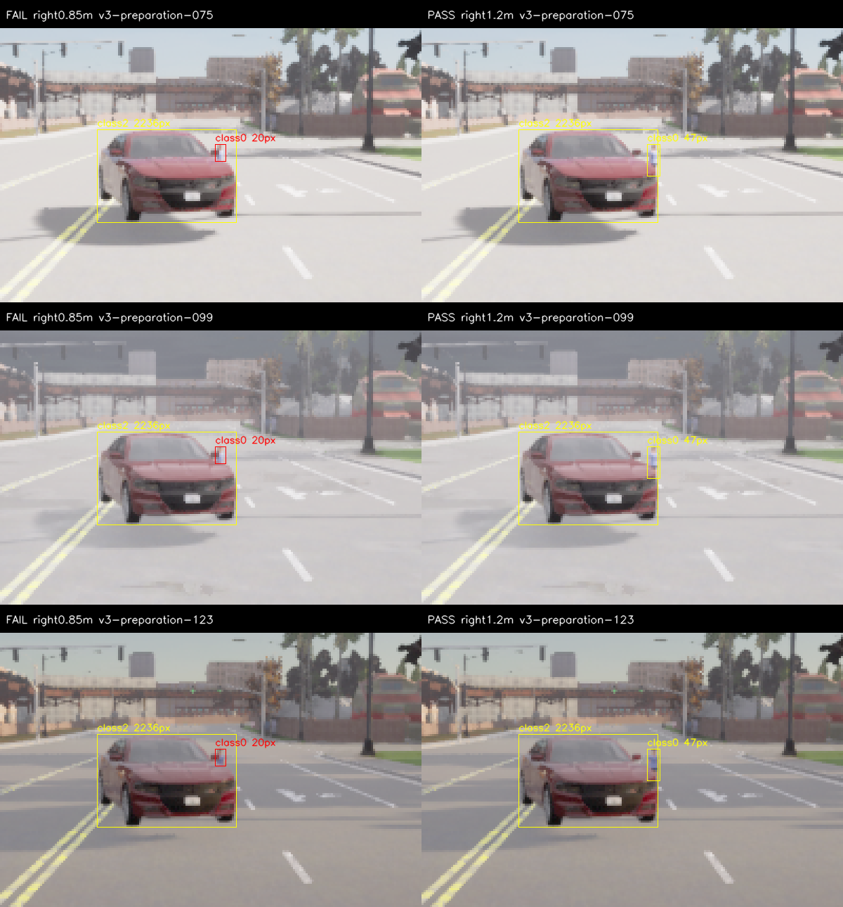
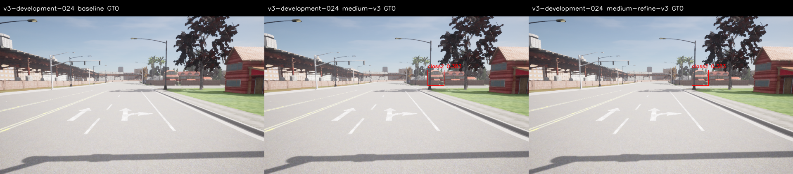
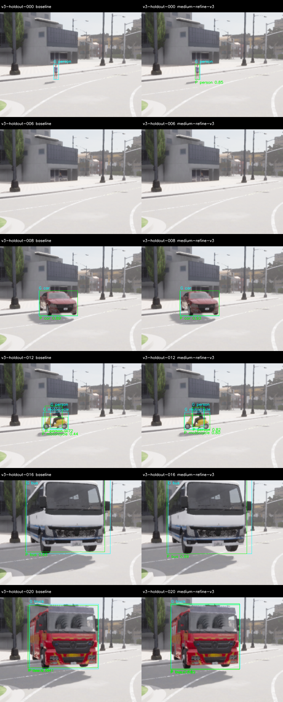
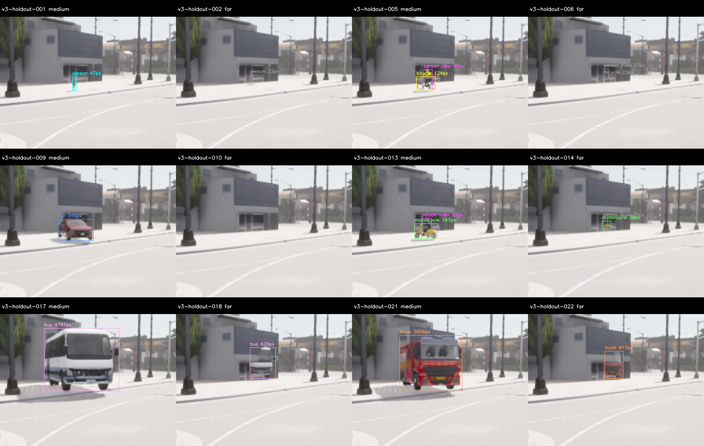

# M10 v3 별도 준비·YOLOX-M·새 평가와 현장 배치 검사

2026-11-07, Host RTX3090/CUDA. **준비·최종 수집·추론·원본 감사는 PASS, 후보는 미채택**이다.
M 확대는 개발의 절대 정확도 기준을 처음 통과했으나 개발의 빈 배경 오검출 증가와 보류의
정밀도·truck recall·조건별 coverage 실패가 남았다. M10 전체·live20Hz·주행 통합은 OPEN이다.

## 구현·사전 고정

[사전 기준](../../perception-quality-v3-protocol.md)에 따라 기존 Pedestrians12/Rider13→person 매핑,
strict visible IoU0.5·25pixel/side4·score0.35, 절대/상대 숫자 gate를 유지했다.
다음을 추가했다.

- 별도 camera spawn4의 자산 생성·settled pose·가시성 준비. 알려진 European HGV는
  서버 시작 전에 거절한다. 이는 engine의 NW movement 호환성 수정이 아니다.
- 동일 pose에서 가림 물체만 제거한 참조36장. 가림 target의 visible support가 참조의
  0초과·95%미만인지 검사하며 모든 계획 actor가 원래 최소 지원을 만족해야 한다.
- [별도 pinned YOLOX-M](../../../../third_party/megvii-yolox/README.md), M+고정 중앙320×192의
  2배 확대 후보. Same-class NMS0.5·경계2pixel·max100이며 cross-class 억제는 없다.
- M의 실제 model SHA를 기록하는 offline envelope. M을 기존 S 모델용 C++ 계약으로
  발행하지 않으며 모델 backend에 평가 GT를 전달하지 않는다. Runner는 준비 보고서/사전 계획을 검사한다.
- 준비 PASS와 CPU/CUDA/OpenCV의 독립 tensor/raw 수치 비교 뒤 코드·설정54개를 freeze한다.
  최종 source snapshot에는 평가 뒤 추가한 지도 검사와 그 테스트도 포함하지만 고정한54개는 바꾸지 않았다.

Town03_Opt/Epic/postprocess on, RGB640×384/FOV90, world10ms다. 새 개발 camera spawn5,
보류6을 사용한다. Near12/14m·medium20/22m·occluded16/18m, far는
person28/30m·이륜차34/36m·나머지 차량38/40m다. 준비는 각 배치보다1m 멀다.
이 유한 class별 거리·방향·자산과 다른 camera/site의 결과를 v1/v2와 같은 분포로 합산하지 않는다.
Bus와 Town은 공유하며 지리적으로 독립된 일반화 평가는 아니다.

## 준비 실패·수정과 종료 실패 보존

첫 준비144장은 서버/수집은 정상 종료했지만 held walker의 가림3개가20pixel이라 준비 FAIL이었다.
**새 평가의 추론 전에** target right만0.85→1.2m로 옮기고 참조36장을 추가한 v3b의180장을
전체 재수집했다. 해당 mask는47pixel이고 여전히 일부 가려진다. 모든 계획 actor216개가
포함되며36개 가림/참조의 visible ratio는 .3697–.8866이다. 준비에서는 모델 점수를 사용하지 않았다.

개발 첫 시도는81pair를 저장하고 client cleanup도 끝났지만 서버가30초 종료 제한을 넘었다.
Vulkan의 unfreed PooledBuffer/suballocation 경고·stack과 RequestExit130 로그가 있으나 실제
프로세스는 강제 종료되어 exit-9다. **전체 FAIL**, 해당 영상은 추론에 사용하지 않았다.
초기 메모의 allocation assertion 표현은 과도했으며 OOM/인과 crash를 규명한 것이 아니다.
`shutdown-review.json`에 정정했다. 동일54개 freeze·계획·timeout·엔진으로 새 서버에서 재수집했다.

| 실제 실행 | Pair/조회 | 판정 | Server exit | Wall s |
| --- | ---: | --- | ---: | ---: |
| 첫 준비 `m10-quality-v3` | 144 | 기술 수집 PASS / 준비 FAIL | 130 | 181.40 |
| 수정 준비 `m10-quality-v3b` | 180 | 준비 PASS | 130 | 239.03 |
| 첫 개발 `m10-quality-v3b` | 81 | 종료 FAIL / 추론 미사용 | -9 | 139.31 |
| 재수집 개발 `m10-quality-v3c` | 81 | PASS | 130 | 122.65 |
| 보류 `m10-quality-v3c` | 81 | PASS | 130 | 135.27 |
| 사후 지도 검사 | actor204개 조회 | 기술 PASS / 배치 screen FAIL | 130 | 26.05 |

총567개의 새 raw pair 중 최종 평가 장면은162개다. 준비324개와 종료 실패81개를 평가 표본에
더하지 않는다. 최종 준비·개발·보류420개 actor pose는 계획2cm/0.1° 이내이며 최대 위치 오차
0.00002143m, 최대 yaw 오차0.00005341°다. Static root pose 일치는 실제 지형 위 가시성 보장이 아니다.

## 수치 동등성·입력 분리

M의101259744byte/SHA를 확인하고 준비 영상3장에 대해 독립 RGB tensor, CPU ORT·CUDA ORT·
OpenCV raw 출력을 비교했다. Atol1e-3/rtol1e-4로 모두 PASS이고 최대 절대 차이는0.000152미만이다.
TF32 off·ORT1.23.2·CPU node fallback 금지를 유지한다. 모든 cold/초기화 비용을 남겼다.
이는 정의한 tensor의 수치 동등성이며 정확도 보장은 아니다.

소비한 v1/v2 RGB324개와 첫/수정 준비324개, 총648개 hash를 새 평가에서 제외했다.
개발/보류 RGB byte 중복도0이다. 추론 전에 각각 ClearNoon6class×4조건24장의 정답 contact sheet를
검수하고 모든81장의 raw mask/계획/pose를 자동 검증했다. 원본 RGB와 정답 기준은 변경하지 않았다.

## 실제 후보 비교

| Dataset | 후보 | TP | FP | FN | Precision | Recall | F1 |
| --- | --- | ---: | ---: | ---: | ---: | ---: | ---: |
| 개발 | S baseline | 97 | 11 | 32 | .898 | .752 | .819 |
| 개발 | M | 102 | 7 | 27 | .936 | .791 | .857 |
| 개발 | M 중앙 확대 | 123 | 7 | 6 | .946 | .953 | .950 |
| 보류 | S baseline | 67 | 17 | 47 | .798 | .588 | .677 |
| 보류 | M 중앙 확대 | 97 | 22 | 17 | .815 | .851 | .833 |

절대 기준은 P≥.85·R≥.80·각 class R≥.70·near-person R≥.90 등이다. 개발 M 확대는 모든
절대 gate를 PASS했다. 개발 far primary10/18→18/18, occluded12/18→18/18, rider12/27→21/27이다.
남은 FN6개는 rider이며 bicycle/car/motorcycle/bus/truck recall은 각각1.0이다.

그러나 개발 negative3장 중 한 장에서 M과 M 확대가 car .383 오검출을 추가했다. 절대 허용치
1/3은 만족하지만 **baseline 대비 FP 증가0**의 상대 gate를 실패했다. Threshold를 올려 재평가하지 않았다.
두 후보 모두 relative FAIL이므로 사전 F1/recall/precision/ID 규칙으로 M 확대를 진단용 지명했다.
그 selection을 새 보류 서버 시작 전에 복사했으며 보류에는 S와 이 후보만 실행했다.

보류에서는 rider12/21→21/21, near-person1/3→3/3, bicycle6/12→12/12,
motorcycle2/12→9/12, truck5/12→8/12로 개선했다. Car30/30과 bus12/15는 그대로다.
그러나 P .815<.85, truck R8/12=.667<.70이다. 상대 P 개선도1.75%p로 필요한3%p에 미달한다.
보류 negative3장 FP0이며 far primary 검출은 두 모델 모두0/9다. Occluded primary는6/18→14/18이다.

FP의 IoU0.5 연관에서는 보류 baseline이 truck을 bus로9개, bus를 truck으로4개 분류했다.
M 확대는 각각6/3개로 줄었으나 bicycle과 연관된 motorcycle FP7개 등이 남았다.
이 연관은 정답 class를 수정하거나 모든 unmatched box를 배경으로 단정하는 값이 아니다.
Small-ignore 진단은 보류 M 확대 FP1개에만 해당하며 raw/gate를 바꾸지 않는다.

## 최종 coverage 실패와 모든 site의 지도 검사

준비 PASS를 새 camera/site의 가시성 보장으로 올리지 않았다. 실제 개발은 GT129·excluded0,
모든 class×조건3/3이다. 보류는 GT114·excluded255이며 다음 coverage FAIL을 그대로 보존한다.

| 보류 primary class | Near | Medium | Far | Occluded |
| --- | ---: | ---: | ---: | ---: |
| person/bicycle/car 각각 | 3/3 | 3/3 | **0/3** | 3/3 |
| motorcycle/bus/truck 각각 | 3/3 | 3/3 | 3/3 | 3/3 |

Far walker는23pixel, bicycle와 rider도23pixel, motorcycle rider는20pixel이다. Far car는
visible mask에 없었다. Far primary9개와 rider6개가 포함 GT에서 빠진다. Excluded255개 중243개는
매 frame의 아주 먼 배경 car3개(1/1/3pixel)이고12개는 위의 작아진 대상/rider다. 임의로 mask를
키우거나 장면을 교체하지 않았다. 전체 객체 분모114, far primary 분모9를 유지한다.

평가 뒤 `quality_site_geometry.py`를 추가하고 새 서버에서 두 최종 site의 계획 actor204개를
센서/모델/spawn 없이 조회했다. Base의 actor origin clearance를 유지한 nearest-lane 높이 비교는
모두15cm 이내였다. **높이 차이가 원인이라고 입증하지 않았다.** 대신 보류 far18개 전체의
계획 XY가 가까운 차로·보도에서5.875–10.435m 벗어났다. 직선 camera-forward 배치가 도로 방향을
끝까지 따르지 않는다는 구체 근거다. 지도 projection은 collision mesh의 정확한 지면이나 시야 증명은 아니다.

새 screen은 고도 오차15cm·projection 거리2m를 넘는 site를 거절하는 도구다. 이는 **다음 준비 계획용
사후 검사**, v3 정확도 gate 변경이나 현재 장면 교체가 아니다. 다음 평가는 모든 실제 camera/site에서
이 검사와 새 RGB 가시성을 먼저 확인하고, on-road geometry와 negative/차종 충돌 후보를 별도로
고정해야 한다. 이미 소비한 v1/v2/v3 보류 영상을 새 holdout으로 재사용하지 않는다.

## 시간·회귀·재현

| 실행 | Mean ms | P95 ms | Max ms | Admitted |
| --- | ---: | ---: | ---: | ---: |
| 개발 S | 12.90 | 10.75 | 234.35 | 80/81 |
| 개발 M | 12.98 | 12.19 | 94.17 | 81/81 |
| 개발 M 확대 | 25.40 | 24.78 | 106.71 | 80/81 |
| 보류 S | 12.61 | 10.21 | 234.67 | 80/81 |
| 보류 M 확대 | 25.37 | 24.63 | 110.44 | 80/81 |

전체405 candidate frame이 model-valid, backend error0이다. Cold와 모든 단계/초기화 시간을
제외하지 않았고, 각 원본의100ms admitted 여부를 따로 기록한다. Offline 처리이며 live20Hz 수용이 아니다.

평가 고정 전 Python92개, 사후 지도 검사3개를 추가한 최종 **95개 PASS**다. Debug/Release/
ASan+UBSan perception13개씩(당시 Python92개 포함)을 통과했고, 최종95개도 세 구성의 Python
CTest에서 확인했다. Python 자체를 sanitizer로 계측한 것은 아니다. Ruff·whitespace·문서 링크와
기존 M10 네 묶음 무결성을 확인했다. C++/engine 변경·전체 core1459/M7/live20Hz 재실행은 이번 범위가 아니다.

`audit_quality_v3.py`는 준비의 첫 실패 raw와 수정 준비, 실제 pose·최종 raw→RGB/GT/metadata/seal,
이전 영상 제외·개발/보류 분리·54개 source·선택과 수집 순서·모델 SHA·점수/지명을 재구성했다.
기술 감사 PASS와 품질/coverage FAIL을 구분한다. Runtime review 자격은 false이며 자동 승격은 없다.

- `scores/`, `acceptance.json`, `experiment-audit.json`: 실제 점수·gate·수용 범위.
- `preparation-acceptance.json`, `model-check.json`, `pose-audit.json`: 준비·수치·실제 위치.
- `site-geometry-summary.json`: 사후 모든 site의 배치 screen 결과. 원본은 archive 안에 있다.
- `experiment.tar.gz`: `build/m10-quality-v3/`의 첫 준비/진단, `v3b/`의 준비와 종료 실패,
  `v3c/`의 최종 평가·모든 raw·로그·예측·고정 source54개·재현/보관 script. ONNX/설치된 도구 package는 제외한다.
- `sources.json`/`sources.tar.gz`: baseline4eb743c 위 최종 관련 코드·설정·문서 snapshot.
- `SHA256SUMS`, `archive-recheck.json`: 무결성과 새 임시 경로에서 풀어 재감사한 결과.

[재현 안내](../../../perception-guide.md#m10-v3)와 [ADR-0119](../../../archive/design-decisions.md#adr-0119)를 따른다.
