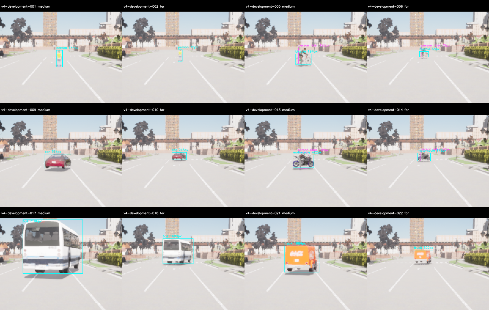
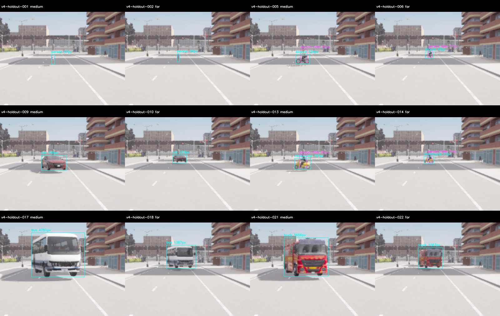
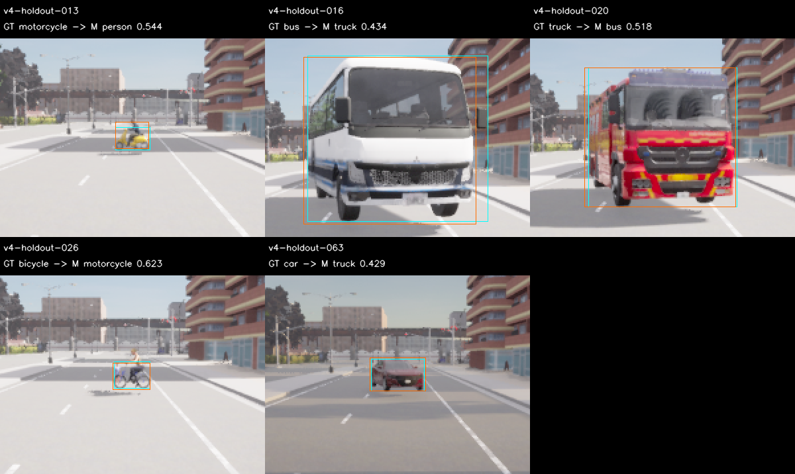

# M10 V4 도로 맞춤 새 정확도 평가

2026-11-09. 봉인된14/24번 실제 site에서 **새 개발81·보류81쌍**을 평가했다.
두 site의 모든 계획 actor/rider·6class×4조건 coverage는 PASS다.
**S와 지명 M의 보류 정확도는 FAIL이며 모델을 교체하지 않았다.** 원본 재감사 PASS와
품질 수용은 다르다. M10의 정확도·실제wall20Hz·시작/종료 안정성·주행 통합은 OPEN이다.

## 결과와 선언 범위

[사전 기준](../../perception-quality-v4-protocol.md)의 strict visible IoU≥.5·25pixel/side4·score.35,
절대/상대 gate를 유지했다. 후보는 기존 `baseline` S, `medium-v3` M, `medium-refine-v3` M 확대다.
V4는 새 도로 평가의 버전이며 새 가중치/threshold가 아니다. 별도 준비198장과 모든 과거
영상1387개에 이번 거절/진단/metadata 실패324개를 합친 **1711개 RGB**를 제외했다.

| Partition·후보 | TP / FP / FN | Precision | Recall | 절대 품질 |
| --- | --- | ---: | ---: | --- |
| 개발 S | 100 / 12 / 29 | .8929 | .7752 | FAIL |
| 개발 M | 112 / 14 / 17 | .8889 | .8682 | FAIL |
| 개발 M 확대 | 120 / 42 / 9 | .7407 | .9302 | FAIL |
| 보류 S | 76 / 25 / 53 | .7525 | .5891 | FAIL |
| 보류 M | 85 / 27 / 44 | .7589 | .6589 | FAIL |

개발의 상대 gate를 통과한 후보는 없다. 고정 순위의 F1에 따라 **M 하나를 지명**하고 보류
서버 시작 전에 복사·재계산했다. 개발 M은 bicycle recall .6으로 class≥.7을 실패했고,
S보다 precision+.03 조건도 실패했다. M 확대는 negative3장에 FP2개와 총FP42개로 실패했다.
보류에서는 S와 지명 M만 실행했으며 다른 후보를 재탐색하지 않았다.

| 보류 class recall | Person | Bicycle | Car | Motorcycle | Bus | Truck |
| --- | ---: | ---: | ---: | ---: | ---: | ---: |
| S | .4762 | .4000 | 1.0000 | .0000 | .9333 | .2500 |
| M | .4524 | .4667 | 1.0000 | .2500 | 1.0000 | .6667 |

보류 M은 precision/recall·class gate가 모두 FAIL이며 person recall은 S보다 낮다.
상대 gate의 precision과 class 무하락도 실패했다. 개발/보류 모두 absolute/relative가 필요하므로
`eligible_for_runtime_review=false`, `runtime_promotion=false`다. 기존 S live/C++ 모델을 유지한다.

## 실제 도로·정답 coverage

| 실제 site | Frame | 계획 actor | 유효 Rider13 | GT objects | Excluded |
| --- | ---: | ---: | ---: | ---: | ---: |
| 개발14·road52 | 81 | 102/102 | 27/27 | 129 | 0 |
| 보류24·road30 | 81 | 102/102 | 27/27 | 129 | 126 |

각6class×near/medium/far/occluded의 primary visible은 모두3/3이다. 이전의 보행자 지원
누락을 배경 객체로 대체하지 않았다. 두 site의27개씩 rider가 모두 정답에 포함됐으나 검출은
S 개발12/보류17, M 개발18/보류16개다. GT coverage와 모델 recall을 구분한다.
보류 excluded126개는 작은 배경 car mask이며 strict FP를 제거하는 데 쓰지 않았다.

최대 settled 위치 오차 .00001108m·각도 .00003815°, 실제 lane projection1.20000005m,
clearance오차0이다. 계획 actor 최소 지원은 개발68/보류34pixel, rider는각37/31pixel이다.
작은 held walker far는 **26m**이며 30m 이상을 수용하지 않는다. 동일 Town의 유한 정지 배치와
평탄한 경로이고 전체 ODD·지리적 독립 일반화·collision mesh/동적 주행 검증은 아니다.

각 site의 고정 ClearNoon24장 패널을 직접 검수했다. 전체162장은 raw hash·instance·RGB
layout/건전성·settled camera/actor pose·road/lane과 정답 최소 지원을 검사했다.
최소 luma std는 개발39.77/보류36.25다. 모델은 RGB만 받으며 GT/scene metadata는 scorer가 읽는다.

## 오검출 진단과 timing

사후 진단에서 개발 M의 FP14개는 class confusion7·visible localization2·background/low overlap5다.
M 확대 FP42개 중 background/low overlap21·localization14·class confusion7개다.
보류 M FP27개는 class confusion26개와 localization1개다. Truck→bus11, motorcycle→person7,
bicycle→motorcycle6, bus→truck1, car→truck1이 관측됐다. 이 분류는 unmatched 예측과 visible
GT의 overlap을 설명하는 진단이며 점수·지명·gate를 수정하지 않는다.

모든 모델 실행은81/81 model-valid·오류0이며 cold call/초기화 비용을 보존했다. 보류 S는
100ms offline admitted80/81, M은81/81이다. 각각 mean13.42/13.18ms·P95 10.68/12.30ms,
max271.26/97.49ms다. 이 offline 재생은 CARLA와의 공유 GPU·센서 취득을 포함한 실제20Hz
수용이 아니며 cold outlier를 제거하지 않았다.

## 거절·진단·metadata 수정 이력

원래 source/config·계획·원본·예측·실패를 덮어쓰지 않았다. 기존 UE/CARLA 엔진·모델·배치·품질 gate와 시간 제한을 유지했다.
준비/점수 코드 오류는 아래처럼 보존하고 새 freeze와 새 수집으로 고쳤다. 아래 진단 실행의 별도600s 시작 예산은
진단용이며 품질 서버의180s 시작/900s 수집/30s 종료 기준과 다르다. 진단을 수용 표본에 넣지 않는다.

| 실제 실행 | Raw pair | 실제 판정 | Exit | Wall s |
| --- | ---: | --- | ---: | ---: |
| 최초 CLI `v4` | 0 | 잘못된 schema 비교로 서버 시작 전 FAIL | client2·서버 없음 | — |
| `v4b` 개발 | 0 | 시작180s 초과·강제 종료 FAIL | -9 | 210.84 |
| `v4c` 개발 | 0 | 시작180s 초과·강제 종료 FAIL | -9 | 210.90 |
| `v4d` 개발 | 81 | 수집/클라이언트 PASS·종료30s 초과 FAIL | -9 | 272.06 |
| `v4e` 개발 | 81 | 수집/클라이언트 PASS·종료30s 초과 FAIL | -9 | 193.33 |
| 센서 없는 진단01 | 0 | OBSERVED·정확도 표본 아님 | 130 | 27.68 |
| 센서81개 진단02 | 81 | OBSERVED·정확도 표본 아님 | 130 | 114.16 |
| `v4f` 개발 | 81 | 수집 PASS·S 추론 후 metadata 점수 계산 FAIL | 130 | 112.13 |
| 최종 `v4g` 개발 | 81 | 수집/종료 PASS·품질 FAIL | 130 | 114.22 |
| 최종 `v4g` 보류 | 81 | 수집/종료 PASS·품질 FAIL | 130 | 115.68 |

총486쌍 중 최종 평가162개만 사용했다. 종료 실패162개·진단81개에는 모델을 실행하지 않았다.
Metadata 실패81개에는 S만 실행했으며 점수·지명·보류 수집 전에 중단했다. 정답 생성기의
`capture_sha256` 연결 누락을 고치고 raw→준비→점수 회귀를 추가한 **v4b metadata revision**을
새로 freeze했다. 해당324개 RGB를 모두 제외하고 최종 개발/보류를 새로 수집했다.
과거 S 예측을 새 결과로 재사용하거나 metadata 실패를 통과로 바꾸지 않았다.

종료 실패에서 `RequestExit(130)` 뒤 메인 futex 대기와 남은 스레드 하나를 관측했다.
별도 진단에서는 같은 Vulkan 경고와 함께 정상 종료돼 그 경고만으로 원인을 입증하지 못했다.
디버거 attach는 지연 재현 시에만 준비했으나 두 진단은 정상 종료해 attach하지 않았다.
엔진/OS 정책을 수정하지 않았고 근본 해결·장기 종료 안정성은 OPEN이다.
같은 freeze/수치 비교/시험 로그를 복사한 재실행은 독립 검사로 세지 않는다.

## 검증·원본 재현과 다음 단계

Python **118개**와 Debug/Release/ASan+UBSan perception **13개씩** PASS다. Python 자체를
sanitizer로 계측한 것은 아니다. Ruff·whitespace·문서 링크와 이전 M10 여섯 근거 묶음의
SHA256SUMS를 확인했다. 전체 core/M7/새 live20Hz나 차량 주행 시험은 이번 범위가 아니다.

최종92개 source/config를 새 freeze에 보존했다. 원본 재감사는 raw→RGB/GT/road/visibility/
seal·예측 점수·개발 지명·실행 순서와 이전1711개/partition 간 중복0을 재구성했다.
초기91개 snapshot·모든 거절/진단/metadata 실패도 별도로 검증했다. 압축을 새 경로에 풀어
같은 결과가 재현되는지 `archive-recheck.json`에 기록한다.

- `experiment-audit.json`, `*-score.json`, `candidate-selection.json`: strict 점수·거절·지명과 감사.
- `*-visibility.json`, `geometry-summary.json`, `*-panels.json`, `*-visual-review.json`: 실제 지원·도로·RGB/GT 검사.
- `*-errors.json`, `holdout-confusions.png`, `holdout-confusion-panels.json`: 사후 오분류 진단. 후보 재지명에 쓰지 않음.
- `prior-attempts-audit.json`: 과거 raw/source·실패·metadata 누락·미지명/미보류·추가324개 제외 재검증.
- `experiment.tar.gz`: `build/m10-quality-v4/`부터`v4g/`까지 원래 실행과 별도 진단01/02의 raw·로그·probe·snapshots·재현 script. 가중치는 제외.
- `sources.json`/`sources.tar.gz`: baseline `f483a63` 위 최종 관련 코드·설정·문서 snapshot.
- `future-evaluation-exclusion.json`: 과거1711개와 최종162개, **1873개** RGB 제외 목록. 미래 계획/수용은 아님.
- `SHA256SUMS`, `archive-recheck.json`: 묶음 무결성과 새 임시 경로에서의 재감사.

다음은 개발 자료에서 작은 VRU/rider·bicycle recall과 차종/이륜차 오분류를 개선하고 별도 새
보류셋으로 검증하는 일이다. 이번 보류셋은 소비됐으며 새 후보의 새 holdout으로 재사용하지 않는다.
실제wall20Hz·시작/종료 안정성·metric fusion/M11·Target과 학습자 수용도 남아 있다.
[재현 안내](../../../perception-guide.md#quality-v4), [ADR-0121](../../../archive/design-decisions.md#adr-0121)을 따른다.
