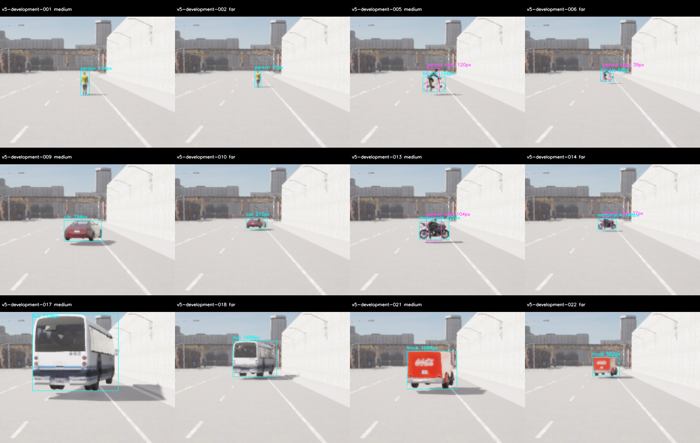
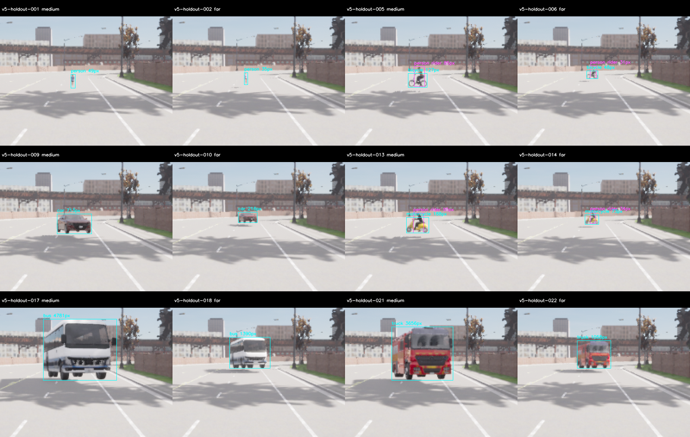
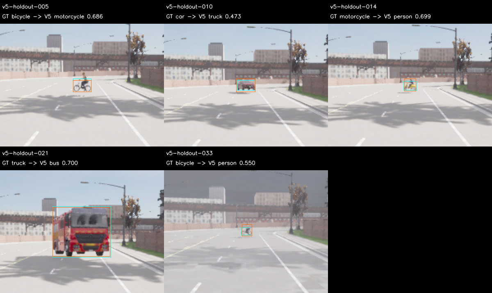
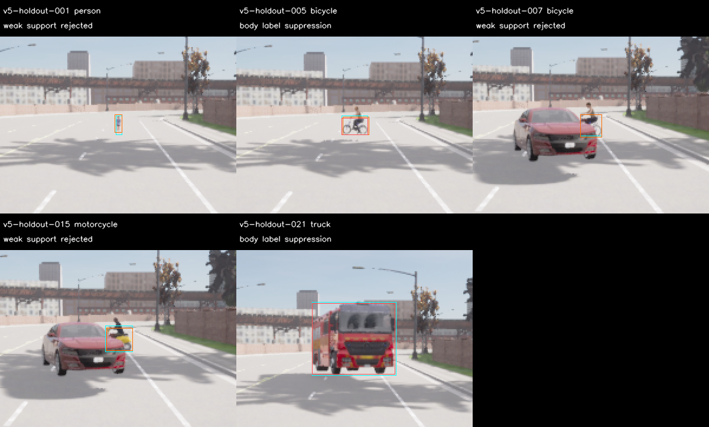

# M10 V5 VRU 다중 시야 후보와 새 도로 평가

2026-11-09, RTX3090/CUDA. **새 개발셋의 절대·상대 기준은 PASS, 새 보류셋은 FAIL**이다.
원본/확대 시야의 약한 클래스 지지를 결합하는 후보를 구현하고31/35번 도로에서 새81+81쌍을
검사했다. 기존 S 모델을 유지하며 M10 정확도·전체wall20Hz·시작/종료 안정성·주행 통합은 OPEN이다.

## 구현과 사전 고정

[사전 기준](../../perception-quality-v5-protocol.md)은 기존 strict visible IoU≥.5·최소25pixel/side4,
score.35와 절대/상대 gate를 유지한다. S와 M 가중치/hash·RGB 전처리는 그대로다.
`medium-vru-v5`는 M 원본과 중앙2배 확대의 person/bicycle/motorcycle을 합친다.
`medium-consensus-v5`는 확대 제안의 원본 raw 같은 클래스 지지와 원본 약한 VRU의 확대 지지를
요구한다. 강한 확대 제안에는 VRU-family 지지를 허용한다. 약한 raw proposal 자체는 발행하지 않는다.
거의 같은 body box의 bicycle/car/motorcycle/bus/truck 충돌은 높은 score 하나를 남기고
person은 다른 클래스와 겹친다는 이유로 억제하지 않는다. 각 view/최종100개와 유한성 검사를 유지한다.

이미 소비된 V4 **개발81장만** 두 설계 라운드에 사용했다. Consensus는 TP120/FP18/FN9에서
TP118/FP6/FN11로 바뀌었으며 이는 개발 설계 결과이고 새 수용 평가가 아니다. V4 보류 영상/예측은
설계 재생에 사용하지 않았다. 최종 정책을 고정한 뒤 모델 없는 준비·수치 비교·별도 품질 freeze를
진행했다. 새 보류를 본 뒤 후보/기준을 수정하거나 다른 후보를 보류에서 비교하지 않았다.

## 새 평가 결과

| Partition·후보 | TP / FP / FN | Precision | Recall | 절대 기준 | S 대비 상대 기준 |
| --- | --- | ---: | ---: | --- | --- |
| 개발 S | 99 / 12 / 30 | .8919 | .7674 | FAIL | 기준 모델 |
| 개발 M VRU | 117 / 11 / 12 | .9141 | .9070 | PASS | FAIL |
| 개발 M consensus | 117 / 3 / 12 | .9750 | .9070 | PASS | PASS |
| 보류 S | 81 / 32 / 48 | .7168 | .6279 | FAIL | 기준 모델 |
| 보류 M consensus | 87 / 16 / 42 | .8447 | .6744 | FAIL | FAIL |

개발의 절대·상대 gate를 모두 통과한 **M consensus 하나를 보류 서버 시작 전에 지명**했다.
보류에는 S와 지명 후보만 실행했다. 보류 precision≥.85·recall≥.8·class recall≥.7을 실패했고,
상대 기준의 클래스 무하락·far/occluded 무하락도 실패했다.
`eligible_for_runtime_review=false`, `runtime_promotion=false`이며 C++/live 모델은 교체하지 않는다.

| 보류 class recall | Person | Bicycle | Car | Motorcycle | Bus | Truck |
| --- | ---: | ---: | ---: | ---: | ---: | ---: |
| S | .5238 | .2000 | .9394 | .0833 | 1.0000 | .7500 |
| M consensus | .6667 | .2667 | .9697 | .2500 | 1.0000 | .4167 |

보류 rider 검출은18/27→23/27로 늘었지만 truck recall은 .75→.4167로 낮아졌다.
Primary far recall은 .3889→.2778, occluded는 둘 다 .3333이다. 전체 recall 개선이 조건별
회귀를 상쇄하지 않는다. Near person·negative FP gate는 두 모델 모두 PASS다.

## 도로 준비·coverage·실패 보존

기존265개 전체 지도 query를 순수 규칙으로 재생해 기존0–6/14/18/24번과 같은 road 또는
50m 안쪽을 제외했다. 다음 적격 위치31번 road28과35번 road67을 영상/점수 없이 선택했다.
전체42m nonjunction·폭/heading/frustum과 기존 pose·road/lane gate를 유지했다.

| 최종 실제 site | 준비 frame | 평가 frame | 평가 actor | 평가 Rider13 | 평가 GT | Excluded |
| --- | ---: | ---: | ---: | ---: | ---: | ---: |
| 개발31 | 99 | 81 | 102/102 | 27/27 | 129 | 0 |
| 보류35 | 99 | 81 | 102/102 | 27/27 | 129 | 0 |

최종 준비는 site마다 모든120개 actor·33개 rider·가림 참조18개를 통과했다. 평가에서도
6class×near/medium/far/occluded primary가 모두3/3이며 작은 rider를 배경 객체로 대체하지 않았다.
최대 실제 pose 위치 오차 .00002276m·각도 .00006104°, lane projection1.200012m 이하,
clearance 오차 .00000936m 이하이다. 계획 actor 최소 지원은 개발68/보류35pixel,
rider는37/31pixel이다. 작은 held walker far는 **26m**이며 준비27m다.

준비/평가의 각 partition 고정 ClearNoon24장 패널을 직접 검수했다. 최종 평가162장 전체의
RGB 건전성도 PASS이며 최소 luma std는 개발33.91/보류35.01이다. 모델 입력은 RGB만 받는다.

| 실제 서버 실행 | Raw pair | 판정 | Exit | Wall s |
| --- | ---: | --- | ---: | ---: |
| 최초 준비 개발01 | 0 | startup180s 초과·강제 종료 FAIL | -9 | 210.72 |
| 최초 준비 개발02 | 99 | 원래 source 준비 PASS·후속 수정으로 미사용 | 130 | 226.68 |
| 최초 준비 보류01 | 25 | 임시 spawn 구조물 충돌 FAIL | 130 | 77.12 |
| staging-v5b 준비 개발01 | 99 | PASS | 130 | 167.14 |
| staging-v5b 준비 보류01 | 99 | PASS | 130 | 110.26 |
| 최종 평가 개발01 | 81 | 수집/종료 PASS·지명 후보 품질 PASS | 130 | 156.99 |
| 최종 평가 보류01 | 81 | 수집/종료 PASS·품질 FAIL | 130 | 93.68 |

원래 임시 spawn이 카메라 뒤 구조물과 충돌했다. 최종 배치·거리·가시성 gate는 유지하고
임시 spawn만 계획 XY의 z+50+10×index로 옮겼다. World tick 전에 physics-off와 최종 pose를
적용하고 요청 staging도 원본에서 대조한다. 원래12개 source snapshot·99개/부분25개 원본·
실패를 남기고 새13개 preparation source freeze로 두 site198개를 전체 재수집했다.
준비 시도322쌍과 과거1873개, **2195개 RGB**를 새 평가에서 제외했다.
이번 전체 raw는484쌍이며 최종162개만 품질 표본이다. 준비 PASS 전에는 모델 점수를 쓰지 않았다.

## 사후 진단과 시간

개발 M consensus의 FP3개는 localization2·class confusion1이다. 보류 FP16개는 모두 class
confusion이며 truck→bus7, bicycle→motorcycle3, motorcycle→person3, bicycle→person2,
car→truck1이다. 아래는 각 오분류의 첫 사례로 점수·지명 변경에 사용하지 않았다.

지명된 동일 정책의 시야 입력을 관찰한 사후 진단에서 GT와 겹치는 확대 제안15개
(person6·bicycle5·motorcycle4)가 약한 클래스 지지 조건에서 제거됐다. Body 충돌 억제에서는
GT와 겹치는 제안3개(bicycle2·truck1)가 제거됐다. 같은 최종 출력을 box .01pixel/score1e-4
이내로 재현했으며 대체 정책 점수·ablation·재지명은 하지 않았다. 억제를 없애면 수용된다는
근거는 아니며 원래 raw/품질 점수를 유지한다.

모든5회 실행은 model-valid81/81·오류0·offline100ms admitted80/81이다. Cold call과 모델
생성 비용도 보존했다. 보류 S/consensus의 mean은15.44/27.68ms, P95는16.64/27.73ms,
max는232.21/109.02ms다. 이는 공유 GPU·센서 취득을 포함한 실제wall20Hz 수용이 아니다.

## 검증·재현 범위

Python **129개**, Debug/Release/ASan+UBSan perception **13개씩**, Ruff가 PASS다.
Python 자체를 sanitizer로 계측하지 않았다. 독립 RGB tensor·CPU/CUDA/OpenCV raw 비교와
준비3장의 두 완성 후보 CPU/CUDA6개 비교도 PASS다. 최종127개 source/config를 봉인했다.
원본 감사는 준비198개·평가162개의 raw→RGB/GT/road/coverage/seal·strict 점수·지명·순서와
기존2195개/partition 간 중복0을 재구성했다. 설계2라운드·원래 source/실패/부분25개·전체
준비322개 제외도 별도 재검증했다. 이전 M10 일곱 묶음의 SHA256SUMS는 그대로 PASS다.

- `experiment-audit.json`, `*-score.json`, `candidate-selection.json`: 원본·점수·지명·보류 실패.
- `history-audit.json`: 소비된 개발 설계 재계산과 최초 source·시작 실패·spawn 충돌·322개 준비 제외.
- `preparation-*-acceptance.json`, `*-visibility.json`, `geometry-summary.json`: 실제 준비/평가 지원과 geometry.
- `*-panels.json`, `*-visual-review.json`, PNG: 고정 GT 패널·전체 RGB 검사·사후 진단.
- `selected-view-diagnostic.json`, `*-errors.json`: 기존 결과를 유지한 사후 관찰이며 새 후보 검증이 아님.
- `experiment.tar.gz`: `build/m10-quality-v5-design/`, `-design-02/`, `build/m10-quality-v5/`, `build/m10-quality-v5b/`의 원래 source·raw·RGB·예측·로그·실패·재현 script. 가중치는 제외.
- `sources.json`/`sources.tar.gz`: baseline `72fc08b` 위 관련 최종 코드·설정·문서 snapshot.
- `future-evaluation-exclusion.json`: 기존2195개+최종162개, **2357개** 미래 RGB 재사용 금지 목록.
- `SHA256SUMS`, `archive-recheck.json`: 무결성과 새 경로에서의 압축 해제 후 재감사.

같은 Town의 유한 정지 배치와 기존에 본 자산을 사용한 새 영상/도로이며 새 도시·자산 독립
일반화나 전체 ODD가 아니다. Full core/M7·새 live20Hz·차량 주행·M11/Target 수용은 이번 범위가 아니다.
다음은 약한 시야 지지의 작은 VRU 누락과 이륜차/차종 충돌을 개발 자료에서 개선한 뒤 **새 보류**로
검증하는 일이다. 소비된 V5 보류를 새 holdout으로 재사용하지 않는다.
[재현 안내](../../../perception-guide.md#quality-v5), [ADR-0122](../../../archive/design-decisions.md#adr-0122)를 따른다.
