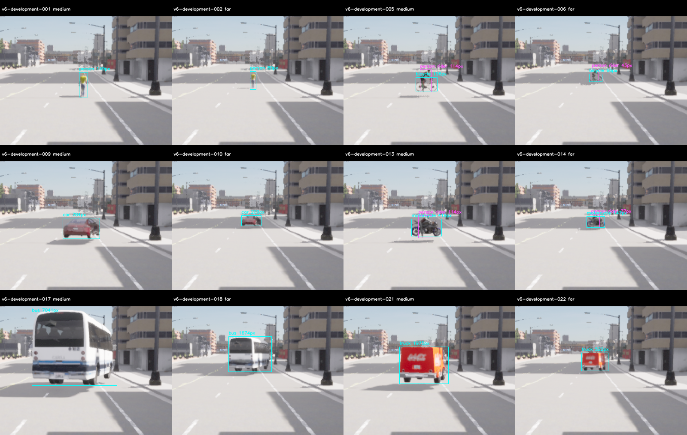
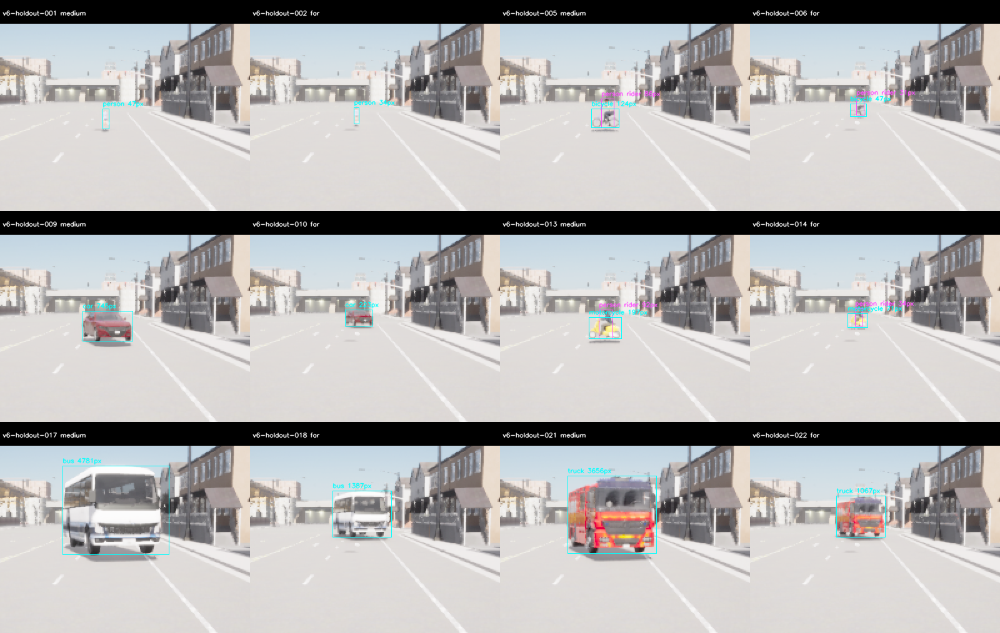
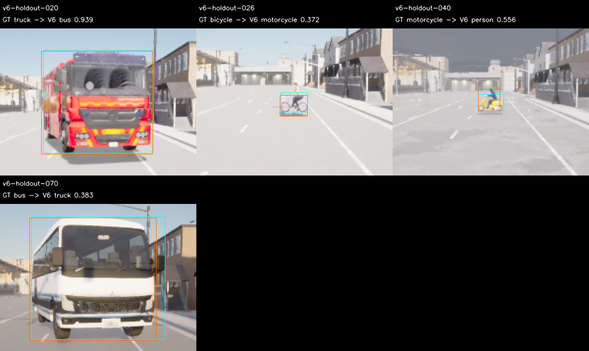

# M10 V6 고정 L 모델·확대 시야 차종 판단과 새 평가

2026-11-09, RTX3090/CUDA. **새 개발의 지명 후보는 절대·상대 PASS, 새 보류는 FAIL**이다.
지명 후보는 `large-v6`다. 기존 S live/C++ 모델은 유지한다. M10 전체 정확도·공유 GPU
실제wall20Hz·시작/종료 장기 안정성·metric fusion/주행 통합은 OPEN이다.

## 구현과 설계 범위

[사전 기준](../../perception-quality-v6-protocol.md)은 공식 YOLOX-L ONNX를 별도 고정 identity로
도입한다. 모델은216746733byte·SHA256 `7860ae79de6c89a3c1eb72ae9a2756c0ccfbe04b7791bb5880afabd97855a411`다.
[출처·라이선스](../../../../third_party/megvii-yolox-large/README.md)를 보존하며 가중치 재학습은 없다.
기존 RGB0–255·FP32·score.35·NMS.5·strict visible IoU≥.5·25pixel/side4와 모든 품질 gate를 유지한다.
L은 S/M envelope로 발행할 수 없으며 새 offline 결과가 실제 model SHA를 대조한다.

`large-v6`는 원본 L, `large-context-v6`는 L 원본/고정 중앙2배 확대다. Context는6종 확대
제안의 원본 약한 같은 클래스 지지를 요구하고 강한 body에는 body-family 지지를 허용한다.
Person은 다른 클래스의 지지를 대신 쓰지 않는다. 약한 raw 자체는 발행하지 않는다. 확대 내부의
거의 같은 body가 다른 클래스로 충돌하면 자격을 갖춘 확대 시야 판단을 사용한다. 원본 약한
VRU의 확대 검증 범위는 score<.5다. Person/rider 중첩·원본 좌표·경계 거절·view/최종100개와
유한성 검사를 유지한다. 자산 이름·GT·scene metadata를 후보에 입력하지 않는다.

이미 소비된 V4/V5 **개발162장만** 설계에 사용했다. 원본·VRU 확대·전체 확대 캐시6개와
원본 약한 VRU 검증 여부4개를 재계산했다. 설계로 고정한 context의 수치는 V4 개발 TP119/FP8/FN10,
V5 개발 TP119/FP9/FN10이다. 이 결과는 새 수용 평가가 아니다. V4/V5 보류 영상/예측을 설계에
재생하지 않았다. 최초 L adapter는 보존 bootstrap에서 재구성해 캐시에 기록된 실행 SHA와 byte
일치를 확인했고, 최초 context source·모든 설계 캐시/제안/점수·정답/RGB manifest도 보존했다.

## 새 정확도 결과

| Partition·후보 | TP / FP / FN | Precision | Recall | 절대 기준 |
| --- | --- | ---: | ---: | --- |
| 개발 baseline | 97 / 10 / 32 | 0.9065 | 0.7519 | FAIL |
| 개발 large-v6 | 113 / 5 / 16 | 0.9576 | 0.8760 | PASS |
| 개발 large-context-v6 | 118 / 6 / 11 | 0.9516 | 0.9147 | PASS |
| 보류 baseline | 71 / 23 / 58 | 0.7553 | 0.5504 | FAIL |
| 보류 large-v6 | 80 / 18 / 49 | 0.8163 | 0.6202 | FAIL |

개발의 지명은 `large-v6`이며 보류 서버 시작 전에 원래 개발 예측에서 다시 계산했다.
L 원본은 상대 기준을 모두 통과했다. Context는 F1이 더 높았지만 truck recall이 S1.0보다 낮은
.9167로 클래스 무하락 조건을 실패해 지명되지 않았다.
보류에는 S와 지명 후보만 실행했다. 보류 relative는 원거리 무하락 조건을 실패해 **FAIL**이다. 클래스·micro recall·precision gain·near person TP·negative FP의
상대 gate는 PASS다. 보류 L의 절대 precision/recall·class recall·near person은 FAIL이다. 지명/숫자 gate를 결과에 맞춰 바꾸지 않는다.
`eligible_for_runtime_review=false`, `runtime_promotion=false`다.

| 보류 class recall | Person | Bicycle | Car | Motorcycle | Bus | Truck |
| --- | ---: | ---: | ---: | ---: | ---: | ---: |
| S | 0.3810 | 0.2667 | 1.0000 | 0.1667 | 1.0000 | 0.0833 |
| large-v6 | 0.4524 | 0.5333 | 1.0000 | 0.2500 | 1.0000 | 0.1667 |

보류 S/지명 후보의 rider는 각각 **13/27**,
**17/27**다. 전체 개선과 클래스/조건별 gate를 구분한다.
엄격한 원래 점수와 admitted/small-ignore 진단을 섞지 않는다. 보류 near person은 두 모델 모두
2/3으로≥.9 기준을 실패했다. Primary far recall은 S.3889→L.3333으로 낮아졌고,
occluded는 .3333→.4444로 개선됐다. 지명 L의 오검출18개는 클래스 혼동16개·배경/낮은 overlap2개다.
Truck→bus12, bicycle→motorcycle2, motorcycle→person1, bus→truck1을 관측했다.
같은 정답에 올바른 예측과 잘못된 다른 클래스가 함께 나오는 경우도 strict FP로 센다.

## 모델 없는 준비와 실제 coverage

기존265개 전체 지도 query를 재생해 과거0–6/14/18/24/31/35번과 같은 road 또는50m 안쪽을
제외한 첫 적격74/80번을 선택했다. 영상/점수로 site를 고르지 않았다. 두 실제 camera site의
준비99장씩198개에서 모든 계획120actor·33rider/site·6class×4조건3/3·18개 가림 참조/site를
검사했다. 기존 도로/pose/시야/최소 지원과 V5b tick 전 staging을 유지했다.

최종 평가81장/site에서도 계획102actor·27rider/site와 각 class×조건3/3이 모두 포함됐다.

| 평가 site | Actor / Rider | GT / 제외 | 계획 actor 최소 pixel | Rider 최소 pixel |
| --- | --- | --- | ---: | ---: |
| 개발74 | 102 / 27 | 129 / 0 | 66 | 37 |
| 보류80 | 102 / 27 | 129 / 0 | 34 | 31 |

최대 위치 오차 .00001413m·각도 .00006104°, lane projection1.200001m 이하와 clearance오차
.00000018m 이하이다.

위 geometry 수치는 raw settled pose와 실제 lane readback에서 계산했다. 작은 held walker far는
**26m**이며 준비27m다. 동일 Town·이미 본 자산·유한 정지 배치의 새 도로/영상이며 새 도시·
자산 독립 일반화,30m 이상 지원,collision mesh나 동적 주행을 수용하지 않는다.

준비/평가의 각 partition 고정 ClearNoon24장 패널을 직접 검수하고 전체 RGB 건전성을 검사했다.
모델은 RGB만 읽고 정답·도로/scene metadata는 scorer와 감사기가 읽는다.

| 실제 서버 실행 | Raw pair | 수집/종료 | Exit | Wall s |
| --- | ---: | --- | ---: | ---: |
| 준비 개발 | 99 | PASS | 130 | 210.92 |
| 준비 보류 | 99 | PASS | 130 | 142.77 |
| 평가 개발 | 81 | PASS | 130 | 173.10 |
| 평가 보류 | 81 | PASS | 130 | 124.04 |

모든 실제 시도의 원래 source/probe·raw·로그·판정과 cold/init/단계별 timing을 보존했다.
서버 startup180s·capture900s·shutdown30s와 exit130 기준은 유지한다. 준비198개와 과거2357개,
**2555개 RGB**를 새 평가에서 제외했다. 새 raw360쌍 중 최종162개만 정확도 표본이다.

## 검증·사후 진단·재현

Python **139개**, Debug/Release/ASan+UBSan perception **13개씩**, Ruff가 PASS다. Python 자체는
sanitizer로 계측하지 않았다. 준비3장의 독립 RGB tensor·CPU/CUDA/OpenCV raw(atol1e-3/rtol1e-4),
두 완성 후보6개 CPU/CUDA 비교(class/count·box.01pixel/score1e-4)가 PASS다. **152개 source/config**를
봉인했다. 이전 M10 여덟 근거 묶음 SHA256SUMS도 PASS이며 수정하지 않았다.

원본 재감사는 준비198개·평가162개의 raw→RGB/GT/road/visibility/seal·strict 점수·개발 지명·
실행 순서와 과거2555개/partition 간 중복0을 재구성했다. 설계162장도 별도 cached-policy 재생으로
검증했다. 보류 오분류 진단은 이미 지명된 결과만 설명하고 대체 후보·재지명·gate 조정에 쓰지 않는다.

- `experiment-audit.json`, `*-score.json`, `candidate-selection.json`: 원래 strict 점수·지명·수용 판정.
- `history-audit.json`: 소비된 개발 캐시/지원 제안·정책·점수 재생이며 새 수용이나 neural 재실행이 아님.
- `preparation-*-acceptance.json`, `*-visibility.json`, `geometry-summary.json`: 실제 지원·도로/pose 검사.
- `*-panels.json`, `*-visual-review.json`, PNG: 고정 정답 패널과 전체 RGB 검사·사후 진단.
- `*-errors.json`, `holdout-confusion-panels.json`: 원래 strict 점수와 일치하는 오류 진단.
- `experiment.tar.gz`: `build/m10-quality-v6-design/`, `build/m10-quality-v6/`의 설계·최초 source·raw/RGB·예측·로그·snapshots·재현 script. 가중치는 제외.
- `sources.json`/`sources.tar.gz`: baseline `a11dccb` 위 최종 관련 코드·설정·문서 snapshot.
- `future-evaluation-exclusion.json`: 기존2555개+최종162개, **2717개** 다음 평가 RGB 재사용 금지.
- `SHA256SUMS`, `archive-recheck.json`: 새 경로에 압축 해제한 뒤 원본/점수/설계 이력 재감사.

모든5회 추론은 model-valid81/81·오류0·offline100ms admitted80/81이다. 보류 S/L의
mean은11.71/18.74ms, P95는9.23/17.77ms, max는238.00/121.23ms다. 개발 context는
mean38.56/P9537.76/max139.59ms다. Cold/init 비용과 outlier도 보존했다.
Offline100ms admitted·cold outlier를 실제wall20Hz와 구분한다. Full core/M7·새 공유 GPU live20Hz·
장기 반복 안정성·M11/Target/차량 수용은 이번 범위가 아니다. 소비된 V6 보류를 새 holdout으로
재사용하지 않는다. 다음은 다양한 시야·조명·차종을 포함한 전용 개발/학습 자료와 독립 보류
구성을 확보하는 일이다. 이번 L 후보만으로 새 보류의 기준을 충족하지 못했으며 추가 결합 규칙이
통과한다는 근거는 없다. [재현 안내](../../../perception-guide.md#quality-v6)와
[ADR-0123](../../../archive/design-decisions.md#adr-0123)을 따른다.
