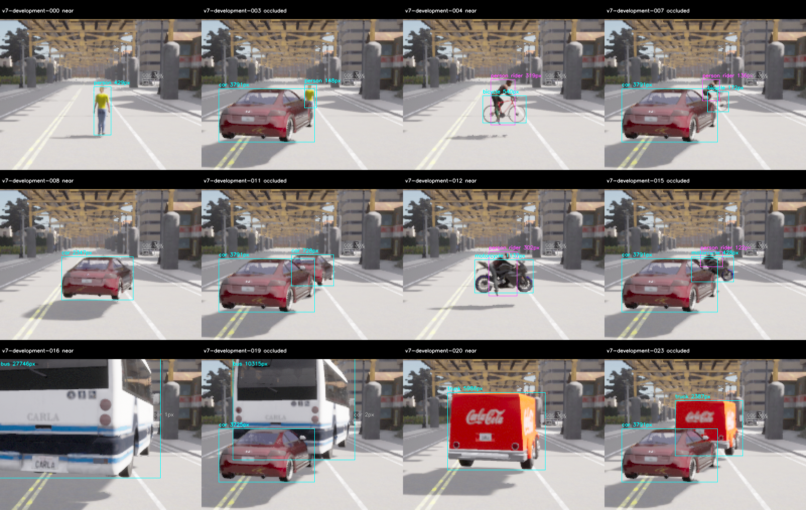
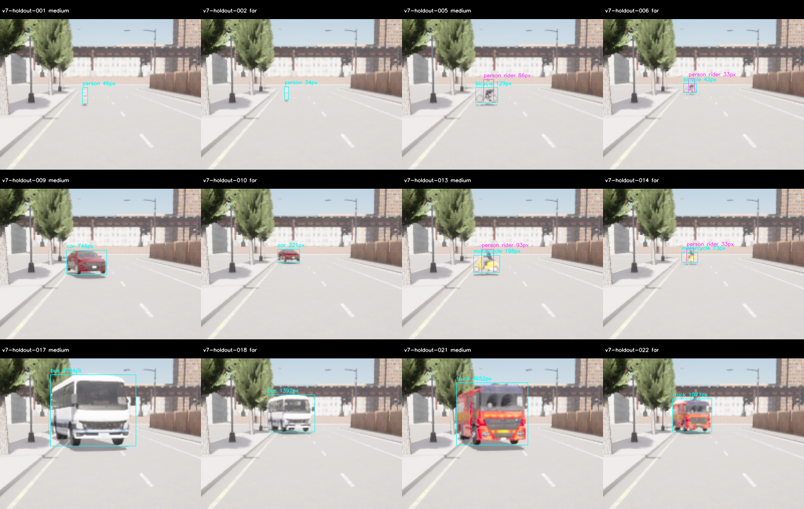

# M10 V7: 고정 L6 학습 후보의 새 도로 개발·보류 평가

2026-11-09. **새 준비198장·개발81장·보류81장의 실제 수집과 S/L6 정확도·원본 감사를 완료했다.**
고정 L6 후보의 전체 정확도 검토 조건은 **FAIL**이다. 기본 S와 M10 OPEN을 유지한다.
자동 runtime 교체·전체wall20Hz·차량 수용은 하지 않았다.

## 고정 후보·새 데이터와 판정

[사전 기준](../../perception-quality-v7-protocol.md)과 [고정 학습 모델](../m10_training_v1/README.md)을 따른다.
모델은 epoch17 ONNX SHA256 `d264c01b4c797108db754e6d2193ad0b42e9cb012e06c3ae1c0e99521f9fa98e`,
216580439byte·output[1,8400,11]·head→native[0,1,2,3,5,7]다. 새 학습·crop·ensemble·threshold
수정은 없다. 원래80-class S와 L6의 별도 offline envelope를 사용하고 source/expiry를 보존한다.
이전 training813/validation267의 수치와 아래 새 품질 표본은 서로 다르다.

| 새 partition | 모델 | Precision | Recall | TP/FP/FN | Absolute |
| --- | --- | ---: | ---: | ---: | --- |
| 새 개발215/road20 | 기존 S | 96.97% | 74.42% | 96/3/33 | FAIL |
| 새 개발215/road20 | 고정 L6 epoch17 | 92.19% | 91.47% | 118/10/11 | FAIL |
| 새 보류127/road6 | 기존 S | 77.78% | 54.26% | 70/20/59 | FAIL |
| 새 보류127/road6 | 고정 L6 epoch17 | 91.23% | 80.62% | 104/10/25 | FAIL |

기존 숫자 gate를 유지했다. P≥.85/R≥.8·모든 class recall≥.7·near person≥.9·negative FP/frame≤1/3,
상대 P+.03·전체/class/far/occluded recall·near person TP 무하락과 negative FP 무증가다.

- 새 개발215/road20: L6 absolute=FAIL·실패 gate=['per_class_recall']; relative=FAIL·실패 gate=['precision', 'per_class'].
- 새 보류127/road6: L6 absolute=FAIL·실패 gate=['per_class_recall']; relative=FAIL·실패 gate=['per_class'].

| Native class | 개발 S recall | 개발 L6 recall | 보류 S recall | 보류 L6 recall |
| --- | ---: | ---: | ---: | ---: |
| person | 64.29% (27/42) | 90.48% (38/42) | 35.71% (15/42) | 64.29% (27/42) |
| bicycle | 40.00% (6/15) | 100.00% (15/15) | 26.67% (4/15) | 73.33% (11/15) |
| car | 100.00% (33/33) | 100.00% (33/33) | 100.00% (33/33) | 100.00% (33/33) |
| motorcycle | 50.00% (6/12) | 100.00% (12/12) | 16.67% (2/12) | 75.00% (9/12) |
| bus | 100.00% (15/15) | 60.00% (9/15) | 100.00% (15/15) | 80.00% (12/15) |
| truck | 75.00% (9/12) | 91.67% (11/12) | 8.33% (1/12) | 100.00% (12/12) |

개발 L6의 bus recall60%는 S100%보다 낮았다. 개발 전체 recall의 향상만으로 이 회귀나
정밀도 하락을 가리지 않았다. 개발에서 실패한 단일 고정 후보도 사전 선언대로 descriptive
holdout을 기록했다. 새 보류를 본 뒤 후보·계획·기준을 수정하지 않았으며 다음 개선에는
별도 개발과 다시 새 보류가 필요하다. 작은 객체 진단용 ignore/covered miss는 TP/gate를 바꾸지 않는다.

## 실제 가시성·도로·분리

원래265개 map-only query에서 이미 쓴 모든 site와 road·50m 분리를 대조했다. 남은 미사용
두 도로 중 예약127번을 보류로, 다음215번을 개발로 고정했다. 학습 road52/28/3와 validation
road4를 재사용하지 않았다. 같은 Town·고정 합성 fixture이며 학습과 공유한 blueprint도 있어
도시/자산 전체 ODD 독립 일반화를 주장하지 않는다.

각 site의 모델 없는 준비99장은 거리+1m/camera높이+.05m, 실제 평가81장과 RGB·episode가 다르다.
모든 계획 객체/Rider·기상/stratum·가림/참조가 준비와 실제 평가 모두 최소25pixel/side4를 통과했다.
Held person far26m/준비27m를 유지한다. 실제 pose·road projection·clearance와 raw semantic mask를
재구성했다. 640×384/FOV90/Epic/postprocess·world10ms·settle40/capture10/선택tick5와
physics-off·tick 전 staging recipe를 바꾸지 않았다. 정지 clearance fixture이며 타이어 접지·동적 주행 수용은 아니다.





과거3973개와 준비198개, **4171개 RGB**를 최종 평가에서 제외했다. 개발/보류 각각81장의 모든
RGB/instance 원본·실제 pose/clock·GT·모델별 prediction을 남겼다. 미래 제외는 **4333개**이며
실패/부분 수집도 포함한다. Cross-partition 및 과거 RGB overlap은0이다.

## 시작 실패·별도 복구와 지연

개발 첫 두 시작은 readiness/RPC180s 제한·0frame·강제 종료exit-9로 FAIL이었다. 원래 자동
재시도1회 소진과 종료를 보존했다. [별도 복구 편차](../../perception-quality-v7-recovery.md)는 그 뒤
대용량 archive 읽기가 모두 끝난 상태의 run03을 실행 전에 기록한다. 동일 source200개·plan·
model/freeze·180/900/30s·exit130·품질 gate를 유지했다. I/O 경합을 단독 원인으로 단정하지 않는다.
복구 성공을 원래 실패의 PASS나 시작 안정성 수용으로 바꾸지 않는다.

| 실행 | Raw pair | Status | Exit | Wall s |
| --- | ---: | --- | ---: | ---: |
| development-01 | 0 | FAIL | -9 | 210.91 |
| development-02 | 0 | FAIL | -9 | 210.58 |
| development-03 | 81 | PASS | 130 | 260.26 |
| holdout-01 | 81 | PASS | 130 | 210.16 |
| preparation-development-01 | 99 | PASS | 130 | 238.17 |
| preparation-holdout-01 | 99 | PASS | 130 | 146.06 |

| 실행 | Model-valid | Logical admitted<100ms | P95 ms | Max ms | Model init ms |
| --- | ---: | ---: | ---: | ---: | ---: |
| development/baseline | 81/81 | 80/81 | 10.479 | 3317.675 | 3698.1 |
| development/trained-v1 | 81/81 | 80/81 | 18.029 | 300.873 | 2317.8 |
| holdout/baseline | 81/81 | 80/81 | 9.292 | 354.718 | 399.8 |
| holdout/trained-v1 | 81/81 | 80/81 | 17.253 | 117.296 | 567.5 |

첫 cold frame과 초기화를 빼지 않았다. Available/admitted 지표도 따로 보존한다. 이 offline
replay 지연을20Hz 전체 경로의 실시간 qualification으로 해석하지 않는다.

## 구현·감사와 재현

새 준비 개발 RGB 고정3개/model에서 독립 tensor와 CPU/CUDA/OpenCV raw·완성 native detections를
비교했다. Raw atol1e-3/rtol1e-4·완성 count/class동일·box.01pixel/score1e-4를 통과했다.
L6 manifest는 이전 학습 artifact와 byte/hash가 같고 기존85채널/다른 model identity는 거절한다.
코드·설정200개·계획·exclusion·모델 수치 자료를 실제 평가 전에 봉인했다. 준비 source14개와 실제 실행
probe/helper/staging hash도 재검사했다. 개발 score·지명을 봉인한 뒤에만 보류를 수집했다.

Python161개·Debug/Release/ASan+UBSan perception13개씩·Ruff·문서 링크·whitespace가 PASS다.
Python 자체는 sanitizer로 계측하지 않았다. 이전 M10 열한 묶음 무결성도 PASS이며 수정하지 않았다.
모든 원본→RGB/GT/pose·실제 coverage·strict score·지명/순서와 새 경로 압축 재감사를 통과했다.
감사 PASS는 model quality PASS가 아니다. 전체 core/M7·M11/Target·차량/새 wall20Hz 수용은 재실행하지 않았다.

- `experiment-freeze.json`, `preparation-freeze.json`, `model-check.json`, `profile-model-manifest.json`: 원본 source/plan·이전 학습 모델·고정 수치 연결.
- `candidate-selection.json`, `*-score.json`, `*-errors.json`, `experiment-audit.json`: 원래 실패·클래스별 결과/진단·strict 지명·보류 비교.
- `geometry-summary.json`, `*-visibility.json`, `*-panels.json`, `*-visual-review.json`, PNG: 모든 실제 가시성/배치와 고정 검수.
- `capture-attempts.json`, `recovery-before-launch.json`: 실패2회와 사전 별도 복구/정상 수집의 원래 기록.
- `future-evaluation-exclusion.json`: 모든 소비 RGB 4333개.
- `experiment.tar.gz`: `build/m10-quality-v7/`의 source snapshots·raw RGB/instance·prepared·예측·실패/로그·재현 script. 가중치는 이전 학습 evidence에 있다.
- `sources.json`/`sources.tar.gz`: baseline `ec24e00` 위 최종 관련 source/config/docs.
- `SHA256SUMS`, `archive-recheck.json`: 묶음 무결성과 모델/GPU 없는 새 경로 raw·score/selection/order 재현.

같은 source checkout과 기존 evidence에서 SHA/LFS를 확인한 뒤 아래처럼 새 출력 경로로 재감사한다.

```sh
python3 docs/test-plan/evidence/m10_quality_v7/check-archive.py \
  docs/test-plan/evidence/m10_quality_v7 build/m10-v7-recheck-new.json
```

[실행 안내](../../../perception-guide.md#quality-v7)를 따른다. 다음은 소비한 개발 자료를 사용한
bus/truck 구분·정밀도 회귀 개선과 별도로 고정한 새 후보/새 보류 검증이며, 기존 보류를 재사용하지 않는다.
