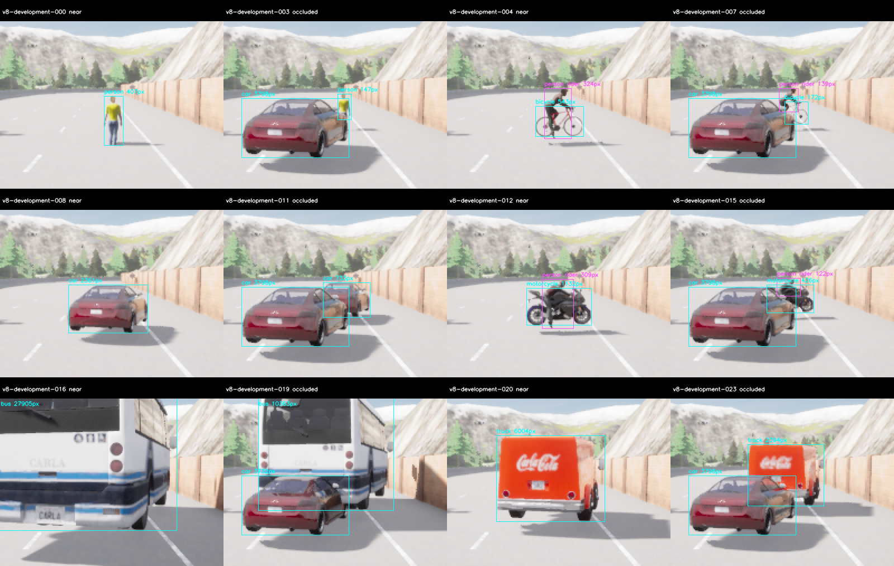
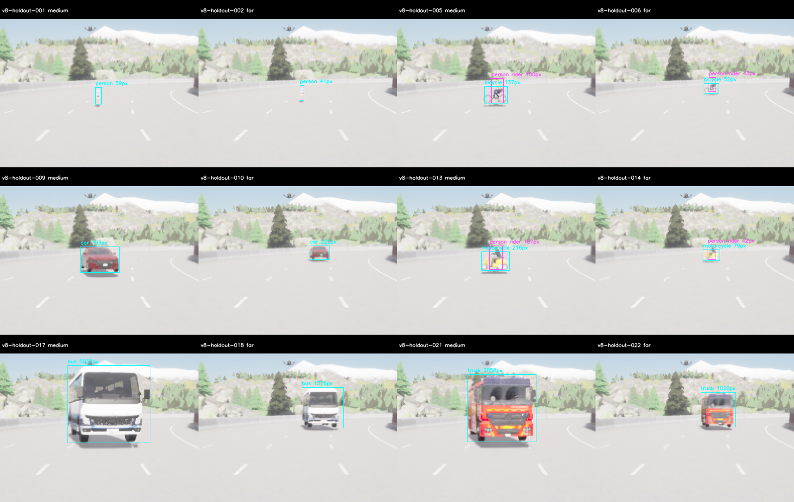
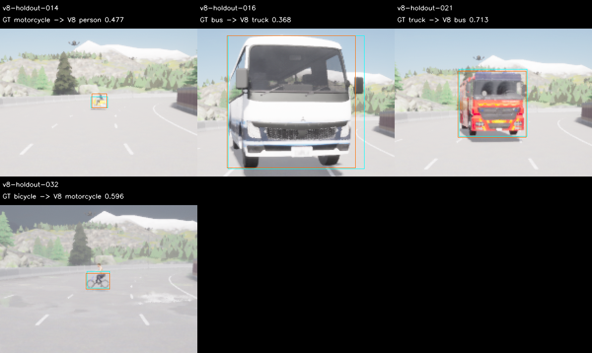

# M10 V8: 공식 L의 새 Town04 개발·보류 평가

2026-11-10. 사전학습5종 개발 비교 뒤 **공식 YOLOX-L 원본을 고정하고 새 지도에서 평가했다.**
개발은 절대·상대 PASS, 보류는 FAIL이다. 기본 S와 M10 OPEN을 유지한다. 추가 학습·threshold
탐색·crop/ensemble·보드 최적화·runtime 자동 교체는 없다.
[모델 선정 순서](../../../perception-model-selection.md)와 [사전 기준](../../perception-quality-v8-protocol.md)을 따른다.

## 새 정확도 결과

| Partition | 모델 | TP/FP/FN | Precision | Recall | 절대 기준 |
| --- | --- | --- | ---: | ---: | --- |
| 새 개발7/road6 | S | 93/14/36 | 86.92% | 72.09% | FAIL |
| 새 개발7/road6 | 공식 L | 116/8/13 | 93.55% | 89.92% | PASS |
| 새 보류25/road43 | S | 69/43/60 | 61.61% | 53.49% | FAIL |
| 새 보류25/road43 | 공식 L | 90/23/39 | 79.65% | 69.77% | FAIL |

각81장·129개 visible GT(계획 actor102+Rider27)다. 개발 L은 모든 상대 gate도 통과했으며
개발 점수·단일 후보 지명 뒤에만 보류를 취득했다. 보류 L은 precision/recall·class recall·
near person 절대 gate를 실패했다. 상대 gate도 motorcycle recall 하락 때문에 FAIL이다.

| Class recall | 개발 S | 개발 L | 보류 S | 보류 L |
| --- | ---: | ---: | ---: | ---: |
| person | 59.52% | 85.71% | 23.81% | 54.76% |
| bicycle | 40.00% | 80.00% | 13.33% | 46.67% |
| car | 90.91% | 93.94% | 100.00% | 100.00% |
| motorcycle | 41.67% | 83.33% | 33.33% | 25.00% |
| bus | 100.00% | 100.00% | 73.33% | 100.00% |
| truck | 100.00% | 100.00% | 75.00% | 75.00% |

보류 near person은 S/L 모두2/3(<.9), Rider는8/27→21/27이다. L의 보류 FP23개는
다른 class GT와의 IoU 중첩19개·visible localization3개·배경/낮은 overlap1개다. 이 중첩
진단은 의미적 원인을 확정하지 않으며 person/Rider/이륜차가 겹치는 경우도 포함한다.
전체 개선으로 실패를 상쇄하거나 보류에서 다른 후보를 재지명하지 않는다.

원래 절대 gate는 P≥.85/R≥.8·모든 class R≥.7·near person R≥.9·negative FP/frame≤1/3,
상대는 S 대비 P+.03·전체/class/far/occluded recall 무하락·near person TP 무하락·negative FP
무증가다. Strict visible IoU.5·Rider→person·primary-ignore=false를 유지했다.
`eligible_for_runtime_review=false`, `runtime_promotion=false`다. 과거 V6 L/V7 L6 FAIL도 유지한다.

## 새 지도·모델 없는 준비·원래 실패

Town03의 적격 미사용 도로가 소진되어 **Town04_Opt의372개 spawn을 지도 정보만으로 조사**했다.
기존0–42m route·전체 nonjunction·폭3.2m·turn15°·camera frustum·index≥7 규칙에서 첫 적격
7번과 다른 road/50m 분리의 다음25번을 고정했다. 영상/모델 점수로 site를 고르지 않았다.
Town04와 Town03의 road ID는 서로 다른 지도 namespace다. 공유 actor asset을 쓴 정지
합성 fixture이며 실제 ODD·새 자산·동적 주행 전체 일반화나 타이어 접지 수용은 아니다.

최초 준비는 개발99장 PASS, 보류99장에서 person 가림의 visible ratio1.0으로 FAIL이었다.
[별도 V8b revision](../../perception-quality-v8-preparation-revision.md)은 모델 추론 전에
holdout/occluded/person의 가림 차량 right_m만-.6→-.4m로20cm 옮긴다. 보행자/다른 actor의
거리·pose·camera·기상·최소 지원·품질 gate는 유지한다. 초기 source18개·raw198쌍·정답과
FAIL은 보존하고 별도 source20개로 양쪽 준비를 다시 수집했다.

수정 보류 run02는99쌍 취득/cleanup은 끝났지만 UE가30초 내 종료되지 않아 forced-stop/
exit-9로 FAIL이다. 로그의 exit130 요청을 실제 성공으로 바꾸지 않았다. 원래 자동 재시도
조건은0frame 시작 실패뿐이므로 [별도 복구](../../perception-quality-v8-recovery.md)를 실행 전에
기록하고 같은 코드·plan·180/900/30s로 run03을 한 번 추가했다. 정상 종료와 모든 준비 gate를
통과한 run03만 채택한다. 종료 안정성이나 근본 원인 해결을 주장하지 않는다.

| 실제 실행 | Raw pair | 실행/종료 | Exit | Wall s |
| --- | ---: | --- | ---: | ---: |
| survey-01 | 0 | PASS | 130 | 169.72 |
| preparation-development-01 | 99 | PASS; 초기 준비 | 130 | 175.91 |
| preparation-holdout-01 | 99 | 수집 PASS; 가림 gate FAIL | 130 | 117.98 |
| preparation-development-02 | 99 | PASS; 채택 | 130 | 100.34 |
| preparation-holdout-02 | 99 | 종료 FAIL; 미채택 | -9 | 124.57 |
| preparation-holdout-03 | 99 | 별도 복구 PASS; 채택 | 130 | 94.88 |
| development-01 | 81 | PASS | 130 | 85.91 |
| holdout-01 | 81 | PASS | 130 | 82.71 |

서버 실행 전 준비 실행기의 경로 복사 오류도 `setup-failure-01/`과 수정 기록에 보존했다.
그 오류는0 RGB·서버 미실행이며 서버 재시도 분모와 혼동하지 않는다.

## 입력·가시성·수치와 지연

모델은 공식 ONNX216746733byte·SHA256
`7860ae79de6c89a3c1eb72ae9a2756c0ccfbe04b7791bb5880afabd97855a411`다.
[출처·license](../../../../third_party/megvii-yolox-large/README.md)를 보존한다.
원래 RGB640×384/FOV90/Epic/postprocess·world10ms·settle40/capture10/선택tick5,
physics-off·tick 전50m staging과 FP32 RGB0–255/640 letterbox114·score.35·NMS.5를 유지한다.

채택 준비는 각99장이고 거리+1m/camera높이+.05m로 실제 평가와 분리한다. 모든 계획
actor/Rider·6class×4stratum×3weather·18개 가림 참조/site가25pixel/side4를 통과했다.
최종 평가도 모두 포함됐으며 개발/보류의 계획 actor 최소 지원은68/41pixel, Rider는37/42pixel이다.
최대 위치 오차.00004361m·각도.00005794°·projection1.232m·clearance오차0이다.
Held person far26m/준비27m를 바꾸지 않았다.

과거4333개+모든 이번 준비495개, **4828개 RGB**를 최종 평가에서 제외했다. 전체 새 raw는
657쌍이며 모두 보존한다. 최종162장은 과거/준비/서로 간 중복0이고 미래 제외는**4990개**다.
보류 RGB/예측은 다음 설계·재선정·새 수용 평가에 재사용하지 않는다.

준비 개발의 고정3장/model에서 독립 tensor·CPU/CUDA/OpenCV raw(atol1e-3/rtol1e-4)와
완성 검출(count/class 동일·box.01pixel/score1e-4)6건이 PASS다. 지도 source5개, 초기 준비18개,
수정 준비20개, 최종 quality source/config237개를 각각 실행 전에 고정했다.

| 실행 | Model-valid | <100ms admitted | P95 ms | Cold 포함 Max ms | 생성 ms |
| --- | ---: | ---: | ---: | ---: | ---: |
| 개발 S | 81/81 | 80/81 | 9.066 | 276.530 | 392.0 |
| 개발 L | 81/81 | 80/81 | 18.491 | 117.456 | 427.8 |
| 보류 S | 81/81 | 80/81 | 9.059 | 240.918 | 387.2 |
| 보류 L | 81/81 | 80/81 | 19.600 | 122.181 | 415.0 |

Cold/init을 빼지 않았다. 이 offline replay는 live 전체wall20Hz·차량·Jetson 수용이 아니다.
현재 보드별 engine·FP16/INT8·전력/클록 최적화나 새 학습은 하지 않았다.

## 검수·재현

채택 준비/실제 평가의 각 partition 고정 ClearNoon24장, 총96장을 직접 검수하고 모든
해당 RGB의 image health를 검사했다. 초기 실패 준비와 보류 오분류 패널은 별도 진단으로
남겼고, 점수·모델·정답·gate를 바꾸지 않았다.





Python **174개**, Debug/Release/ASan+UBSan perception **각13개**, Ruff·문서 링크·CSV·
whitespace가 PASS다. C++ 변경은 없고 Python 자체는 sanitizer로 계측하지 않았다.
전체 core/M7·새 live20Hz·차량/Target 시험은 재실행하지 않았다.

원본→RGB/GT/pose/visibility·strict score·지명/취득 순서를 재구성했다. 새 경로에서 **새 source
snapshot을 실제 실행**하여 같은 결과를 확인한다. 초기 준비198쌍의 원래 가림 FAIL과 채택
준비198쌍·최종162쌍을 재구성하고, 종료 실패99쌍도 원본 pair hash와 제외 목록을 확인한다.
무결성/감사 PASS는 모델 품질 PASS가 아니다.

- `experiment-audit.json`, `*-score.json`, `*-errors.json`, `candidate-selection.json`: 원래 점수·오류·지명·수용 판단.
- `survey-selected.json`, `survey-freeze.json`, `initial-preparation-*`, `preparation-freeze.json`: 새 지도·초기 실패·수정 source와 raw 감사.
- `preparation-revision-before-recapture.json`, `recovery-before-launch.json`, `capture-attempts.json`: 변경/별도 복구의 사전 기록·실제 모든 시도.
- `model-check.json`, `geometry-summary.json`, `*-visual-review.json`, PNG: 수치·실제 geometry/support·고정 검수.
- `future-evaluation-exclusion.json`: 소비 RGB4990개; 이미 본 보류의 재사용 거절용.
- `sources.json`/`sources.tar.gz`, `experiment.tar.gz`, `SHA256SUMS`, `archive-recheck.json`: source와 모든 원본/실패/예측·압축 재현. 가중치는 제외했으며 공식 source/hash를 고정했다.

```sh
build/m10-perception/cuda-venv/bin/python \
  docs/test-plan/evidence/m10_quality_v8/check-archive.py \
  docs/test-plan/evidence/m10_quality_v8 build/m10-v8-recheck-new.json
```

다음은 개발 자료에서 작은 보행자·이륜차·차종 혼동에 강한 사전학습 후보를 확대 비교하고,
고정 후보를 다시 새 자료로 검증하는 일이다. 추가 학습과 보드 최적화를 필수 후속으로 두지 않는다.
