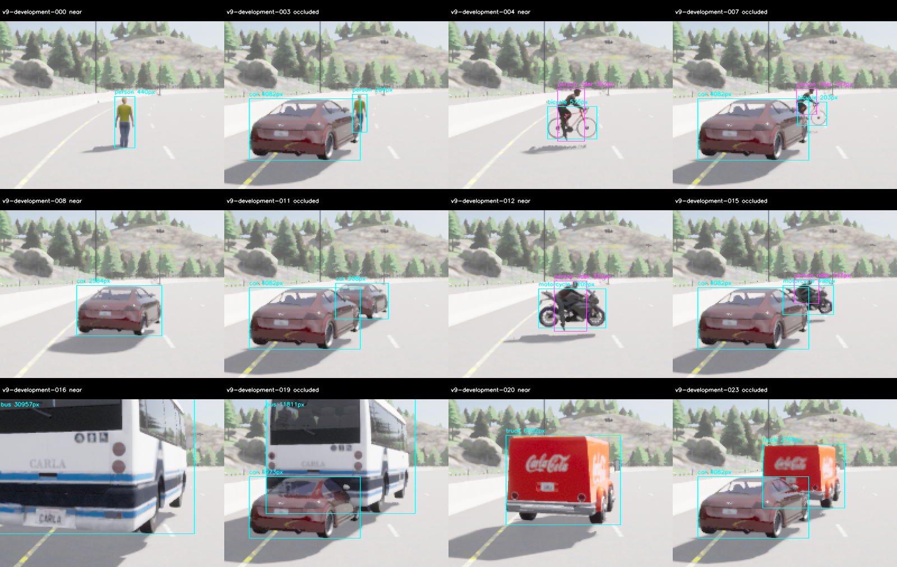
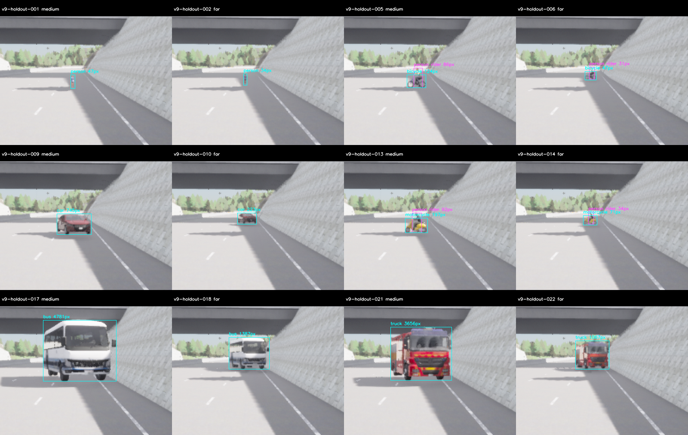

# M10 V9: 고정 D-FINE-M의 새 도로 개발·보류 평가

2026-11-10. 기존 가중치와 클래스별 confidence를 바꾸지 않고 **새 도로에서 개발·보류 평가를 완료했다.**
개발은 절대·상대 PASS, 보류는 상대 PASS지만 절대 FAIL이다. 기본 S와 M10 OPEN을 유지한다.
새 학습·export·crop/ensemble·보드 최적화·runtime 자동 교체는 없다.
[사전 기준](../../perception-quality-v9-protocol.md)과 [모델 선정 순서](../../../perception-model-selection.md)를 따른다.

## 새 정확도 결과

| Partition | 모델 | TP/FP/FN | Precision | Recall | 절대 기준 |
| --- | --- | --- | ---: | ---: | --- |
| 새 개발38/road45 | S | 98/13/31 | 88.29% | 75.97% | FAIL |
| 새 개발38/road45 | D-FINE-M class-v1 | 119/6/10 | 95.20% | 92.25% | PASS |
| 새 보류85/road47 | S | 76/36/53 | 67.86% | 58.91% | FAIL |
| 새 보류85/road47 | D-FINE-M class-v1 | 99/16/30 | 86.09% | 76.74% | FAIL |

각81장·129개 visible GT(계획 actor102+Rider27)다. 개발 점수와 단일 후보 지명을 봉인한 뒤에만
새 보류 서버를 시작했다. 개발과 보류 모두 S 대비 전체 상대 gate는 PASS다. 그러나 보류의
전체 recall76.74%<80%, person50%와 motorcycle50%<70% 때문에 **최종 채택은 불가**다.
Precision 개선이나 상대 PASS가 이 실패를 상쇄하지 않는다. 보류 결과를 보고 설정을 바꾸거나
다른 후보를 재지명하지 않았다.

| Class recall | 개발 S | 개발 D-FINE | 보류 S | 보류 D-FINE |
| --- | ---: | ---: | ---: | ---: |
| person | 64.29% | 85.71% | 50.00% | 50.00% |
| bicycle | 40.00% | 86.67% | 20.00% | 80.00% |
| car | 93.94% | 96.97% | 100.00% | 100.00% |
| motorcycle | 58.33% | 91.67% | 0.00% | 50.00% |
| bus | 100.00% | 100.00% | 66.67% | 100.00% |
| truck | 100.00% | 100.00% | 75.00% | 100.00% |

Near person은 양쪽/두 모델 모두3/3이다. 개발 Rider는13/27→21/27, 보류는16/27→17/27이다.
보류 bicycle80%·car/bus/truck100%만으로 작은 보행자와 오토바이 누락을 상쇄하지 않는다.
원래 절대 gate는 P≥.85/R≥.8·모든 class R≥.7·near person R≥.9·negative FP/frame≤1/3,
상대는 S 대비 P+.03·전체/class/far/occluded recall 무하락·near person TP 무하락·negative FP
무증가다. Strict visible IoU.5·Rider→person·primary-ignore=false를 유지한다.
`eligible_for_runtime_review=false`, `runtime_promotion=false`다.

## 새 지도·모델 없는 준비와 원래 실패

Town04_Opt의372개 spawn을 카메라/모델 없이 새로 조사했다. 기존 V8의7/25번이 쓰는 전체
route road ID6/35/41/43과 route origin50m 이내를 제외하고, 기존0–42m nonjunction·폭3.2m·
turn15°·frustum·index≥7 규칙의 첫 적격38번과 다음85번을 선택했다. 전체 route는 서로 다른
미사용 도로45/47이다. 이전 holdout RGB/GT/예측을 설계·선정에 읽지 않았다.
V8b의 배치/가림 recipe와 held person far26m·가림 차량 lateral−.4m를 그대로 유지했다.
준비는 거리+1m/카메라 높이+.05m의 각99장이다. 모든 actor/Rider 최소25pixel/side4,
6class×4stratum×3weather, 실제 pose/도로와18개 가림 참조/site를 통과했다.

최초 survey는 지도 query가 완료됐지만 UE가30초 내 종료되지 않아 forced-9로 FAIL이다.
[지도 복구 annex](../../perception-quality-v9-survey-recovery.md)를 실행 전에 고정하고 같은
source/180·900·30초 예산으로 한 번 더 실행한 survey02만 채택했다.
개발 준비01은 PASS, 보류 준비01은99쌍 취득 후 종료 실패다. [준비 복구 annex](../../perception-quality-v9-preparation-recovery.md)의
동일 조건 보류02만 채택했다. 실패 보류99쌍도 원본 hash·GT/지원 진단을 재생하지만
`accepted=false`이며 준비 seal을 공급하지 않는다. 종료 안정성이나 원인 해결을 주장하지 않는다.

| 실제 실행 | Raw pair | 상태 | Server exit | Wall s |
| --- | ---: | --- | ---: | ---: |
| evaluation-development-01 | 81 | PASS | 130 | 88.47 |
| evaluation-holdout-01 | 81 | PASS | 130 | 94.83 |
| preparation-development-01 | 99 | PASS | 130 | 172.90 |
| preparation-holdout-01 | 99 | FAIL | -9 | 137.95 |
| preparation-holdout-02 | 99 | PASS | 130 | 110.91 |
| survey-01 | 0 | FAIL | -9 | 121.38 |
| survey-02 | 0 | PASS | 130 | 157.25 |

이전4990개와 모든 준비297개의 **5287개 RGB**를 실제 평가에서 제외했다. 모든 새 raw는459쌍이고,
최종162장은 이전/준비/서로 간 중복0이다. 실패를 포함한 미래 제외는 **5449개**다.
소비한 보류는 다음 설계·재선정·새 수용 평가에 재사용하지 않는다.

## 모델·수치·지연

D-FINE-M ONNX77,949,424byte·SHA256
`40097ba600ba21b94c673a76ff602ece600392fc1d9641576ff66bfa0300e1c2`와
[기존 파생 후보](../../../../profiles/perception-class-calibration-candidates-v1.json)를 유지했다.
class0/1/2/3/5/7 confidence는 `[.60,.40,.70,.50,.50,.60]`이다. PIL RGB bilinear direct640/255,
original[width,height]=[640,384], full80-class top300/noNMS 뒤 target filtering이다.
S는 기존640 letterbox114·RGB0–255·obj×argmax·score.35·class NMS.5다.
출처·가중치·native 구현은 [사전학습 비교 V2](../m10_model_screen_v2/README.md)에 고정돼 있다.

준비 개발의 첫3장/model에서 S의 독립 tensor·OpenCV/ORT CPU/CUDA raw(atol1e-3/rtol1e-4),
완성 class/count·box.01pixel/score1e-4가 PASS다. D-FINE은 unchanged strict upstream PyTorch와
ORT CPU/CUDA의 full300 exact-class 일대일 unordered set·box.1pixel/score1e-4와 고정 vector의
완성 검출이 PASS다. 총6건이며 같은 probe 복제·잘못된 RGB·cold 제외는 거절한다.
지도9개·준비393개·최종 quality456개 source/config를 각각 실제 취득 전에 동결했다.
이전54/200/237/192/363/367/372/375개 동결 source도 그대로다.

| 실행 | Model-valid | <100ms admitted | P95 ms | Cold 포함 Max ms | 생성 ms |
| --- | ---: | ---: | ---: | ---: | ---: |
| development / S | 81/81 | 80/81 | 9.392 | 263.541 | 409.0 |
| development / D-FINE-M | 81/81 | 80/81 | 15.556 | 123.147 | 280.7 |
| holdout / S | 81/81 | 80/81 | 9.623 | 260.963 | 421.9 |
| holdout / D-FINE-M | 81/81 | 80/81 | 15.428 | 127.323 | 293.5 |

모든324개 추론의 full exported raw 배열을 저장하고 score 전에 다시 decode해 JSON 검출과
완전히 대조한다. raw cache 저장 실패는 model-valid/admitted로 계산할 수 없다.
Cold/init/error/late call을 빼지 않았다. 추론 시간에는 raw cache 압축 I/O가 포함되지 않는다.
이 offline Host RTX3090 비교는 전체wall20Hz·동적 주행·차량·Jetson 성능 수용이 아니다.
Thor/Orin에는 이후 각각 전체 Central–Zone–Leaf를 공통 Reference부터 배포하고 측정한다.

## 검수·재현

준비·실제 평가의 양쪽 고정 ClearNoon24장씩 총96장을 직접 검수하고, 채택360장의 전체
RGB health를 확인했다. 작은 held 보행자/Rider도 고정 최소 지원과 tight visible box를 유지했다.




Python208개, Debug/Release/ASan+UBSan perception 각13개와 Ruff·문서/CSV·whitespace가 PASS다.
실행 중 시뮬레이터와 겹친 최초 CTest는 port2300 충돌로 실패했으며 원래 로그를 보존했다.
시뮬레이터 종료 후 설정별 검사를 순서대로 다시 실행해 모두 PASS했다. C++ 변경은 없고 Python은 sanitizer
계측 대상이 아니다. 전체 core/M7·새 live20Hz·차량/Target 시험은 재실행하지 않았다.

원본459쌍의 SHA와 모든 시도 제외 목록을 재구성한다. 채택 준비198장/실제 평가162장의
RGB→GT/pose/visibility·strict score·nomination/취득 순서, 실패 준비99장의 미채택 지원 진단을
감사한다. 새 경로에서 압축한 source를 실제 실행해 같은 결과를 재검사한다.
최초 압축 재감사는 V8 지도 메타데이터 두 파일 누락으로 실패했다. `archive-recheck-initial.log`와
`archive-dependency-annex.json`에 보존하고 이미 고정된 두 의존 파일을 source 묶음에 추가했다.
원래456개 quality source/freeze·raw/점수·experiment archive는 그대로다. 최종 source 묶음은
458개이며 추가 파일도 기존 used-roads/base-exclusion의 SHA에 묶인다.
감사 PASS와 모델 품질 FAIL은 별개다.

- `experiment-audit.json`, `*-score.json`, `candidate-selection.json`: 원래 점수·선정·미채택 판정.
- `survey-runs.json`, `preparation-attempts.json`, `*-recovery-before-launch.json`: 실패와 실행 전 별도 복구 기록.
- `capture-attempts.json`, `future-evaluation-exclusion.json`: 전459쌍과 소비 RGB5449개 제외.
- `model-check.json`, `numeric-reference-01/`, `*-freeze.json`: 독립 수치·고정 source와 프로파일.
- `sources.json`/`sources.tar.gz`, `experiment.tar.gz`, `SHA256SUMS`, `archive-recheck.json`: 새 source 압축 재현.

```sh
build/m10-perception/cuda-venv/bin/python \
  docs/test-plan/evidence/m10_quality_v9/check-archive.py \
  docs/test-plan/evidence/m10_quality_v9 build/m10-v9-recheck-new.json
```

원래 가중치는 이 묶음에 중복하지 않았으며 기존 V2의 정확한 model/source hash를 따른다.
다음은 소비한 개발 자료에서 작은 VRU/Rider 누락·입력 해상도/사전학습 후보의 효과를 검증하고
설정을 새로 고정한 뒤 별도의 새 보류에서 확인하는 일이다. 이번 보류로 새 설정을 고르지 않는다.
추가 학습이나 보드 최적화를 필수 후속으로 두지 않는다.
