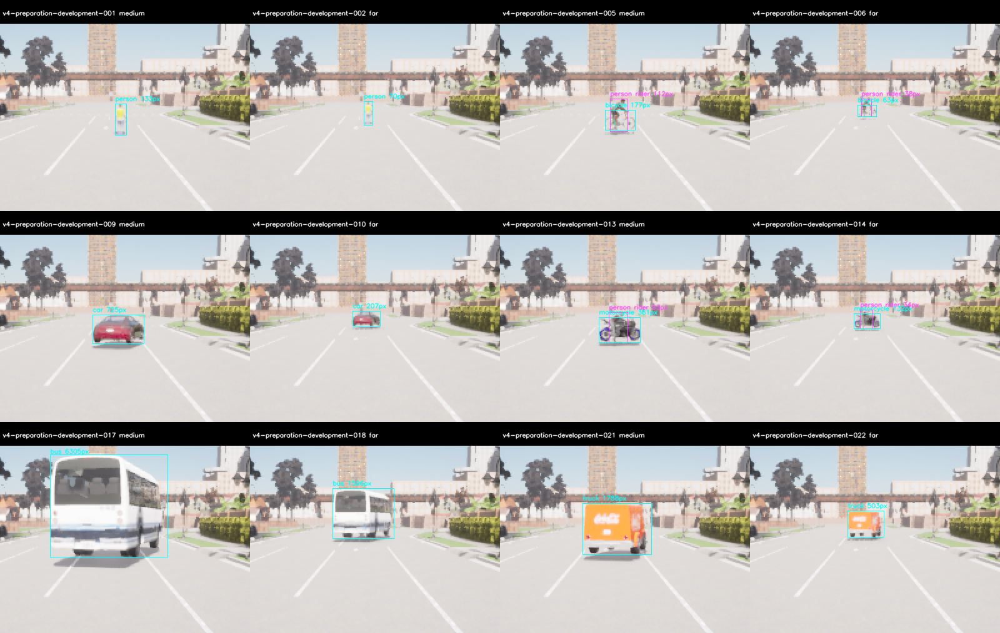
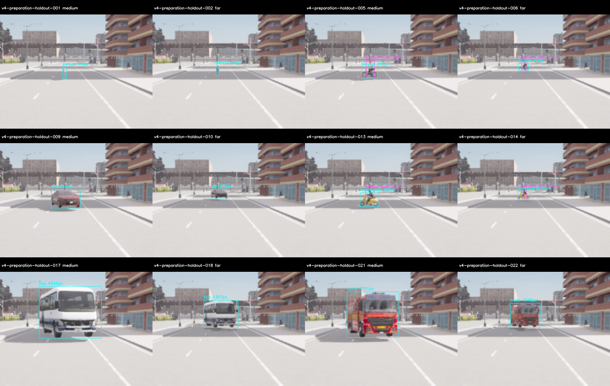

# M10 v4 실제 site 도로 맞춤 배치·준비198장·미래 계획 봉인

2026-11-09. **선언한 두 실제 camera site의 모델 없는 준비는 PASS**다. 위치14/24에서 최종99장씩
198개를 검사했고, 모든 계획 actor와 이륜차 Rider13·class×조건·부분 가림 참조를 통과했다.
미래162개 평가 계획을 봉인했다. **새 모델 추론/정확도 평가는 NOT RUN**, M10 전체는 OPEN이다.

## 바뀐 배치와 준비 기준

[V4 사전 기준](../../perception-road-preparation-v4-protocol.md)을 따른다. 카메라 방향의 직선
좌표를 늘리던 방식 대신 실제 driving waypoint의 위치·높이·pitch/roll/right vector와 base origin
clearance를 사용한다.1m씩42m 경로를 조회하고 갈림길은 직전 heading의 최소 변화와 안정적인
road/section/lane/s/id 순서로 고른다. 전체 경로 junction·폭3.2m·heading변화15°·pinhole 시야를
검사하고, 사용하지 않은 index≥7 중 서로 다른 road ID·50m 이상 떨어진 첫 두 site를 고른다.
영상이나 모델 점수로 camera site를 순위화하지 않는다.

현재 선택은14번 road52와24번 road30이다. 두 site의 경로는 조회 범위에서 heading 변화0°다.
고정 map의265개 route query를 강화된 순수 규칙으로 재생한 선택이며, 같은 query를 새 서버
실행으로 세지 않는다. 같은 Town의 유한 정지 배치로 지리적으로 독립된 일반화나 실제 주행을 주장하지 않는다.

- 실제 capture에서 nearest driving lane의 road/lane ID, projection≤2m·clearance오차≤15cm를 대조한다.
- Actor와 camera의 settled pose는 계획2cm/각도0.1° 이내여야 한다. Spawn 직후 SDK cache를 정답으로 쓰지 않는다.
- 모든 계획 actor와 모든 bicycle/motorcycle의 별도 Rider13 person이25pixel/side4를 만족해야 한다.
- 각 class×near/medium/far/occluded는3/3, 가림 없는 참조18개/site와의 visible ratio는0초과·95%미만이다.
- RGB640×384/FOV90/Epic/postprocess on, world10ms·settle40tick 뒤 사전 선택 tick5의 pair 하나를 사용한다.

준비는 각 미래81개 배치와 가림 없는 참조18개, 각99개다. 평가와 같은 실제 site이며 준비 actor는
route1m 더 멀고 camera는5cm 높다. RGB를 재사용하지 않는 근접 준비 배치다. 최종 실제 평가의
가시성을 보장하는 것은 아니므로 이후 coverage도 다시 검사해야 한다. 지도 projection은 collision
mesh·광학 시야의 정확한 증명이나 움직이는 차량의 물리 수용이 아니다.

## 실패와 수정: 모델을 실행하기 전에 준비 범위를 확정

1. 첫 조사 스크립트의 문법 오류는 client exit1의 실제 FAIL로 보존했다. Server는130으로 종료했다.
2. 첫 선택14/18에서14번99장은 준비 PASS였지만,18번은 경로 중간 junction에 들어가 실제 driving-lane
   검사가 거절했다.1pair만 저장한 전체 FAIL이다. 시작점만 검사하던 선택 규칙을 **경로 전체**로 보강하고
   기존265개 query를 재생해14/24번을 선택했다. 중간 junction 회귀 테스트를 추가했다.
3.14/24번 전체 준비에서는 도로 검사가 통과했으나 held walker0010의 far31m가24pixel이라 준비 FAIL이었다.
   최소25pixel/side4를 낮추거나 mask를 키우지 않았다. **미래 평가를 freeze하기 전에** 해당 자산의
   far를 평가30→26m·준비31→27m로 한정한 v4c를 전체 재수집했다. 준비 far의 실제 지원은30pixel이다.
   이 조건의30m 이상 가시성·정확도를 수용하지 않는다. 다른 객체의 원래 거리·정답 기준은 유지한다.

| 실제 실행 | Raw pair | Capture/준비 판정 | Server exit | Wall s |
| --- | ---: | --- | ---: | ---: |
| 원래 조사01 | 0 | 문법 오류 FAIL | 130 | 28.79 |
| 원래 조사02 | 0·route265개 | Query PASS·초기 선택14/18 | 130 | 93.48 |
| 초기14번 준비 | 99 | PASS | 130 | 129.30 |
| 초기18번 준비 | 1/99 | 실제 lane 검사 FAIL | 130 | 28.30 |
| 중간14번 준비 | 99 | PASS | 130 | 132.71 |
| 중간24번 준비 | 99 | 수집 PASS·walker24pixel 준비 FAIL | 130 | 135.96 |
| 최종14번 준비 | 99 | PASS | 130 | 131.90 |
| 최종24번 준비 | 99 | PASS | 130 | 173.66 |

총496개 raw pair 중 최종 준비 표본은198개다. 반복한 레이아웃·초기 실패를 독립적인 정확도
표본으로 합산하지 않는다. 모든 원래 실행·source·plan·timestamp를 보존한다. Startup180s/
capture900s/shutdown30s와 기존 UE/CARLA source를 바꾸지 않았다. 이8개의 종료130을 과거
renderer 종료 실패의 근본 해결이나 장기 안정성 수용으로 확대하지 않는다.

## 최종 준비 결과

| 실제 site | Primary6class×4조건 | 계획 actor | 유효 rider | 가림/참조 | GT objects | Excluded |
| --- | --- | ---: | ---: | ---: | ---: | ---: |
| 14·미래 개발용 | 각 cell3/3 | 120/120 | 33/33 | 18/18 | 153 | 0 |
| 24·미래 보류용 | 각 cell3/3 | 120/120 | 33/33 | 18/18 | 153 | 153 |

Site24의 excluded153개는 작은 배경 car mask다. 계획 target/rider가 제외된 것은 아니다.
계획 actor의 최소 지원은14번63pixel·24번30pixel, rider 최소는각34/31pixel이다.
36개 가림/참조의 visible ratio 범위는 .3905–.8893이다. 모델 TP/FP/FN이나 COCO mAP가 아니다.

최종240개 actor pose와 실제 lane readback을 확인했다. 최대 위치 오차0.00000960m,
최대 각도 오차0.00003815°, 최대 projection1.20000005m, clearance오차0이다. 이번 선택 경로는
평탄하며 비평탄/교차로 전체 ODD를 수용한 결과가 아니다. 두 camera pose도 동일 허용치로 대조했다.

각 site의 ClearNoon6class×4조건24장 패널을 시각적으로 검수했다. 모든198장에 raw hash·layout·
source/instance·actor pose·road identity·최소 지원·RGB 정보 손실 검사를 적용했다. 최소 luma std는
각39.87/36.33으로 정보 손실 gate를 통과했다. 이 검사는 렌즈/ODD의 모든 열화를 판정하는 것은 아니다.

## 미래 정확도 평가의 입력과 남은 일

`prepared-plan-seal.json`은 다음162개 계획·준비 source freeze·survey·두 준비 보고서와
`future-evaluation-exclusion.json`을 연결한다. 이전891개와 이번 모든 완전/부분 준비496개,
**총1387개 RGB hash**를 미래 평가에서 제외한다. 최종 두 준비 site 간 byte 중복도0이다.
준비 영상을 미래 holdout으로 재사용하지 않는다.

미래 계획은 개발14번/보류24번이며 near12/14m·medium20/22m·occluded16/18m,
far는 person28/**26m**, 이륜차34/36m, 나머지 차량38/40m다. 이 거리 범위와 정지 pose를
전체 Reference 인지 요구로 바꾸지 않는다. 특히 작은 held person의30m 이상은 미검증으로 남긴다.

다음은 이 계획·새 모델 비교 기준을 별도 quality freeze로 고정하고 새로운 실제 RGB를 수집해
정확도와 coverage를 확인하는 일이다. 빈 배경 FP·차종 혼동, 실제wall20Hz·renderer 장기 안정성,
metric fusion·M11 주행/Target은 여전히 남아 있다. 이번 준비에서 모델을 실행하거나 교체하지 않았다.

## 검증·원본·재현

기존95개에 도로 geometry/계획/준비의14개를 추가해 Python **109개 PASS**다. 중간 junction,
비결정적 분기·차로 밖 배치·pose/시야 변조·누락 target/rider·가림 없는 가짜 occlusion과 분모
변조를 검사한다. Debug/Release/ASan+UBSan perception13개씩과 최종 Python CTest를 확인했다.
Python 자체를 sanitizer로 계측한 것은 아니다. Ruff·whitespace·문서 링크·이전 M10 다섯 묶음
무결성도 확인했다. C++/engine 변경과 전체 core/M7/새live20Hz 실행은 이번 범위가 아니다.

초기 준비 전78개, 보강/최종 준비 전81개 source/config를 각각 저장했다. `audit_quality_road_v4.py`는
원래 query에서 site 선택·계획을 재생성하고, raw→RGB/GT·actual pose/lane·각 준비 gate·분리·과거
실패를 재구성했다. 기술 감사 PASS와 모델 정확도·runtime/차량 수용을 구분한다.

- `acceptance.json`, `preparation-audit.json`, 두 `*-preparation.json`: 선언 범위·각 gate·실패 재감사.
- `evaluation.json`, `preparation.json`, `protocol.json`, `survey-selected.json`: 현행 계획·기준과 선택.
- `prepared-plan-seal.json`, `future-evaluation-exclusion.json`: 다음 평가용 연결·제외 목록. 별도 quality freeze 필수.
- `geometry-summary.json`, `*-panels.json`, `*-visual-review.json`: 실제 pose/차로·RGB/정답 검수.
- `experiment.tar.gz`: `build/m10-road-preparation-v4/`, `v4b/`, `v4c/`의 모든 raw·원래 script/probe/
  source snapshot·server log·판정·재현 script. 복사한 survey 이력은 같은 원래 query이며 별도 실행이 아니다.
- `sources.json`/`sources.tar.gz`: baseline3d6b9bb 위 관련 코드·설정·문서 snapshot.
- `SHA256SUMS`, `archive-recheck.json`: 무결성과 깨끗한 임시 경로에서 풀어 원본을 재감사한 결과.

[재현 안내](../../../perception-guide.md#road-preparation-v4)와 [ADR-0120](../../../archive/design-decisions.md#adr-0120)을 따른다.
