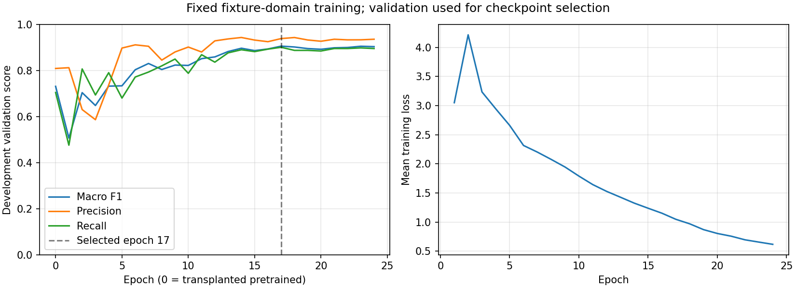
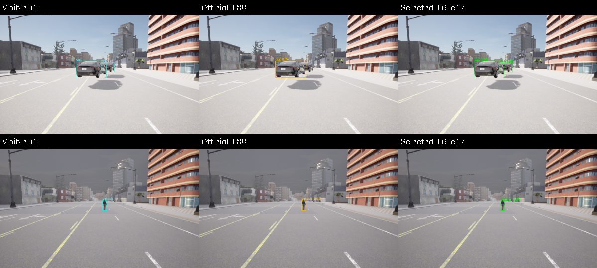

# M10 첫 전용 데이터 L6 학습 후보 v1

2026-11-09. **고정 train813/validation267으로24epoch·4896 optimizer step의 실제 FP32 CUDA
학습을 완료했다.** 사전 macro F1 선택 규칙은 17번째 epoch를 골랐다. 아래 수치는
checkpoint 선택에 사용한 **개발 validation** 결과다. 새 quality holdout 평가는 실행하지 않았으며
기본 S와 기존 정확도 FAIL·M10 OPEN을 유지한다.

## 입력·학습과 모델 계약

[사전 학습 기준](../../perception-training-v1-protocol.md)과 [고정 자료](../m10_domain_data_v1/README.md)를
따른다. 정지 합성 fixture·같은 Town·bus/truck 공유의 제한을 유지한다. 과거 보류/예약127번을
학습·선택에 읽지 않았다. 새로운 raw 수집은0개다. 향후 제외 RGB3973개도 그대로 보존한다.

공식 YOLOX L의 소스 commit `e1052df71842031413f6030723c3607b839c80ce`와
`yolox_l.pth`434357141byte/SHA256 `1e6b7fa6240375370b2a8a8eab9066b3cdd43fd1d0bfa8d2027fd3a51def2917`를 고정했다.
Checkpoint는 hash 대조 후 `weights_only=True`로 읽었다. Classifier native [0,1,2,3,5,7] 행을
6개 연속 head로 이식하고 나머지 모든 tensor를 strict load/equality 검사했다. 원래80-class와
이식 직후6-class를 각각 평가해 구조 변경과 실제 학습을 구분했다.

Python3.10·torch2.5.1+cu124/torchvision0.20.1+cu124·RTX3090,FP32·TF32 off·seed20261109·
deterministic algorithms을 사용했다. Batch4·마지막1장·workers0이며 매 epoch813장을 정확히
한 번 읽었다. AdamW1e-4/weight_decay1e-4·warmup1epoch·cosine.1floor·gradient clip10,
모든 parameter 학습·BN running buffers 고정이다. 실제 peak CUDA 할당은5180916736byte,
총 training wall은1230.26s다. Smoke의 갱신 가중치는 버리고 본 학습은 공식 초기 가중치로 새로 시작했다.

RGB0–255·좌상단640square/114 padding과 좌우반전.5만 적용했다. 모든 작은 양성/Rider와
빈 프레임을 포함하고 box를 rounding/crop/filter하지 않았다. Mask/area는 학습 입력 box로
명시 변환하며 기존 품질 GT 정의를 바꾸지 않았다. 새 출력은 `[1,8400,11]`,head→native
`[0,1,2,3,5,7]`다. 기존80-class/S/M/L runtime envelope와 자동 연결하지 않는다.

## 고정 개발 validation 비교

267장·372개 모든 visible 양성에 score.35,classwise NMS.5,strict IoU.5를 적용했다.
최대 macro F1·동점은 이른 epoch이며 epoch0도 후보였다. threshold나 설정을 중간에 바꾸지 않았다.

| 후보 | Precision | Recall | Micro F1 | Macro F1 | TP/FP/FN |
| --- | ---: | ---: | ---: | ---: | ---: |
| 공식 L checkpoint80 | 80.86% | 70.43% | 75.29% | 73.09% | 262/62/110 |
| 이식 L6 epoch0 | 80.86% | 70.43% | 75.29% | 73.09% | 262/62/110 |
| 선택 L6 epoch17 | 93.84% | 90.05% | 91.91% | 90.55% | 335/22/37 |

| Native class | 이식 epoch0 TP/FP/FN | 선택 TP/FP/FN | Recall 변화 |
| --- | ---: | ---: | ---: |
| person (0) | 105/5/33 | 132/4/6 | 76.09% → 95.65% |
| bicycle (1) | 22/2/20 | 30/7/12 | 52.38% → 71.43% |
| car (2) | 36/1/30 | 48/0/18 | 54.55% → 72.73% |
| motorcycle (3) | 25/5/17 | 41/0/1 | 59.52% → 97.62% |
| bus (5) | 38/6/4 | 42/2/0 | 90.48% → 100.00% |
| truck (7) | 36/43/6 | 42/9/0 | 85.71% → 100.00% |

6개 클래스 recall은 초기 모델보다 모두 올랐다. 다만 bicycle FP는2→7로 늘었고 precision은
91.67%→81.08%로 내려갔다. Car recall72.73%와 작은 bicycle 누락도 남았다. 전체 평균만으로
이 부족을 가리지 않는다. 초기 epoch의 하락과 모든24개 prediction/score/loss·state digest를 보존했다. 학습을 개발
validation으로 선택했으므로 이 수치를 독립 보류 성능이나 차량 수용으로 주장하지 않는다.

고정한8개 validation 장면의 GT·초기/학습 모델 비교도 검수했다. 아래 예시는 같은 규칙의
가림/작은 person 장면이며 모델 점수로 장면을 선택하지 않았다.

## 내보내기·수치·원본 검사

선택 checkpoint·training freeze·data manifest·native mapping과 새 ONNX bytes/hash를 연결했다.
선택 epoch의 tensor digest는 `64373ce702ef1806ca339f5db51dbd550476560a79ff00657c797b316dd11eaa`,
ONNX SHA256은 `d264c01b4c797108db754e6d2193ad0b42e9cb012e06c3ae1c0e99521f9fa98e`다. ONNX opset11/checker와 고정 FP32 input/output을 검사했다.

독립 synthetic4개·고정 validation8개·train4개 총16개의 RGB에서 PyTorch CUDA와 비교했다.
Raw atol/rtol.003,완성 detection count/class동일·box최대.1pixel·score최대.0001 기준이다.

| 구현 | Probe | 최대 raw abs | 최대 box pixel | 최대 score |
| --- | ---: | ---: | ---: | ---: |
| cpu/onnx | 16 | 0.0000084 | 0.0000194 | 0.00000018 |
| cpu/opencv | 16 | 0.0000262 | 0.0000970 | 0.00000248 |
| cuda/onnx | 16 | 0.0000119 | 0.0000235 | 0.00000135 |

ONNX CPU/CUDA는 validation267장 전부를 다시 추론해 선택 epoch와 class별 TP/FP/FN이 동일했다.
OpenCV는 고정16probe를 비교했다. CUDA fallback을 금지하고 적용 provider/config도 확인했다.
Manifest의 다른 class 계약·변조,raw shape/confidence/overflow·작은 box 변환·라벨 truncation을 거절한다.

Python156개와 Debug/Release/ASan+UBSan perception13개씩·Ruff·문서 링크·whitespace가 PASS다.
Python 자체는 sanitizer로 계측하지 않았다. Release 검사 중 새 audit 파일 저장과 임시 source
freeze 검사가 겹친1회 FAIL은 원래 로그와 원인을 남기고 소스 고정 후 재실행했다. gate 변경은 없다.
기존 M10 열 묶음 SHA256SUMS도 PASS다. 전체 core/M7·새 wall20Hz·주행 수용은 재실행하지 않았다.

모든 epoch의267개 prediction을 독립 scalar evaluator로 재채점해 선택을 재현했다. 공식 초기
가중치 이식과 best/last tensor digest·실제 parameter 변화·모든 BN buffers 무변경을 검사했다.
새 경로 압축 해제는 동일한 scores/선택/retained tensors를 재감사한다.24epoch 역전파 자체를
두 번째 실행한 것은 아니며 다른GPU/패키지 환경의 학습 bitwise 동등성도 주장하지 않는다.

## 자료와 재현

- `freeze.json`, `profile.json`, `upstream.json`, `environment.txt`: 실행 전 source/config·입력/초기 가중치와 실제 환경.
- `training-result.json`, `experiment-audit.json`, `epoch-summary.csv`: 실제 학습과 모든 score/선택·tensor 재감사.
- `model-manifest.json`, `numeric-cpu.json`, `numeric-cuda.json`: 새 모델 식별자와 독립 구현 수치·267장 재추론.
- `experiment.tar.gz`: `build/m10-training-v1/`의 run source snapshot·24epoch 결과/로그·공식 초기/best/last `.pth`·export ONNX·16probes·실패/QA 이력. Venv/wheels는 제외하고 전체 pip freeze를 남겼다.
- `sources.json`/`sources.tar.gz`: baseline `9639a9b` 위 최종 관련 source/config/docs. Vendor23파일(LICENSE 포함)은 원본 bytes다.
- `future-evaluation-exclusion.json`: 기존3973개·새 영상0개; 미래 quality holdout 재사용 금지.
- `SHA256SUMS`, `archive-recheck.json`: 묶음 무결성과 새 경로 독립 재감사.

기존 data evidence와 새 LFS archive를 받은 같은 source checkout에서 재현한다. GPU/CUDA
학습은 별도 venv를 사용하며 `physical_ai/requirements-training-v1.txt`와 공식cu124 index를 따른다.
모델/학습 자체 재실행은 빈 output directory를 지정해야 한다. 같은 seed는 다른 환경에서의
bitwise 동일성을 보장하지 않는다. [실행 안내](../../../perception-guide.md#training-v1)를 따른다.

다음은 이 후보를 먼저 고정하고 새 개발/quality holdout을 수집해 기존 절대·상대 품질 gate와
별도 source/model freeze로 평가하는 일이다. 새 보류를 본 뒤 후보를 수정하면 다시 새 보류가 필요하다.
