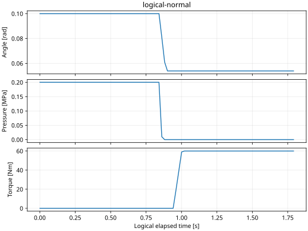
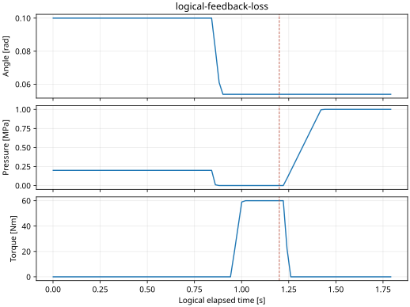
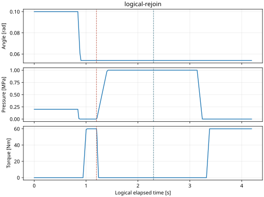

# M4 owner 비동기 통합 — 최소 공유 검증 근거

Result: **RES-M4-ASYNC-20261019**, Host component PASS. 전체 system32요구/29 TC **NOT RUN**.
현재 상태의 기준은 [project_status](../../../project_status.md)이며 [설계](../../../adr/ADR-0055-asynchronous-normal-owner-integration.md)와 [읽는 순서·CLI](../../../learning/m4_async_owners.md)를 함께 본다.

## 대상·환경·입력

시험한 코드 commit: **`117ebc002e2927d0886b8e6407497de716772adb`**.
[results.json](results.json)의 metadata에 source SHA256·UTC·compiler·kernel·affinity·입력 설정을 저장했다.
2026-10-19 UTC11:13:24부터 Linux6.8.0-138-generic x86_64, GCC11.4.0/C++17, CMake4.3.2,
Python3.10.12, GoogleTest1.11.0에서 실행했다. Debug normal과 ASan/UBSan, 실제 thread는 SCHED_OTHER,
CPU0–15 허용·pinning/추가 부하 없음이다. FIFO/RTOS/Target 성능 결과가 아니다.

세션8-role + 정상9-owner(Central·Front/Rear·Steering/Brake/Drive/BMS/Power·Physical) 경로다.
IO poll200μs, 물리1ms, 제어10ms, BMS/배분20ms, 기존 age/expiry/gap guard를 사용한다.
초기 조향0.1rad·압력0.2MPa·토크0Nm·SOC0.63·온도25°C·modelEpoch7이다.
가속 요청0.2m/s²·곡률0.02m⁻¹, wheel speed0rad/s·aux current0.25A를 고정했다.
실제 BMS dwell·limits, PowerController/RC/접점과 센서/Actual ingress를 거친다. 속도·차량 관성은 이 시험의 모델이 아니다.

## 실행과 판정

한 번의 전체 CTest 실행에서 각 시나리오 CSV/JSON과 JUnit을 함께 얻었다. 같은 결과를 추적성/그래프에 재사용했다.
Normal·ASan/UBSan **각각872/872 PASS**, durable CLI 재가입 **각각1/1 PASS**다.
대표20개 requirement→함수→정확한 GTest→판정 기준·두 빌드의 실제 PASS는 [component_results.csv](component_results.csv)에 있다.
전체 시험 이름·개별 결과 원본은 `build/m4-async-verification-safety/{normal,sanitized}/unit.xml`, 실행 로그는 같은 폴더의 `ctest.txt`다.
Scenario JSON의 `passed`는 harness 판정이다. 전체 시험 PASS는 추가 GTest assertion까지 포함한 JUnit과 함께 확인하며, 추출 runner도 둘 다 검사한다.
CSV는 normal 원본의10ms sample에서20ms 간격과 주입/복구 인접점·마지막 행을 선택했다. 보간/값 수정은 하지 않았다.

| 시나리오 / 입력 | 기대 동작·기준 | 실제 normal 논리 clock 결과 |
| --- | --- | --- |
| [정상](logical-normal.csv), duration1.8s | INIT/global gate·BMS/HV readiness·각 Leaf arm 전 정상 프레임 없음; 각도 atan(2.7×0.02)±0.001rad·압력<1Pa·토크>50Nm | 최초 active775ms,51 batch; 마지막0.0539rad/0Pa/60Nm, bus399.972V·SOC0.629996769 |
| [부분 Front](logical-partial-front.csv),1200ms부터 Brake write 실패 | Steering 성공 후 Brake 실패; 그 batch의 Rear 송신 없음·재시도 없음; ≤100ms에 전체 보호 선택 | Front43/Rear21 frame·완료21 batch; Central fault/전체 ACK1215ms(주입+15ms) |
| [Actual 상실](logical-feedback-loss.csv),1200ms부터 Steering Actual만 중단 | 살아 있는 Zone heartbeat가 개별 Actual loss를 숨기지 못함; ≤100ms에 전체 보호 선택·gate 폐쇄 | Central fault1221.2ms/전체 ACK1221.4ms; 마지막 torque0Nm·압력1MPa |
| [정상 정지](logical-normal-stop.csv),1200ms부터 fresh Stop intent, duration3s | fresh actual dwell·원래 terminal lease·양 Zone/Leaf ACK 뒤 Shutdown; actual OFF 확인 | fault0, Stop Complete; 마지막 torque0Nm·압력0.1MPa·bus0.191V, OFF 확인 |
| [명시적 재가입](logical-rejoin.csv),부분 실패1200ms/새 Epoch2300ms, duration4.2s | 같은 Epoch 자동 복구 금지; 새 전체 INIT·BMS/HV 재검증; 물리 상태/장부 보존 | epoch1→2, 재active3074.2ms; model7 연속, 마지막SOC0.629993436·torque60Nm |

`first_fault_ns`는 **Central이 fault를 관측한 elapsed time**, `all_protected_ns`는
**Central이 양 Zone의 실제 다섯 Leaf 보호 선택 ACK를 모두 관측한 시각**이다. 로컬 검출의 최초 시각과 같다고 가정하지 않는다.
ACK는 물리 정지 시각이 아니다. 예를 들어 논리 Actual 상실 뒤 torque는1261ms sample에0Nm,
압력은1441ms sample에1MPa가 관측된다. 주입+100ms는 **보호 선택** 기준이며 압력 도달 시한이 아니다.
다른 명령 유효성/old Epoch/arm 실패/BMS fault·clear·센서 residual/dwell은 추적표의 실제 시험 이름으로 확인한다.

## Gate 회귀의 실패와 수정 근거

[gate-regression.csv](gate-regression.csv)는 원본의 해당 행만 고른 작은 전후 근거다.
초기617c200의 논리 rejoin1211ms에 protection ACK 후 열린 gate가 관측됐다.
최초 세션 Release 한 번만 gate를 열도록 수정한 뒤, native6677a46에서도 로컬 보호가 Central에 전달되는 사이 열린 gate가 관측됐다.
강화한 GTest oracle이 해당 attempt를 **871/872 PASS·1 FAIL**로 판정했고 sanitizer는 그 attempt에서 **NOT RUN**이다.
최종117ebc0은 모든 Zone/Leaf 보호 진입이 즉시 atomic gate를 닫도록 연결했다. Central만 새 전체 세션 Release에서 다시 연다.
모든 runtime 시나리오에서 `protected_all => !run_gate`를 확인하며 두 최종 빌드 모두 PASS다.
실패 원본은 `build/m4-async-verification-release/normal/{unit.xml,ctest.txt,wall-feedback-loss.csv}`에 보존한다.

## 실제 실행 시간 관측

논리 결과와 합치지 않는다. Native wall 정상/Actual 상실은 **각 빌드·조건1회, 각1.8초**다.
Metadata와 원래 절대 source time을 CSV에 남겼다. 파일 [wall-normal.csv](wall-normal.csv), [wall-feedback-loss.csv](wall-feedback-loss.csv)는 normal 표본이다.

| 관측 | normal | ASan/UBSan |
| --- | --- | --- |
| 정상 최초 active | 785.977ms | 826.643ms |
| Actual 상실 주입→Central fault/전체 보호 ACK | 11.441ms /11.848ms | 12.377ms /12.976ms |
| 정상: 전체 owner 중 body max | 184.272μs | 1203.494μs |
| 상실: 전체 owner 중 body max | 73.848μs | 119.519μs |
| 두 wall 시나리오 body>4ms | 0회 | 0회 |

Owner별 sample수·Mean/P95/P99/Max·최대 poll/runnable gap은 [results.json](results.json)에 모두 있다.
Body는 각200μs service 호출 전체(대기 polling·session·정상 runnable·trace 포함)이며 비실행 poll도 분모에 들어간다.
Physical은1ms 호출이다. `max_runnable_gap_ms`는 실제 Leaf/VM 본문/Zone 관측 사이의 최대 간격이다.
정상 normal에서 Leaf10.012–10.201ms, BMS20.209ms, Zone10.225–10.302ms를 관측했다.
Zone loss 감시는 fallback20ms도 포함한다. Central allocation20ms의 별도 분포·release lateness/CPU시간·부하/FIFO/고장별 장기 반복은 이 표본에서 측정하지 않았다.
4ms는 **초과 관측 수**이며 이 새 harness가 기존 M3 독립4ms guard를 이식·재검증했다는 뜻이 아니다.
기존 M3 sanitizer OTHER 두 실패와 전체 timing 수용 PENDING을 유지한다.

## 그래프

실제 모델 수치의 작은 CSV를 그대로 그렸다. 세로 점선은 주입1.2s, 재가입 요청2.3s다.




CSV의 `source_ns`는 물리 취득 clock, `*_source_ns`는 Central에 도착한 원래 wire source이며 unavailable은0이다.
중간 Central 상태는 해당 물리 취득 이전의 가장 최근 관측으로 합쳤다. `command_source_ns`/root sequence는 마지막 발급 명령이다.
Epoch·gate·armed·protected·VM/fault/stop enum도 함께 기록한다. Enum 정의는 coordinator/VM/NormalStop header를 따른다.

## 재현

Repository root, Linux native·C++17/GTest·Python matplotlib가 필요하다. 실행 중 C++ 파일을 수정하거나 build/부하 시험을 병행하지 않는다.
새 raw directory를 지정한다. 스크립트는 configure/build→전체 CTest/JUnit→durable CLI rejoin→검증/추출을 순서대로 실행하며 실패 원본을 지우지 않는다.

```sh
python3 tests/integration/runtime/check_m4_async.py --raw-dir build/m4-async-reproduce --output build/m4-async-reproduced-evidence
```

구체적인 하위 명령은 각 profile에 대해 아래와 같다(sanitized는 마지막 옵션ON·build경로 변경).

```sh
cmake -S . -B build/m4-readiness -DCMAKE_BUILD_TYPE=Debug -DSTRATADRIVE_SANITIZERS=OFF
cmake --build build/m4-readiness -j 4
STRATADRIVE_M4_RESULTS="$PWD/build/m4-async-reproduce/normal" ctest --test-dir build/m4-readiness --output-on-failure --output-junit "$PWD/build/m4-async-reproduce/normal/unit.xml"
```

논리 개별 재현·native 실행은 [기존 actuator_demo의 m4-async](../../../learning/m4_async_owners.md)를 사용한다.
위 raw 결과를 추출만 다시 할 때는 같은 명령에 `--reuse`를 추가한다. 코드 SHA256이 달라지면 거부한다.
Docs-only 후속 commit에서도 `results.json`의 **원래 시험 commit**을 유지한다. Wall 수치는 다음 실행과 같을 필요가 없으며 같은 oracle로 다시 판정한다.
`component_results.csv`는 추적표에 두 JUnit의 실제 test verdict를 붙인 최소 표다. 재추출은 다음과 같다.

```sh
python3 - <<'PY'
import csv, pathlib, xml.etree.ElementTree as ET
raw = pathlib.Path('build/m4-async-reproduce')
rows = list(csv.DictReader(open('docs/test-plan/component_traceability.csv')))
for profile in ('normal', 'sanitized'):
    tests = {c.attrib['name']: 'FAIL' if c.find('failure') is not None or c.find('error') is not None else 'NOT RUN' if c.find('skipped') is not None else 'PASS' for c in ET.parse(raw/profile/'unit.xml').getroot().findall('.//testcase')}
    for row in rows: row[profile] = tests[row['test']]
with open('build/m4-async-reproduced-evidence/component_results.csv', 'w') as stream:
    writer = csv.DictWriter(stream, fieldnames=list(rows[0]), lineterminator='\n')
    writer.writeheader(); writer.writerows(rows)
PY
```

추가 vCAN 회귀의 결과·명령은 [transport-results.txt](transport-results.txt)에 보존한다. 새 owner mailbox의 remote wire 검증은 아니다.

## 미실행·남은 제약

Remote Leaf composite lease/INIT/stop/protection wire·독립 process/DDS·방향별 partition/owner 정지 전체 matrix·
M3 선택 FIFO/CPU 배치에서의 새 workload timing·TSan·ARM64/RTOS runtime·차량 motion/closed-loop·MBD MIL은 **NOT RUN**이다.
기존 EV demo는 개별 모델 실험용으로 유지한다. 새 M4 경로의 BMS/authority는 실제 component가 담당한다.
학습자 review와 M3 timing 예외는 미해결이며 M4 전체 완료를 뜻하지 않는다.
