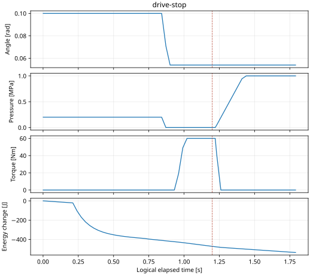
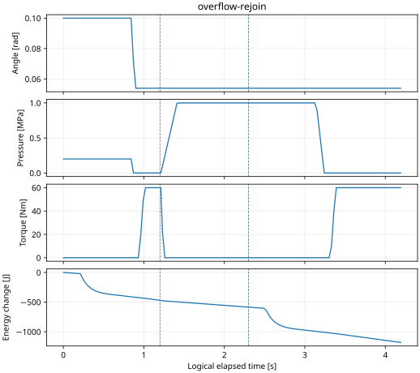

# M4 고장·복구와 M3 독립 감시 — 공유 실행 근거

Result: **RES-M4-FAULT-20261020**. Host component 기능/회귀 PASS, native timing **41/48 PASS·7 FAIL**.
현재 상태는 [project_status](../../../project-status.md), 설계는 [ADR-0056](../../../archive/design-decisions.md#adr-0056),
실행 계획은 [사전 프로토콜](../../../archive/protocols/m4-fault-timing-protocol.md)이다. 학습자의 직접 재현·이해 확인은 **PENDING**,
32개 requirement/29개 전체 system TC는 **NOT RUN**이다.

## 대상과 환경

최종 시험 소스 commit **`12fc4a51449cd9f14ad1be8b243dea4d8d4d7311`**.
소스 SHA256 **`c009177e966b72ae21ff209079543fb6c537ef82d0fff8a6d364f9548958dc6a`**는 CMake/production/tests/tools의 경로와 내용을 함께 해시한다.
[results.json](results.json)에 실제 tested commit·환경·입력·두 빌드의32개 fault runtime 요약을 기록한다.
외부 검토 `b65ec25` 이후 `c83004f` 공통 고장·`83a3f00` guard·`12fc4a5` atomic 시작 장벽 순서다.
문서/CSV 분석은 뒤에 갱신했으며 시험 소스 commit을 문서 commit으로 바꾸지 않았다.

Linux6.8.0-138-generic x86_64·GCC11.4/C++17·CMake4.3.2·Python3.10.12·GoogleTest1.11,
Debug normal과 ASan/UBSan이다. CPU0–15 허용·PREEMPT_DYNAMIC이며 PREEMPT_RT가 아니다.
[FIFO/커널 접근 실제 probe](host-capabilities.json)는 rlimit20/20·FIFO20 AVAILABLE,
perf paranoid4/exit255·tracefs EACCES를 기록했다. 시스템 설정은 변경하지 않았다.

초기 angle0.1rad·pressure0.2MPa·torque0Nm·SOC0.63·modelEpoch7·온도25°C,
acceleration0.2m/s²·curvature0.02m⁻¹·wheel speed0rad/s·aux current0.25A를 고정했다.
실제 BMS dwell/limits·Power/RC/접점·독립 sensor acquisition·Actual ingress를 사용한다.
차량 운동/실차 calibration·추종 제어 검증은 아니다. 물리 owner가 Battery/energy/RC를 혼자 수정한다.

## 실행 결과와 서로 다른 분모

| 실행 | 실제 결과 | 범위 |
| --- | --- | --- |
| 전체 CTest | normal908/908·ASan/UBSan908/908 PASS | 기존 정상/부분 송신/정상 정지/old Epoch/재가입 포함 |
| 신규 공통 고장·guard |872개 위에36개 추가;32개 runtime artifact씩 두 빌드 PASS | parser/mailbox/guard 순수 unit과 runtime artifact 수를 구분 |
| 기존 durable CLI rejoin | 두 빌드 각각1/1 PASS | 전체 runner에서 영속 grant1→2 |
| 새 fault CLI overflow/rejoin | normal·sanitizer × logical/wall **4/4 PASS** | 실제 CLI·durable1→2·owner join/link 교체·모델 보존, [실행 명령/결과](durable-cli.json) |
| 격리 Zone gateway vCAN | 두 빌드 각각5/5 PASS | CAN write/metadata·expiry·arm/terminal 거부; 전체 remote lease 검증 아님 |
| Release BUILD_TESTING=OFF | build PASS, compiler 새 warning0 | runtime timing 실행은 아님 |
| TSan | 기본 ASLR에서 body 전 매핑 실패; process-local `setarch -R`에서 native7/7 PASS·경합 경고0 | 신규5·기존2 native 시험만, sanitizer timing cohort와 별도 |
| 물리 trace 사후 감사 | active fault56개 PASS; never-active8개 N/A | 기존 hold/floor/zero·접점 open/상태 연속성; 새 timing 수용 기준 아님 |
| prospective native cohort | **41 PASS / 7 FAIL / 0 BLOCKED**, 요청48/기록48/미실행0 | 아래 고정 조건·분모. unit PASS에 합치지 않음 |

[component_results.csv](component_results.csv)는 요구사항→실제 함수/모듈→정확한 GTest→criterion→두 빌드 결과56개다.
원래20개 대표 데이터는 [이전872개 근거](../m4_async/README.md)를 유지하고, 최신 재실행 PASS는 이 표에 기록했다.
기능 실패/수정은 [defects.csv](defects.csv), 도구 경고·원본 로그 SHA는 [tool-checks.txt](tool-checks.txt)에 있다.

## 주입·검출·ACK·물리 반응 읽기

Owner 번호는 Front0/Rear1/Steering2/Brake3/Drive4/BMS5/Power6/Central7/Physical8/Monitor9다.
Owner pause는 세션·RX·제어·자체 감시·출력·ACK를 함께 건너뛴다. Drop/delay는 owner를 실행한 채 메시지만 막는다.
실제 주입은 설정 시작과 다른 첫 stop/drop/delay/receive-blocked일 수 있다. FIFO overflow는 그 뒤 실제 full 상태에서 별도 발생한다.

[events CSV](drive-stop-events.csv)의 `time_ns`는 실제 관측, `source_ns`는 원천, `deadline_ns`는 원래 기한이다.
유효 Leaf 입력의 `reference_ns`는 receiver에 넘긴 실제 RX 시각이다. Feedback은 actual acquisition/source를 유지한다.
`command-expired`는 이미 수용한 context의 exclusive expiry, `deadline-detected`는 service guard의 원래4ms deadline이다.
Source/valid RX·주입·deadline을 서로 대체하지 않는다.

[전체 owner timeline](timeline.csv)은 controller 검출까지 마지막 유효 RX/source/deadline과 gate 관측/선택 ACK/물리 적용을 분리한다.
해당 owner 검출이 없으면 injection까지의 마지막 valid를 사용하며0은 미관측이다. 물리 owner의 watchdog target은 원본 event의 code를 함께 본다.
`normal_blocked_ns`는10ms 간격 물리 trace가 처음 닫힌 gate를 관측한 **상한**이다. 실제 gate 관측 event는 별도다.
`first_fault_ns`는 이전 Central 관측 항목이며, Central 정지 중의 살아 있는 Zone/Leaf 검출은 `live_fault_ns`로 읽는다.

| 대표 logical 사례 | 첫 실제 주입 ms | 살아 있는 경로 검출 ms | 닫힌 gate trace ms |100ms 내 Leaf 선택 mask / missing |
| --- | ---: | ---: | ---: | --- |
| Central pause |1200.0|1211.2|1221.0|124 /0 |
| Drive pause |1200.0|1221.2|1231.0|108 /16(Drive) |
| Brake40ms delay |1205.4|1211.2|1221.0|124 /0 |
| Rear uplink overflow |1201.2|1211.2|1221.0|124 /0 |

선택 mask bit2–6은 다섯 Leaf다. 멈춘 Drive는 ACK하지 않았고 Physical output watchdog(owner8/code4)이 마지막 출력 source+30ms 뒤 torque zero를 적용했다.
주입 구간의 멈춘 owner ACK 위반은 모든 표본0이다. Resume 뒤 ACK와100ms 내 missing mask를 섞지 않는다.
보호 선택 ACK는 실제 압력 도달·토크0·전원 OFF가 아니다.
[physical-results.csv](physical-results.csv)는 복구 전 마지막 관측과 angle 안정·pressure floor1MPa·|torque|<0.1Nm·접점 open을 사후 대조한다.
짧은1.8s run 일부의 bus는 약31–33V이므로 actual OFF(<30V)를 주장하지 않는다. 접점 open과 잔류 전압을 각각 보존했다.



Drive resume1400ms 뒤에도 gate는 닫혀 있다. Rear uplink overflow/rejoin은2300ms에 모든 owner를 join한 후 failed link를 교체하고
새 Epoch/full INIT·BMS/HV readiness·arm 뒤 logical3074.2ms에 정상 운전을 재허용했다.
Native 대표는 actual1202.384ms 주입,1211.773ms live 검출,3116.080ms 재허용이다. 논리 통계에 합치지 않는다.
모델 Epoch7/sequence·SOC/energy·angle/pressure/torque/회로를 재생성하지 않는다.



정상 데이터는 [normal.csv](normal.csv), 대표 고장/복구는 [central](central-stop.csv), [Drive](drive-stop.csv),
[delay](delay-expiry.csv), [overflow/rejoin](overflow-rejoin.csv), [native rejoin](wall-overflow-rejoin.csv),
[Monitor overrun](guard-monitor-overrun.csv)이다. 원본 정수 시각/값을 복사하고 decimate하며 경계 인접 표본을 유지했다.
전체 물리 감사는 [분석 코드](summarize_response.py)와 [별도 SHA/판정](physical-audit.json)로 재현한다. 이 사후 분석을 prospective timing PASS로 세지 않는다.

## M3 독립 감시·48회 timing

[protocol](../../../archive/protocols/m4-fault-timing-protocol.md)의 내용 SHA는 results.json timing metadata에 고정했다.
Run2540ms·guard lead100ms·period2ms·deadline4ms·owner당1211 slots·20ms tail이다.
CPU0=Front/Rear/Physical/Monitor, CPU1=Central/다섯 Leaf이며 FIFO priorities는18/18/10/10/10/9/10/11/19/20이다.
별도 OTHER CPU1 load process는10ms 중7ms busy, 실제 CPU≥100ms·affinity·policy·생존/window를 대조했다.
모든48개 설정/부하 control PASS다. 측정 중 다른 build/시험을 실행하지 않았다. Host의 다른 시스템 작업은 격리한 환경이 아니다.

| 조건 | normal build | ASan/UBSan | 합계 PASS/분모 |
| --- | ---: | ---: | ---: |
| 정상 OTHER quiet |3/3|3/3|6/6 |
| 정상 OTHER loaded |0/3|0/3|0/6 |
| 정상 FIFO quiet |3/3|3/3|6/6 |
| 정상 FIFO loaded |3/3|3/3|6/6 |
| Drive pause OTHER |3/3|3/3|6/6 |
| Drive pause FIFO |2/3|3/3|5/6 |
| Monitor overrun OTHER |3/3|3/3|6/6 |
| Monitor overrun FIFO |3/3|3/3|6/6 |
| 전체 |20/24|21/24|**41/48** |

[48개 개별 결과](timing-results.csv), [owner별 주기/wake/body·제어 주기](owner-timing.csv), [실패 첫 slot](failure-examples.csv)을 보존했다.
OTHER loaded6회에서60/61/98/140/159/194개의 누락이 있었다. 완료 body 최대는0.028–0.093ms여도 누락 기회는 존재한다.
FIFO Drive-stop 반복2는736.513ms에 Monitor slot316의 미완료를 먼저 검출했고 Physical override는736.514ms였다.
계획한1200ms 주입 전에 실패했으므로 고장 검증 성공으로 간주하지 않았다. 추가 Drive 누락100개와 합해101개를 기록했다.

통과한 intentional fault23회에서 원래 deadline→독립 검출0.479–1.721ms, 검출→physical override0.001–0.997ms다.
전체 service guard2/4ms와 각 Leaf의 nominal10/20ms 자체 admission/완료5/8ms 검사를 구분한다.
Start/end가 있는 slot만 latency 분포에 포함하며 미실행 slot은 별도 miss/skip 분모에 남긴다. Run 사이 대기 간격을 주기 통계에 넣지 않는다.
Raw thread CPU time과 wall body/release 지연, logical/manual clock과 sanitizer/normal은 서로 다른 측정이다.

**OPEN-M4-TIM-01**:7개 timing 실패는 미해결이다. 독립 감시/보호는 실행됐지만 정상 완료 계약은 실패했다.
커널 timer→wakeup→switch 원인 분해는 trace/perf 권한 부재로 미실행이다. 기존 OPEN-M3-01/02도 유지한다.
정상 FIFO12/12 PASS로 이전/새 실패를 삭제하거나 WCET·임의 부하·PREEMPT_RT/Target 보장을 주장하지 않는다.
설정 개발 smoke2회는 [별도 파일](development-smoke.json)에 OTHER FAIL/FIFO PASS를 보존했다. 당시 dirty source의 완전 지문은 확보하지 못했으며48회와 합치지 않는다.

## 재현 명령과 원본

새 directory를 사용한다. 다음 명령은 normal/sanitizer 전체 회귀, durable legacy rejoin, 이어48회 cohort를 실제 실행한다.

```sh
python3 tests/integration/runtime/check_m4_faults.py \
  --raw-dir build/m4-fault-reproduce --output build/m4-fault-reproduce-evidence \
  --timing-dir build/m4-timing-reproduce --run-timing
```

이번 원본은 `build/m4-fault-atomic/{normal,sanitized}/`의 unit.xml/ctest.txt/build.txt·faults/*·cli-rejoin이다.
이전 `c83004f`는 `build/m4-fault-functional`, `83a3f00`은 `build/m4-fault-final`에 보존했다.
같은 소스의 결과를 재사용한 정확한 export/분석 명령은 다음이다. 결과를 새로 실행하는 옵션이 아니다.

```sh
python3 tests/integration/runtime/check_m4_faults.py \
  --raw-dir build/m4-fault-atomic --output docs/test-plan/evidence/m4_faults \
  --reuse --timing-dir build/m4-timing-final
python3 docs/test-plan/evidence/m4_faults/summarize_response.py build/m4-fault-atomic
```

`build/m4-timing-final/`은 metadata/cohort.json와48개 run의 command.json/runtime.log/result/*-execution.csv·*-events.csv·*.csv/JSON·owners.json·load.json을 가진다.
`--reuse`는 fingerprint가 같을 때만 원래 tested commit을 유지한다. 위 export는 별도 posthoc/tool/CLI 파일을 삭제하지 않는다.
새 fault CLI 명령은 durable-cli.json에 모두 저장했다. 단일 수동 사례:

```sh
build/m4-readiness/actuator_demo epoch init build/m4-fault-reproduce-epochs
build/m4-readiness/actuator_demo m4-async wall fault build/m4-fault-reproduce-epochs build/m4-fault-reproduce-cli fault=zone-central:overflow:rear:1200:200:0 duration-ms=4200 recover-ms=2300 replace-links
```

TSan은 ASan과 다른 build다. 기본 실행의 매핑 실패를 유지하며 시스템 ASLR은 바꾸지 않았다.

```sh
cmake -S . -B build/m4-tsan -DCMAKE_BUILD_TYPE=Debug -DSTRATADRIVE_TSAN=ON -DSTRATADRIVE_SANITIZERS=OFF -DCMAKE_GTEST_DISCOVER_TESTS_DISCOVERY_MODE=PRE_TEST
cmake --build build/m4-tsan --target m4_fault_test m4_async_runtime_test -j4
setarch x86_64 -R build/m4-tsan/m4_fault_test --gtest_filter='M4FaultWall.*:Independent/M4GuardWall.*'
setarch x86_64 -R build/m4-tsan/m4_async_runtime_test --gtest_filter='M4AsyncWall.*'
```

TSan 원본은 `build/m4-tsan-{native,noaslr,atomic-native,atomic-legacy}.log`, 올바른 잠금 최소 재현은 `build/tsan_cv_probe.cpp`/`build/tsan-cv-probe.log`다.
Timed wait_for를 가진 표준 CV 예제도 같은 경고를 냈고 atomic 장벽으로 바꾼 후 경고0이다. 이 결과는7개 native 경로 범위다.
정적 분석은 `build/m4-fault-tidy-*.log`·`build/m4-fault-cppcheck-final.log`, Release는 `build/m4-release-final-{configure,build}.log`,
vCAN은 `build/m4-fault-gateway-{normal,sanitized}.log`, read-only preflight는 `build/m4-fault-preflight/`에 있다.
실행 명령은 각각 `clang-tidy-14 -p build/m4-readiness`의 analyzer/bugprone10개 파일, `cppcheck --project=build/m4-fault-cppcheck.json` production8개,
`cmake -S . -B build/m4-release-final -DCMAKE_BUILD_TYPE=Release -DBUILD_TESTING=OFF`/build,
[기존 vCAN namespace 명령](../../../learning/vehicle-lifecycle-guide.md), `tools/runtime_diagnostics.py --probe-only --fifo-priority 20 --output-dir NEW_DIR`다.

## 완료 범위와 다음 단위

정상 request/arm/TX result/status/Actual/protection을 타는 **같은 Host 비동기 runtime**의 대표 고장·latch·명시적 joined 복구와 독립 실행 감시 연결까지 구현/실행했다.
Prepare/INIT/Release/arm/정상 종료/재가입의 대표 ACK 경계도 포함하지만 모든 복합 고장·원격 배포의 전수 검증은 아니다.
공유 global gate/atomic priority signal은 끊긴 mailbox를 우회한다. Physical/Monitor가 모두 멈추거나 OS 전체 정지 시의 하드웨어 감시는 제공하지 않는다.

다음 단위는 TBD-15 remote composite lease/INIT/arm/stop/protection·원천 feedback·clock/freshness 계약과 TBD-05 DDS/QoS/격리를 고정하고
첫 독립 Central↔Zone process adapter 및 방향별 단절/새 세션 시험을 연결하는 것이다. Native fault recipe·관측/판정 기준을 M5에 재사용한다.
새/기존 timing 예외의 원인 분석과 학습자 직접 재현은 병행 관리한다. MBD M6→M8, AUTOSAR/Target pilot의 기존 순서를 유지한다.


정적 입력10개 경로는 [static-inputs.json](static-inputs.json)에 있다. 같은 compile database에서 첫8개 production entry만 선택하면 cppcheck 재현 project를 만들 수 있다.

```sh
python3 - <<'PYTHON'
import json
from pathlib import Path
files=json.load(open('docs/test-plan/evidence/m4_faults/static-inputs.json'))
project=json.load(open('build/m4-readiness/compile_commands.json'))
selected=[row for row in project if any(Path(row['file']).as_posix().endswith('/'+p) for p in files[:8])]
assert len(selected)==8
Path('build/m4-fault-cppcheck-reproduce.json').write_text(json.dumps(selected))
PYTHON
cppcheck --project=build/m4-fault-cppcheck-reproduce.json --enable=warning,performance,portability --suppress=missingIncludeSystem --error-exitcode=1
```

Clang은 위10개 각각 `clang-tidy-14 FILE -p build/m4-readiness '-checks=-*,clang-analyzer-*,bugprone-*' '-header-filter=(central|zone|vecu|interfaces|simulation)/'`로 실행했다.
Variant/Leaf 역할이 고정된 `std::get`의 noexcept escape와 인자 순서 경고는 보존했다. Analyzer 오류는 없으며 경고0으로 표시하지 않는다.
GCC11 timed-CV 도구 제약의 최소 재현은 다음 코드다. 이 표준 잠금 코드에서도 double-lock/data-race 진단이 났다.

```cpp
#include <condition_variable>
#include <mutex>
#include <thread>
#include <chrono>
int main() {
    std::mutex m; std::condition_variable cv; int ready=0; bool go=false;
    auto work=[&] {
        std::this_thread::sleep_for(std::chrono::milliseconds(5));
        std::unique_lock<std::mutex> lock(m); ++ready; cv.notify_all();
        cv.wait(lock,[&] { return go; });
    };
    std::thread a(work),b(work);
    {
        std::unique_lock<std::mutex> lock(m);
        cv.wait_for(lock,std::chrono::milliseconds(100),[&] { return ready==2; });
        go=true;
    }
    cv.notify_all(); a.join(); b.join();
}
```

`c++ -fsanitize=thread -g -std=c++17 -pthread PROBE.cpp -o PROBE` 뒤 `setarch x86_64 -R ./PROBE`로 재현했다.
이 최소 예제의 진단을 근거로 native 보호/세션 경합을 무시하지 않고 실제 장벽을 atomic으로 바꿔 새7개 경로를 다시 검사했다.
